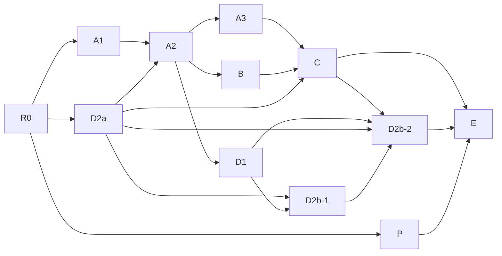

# NIR-1 L6〜L9 実行計画

更新日: 2026-10-14（初版: 2026-09-17）

初版基点: master@9f6aba5f
Tree: b7f97fc7dbbb5243da090b41dbc884ecfdc0ec2b

状態: 2026-09-17現在、#596/#597 foundations、#598 A3 review remediation、#599 typed Packing review remediationがmasterにある。Graph、Packing、AI dispatchは未activateで、Bはcapacity-remediation-in-progressである。proposal/5の契約は確認済みだが、supported capacityの数値、whole-project build、B activationは未完了である。downstream threat modelはdraft、NIR-1全体のruntime integration・activation・受入れは未完了である。#591のA2限定完了とR0台帳は履歴として保持する。

2026-09-22 B-close追記: #604を親とするstacked実装で、lifecycle SQL上界・WAL/journal/backup/Restore copyを含む総一時logical disk上界、必須lifecycle境界、数値容量契約とN/N+1検証を完了した。19-path / 114-childの測定と、確定値に対する8成功・4安全拒否のrelease childを分けて記録する。数値と適用範囲はユーザーが明示確認した。詳細は [B-close completion evidence](nir1-b-close-completion-2026-09-22.md)。Graph、Packing、AI dispatchは未activateで、NIR-1全体受入れは未完了。ユーザー指定により本候補のFull CI・独立受入れレビューは省略し、mergeは依頼範囲外として行っていない。

2026-09-24 post-#608現在地: #608の内部生成attempt／receipt／bounded recovery、canonical Graph reader、Source-backed Raw＋typed Revisionの共通snapshot Packing、標準ビルド証跡producerはmaster `fb967eb9` にマージ済み。上記の2026-09-17/22記録は当時の候補についての履歴であり、#608後のGraph・local送信が公開された証拠ではない。#608候補 `27ae54e` と旧候補 `cdc2580` のQuickを混同しない。次の最初の実装PRはR-hookであり、D-final内部接続とC-resource診断は並行可。[post-B実行計画](nir1-post-b-execution-plan.md)の依存と公開条件を維持する。

2026-10-01 #610数値契約の明示改訂（当時の履歴）: Graph input/aggregateは6 MiB (6,291,456 B)、worker Qは4.5 MiB (4,718,592 B)、Native regionは1.5 MiB (1,572,864 B)、Native admission-to-returned-result-leaseは16 ms。これだけを旧2 MiB／8 msから改訂し、512 charged records、100,000 SQLite steps、authorization/Gold、registration S/baseline、ownership/lifecycle、Graph非公開を維持する。古い測定・receipt・診断スコープは履歴のまま保持する。

2026-10-02 #610期限の明示改訂（当時の履歴）: parent admission-to-valid-Native-result-leaseは16 msから100 msへ改訂する。6 MiBの固定split、512 charged records、100,000 SQLite steps、authorization/Gold、registration S/baseline、ownership/lifecycleは維持し、registration/READYとstartup/retirement waitsをquery deadlineへ含めず、期限後の結果を拒否する。製品Graph入口は引き続き閉じる。

2026-10-04 post-B current contract: C-queryの6 MiB aggregate physical-memory cap/proof（worker Q 4.5 MiB／Native 1.5 MiB）とNative fixed-area packingは現行の受入れ条件ではない。whole-project B build/full-set maintenanceの独立したfixture-scoped resource measurement/accountingとcapacity criteriaは、B-closeで確認された別budgetとして維持する。日付付きの旧数値契約・測定は履歴として保持する。単一Revision validationの512 records/6 MiB、Packing、whole-project buildの別resource/semantic/lifecycle budgets、C-queryの512 admission・100,000 SQL steps・入力/frame/fixed-buffer safety・100 ms lease・所有権/終了条件は変更しない。aggregate physical-memory guaranteeや新しいbuild capacityは含意しない。

2026-10-12 K1追記（上の2026-10-01／10-02／10-04の改訂は当時の履歴としてそのまま残す）: これらの改訂は叙述だけで記録され、`draftRef` と `contractId` を名指した確認台帳の形式では確認されていなかった。2026-10-12に `nir1-l6-l9-contract-proposal/6` の `graph-limited-binding` と `nir1-defensive-resource-limits` が確認され（下の「契約別の確認台帳」）、次がproposal/6で正式化された。単一Revision validationの `512 records`／`6,291,456 B`（#610の作業中、2026-10-02のcommit `85898500` で共有定数が変わった値で、上の10-04の段落が前提にしている）。parent admission→valid Native result leaseの `100 ms`（10-02。registration／READYまでのstartupとcleanup／retirementの待ちを含めない）。query全体の物理メモリ上限とその証明（6 MiBのaggregate cap/proof、worker Q 4.5 MiB／Native 1.5 MiBの物理的な収まり）とNative fixed-area packingの削除（10-04）。10-01の値のうち、queryの入力と保持見積りの `6,291,456 B`、worker Qの固定allocator `4,718,592 B`、Native領域 `1,572,864 B` は、物理メモリの保証ではない「実装上の防御上限」として現行値のまま維持し、緩めるには再確認を要する。10-01の `16 ms` は10-02の `100 ms` で置き換わった。C-queryのper-Revision preflight（`2,097,152 B`）とPackingの `2 MiB` は変わらない。

2026-10-12 post-#629現在地: master `a153743b` には、#609（R-hook、`689261c3`）、#611（D-final内部候補とcurrent-turn Human capture、`902a7e79`）、#614（依存更新、`dd7d6599`）、#610（C-query worker、`13e3f6c6`）、#627（通常CIの自動実行とproduct journeyの並列化、`af13db45`）、#628（自動maintenanceの一時失敗をRecoveryRequiredにしない、`5d2a56eb`）、#629（journey shard 2〜7のXvfb wrapper）が入っている。#610で別processのC-query worker、Native owner、100 ms result lease、512／513、100,000 SQL stepsがmasterに入ったが、C-resourceの受入れと独立証明はHOLDで、製品Graph入口は `NIR1_GRAPH_NOT_ACTIVATED` のまま閉じている。local送信、履歴の実authority、Graph先本文の開示もHOLDである。#610は単一Revision validationの上限を2 MiBから6 MiBへ変えたが、確認台帳の形式では確認されていなかった。この値は2026-10-12にK1（`nir1-l6-l9-contract-proposal/6`）で確認し、確認台帳に記録した。2026-09-25/26のoff-master承認と未commit WIPは採用せず参照だけに使い、契約は最新master前提の新しいdraftRefとして起案し直す。ユーザー決定（逐語）、委任範囲、レーン、merge列、worktree台帳は [NIR-1続行計画の作業記録](nir1-continuation-2026-10.md) に記録する。Full admissionはGitHub-hosted job以外を拒否するため、canonical Fullはhostedの`canonical-ci.yml`で実行する。2026-10-13のU7（[作業記録](nir1-continuation-2026-10.md)）で、通常のPRのmerge gate MからFullを外した。

2026-10-13 CR-REC追記: C-resourceの受入れを [C-query受入れ台帳](nir1-c-query-acceptance-2026-10.md) に記録した。CR-1（#636）の試験とopt-in／lifecycle laneのrunを、CQ-1〜3と資源契約の各条件に対応づけ、対応する証跡が無い条件は未充足として残した。下の残HOLD表のC-resourceの行は、この台帳を根拠に解除済みである。条件：CR-1（#636）のmergeと最終headのQuick・PR checks・lane 6本のgreen（CR-1 の squash commit：750741183cf4d75ccf18b3904a5751b762284bda）。U7（2026-10-13のユーザー決定）により Full は merge 後の master で走らせる。台帳の未充足（G-1〜G-4）は別の行でHOLDのまま残す（後続はCR-2）。製品のGraph入口は閉じたまま（A-1）で、Graphの公開、local送信、固定値と閾値、確認台帳の各行は変えない。

2026-10-14 CR-2追記: C-resourceの残る境界（[C-query受入れ台帳](nir1-c-query-acceptance-2026-10.md) §7のG-1〜G-4）の試験を足し、台帳を更新した。writerのRevision上限のN／N+1と上限ちょうどの保存・A2の読取、per-Revision preflightのN／N+1と本番のworker構成（in-process）での正例・負例、SQLITE_BUSYでの待たないunavailable、unknown seed・3 hop・Entity 12・edge 144の試験が入り、下の残HOLD表の該当部分は解除する（条件：CR-2のmergeと最終headのPR checksのgreen）。Bの上限近傍のpublish（G-1）と、実worker（固定allocator）での上限近傍の候補（G-2）は、確認済みの契約と実装が食い違うため、[precheck] でHOLDのまま残す。Scene 8はCP-1の受入れに移す。通常のreaderは製品buildから外し、製品のqueryはworker経路だけにした。固定値と閾値、worker、NQG1、製品のGraph入口（A-1）、確認台帳の各行は変えない。

2026-10-14 CQ-MEM追記: C-resourceのG-2（[C-query受入れ台帳](nir1-c-query-acceptance-2026-10.md) §7.2）で、実worker（固定allocator）のregistrationとqueryのRust側の複製を減らした。Graphの読取がDecisionの本文を持たずtokenをstreamingにし、A2の読取を承認先行・借用parseにし、registrationのRevisionごとの資格確認をSのscopeで行い、`verify_complete_source_index`の結合順を固定し、長さのSQLを`octet_length`にした。Q（4,718,592 B）、S（64 MiB）、per-Revision preflight（2,097,152 B）、whole-set（16 MiB）の値は変えていない。decisionの形とenvelopeの形は、実workerで2,097,152 Bの正例と2,097,153 Bの全体拒否が通り、lifecycle laneに4 caseを配線した（条件：CQ-MEMのmergeと最終headのPR checksおよびlifecycle laneのgreen）。製品形（日本語のsummaryを持つRevision）は、SQLiteのJSONと応答frameの上限のため、成功する最大がA2の約1.13 MBで、2,097,152 Bに届かず、下の残HOLD表のG-2の行に[precheck]として残る。このNOMEMはregistrationで起き、per-Revision preflightの外にあって承認状態に関わらないので、下書きや却下の製品形（A2の約1.19 MB以上）でもworkerは起動時に終了する（台帳§7.2）。固定値と閾値、worker、NQG1、製品のGraph入口（A-1）、確認台帳の各行は変えない。

| post-#608の残HOLD | 閉じる実装スライス・受入れ境界 | 状態（2026-10-12） |
| --- | --- | --- |
| Open／Restoreの回復起動、同bindingの再入・取消とcaller outcome | R-hook。生成開始barrierの実消費はD-transport | 完了（#609）。barrierの実消費はDT-1で扱う |
| 実Source/Revisionからの最終payload・採用入力参照の同時確定 | D-final。履歴authorityや送信可能性は含めない | 内部候補はmaster（#611）。DF-01／DF-04のP2 HOLDは解消済み。資格refの完備規則、IP literal限定、SSEはD-final追補で扱う |
| 履歴tupleのfield/writer、immutable保存、Artifact producer関係 | H-store。未承認mappingは差分確認まで保存しない | HOLD。K4/3は2026-10-17に確認済み（確認台帳の2026-10-17補足）。HS-1はDF+-aとHP-1（#632でmaster）の後に通常の依存で着手する（実装前のためHOLDのまま） |
| 実authorityの毎turn再認可・正常な会話継続 | H-current。過去来歴／今回資格／今回requestを別々に検証 | HOLD。K4/3は2026-10-17に確認済み。HC-1はDF+-a、HS-1の後。HC-1aの実測と型付きRevision入力の再資格化の受入れはX1-3のmergeの後（K4/3の前提XP） |
| trusted local transport、回復barrier、一回限りdispatch・terminal保存 | D-transport。製品入口は閉じたまま | HOLD。DT-1〜3はU3委任の基盤でmaster（#634、#642、#637）。DT-2の再試行の上限（K1b規則7の再確認の対象）はSession B1の9文に含まれず未解決（続行計画§11）。K5/3は2026-10-17に2文とも確認済みで、DT-4は着手でき、DT-5はDF+-bの後。製品入口はPUB-Lまで閉じたまま |
| C-queryのfunctional/resource-safety・100 ms lease、SQL・cleanup | C-resource。aggregate physical-memory cap/proofは削除済み。Revision／Packing／whole-project-buildの別budgetは維持する。normal-build acceptanceと独立証明は台帳に記録した | 解除済み（CR-REC、2026-10-13）。worker・Native owner・100 ms leaseは#610でmaster、資源の固定値はK1（proposal/6）で確認済み。CR-1（opt-in／lifecycle lane、CQ-2、安全失敗）の試験とrunをCQ-1〜3と資源契約の各条件に対応づけ、独立受入れとともに [C-query受入れ台帳](nir1-c-query-acceptance-2026-10.md) に記録した。条件：CR-1（#636）のmergeと最終headのQuick・PR checks・lane 6本のgreen（CR-1 の squash commit：750741183cf4d75ccf18b3904a5751b762284bda）。U7（2026-10-13のユーザー決定）により Full は merge 後の master で走らせる。台帳の未充足は次の行でHOLDのまま。製品Graph入口は閉じたまま（A-1） |
| C-resourceの境界試験（台帳§7のG-1〜G-4） | writerのRevision上限（512 records／6,291,456 B）のN／N+1と上限ちょうどの保存・A2の読取、per-Revision preflight（2,097,152 B）のN／N+1と本番のworker構成（in-process、maintenance owner、SQL 100,000 steps）での正例・負例、DBのSQLITE_BUSY、proposal/5の負例（unknown seed、3 hop、Entity 12、edge 144） | 解除（CR-2、2026-10-14）。CR-2が試験を足し、[C-query受入れ台帳](nir1-c-query-acceptance-2026-10.md) の§2.6と§7に対応づけた。G-3は充足（rollback journalでのSQLITE_BUSY注入。WAL固有のbusyは対象外）。条件：CR-2のmergeと最終headのPR checksのgreen。worker・NQG1・固定値と閾値は変えない。12／13と144／145は、stepsの上限を外した条件を含む論理の試験（144本に届く形は本番ではstepsが先に効く）。残る部分は次の3行のとおり、2点は[precheck]でHOLDのまま、Scene 8はCP-1の受入れに移す |
| C-resourceのBの上限近傍のpublish（台帳§7.1のG-1） | 契約のRB-1の正例「512 records／6,291,456 Bの内のRevisionは、Bのwhole-setの内ならB buildでpublishされる」 | HOLD（[precheck]）。試験を足しても満たせない。writerが数える長さ（counted）とBが数える保存bytes（payloadとenvelopeを成分ごと）の単位が違う。保存されたenvelopeはcountedの約2倍（試験形2.03倍、製品形1.03〜1.06倍）になり、Bは成分guardとwhole-setでbuild全体を止める（B-GUARD、2026-10-14で、成分guardは承認済みの候補にだけ効くようにした。未承認・却下の候補は成分guardでは除かれるが、whole-setには従来どおり数える）。counted 2,621,440 Bはpublishされ、約3 MiB以上は成分guard、上限ちょうどはwhole-setで拒否される。数え方・値・文言のどれを変えるかはユーザーの確認が要る（選択肢は台帳§7.1） |
| C-resourceの実workerでの上限近傍の候補（台帳§7.2のG-2） | 契約のRB-2の正例「per-Revision preflight 2,097,152 Bの内のRevisionは通常どおりGraphに使われる」を、固定allocator（query 4,718,592 B）のworker binaryで確かめる | HOLD（[precheck]）。製品形で確認済みの固定値が両立しない。CQ-MEM（2026-10-14）の前は、ちょうど2,097,152 Bの候補を持つprojectで実workerが起動時のregistrationでSIGABRTし、約0.38 MB〜1.4 MBの候補ではquery中に、約1.7 MB以上では起動時に異常終了していた（Graphはunavailableで安全側）。CQ-MEMでRust側の複製を減らし（Decisionの絞込みとstreaming token、A2の借用parse、registrationのS scope、`verify_complete_source_index`のJSONのgate、octet_length）、decisionの形とenvelopeの形は実workerで2,097,152 Bの正例と2,097,153 Bの全体拒否が通り、lifecycle laneに4 caseを配線した（解除の条件：CQ-MEMのmergeと最終headのPR checksおよびlifecycle laneのgreen）。製品形（日本語のsummaryをpayload・envelope・live Sourceの3か所に持つRevision）は、SQLiteのJSON（registrationで約8.9倍、queryで約7倍）と応答frameの上限（約1.55 MB）のため、成功する最大がA2の約1.13 MBで、2,097,152 Bに届かない。registrationはper-Revision preflightを使わず、承認状態に関わらずcurrentなRevisionのpayloadをSQLiteのJSON（Q）で処理するので、下書きや却下の製品形（A2の約1.19 MB以上）でも同じNOMEMでworkerが起動時に終了する（台帳§7.2の表5）。そのためpreflightの値を下げる案(a)は、registration側の扱いか(b)／(c)と組み合わせない限り、起動時の終了を防がない。preflightの値、Q arenaとframeの上限、JSONの数え方の置換のどれで扱うかはユーザーの確認が要る（選択肢は台帳§7.2） |
| Scene 8の上限（台帳§7.3のG-4） | proposal/5の負例のScene 8。CR-2の旧基点`fbdc8588`ではreaderの応答にSceneが無く、Scene joinはCP-1（#641）で接続された | 移管。C-resourceのHOLDからは外し、CP-1の受入れ（C-product）で確かめる。CP-1の実装は先頭8 Sceneの打切りと `scene_total` で、proposal/6の「同上」（超えたらquery全体を拒否）がScene 8にもかかるかをCP-1の受入れ記録で明示する |
| Graph先本文の独立した開示authority・正常開示 | C-body。作者宣言などの未確定契約は明示確認後 | HOLD。K2の確認待ち。旧draftはsuperseded |
| Related Scenes実接続、実Graph G-01〜G-08、P再評価 | C-product。成立後にGraphのみ公開、local送信は閉じる | HOLD。G-02〜G-08の事前固定はCP-0、接続はCR-1の後のCP-1〜CP-4 |
| 最終request→local生成→次turn、P-01〜P-12 | D-dispatch。C-productと履歴・transportが揃った後に対応localのみ公開 | HOLD。DP-H、DD-1、PUB-L。K5/3とK6/2の `nir1-final-request-packing-eval` は2026-10-17に確認済み（公開にはSession C-2の承認が別に要る） |
| 固定比較と実製品Journey、全必須HOLDの独立受入れ | E-acceptance。HOLDが残ればNIR-1は未完了 | HOLD。E-1、E-2 |
| Revision上限の整合 | K1（`nir1-l6-l9-contract-proposal/6`）。#610で2 MiBから6 MiBになった単一Revision validationを確認台帳で確認する。C-queryのper-Revision preflightとPackingは2 MiBのまま | 解消（K1 確認）。2026-10-12に `nir1-l6-l9-contract-proposal/6#graph-limited-binding` で `512 records`／`6,291,456 B` を確認し、確認台帳に記録した |
| D2a activation | DA-1／DA-2（K3）。activationのtrigger・開示・順序・起動時gateと、restricted下のroute区分 | HOLD。K3/2は2026-10-17に確認済み。activationの実装と受入れはDA-1／DA-2で、未実装のためHOLDのまま。UIと開示の公開はSession C-1（PUB-G）の別の承認 |
| A3 consumer activation | CP-4。実製品経路で全Scope軸のpositive／negative／unavailable、非開示bridgeの禁止、再検証、fallbackを示す | HOLD |
| AttemptBinding v2 | DT-3（U3委任）。版dispatcher、DBで検証するsessionとcaller bindingの分離、Scene incarnation／source token／body digestへの束縛、history slotの予約 | HOLD |
| D-final追補 | DF+-a（K4。資格refの完備規則）、DF+-b（K5。IP literal限定、SSE、Review） | HOLD。K4/3とK5/3は2026-10-17に確認済み。実装は通常の依存で着手する |
| DI-1（3分割） | DI-1c（handoff→persistと送信前の再確認）、DI-1a（Graph材料の再資格化）、DI-1b（historyの最終予算） | HOLD。K4/3とK6/2は2026-10-17に確認済み。DI-1cはDF+、DT-1〜3、HS-1の後、DI-1aはCP-1／2aの後、DI-1bはHC-1の後 |
| P-12の最終request baseline | K6とDP-H。Nativeの最終requestをRustのbaseline armと比べる。K6/2の `nir1-final-request-packing-eval`（2026-10-17に確認済み）が手順を定める | HOLD。HOLDを解くのはDD-1のDP-1がPASSした後 |

#609（R-hook）のmerge証跡。`nir1-r-hook` worktreeの `.artifacts/nir1-r-hook/merge-candidate-2a13e260.json`（SHA-256 `1b3700be6789cedc5379ed2128028d3c028a4dd5f1a92e6916cee6f4aa8cf3ec`）を読取だけで転記し、同じ記録が指す `full.json`／`quick.json` のSHA-256が記録値と一致することを確認した。#610より前のローカルFullであり、当時のhosted checksは0件だった。

| 項目 | 値 |
| --- | --- |
| candidate | base `fb967eb9b56caad536bd9589eb69df9a075f9a62`、head `2a13e2601b5ef276be9d60cbf8b14a29ae5b85ad`、tree `cf004de0d20756cb215e3205090aafdf0e924342`、clean |
| Full | run `005a8f33-d671-4ac0-8f2c-685cba06f872`（2026-09-24T19:32:21Z〜19:45:19Z）。stage 1からのcomplete、62 task passed、product journey 28/28 allPassed／allClean、直後のverify済み。`full.json` のSHA-256 `299644165509a12e42eb5996db86f6941e62b8f4008615d471e065ebb65622fa` |
| Quick | run `f5c5e1de-819d-4235-98bb-57627df088b5`。`quick.json` のSHA-256 `df550cd0b2503143ac8e085e8ef19f8a0814737c704a51066ee4bc1364278d9e` |
| release-only | `electron-windows-installer-contract` はWindowsの手動Full CI／tag releaseの別義務で、合格扱いにしない |
| 独立受入れ | candidate-untouched。clean candidateに束縛したbuild・Quick・Full・verifyを条件とするOK |
| merge | squash、expected head `2a13e2601b5ef276be9d60cbf8b14a29ae5b85ad`、merge commit `689261c3672963b5695a30df6d6a3b3691e35697`。first parentはapproved merge base `fb967eb9b56caad536bd9589eb69df9a075f9a62` と一致し、`origin/master` に含まれる |

## 概要

本書は、L0〜L5を引き継いでL6〜L9を実装するための実行契約である。統合計画の履歴的な設計・受入れ記録を置き換えず、実装順序、公開前提、境界、評価、完了判定を具体化する。

初期版の強い送信境界は、制限成立後、同一Electron profile内の全作品・全会話を継続的なlocal-only領域にする。NIR非対応の通常会話も例外にしない。通常操作による解除や、外部利用と併存する分離profileは初期版に含めない。reload、workspace切替、別窓、再起動後も制限を維持する。

## PR-R0 — 履歴台帳と評価契約の固定

この節の台帳、開始判定、ready状態は2026-09-13時点のR0記録であり、2026-09-16の現在スナップショットにあるA2限定完了を上書きしない。

R0は、#572の現在地、後続laneの境界、契約ごとの開始可否、評価条件をこの実行計画に固定する文書・品質契約の変更である。runtime、policy、activation、既存のL0〜L5評価fixtureは変更しない。確認基点は最新 `origin/master` の #572であり、下表のrefは実装・履歴の存在または記録した明示確認の範囲だけを示し、確認済みtyped /4のscopeを越えて新しいruntime／consumer資格を有効化したことを示さない。

| 項目 | R0で記録する値 |
| ---- | -------------- |
| requestedBase / resolvedBase | `master@68516b033f395f24f98c502c9fd2a715d7aec2af` / 同じ #572 を含む `origin/master` |
| Tree | `04c491c29627ecc840112ebe379a5363e16892ff` |
| candidateBranch | `codex/nir1-r0-contract-ledger` |
| plan / policy / threat refs | 本書、統合計画、ロードマップ、既存 quality manifest / impact map。下流 threat model は draft のまま |
| receipt boundary | 初回static draftの旧R0候補のfocused test／`verify:quality`／Quick＋verifyは無効。今後の実装候補は全PR共通 merge gate M（通常のPRはrebase済みclean candidateのQuick＋直後verifyと同じheadのPR checks、release PRはFull＋直後verify）で判定し、旧receiptを流用しない |

### #572の実装済み／未完了

| #572で確認できる実装 | 未完了・R0で公開しないもの |
| -------------------- | ----------------------------- |
| typed Scope / Entity / Relation / Evidence validation、Native所有のimmutable Revision保存と承認済みRevision reader | RevisionのSource Basis / Dependency / Generic Freshnessによるcanonical資格、全材料closure |
| request-local Graph primitive、Raw必須・非Raw atomic groupを扱うPacking primitive | canonical Graph Index、全Scope軸の開示、ContextPlan／dispatch／履歴への製品統合 |
| typed createとPacking helper、および境界の拒否を検証する既存契約 | 通常操作でのreview公開、D2a profile制限、D2b receipt／履歴再認可、L9 journey |
| typed writerのreconciliation envelope（現状NULLを含む）を保存 | NULL envelopeを後から適格化すること、#572のcatalog読取をGraph Indexへ昇格すること |

### writer・caller・plaintext・egress影響台帳

| ledgerId | writer / caller / 入口 | 現在の扱い | R0の判定 |
| -------- | ------------------------ | ---------- | --------- |
| `source-tree-scope` | 本文、tree、Scope registry、scene設定、incarnation | 正本authorityを再利用。設定・本文・復元は旧資格を失効させる対象 | A1/A3/B/D1で詳細ref確認まで未開始 |
| `proposal-revision` | typed Revision、Human Decision、Evidence、Dependency / Freshness | #572のwriterは保存まで。NULL envelopeは利用資格を証明しない | A2/B/C/D1で材料契約を閉じるまで未開始 |
| `human-decision` | review、承認、取消、差替え、import / undo / restore | currentかつ明示承認を独立軸として維持 | A2/B/Cで同一transactionの失効を確認するまで未開始 |
| `index-generation` | Chronicle / Graph build、publish、rebuild、sealed generation | Graphは独立Indexと限定bindingが必要。別authorityを作らない | B/Cでregistry・Freshness・D1 headを確認するまで未開始 |
| `renderer-typed-ipc` | renderer → preload / main → Native | renderer申告を認可根拠にしない。新IPCのactivationはR0で行わない | D2a/D2bがcaller epochとhandleを固定するまで未開始 |
| `ai-senders` | chat stream / single-shot / CLI / Codex App Server / background | local設定を含む旧経路をD2a後は拒否。停止経路を利用可能とは数えない | D2aのprofile-wide gateまで未開始 |
| `review-db-audit-event` | review表示、汎用DB、保存会話・audit、event配信 | 制限対象plaintextの全入口。未分類出口は許可しない | D2a後の公開条件を満たすまで未開始 |
| `mcp-generic-http-connection` | MCP / HTTP / proxy / redirect / 接続テスト | 新規外部送信や既存localの例外を作らない | D2a/D2b-1の拒否とlocal transport確認まで未開始 |

台帳にない出力入口を「通常機能」と推定して許可しない。R0では既存コードを変更せず、writerの境界とcaller／plaintext／egressの分類だけを固定する。

### profile状態遷移（計画上の開始条件）

| state | 意味 | 次へ進む条件 | R0時点 |
| ----- | ---- | ------------ | ------- |
| S0 | 既存L5と#572のtyped基盤runtime。NIR-1 L6〜L9のproduction runtime integration／activationなし | R0台帳が固定される | 現在地 |
| S1 | A1保存・incarnationと既存L5移行ガードの候補 | Scope authorityの詳細refとA1 focused受入れ | blocked |
| S2 | D2a profile-wide local-only制限の成立処理中 | 全旧caller・入口拒否、永続化、起動時gate | blocked |
| S3 | D2a成立後、D2b-2/P3前 | 旧localを含む旧送信拒否を維持し、新しい送信は公開しない | blocked |
| S4 | D2b-2/P3統合後の対応済みlocal経路だけ | handle、receipt、履歴再認可、最終requestの独立受入れ | blocked |

R0の `ready` は文書・評価契約を次のlaneへ引き渡せるという意味に限る。S1〜S4のruntime開始・activationを許可する意味ではない。

### 契約別の確認台帳

2026-09-22補足: 以下のproposal/5本文は確認時点の契約として保持する。未測定だったB full-set数値は、その後の測定とユーザーの別途明示確認により [B-close completion evidence](nir1-b-close-completion-2026-09-22.md) で確定した。この追加確認はRevision／queryの上限や製品activationの権限を変えない。

2026-10-12補足（K1、proposal/6）: `graph-limited-binding` の行を、proposal/5からproposal/6へ更新し、`nir1-defensive-resource-limits` の行を加えた。どちらも2026-10-12（JST 23:58受信、Session A）に、contractIdごとのユーザーのexact statementで確認された。確認されたdraftは `claude/nir1-contracts` の commit `ba7ceb46306ec48383a70e52951288ed8c7e960b` の `docs/plans/nir1-l6-l9-contract-proposal-6-draft.md` で、byte同一で取り込んだ [proposal/6 draft](nir1-l6-l9-contract-proposal-6-draft.md) のSHA-256は `5528f4e091ca087c0f1e071039c6bcede9d3d7cde1422ac1bfd852ee1d8d6b4b`。draftの「Status: draft／未確認」の行はbytesを変えないためにそのまま残し、確認状態は本台帳で表す。proposal/5の確認の記録（`confirmedRef=nir1-l6-l9-contract-proposal/5#graph-limited-binding`、exact statement: `I confirm draftRef nir1-l6-l9-contract-proposal/5 for contractId graph-limited-binding.`）は履歴としてここに残す。下のproposal/5本文とL7のresource unit表は確認時点（`13e3f6c6^`）の文面に戻した履歴で、資源の値はproposal/6の節が置き換える。proposal/5のその他の条項（三つのresource unit、whole-project build lifecycle、measurement／acceptance split、finalized P2 boundaries）は、proposal/6がそのまま保持する。

2026-10-17補足（Session B1。K3/2、K4/3、K5/3、K6/2、X1/1）: 次の9文が、contractIdごとのユーザーのexact statementで確認された。受信は2026-10-17（JST、Session B1）。最初のメッセージで8文が届き、9文目（X1/1の `typed-revision-material`）は、最初の送信では文中の空白の位置が改行になって届いたので確認として記録せず（無効）、同日にユーザーが1行で入力し直して確認された。確認された版は `claude/nir1-contracts` の commit `af643a93eeae7f937c9cd5a9dd87a6308c96fab6`（push済み。repository activityのserver側の記録で2026-10-17T02:13:10Z）。5本のdraftと、draftが引く設計メモ（[DSN](nir1-dsn-2026-10.md)。確認の対象ではない）と、版の照合に使う[manifest](nir1-session-b1-manifest.md)を、この版でbyte同一に取り込み、5本のdraftのSHA-256が下の値（manifestの値）と一致することを確かめた。draftの「Status: draft／未確認」の行はbytesを変えないためにそのまま残し、確認状態は本台帳で表す。X1/1が引くK2/3（`nir1-c-body-disclosure-proposal-3-draft.md`）とK4/2（`nir1-d2b-history-mapping-proposal-2-draft.md`）は確認されておらず（K2はSession B2でK2/4に改め、K4/2はK4/3が置き換える）、取り込まないので、X1/1の中のその2本へのlinkは切れたまま残る。9文の逐語は各draftの末尾の「確認文」と1字違わず、[続行計画の作業記録](nir1-continuation-2026-10.md)の§10.3に転記した。

| # | draftRef#contractId（略称） | 取り込んだdraft | SHA-256 |
| - | --------------------------- | --------------- | ------- |
| 1 | `nir1-d2a-activation-proposal/2#caller-profile-egress`（K3/2） | [nir1-d2a-activation-proposal-2-draft.md](nir1-d2a-activation-proposal-2-draft.md) | `a16e8b259f8b58e53152e5bb2e503f3cf995f979d85bf4922ccd420f6bf5fd30` |
| 2 | `nir1-d2b-history-mapping-proposal/3#history-reauthorization`（K4/3） | [nir1-d2b-history-mapping-proposal-3-draft.md](nir1-d2b-history-mapping-proposal-3-draft.md) | `f6a189371b4d793c0c440d2ee1d0c96d66c60069d35fa95d31e5c971701a99d7` |
| 3 | `nir1-d2b-local-send-proposal/3#nir1-local-product-send`（K5/3） | [nir1-d2b-local-send-proposal-3-draft.md](nir1-d2b-local-send-proposal-3-draft.md) | `5a8962cd9aa5525046349b31af825c4637dc152e2bb1c5d348fc2bc8fb576723` |
| 4 | `nir1-d2b-local-send-proposal/3#caller-profile-egress`（K5/3。B-1〜B-4） | 3と同じdraft | 3と同じ |
| 5 | `nir1-final-request-eval-proposal/2#nir1-final-request-packing-eval`（K6/2） | [nir1-final-request-eval-proposal-2-draft.md](nir1-final-request-eval-proposal-2-draft.md) | `4ccca08314c022fd969308fa969e6fcb3e2c439fe12757bfec0e901b905676f8` |
| 6 | `nir1-final-request-eval-proposal/2#g01-eval-revision`（K6/2。条件付き。事前の確認） | 5と同じdraft | 5と同じ |
| 7 | `nir1-final-request-eval-proposal/2#graph-eval-procedure`（K6/2。条件付き。事前の確認） | 5と同じdraft | 5と同じ |
| 8 | `nir1-scene-scope-projection-proposal/1#scope-storage-authority`（X1/1） | [nir1-scene-scope-projection-proposal-1-draft.md](nir1-scene-scope-projection-proposal-1-draft.md) | `a2d85d92f4f737405922c5fefbe9acf732a8d784a27c6a2f79894c6278dc6c5e` |
| 9 | `nir1-scene-scope-projection-proposal/1#typed-revision-material`（X1/1の2文目。再入力で確認） | 8と同じdraft | 8と同じ |

K6/2の条件付きの2行（6、7）の扱い: draftの「確認の扱い」は「条件が成立したときだけ、判定に使ったreceiptを添えて確認を求める。成立しなければ確認を求めず、台帳には『条件不成立・未提示』と記録する。行の内容が効くのは、条件が成立して確認された後に限る」と定める。今回は条件の成立前にユーザーが確認文を入力した。台帳には、事前の確認（条件は未成立）。行の内容は条件が成立するまで効かず、条件が成立したときのreceiptの照合（事前登録の凍結の照合3）はintegratorが行う、と記録する。receiptの照合は省かない。この事前の確認は、条件が成立したときの確認の代わりにならず、条件の判定に使うreceiptや診断の代わりにもならない。効力の発生条件は次の1通りに揃える（下の2行、続行計画§10.3も同じ）。条件が成立し、integratorが照合3を済ませたら、判定に使ったreceiptと診断、照合の結果を添えて、利用者へ改めて確認を求める（draftの規則どおり、確認は条件の成立後の1回）。行の内容が効くのは、その確認文が記録された後に限る。事前の確認は、利用者がdraftの規則の内容を読んで確認文を入力したという記録として残るが、効力の根拠にはしない。

K6/2の事前登録の凍結の記録: 凍結のcommitは `af643a93eeae7f937c9cd5a9dd87a6308c96fab6`、K6/2のSHA-256は上の5の値。`git ls-remote origin refs/heads/claude/nir1-contracts` の出力は `af643a93eeae7f937c9cd5a9dd87a6308c96fab6 refs/heads/claude/nir1-contracts`。pushの時刻は、自己申告が2026-10-17 11:13 JST（commitのauthor／committer時刻11:13:09 +0900）、repository activity（`gh api repos/{owner}/{repo}/activity` のうち `ref` が `refs/heads/claude/nir1-contracts`、`activity_type` が `push`、`after` が凍結のcommitのもの）のserver側の時刻が2026-10-17T02:13:10Z。PushEvent（events API）は、起案時に取った時点では現れていなかった。取り直した（2026-10-17T03:21Zごろ）が、このときも凍結のcommitのPushEventは現れず、events APIの最新のPushEventはこの時点で2026-10-14のものだった（events APIの遅れが続いている）。条件を判定する前（照合3の前）までに、凍結のcommitのPushEventかrepository activityを取り直して作業記録に書く。照合3(c)のpushの時刻には、PushEventが現れるまではrepository activityのtimestampを使う。

この9文は、Graphの製品公開、local送信の公開、activation UIの公開（PUB-G、PUB-L、Session C-1／C-2）、新しいauthority・保存先・送信先を許可しない。1文の確認はそのcontractIdの行だけを確認し、依存する契約を確認しない（K4/3は前提K5-1とXPを置くが、K5/3とX1/1の確認を代行しない。今回はK5/3とX1/1も別々の文で確認された）。K2/4（Session B2。`graph-target-scene-body-disclosure` と `scope-storage-authority` のC-body差分）は未確認で、X1/1の `scope-storage-authority` の行と互いを前提にしない。既存のproposal/3、proposal/4、proposal/6のrefは、下の表のとおり消さず、置き換えない。確認された行はR0 mergeと通常の依存を満たすまでlaneを完了へ進めない。

`draftRef` はレビュー対象の提案版、`confirmedRef` は明示確認済みの批准refであり、同じ値や提案の存在を確認と読み替えない。四つのproposal/3行は確認済みbaselineとして保持し、typed Revisionの `nir1-l6-l9-contract-proposal/4` Option B rowと、容量境界のmaterial deltaを含む `nir1-l6-l9-contract-proposal/5` `graph-limited-binding` rowも、ユーザーのexact statementにより `draftRef#contractId` の形式で明示確認済みとして記録する。proposal/5の確認は三つのresource unit、whole-project lifecycle、測定／受入れ分離を契約化するが、supported capacityの数値やruntime／consumer activationを許可しない。資源の上限を防御用に簡素化する `nir1-l6-l9-contract-proposal/6` の `graph-limited-binding` row（proposal/5の資源の値と受入れの改訂）と、新しい `nir1-defensive-resource-limits` rowも、ユーザーのexact statementにより `draftRef#contractId` の形式で明示確認済みとして記録する。proposal/6の確認は固定値、削除する要件、今後の上限に共通の規則を契約化するが、Graphの製品公開、local送信、新しいauthority・保存先・送信先を許可しない。confirmed行もR0 mergeと通常依存、capacity remediationの受入れを満たすまでlaneを完了へ進めない。

| contractId | draftRef | confirmedRef | confirmedScope | remainingDelta | affectedLanes | startStatus | blockedReason | unblockingEvidence |
| ---------- | -------- | ------------ | -------------- | -------------- | ------------- | ----------- | ------------- | ------------------ |
| `scope-storage-authority` | `nir1-l6-l9-contract-proposal/3` | `nir1-l6-l9-contract-proposal/3#scope-storage-authority` | proposal/3 scope only: L0〜L5の `nir1-product-tm/1` と既存Scope vocabulary＋記載したL6〜L9保存delta | none — proposal/3 confirmed; implementation／acceptance remains dependency-gated | A1、A2、A3、B、D1 | ready-after-R0-merge | none — explicit user confirmation recorded; R0 merge／normal dependencies still gate start | `confirmedRef=nir1-l6-l9-contract-proposal/3#scope-storage-authority`; exact row only; start after R0 merge／normal dependencies |
| `caller-profile-egress` | `nir1-l6-l9-contract-proposal/3` | `nir1-l6-l9-contract-proposal/3#caller-profile-egress` | proposal/3 scope only: L0〜L5の `nir1-product-tm/1` boundary＋記載したL6〜L9 egress delta | none — proposal/3 confirmed; implementation／acceptance remains dependency-gated | D2a、A2、C、D2b | ready-after-R0-merge | none — explicit user confirmation recorded; R0 merge／normal dependencies still gate start | `confirmedRef=nir1-l6-l9-contract-proposal/3#caller-profile-egress`; exact row only; start after R0 merge／normal dependencies |
| `typed-revision-material` | `nir1-l6-l9-contract-proposal/4` | `nir1-l6-l9-contract-proposal/4#typed-revision-material` | proposal/4 scope only: Option B independent Entity／Relation-only assertion family `nir1.entity-relation@1`、L0〜L5の `nir1-product-tm/1`＋既存Revision/Freshness vocabularyと記載したdelta。generic consumer／authorityへの拡張なし | none — proposal/4 Option B is explicitly ratified and effective; implementation／acceptance remains dependency-gated | A2、A3、B、C、D1 | ready-after-R0-merge | none — exact user confirmation is recorded; A1／D2a／normal dependencies still gate implementation／acceptance | `confirmedRef=nir1-l6-l9-contract-proposal/4#typed-revision-material`; exact statement: "I confirm draftRef nir1-l6-l9-contract-proposal/4 for contractId typed-revision-material."; this independently ratifies only this row |
| `graph-limited-binding` | `nir1-l6-l9-contract-proposal/6` | `nir1-l6-l9-contract-proposal/6#graph-limited-binding` | proposal/6 confirmed scope: proposal/5の資源の値と受入れだけを改訂し、proposal/5のその他の条項（三つのresource unit、whole-project build lifecycle、measurement／acceptance split、finalized P2 boundaries）とproposal/3のGraph binding／query protectionsを保持する。固定値はRevision `512 records`／`6,291,456 B`、C-query per-Revision preflight `2,097,152 B`、read／admission `512`、batch `16x32`、SQL `100,000 VM steps`（`1,000` stepsごと）、parent admission→valid Native result lease `100 ms`、reader／busy wait `0`、2hop／12／144／8。B-closeの数値とPackingの `2 MiB` は変えず、query全体の物理メモリ上限とその証明、Native fixed-area packing、B容量の再認定は求めない。L0〜L5の `nir1-product-tm/1` scope、既存dependency／Source／D1 authorityは変更しない | none — proposal/6 is explicitly confirmed; B full-set numbers ratified on 2026-09-22 stay unchanged; implementation defensive limits stay at their current values and relaxing them requires reconfirmation; product activation is not ratified | B、C | b-close-complete | exact confirmation is recorded; B implementation and required focused evidence are complete; C-resource acceptance remains HOLD until CR-REC binds the CQ-1〜3 evidence and independent acceptance (CR-REC bound them in the [C-query acceptance ledger](nir1-c-query-acceptance-2026-10.md) on 2026-10-13; the release condition, the CR-1 merge and the green final-head Quick, PR checks and lanes, was met by the CR-1 squash commit 750741183cf4d75ccf18b3904a5751b762284bda, Full runs on master after the merge by U7, and the ledger's unmet items stay HOLD); C remains gated by its contract, normal dependencies and product activation | `confirmedRef=nir1-l6-l9-contract-proposal/6#graph-limited-binding`; exact statement: `I confirm draftRef nir1-l6-l9-contract-proposal/6 for contractId graph-limited-binding.`; confirmed 2026-10-12 (Session A, received 23:58 JST); draft `docs/plans/nir1-l6-l9-contract-proposal-6-draft.md` at commit `ba7ceb46306ec48383a70e52951288ed8c7e960b`, SHA-256 `5528f4e091ca087c0f1e071039c6bcede9d3d7cde1422ac1bfd852ee1d8d6b4b`; this independently ratifies only this row; the proposal/5 record above is history |
| `nir1-defensive-resource-limits` | `nir1-l6-l9-contract-proposal/6` | `nir1-l6-l9-contract-proposal/6#nir1-defensive-resource-limits` | proposal/6 scope only: NIR-1の残レーンで今後追加する資源の上限（どれだけ読む・待つ・保持するか）に共通の規則1〜8（有限、取消できる、allocationの前に検査、fail-safe、integratorが実測から選んで記録、厳しくするのは自由、merge後に緩めるときは再確認、物理的な証明は求めない）。何を読む・保存する・送るか（authority、保存範囲、送信先、同意、開示）は決めない | none — proposal/6 is explicitly confirmed; existing fixed values (P, Gold, the `graph-limited-binding` fixed values, Packing `2 MiB`, B-close numbers) are outside this rule and still need individual confirmation to change; product activation is not ratified | C-body、C-product、H-store／H-current、D-transport | rule-effective | none for the rule — exact confirmation is recorded; each affected lane remains gated by its own contracts (K2〜K5 are not confirmed), normal dependencies and product activation; each new limit needs boundary tests and a recorded value／measurement in the PR body and the work record | `confirmedRef=nir1-l6-l9-contract-proposal/6#nir1-defensive-resource-limits`; exact statement: `I confirm draftRef nir1-l6-l9-contract-proposal/6 for contractId nir1-defensive-resource-limits.`; confirmed 2026-10-12 (Session A, received 23:58 JST); draft `docs/plans/nir1-l6-l9-contract-proposal-6-draft.md` at commit `ba7ceb46306ec48383a70e52951288ed8c7e960b`, SHA-256 `5528f4e091ca087c0f1e071039c6bcede9d3d7cde1422ac1bfd852ee1d8d6b4b`; this independently ratifies only this row |
| `native-generation-receipt` | `nir1-l6-l9-contract-proposal/3` | `nir1-l6-l9-contract-proposal/3#native-generation-receipt` | proposal/3 scope only: L0〜L5の `nir1-product-tm/1` boundary＋記載したreceipt delta | none — proposal/3 confirmed; implementation／acceptance remains dependency-gated | D2b-1、D2b-2 | ready-after-R0-merge | none — explicit user confirmation recorded; R0 merge／normal dependencies still gate start | `confirmedRef=nir1-l6-l9-contract-proposal/3#native-generation-receipt`; exact row only; start after R0 merge／normal dependencies |
| `history-reauthorization` | `nir1-l6-l9-contract-proposal/3` | `nir1-l6-l9-contract-proposal/3#history-reauthorization` | proposal/3 scope only: L0〜L5の `nir1-product-tm/1`＋既存Scope／Revision vocabularyと記載したlineage delta | none — proposal/3 confirmed; implementation／acceptance remains dependency-gated | D2b-2、E | ready-after-R0-merge | none — explicit user confirmation recorded; R0 merge／normal dependencies still gate start | `confirmedRef=nir1-l6-l9-contract-proposal/3#history-reauthorization`; exact row only; start after R0 merge／normal dependencies |
| `caller-profile-egress` | `nir1-d2a-activation-proposal/2` | `nir1-d2a-activation-proposal/2#caller-profile-egress` | proposal/3の範囲とK3/2の差分。draftの「baseline から変える点」の1〜7（外へ出す経路を通した漏れの読み、rendererの隔離の仕組み、分類ledgerによる許可と拒否、開くのは読取だけ、状態ファイルの保護SF-1と外部folderのmountの範囲E-3、Recoveryの読み、external sendの読み）と、「選択肢と推奨」の推奨案（T-1、R-1、O-2、Q-1、RW-1、G-2、SF-1、Y-1、E-3、L-1、N-1、F-1、J-1、W-1、P-1、X-1）、DA-2の待ちの上限（participantの停止と停止barrierのdrainは各30 s以下でfail-closed）。activationは利用者の明示操作の後にMainの確認dialog（既定は取消）と一回限りの `ProfileActivation` grantの消費を経たときだけ起こし、順序は「grantの消費→Mainの同期閉鎖→main participantの停止→restrictedの永続化→Nativeの停止barrier→Mainの更新→callerの再登録と新しい区分の開放」。restricted下はroute区分（`internal`、`nir1-publication`、`nir1-restricted-only`、読取専用の `own-data-read`、`license-control`）、外へ出す経路の台帳（外部AI、旧send、CLI、Codex、MCP、外部URL、Vivliostyle、接続試験は閉じたまま）、行を挿入しないtypedなchat writer（CW）、既存機能の対処表を契約化する。Graphの公開、activation UIの公開、local送信、依存する契約（K2、K4、K5、K6、`graph-limited-binding`、`nir1-defensive-resource-limits`）は確認しない | none — K3/2 is explicitly confirmed; implementation／acceptance remains dependency-gated. 表にない機能はDA-1／DA-2が同じ規則で分類して記録し、`own-data-read` の台帳にcommandか表を足すには新しいdraftRefが要る。規則で分類が決まらない機能は[precheck]で止める | D2a、DA-1、DA-2、CP-3a、PUB-G、DD-1 | ready-after-normal-dependencies | none — explicit user confirmation recorded; normal dependencies and product activation still gate completion. DA-1は通常の依存だけで着手できる。DA-2の通常の依存には、DA-1に加えてMG-1（CB-2。K2/4待ち）とCP-3aが含まれる（MG-1のMain grantの基盤を使う）。activation UIと開示の文言の公開はSession C-1（PUB-G）の別の承認が要る。本文の宣言の入口はK2/4（Session B2）の確認を要する | `confirmedRef=nir1-d2a-activation-proposal/2#caller-profile-egress`; exact statement: `I confirm draftRef nir1-d2a-activation-proposal/2 for contractId caller-profile-egress.`; confirmed 2026-10-17 (Session B1, JST); draft `docs/plans/nir1-d2a-activation-proposal-2-draft.md` at commit `af643a93eeae7f937c9cd5a9dd87a6308c96fab6`, SHA-256 `a16e8b259f8b58e53152e5bb2e503f3cf995f979d85bf4922ccd420f6bf5fd30`; this independently ratifies only this row; the proposal/3 ref in this contractId stays as baseline and is not replaced, and the K5/3 ref (`nir1-d2b-local-send-proposal/3#caller-profile-egress`) stays beside this row as a parallel delta to the same contractId (the three refs are additive; see the 2026-10-17 ledger note); `nir1-d2a-activation-proposal/1` was never submitted for confirmation and is superseded (reference only) |
| `caller-profile-egress` | `nir1-d2b-local-send-proposal/3` | `nir1-d2b-local-send-proposal/3#caller-profile-egress` | proposal/3の範囲と、K5/3のB-1〜B-4（`nir1-local-product-send` のrouteに限る）。B-1: `ai-settings.json` の接続先と `projects.ai_policy` の内容を利用者の送信の意思表示として使い、乗っ取られたrendererによる設定とポリシーの書換え後の送信と、設定を変えずに入力へ平文を載せる送信を残余に移す（外部へ送らないことを定める語句は、Grimodex自身のdispatchはloopbackのIP literalのportだけという読み方で保つ）。B-2: Nativeが会話のprojectのAI使用ポリシーを認可の入力に読む。B-3: 設定がD2aのgateを開けず、このrouteが「localの設定」を理由とする例外でないという解釈。B-4: 送信のたびの確認を取らず、開示を設定画面などの常設の表示に置く。新しいauthority、保存先、schema、送信先は加えない | none — B-1〜B-4 confirmed. 適用先は `nir1-local-product-send` のrouteだけで、このrow単独では何も開かない。K3/2の同じ行への差分とは加算で、互いを弱めない（K5/3の「K3 の proposal/2 との合成」） | D2b-2、DF+-b、DT-4、DT-5、DD-1、PUB-L | applies-to-registered-route-only | none — explicit user confirmation recorded. 適用先のrouteは、登録とPUB-L（Session C-2）の公開、A-1（製品入口は閉じたまま）を満たすまで製品で働かない。DD-1とPUB-Lの契約適合の独立受入れはB-1〜B-4を基準に審査する | `confirmedRef=nir1-d2b-local-send-proposal/3#caller-profile-egress`; exact statement: `I confirm draftRef nir1-d2b-local-send-proposal/3 for contractId caller-profile-egress.`; confirmed 2026-10-17 (Session B1, JST); draft `docs/plans/nir1-d2b-local-send-proposal-3-draft.md` at commit `af643a93eeae7f937c9cd5a9dd87a6308c96fab6`, SHA-256 `5a8962cd9aa5525046349b31af825c4637dc152e2bb1c5d348fc2bc8fb576723`; this independently ratifies only this row; the SHA-256 is the same as the `nir1-local-product-send` row; the proposal/3 ref stays as baseline and the K3/2 ref stays beside this row as a parallel delta to the same contractId (the three refs are additive; see the 2026-10-17 ledger note); the ledger note below records which wording B-1〜B-4 take precedence over |
| `nir1-local-product-send` | `nir1-d2b-local-send-proposal/3` | `nir1-d2b-local-send-proposal/3#nir1-local-product-send` | K5/3のB-1〜B-4を除く全体。localの生成の送信先（`127.0.0.1`／`[::1]` のOpenAI互換 `POST /v1/chat/completions`）、wire（SSE）と終端の規則、client（HTTP/1.1）の規則、purpose、監査（full-observable。rendererの汎用appendからこのrouteのpathとIDを外す）、routeの登録、同意の取り方（Mainのdialogを置かず、利用者のAI使用ポリシーと接続先の設定を同意とみなす。GDX-AI-CONSENT-001をElectronに広げない）、ポリシーの検査の項目・読む者と時点・読めない値の扱い、進行中の生成をポリシーの変更で取消さないこと、modelの名前の最小の規則、開示の項目と置き場、監査の書込みの閉じ方、IPCのcommand（6件）、このrouteの会話の範囲と読取面、journey seamの条件、DT-5のowner/lifecycle matrixの性質。Ollamaは後続。利用規約§4.3とプライバシー通知§5の約束をこのrouteの要件にしないことと、規約とプライバシー通知をこのrouteについて改めるまでこのrouteを公開しないことを含む | 規約とプライバシー通知の改訂の文言と、規約の改訂が規約§7.3の実質的な改訂に当たるかの判断は、ユーザーが確認する（遅くともPUB-Lの承認〔Session C-2〕の前）。当たれば規約とプライバシー通知の版と `EULA_VERSION` の更新と起動時の再同意もPUB-Lの条件。製品での送信は始まらない（PUB-Lの承認とPackingの公開条件C＋D1＋D2a＋D2b-1＋D2b-2が別に要る） | DF+-b、DT-4、DT-5a／b、DD-1、PUB-L | ready-after-normal-dependencies | none — K5/3の2文（このrowと `caller-profile-egress` のB-1〜B-4）がそろって記録されたのでlaneは開く。DT-5はDF+-bとDT-1〜3（master）の後、DD-1とPUB-Lは通常の依存とSession C-2の承認が要る | `confirmedRef=nir1-d2b-local-send-proposal/3#nir1-local-product-send`; exact statement: `I confirm draftRef nir1-d2b-local-send-proposal/3 for contractId nir1-local-product-send.`; confirmed 2026-10-17 (Session B1, JST); draft `docs/plans/nir1-d2b-local-send-proposal-3-draft.md` at commit `af643a93eeae7f937c9cd5a9dd87a6308c96fab6`, SHA-256 `5a8962cd9aa5525046349b31af825c4637dc152e2bb1c5d348fc2bc8fb576723`; this independently ratifies only this row; the SHA-256 is the same as the K5/3 `caller-profile-egress` row; `nir1-d2b-local-send-proposal/1` (not adopted, U1) and `/2` (replaced by `/3`, never confirmed) are reference only |
| `history-reauthorization` | `nir1-d2b-history-mapping-proposal/3` | `nir1-d2b-history-mapping-proposal/3#history-reauthorization` | K4/3の差分: 確認済みの記録項目と毎turnの再認可を、既存の保存先・writer・readerに対応付ける規則。保存先（turnに一つの固定長の文脈 `HistoryTurnContextV1` をDT-3が予約した `binding_json` のslotに置く。入力ごとの証跡は既存の入力行と資格行の、版を上げた閉じた形のJSON。上限を超えるときは文脈なしでattemptを作りhistoryに使わない。schemaは変えない）、候補の列挙の鍵（attemptの既存の `session_id` 列をDBで検証したchat session IDにする）、資格の完備規則とtyped N/A、軸の取得源と比べ方（witnessにprojectのscope authorityの版とstoryの順位を入れない）、auto・phase・reveal、input-use・send・purposeの分類、範囲（同じchat sessionで同じtarget Scene〔同じincarnation〕のturnに限る）、過去のHumanと生成出力（1つのHumanのversionにattemptは生涯1件まで）、durable workspace identityとrestore epoch、有効期間30日、除外とturnの停止、writer、失効、型付きRevision入力の再資格化（Q8、Q9。対象Scene自身の本文Sourceは生成出力の資格の依存に数えない）、DT-2／DT-3のうちdraftが規則として前提にする点、Mandatory defenses（claimでのcaptureの再確認、createとclaimでのScope binding tokenとrestore epochの再確認、作成時刻のNative時計での決定、capture取消とownerの `cancel()` の結束の責務をDI-1cとDD-1に置くこと）、確認済み行の文の読み方（draftの「確認を求めるもの」の(1)(2)(4)）。前提K5-1（route会話の範囲とpurpose照合）とXP（X1の確認とX1-1〜X1-3のmerge）に依存することを含み、K3/2には前提を置かない。K1bの数値、Graph由来のPendingの解除、local送信の公開は確認しない | none — K4/3 confirmed; implementation／acceptance remains dependency-gated. 前提XP: X1/1は同じSessionで確認され、X1-1は#662でmasterにあり、X1-2とX1-3は未mergeで、可用性と受入れの記述（HC-1aの実測、型付きRevisionの再資格化）はその後。前提K5-1: K5/3は同じSessionで確認された。DSNのretry行の追随（DD-1のTASK.mdを作る前の前提条件）は提示版のDSNで済んでいる。Graph由来のPendingは別のdraftRefの確認まで残る | D2b-2、DF+-a、HS-1、HC-1a／b、DI-1b、DI-1c、E | ready-after-normal-dependencies | none — explicit user confirmation recorded. HS-1はDF+-aとHP-1（#632でmaster）の後、HC-1はHS-1の後。HC-1aの実測と型付きRevisionの再資格化の受入れはX1-3のmergeの後。draftの `[precheck]` 条件（XPが外れる、K5-1が弱まる、attemptを1件に限る前提が崩れる、など）に当たれば新しいdraftRefを起案する | `confirmedRef=nir1-d2b-history-mapping-proposal/3#history-reauthorization`; exact statement: `I confirm draftRef nir1-d2b-history-mapping-proposal/3 for contractId history-reauthorization.`; confirmed 2026-10-17 (Session B1, JST); draft `docs/plans/nir1-d2b-history-mapping-proposal-3-draft.md` at commit `af643a93eeae7f937c9cd5a9dd87a6308c96fab6`, SHA-256 `f6a189371b4d793c0c440d2ee1d0c96d66c60069d35fa95d31e5c971701a99d7`; this independently ratifies only this row; the proposal/3 ref (`nir1-l6-l9-contract-proposal/3#history-reauthorization`) stays as baseline; `nir1-d2b-history-mapping-proposal/1` and `/2` were never confirmed (superseded, reference only); the X1/1 confirmations (`#scope-storage-authority`, `#typed-revision-material`) are recorded in their own rows and the XP prerequisite is met only when X1-2 and X1-3 are merged |
| `nir1-final-request-packing-eval` | `nir1-final-request-eval-proposal/2` | `nir1-final-request-eval-proposal/2#nir1-final-request-packing-eval` | K6/2の `nir1-final-request-packing-eval`: DP-1のP-01〜P-12を、Nativeの最終request（D-finalが作るcanonical payload）で測る評価の手順と、それに伴う受入れ。2つのarm（candidateは製品の経路。P-12のbaselineはcandidateと同じcaptured turn・user message・snapshot・候補集合・estimator・予算・measureを使い、`selectContextItems` の除去順をRustの評価専用armに移したもので、選択の後に同じNative rendererで1回だけ描画し、slotはpayloadを固定の規則で切り出す）、variantの区分（DP-Hは正例variantと、不適格なRevisionを含むrequestをtypedに拒否される拒否variant。DD-1は適格と不適格を同じrequestに置く混在variant）、setupの前提とhistory枠（tree・2軸・Codexの書込みをRevisionの最初の準備より前に終える）、評価専用の呼び出し口（製品buildに無いことの検査）、caseごとの材料と測る時期、DI-1の3分割、D-finalでのGraphの到達。D1 fixtureの結果はDP-1の証跡にしない。`g01-eval-revision` と `graph-eval-procedure`、K3/2とK5/3の確認は含まない | none — packing-eval confirmed; implementation／acceptance remains dependency-gated. DP-Hで実行するcase（P-01、P-02、P-04〜P-08、P-10、P-11）とDD-1の受入れ（P-03、P-09、P-12と混在variant）の分担はK6/2のとおり。P-12のHOLDはDD-1のDP-1がPASSした後に解く | DP-H、DD-1、PUB-L | ready-after-normal-dependencies | none — explicit user confirmation recorded. DP-HはCP-0（master）の上で着手できる。DD-1とPUB-LはK3/2、K4/3、K5/3の実装、Session C-2の承認など通常の依存が要る | `confirmedRef=nir1-final-request-eval-proposal/2#nir1-final-request-packing-eval`; exact statement: `I confirm draftRef nir1-final-request-eval-proposal/2 for contractId nir1-final-request-packing-eval.`; confirmed 2026-10-17 (Session B1, JST); draft `docs/plans/nir1-final-request-eval-proposal-2-draft.md` at commit `af643a93eeae7f937c9cd5a9dd87a6308c96fab6`, SHA-256 `4ccca08314c022fd969308fa969e6fcb3e2c439fe12757bfec0e901b905676f8`; this independently ratifies only this row; `nir1-final-request-eval-proposal/1` was never confirmed (superseded, no ledger row) |
| `g01-eval-revision` | `nir1-final-request-eval-proposal/2` | none（事前の確認のみ。`nir1-final-request-eval-proposal/2#g01-eval-revision` は、条件の成立後に改めて確認されたときに批准される） | 事前の確認（条件は未成立）。行の内容は条件が成立するまで効かない。条件が成立し、判定に使ったreceiptの照合が済み、receiptと照合の結果を添えた改めての確認が記録された後に限り、draftの `g01-eval-revision` の規則（G-01のv2を1回だけ作る改訂。区分1か区分2のとき。事前登録の規則）が効く。事前の確認は効力の根拠にしない | 条件（事前登録の凍結の後に要件を満たして取ったreceiptの組の区分が、区分1か区分2）は未成立・未判定。条件が成立したときのreceiptの照合（事前登録の凍結の照合3）はintegratorが行い、結果を作業記録に書く。照合を省かない。照合の後、receiptと結果を添えて改めて確認を求める。条件が成立しないあいだ、この行は何も効かない | G01-RM、DA-1（最終候補）、CP-4（G-01） | condition-not-met | 条件が未成立。ユーザーの確認文は条件の成立前に入力された事前の確認で、行の内容は条件が成立するまで効かない。条件の成立後に改めて確認を求める。事前の確認は参考として残る。K2でOption Aが選ばれた場合のG-01の改訂は、この行の範囲外（新しいdraftRef） | `preConfirmationRef=nir1-final-request-eval-proposal/2#g01-eval-revision` (not a confirmedRef); exact statement: `I confirm draftRef nir1-final-request-eval-proposal/2 for contractId g01-eval-revision.`; confirmed 2026-10-17 (Session B1, JST); draft `docs/plans/nir1-final-request-eval-proposal-2-draft.md` at commit `af643a93eeae7f937c9cd5a9dd87a6308c96fab6`, SHA-256 `4ccca08314c022fd969308fa969e6fcb3e2c439fe12757bfec0e901b905676f8`; this records only this pre-confirmation and ratifies nothing; the condition was not met when the statement was typed, and the row takes effect only after the condition is met, the integrator has completed the receipt check (the pre-registration freeze check 3), and the user has confirmed again with the receipt and the check result attached |
| `graph-eval-procedure` | `nir1-final-request-eval-proposal/2` | none（事前の確認のみ。`nir1-final-request-eval-proposal/2#graph-eval-procedure` は、条件の成立後に改めて確認されたときに批准される） | 事前の確認（条件は未成立）。行の内容は条件が成立するまで効かない。条件が成立し、判定に使った診断とreceiptの照合が済み、診断とreceiptと照合の結果を添えた改めての確認が記録された後に限り、draftの `graph-eval-procedure` の規則（Graphの定常状態の窓外率と、実際の操作のtraceの窓外率・失効率を測る診断の手順と物差し〔選択肢A: 1%以下〕。CP-4の可用性の判定）が効く。事前の確認は効力の根拠にしない | 条件（診断で(a)の定常状態の窓外率が物差しの内側、かつ(b)がworkerの鮮度と判定されること）は未成立・未判定。条件が成立したときの診断とreceiptの照合（事前登録の凍結の照合3）はintegratorが行い、結果を作業記録に書く。照合を省かない。照合の後、診断とreceiptと結果を添えて改めて確認を求める。条件が成立しないあいだ、この行は何も効かない。既存の条件のCP-4は、K6/2の「条件が成立しない場合のCP-4の可用性」に従う | CP-2a以降の診断、CP-4、PUB-G | condition-not-met | 条件が未成立。ユーザーの確認文は条件の成立前に入力された事前の確認で、行の内容は条件が成立するまで効かない。条件の成立後に改めて確認を求める。事前の確認は参考として残る。X1-2とX1-3のmergeまでは、編集中のtraceの失効率はX1の前の挙動で決まり、診断は[precheck]に回る（K6/2の「確認の扱い」の「承認の失効への対応」） | `preConfirmationRef=nir1-final-request-eval-proposal/2#graph-eval-procedure` (not a confirmedRef); exact statement: `I confirm draftRef nir1-final-request-eval-proposal/2 for contractId graph-eval-procedure.`; confirmed 2026-10-17 (Session B1, JST); draft `docs/plans/nir1-final-request-eval-proposal-2-draft.md` at commit `af643a93eeae7f937c9cd5a9dd87a6308c96fab6`, SHA-256 `4ccca08314c022fd969308fa969e6fcb3e2c439fe12757bfec0e901b905676f8`; this records only this pre-confirmation and ratifies nothing; the condition was not met when the statement was typed, and the row takes effect only after the condition is met, the integrator has completed the receipt check (the pre-registration freeze check 3), and the user has confirmed again with the receipt and the check result attached |
| `scope-storage-authority` | `nir1-scene-scope-projection-proposal/1` | `nir1-scene-scope-projection-proposal/1#scope-storage-authority` | X1/1の差分(1): Sceneのscope世代（`narrative_scene_scope_bindings` の `version`）を進める編集の閉じた一覧（POVの値の変更にCodexの人物の削除による外部キーのNULL化を含む。holderとaudienceの人物の参照はundo journalの経路でも持ち越さず、参照されている間の削除と型の変更を拒否して戻しでA1を無効化する〔方式J1〕。project snapshotの本文のrestoreはbindingを作り直す）、進めない編集（本文と表示の更新はその本文Sourceのtokenだけを進め、`version` を進めないwriterを含めて、同じrestore epochの中での単調な変化をNativeが保証する）、型付きRevisionのScopeのSourceをanchor（Entityの `scope.reading` が指すScene）ごとのScene Scope投影（Source kind `scene-scope-projection-v1`）にすること、投影に入れる情報と入れない情報、完全なSourceとしての登録、project Scope authorityをrequestの文脈に限ること（authority tokenの読み方は下の注）、版1の型付きRevisionをunavailableにすること。推奨案（設計B、Q2: registry変更は全件失効のまま、Q3: 版1はunavailableにして作り直しを求める、Q6: Graph Indexのdirtyを絞るX1-5はX1に含めない）を確定する。schemaは変えない。X1-1（#662でmaster）は確認を待たずに進んだ委任判断で、この確認の対象ではない。K2/4のC-body差分は含まない | none — X1/1 `scope-storage-authority` confirmed; implementation／acceptance remains dependency-gated. K2/4（Session B2。C-body差分）の同じcontractIdの行が後から並んでも、互いを前提にしない。X1-5、Q2／Q3の対案、設計Aは、別のdraftRef（/2）の確認が要る | X1-2、X1-3、X1-4、A2、A3、B、C、D2b-2（K4/3の前提XP）、CP-4 | ready-after-normal-dependencies | none — explicit user confirmation recorded. X1-2は着手できる。X1-3は `typed-revision-material` のX1/1の行と合わせて2文がそろい、X1-2のmergeなど通常の依存で待つ。X1-4はX1-3の後 | `confirmedRef=nir1-scene-scope-projection-proposal/1#scope-storage-authority`; exact statement: `I confirm draftRef nir1-scene-scope-projection-proposal/1 for contractId scope-storage-authority.`; confirmed 2026-10-17 (Session B1, JST); draft `docs/plans/nir1-scene-scope-projection-proposal-1-draft.md` at commit `af643a93eeae7f937c9cd5a9dd87a6308c96fab6`, SHA-256 `a2d85d92f4f737405922c5fefbe9acf732a8d784a27c6a2f79894c6278dc6c5e`; this independently ratifies only this row; the proposal/3 ref (`nir1-l6-l9-contract-proposal/3#scope-storage-authority`) stays as baseline and is not replaced; the C-body difference (K2) will sit beside this row as a separate row |
| `typed-revision-material` | `nir1-scene-scope-projection-proposal/1` | `nir1-scene-scope-projection-proposal/1#typed-revision-material` | X1/1の差分(2): proposal/4の `typed-revision-material` が照合する「current Scope token」の読み方だけ。writerとreaderが照合するScope tokenを、Entityごとのanchorの投影のtokenにし、material basisのScopeのSourceを `scene-scope-projection-v1` にする（`scope.authorityRevision` はそのEntityのanchorの投影のtokenになる）。materialのcomponent contractを版2にし、版1の行はunavailableとして読んで書き換えず、版1と版2が混ざったbasisもunavailableにする。版2のRevisionのmaterial basisのScopeのSourceに入れるのは投影だけで、`project-scope-authority` は入れない。payloadの形、materialの境界、Decision、canonical Freshness、IndexとPackingへの流入の条件、`scene-event@1` への読み替えの禁止は変えない。generic consumer／authorityへの拡張はない | none — the narrow X1/1 delta is explicitly confirmed and effective; implementation／acceptance remains dependency-gated. X1-3の実装はX1-2のmergeなど通常の依存で待つ（CQ-OPT、B-GUARD、CQ-AVAIL、CQ-MEMはmaster）。既存の版1のRevisionは再準備と再承認が要る | X1-3、X1-4、A2、A3、B、C、D2b-2（HC-1b） | ready-after-normal-dependencies | none — explicit user confirmation recorded. X1-3は `scope-storage-authority` のX1/1の行と合わせて2文がそろったので、X1-2のmergeなど通常の依存だけが待ちになる。X1-4はX1-3の後 | `confirmedRef=nir1-scene-scope-projection-proposal/1#typed-revision-material`; exact statement: `I confirm draftRef nir1-scene-scope-projection-proposal/1 for contractId typed-revision-material.`; confirmed 2026-10-17 (Session B1, JST); draft `docs/plans/nir1-scene-scope-projection-proposal-1-draft.md` at commit `af643a93eeae7f937c9cd5a9dd87a6308c96fab6`, SHA-256 `a2d85d92f4f737405922c5fefbe9acf732a8d784a27c6a2f79894c6278dc6c5e`; this independently ratifies only this row; the first transmission of this statement arrived with a newline in place of a space and was not recorded; the user re-typed it on one line the same day and that statement is the confirmation; the proposal/4 ref (`nir1-l6-l9-contract-proposal/4#typed-revision-material`) stays as baseline |

2026-10-17の台帳の注（Session B1。下のproposal/3以前の本文は確認時点のbaselineとして変えない。先の注記は消さず、読み替える語句を次のとおり足す）:

- K3/2（`nir1-d2a-activation-proposal/2#caller-profile-egress`）。確認により、`caller-profile-egress` の次の語句は、下の読みで読む。(1) In-scope attacksの「DB／review／event／CLI／background plaintext leak」と、制限対象plaintextの「全入口。未分類出口は許可しない」、L8のD2a節の「汎用DB、review bundle、保存会話・audit、イベント配信…を経路台帳へ登録する。未分類の出口は許可しない」の「入口」「出口」: 外へ出す経路（network、子process、URL、ほかの窓へのeventなど）を通した漏れ。(2) Trusted actorsに、rendererの隔離の仕組み（sandbox、contextIsolation、nodeIntegration false、productionのCSP、navigation／window.open／permissionの制限、packaged buildが起動のenv `ELECTRON_RENDERER_URL` を無視すること）を前提として加える。(3) L8のD2a節の「全読取・配信gateを有効化」と、GDX-POLICY-001の「local設定や未分類入口を例外化」: 分類ledgerによる許可と拒否。(4) 制限対象平文のうちrendererに返してよい範囲: K3/2のread-openの表と `own-data-read` の台帳。(5) Trusted actorsの「profile state store」、Mandatory defensesの「exception／unlockを作らない」、D2a節の「初期版にprofile内の解除操作を設けない」: アプリの画面から届く経路まで含めてSF-1で保つ。(6) Acceptance implicationsのRecoveryの「failure／partial stop後もplaintext denyと旧handle拒否を保つ」: `nir1-publication`、`nir1-restricted-only`、`plaintext-publication`、旧AIの経路の結果を返さないこと。段2の前に受け付けた `own-data-read` の読取の結果（activationの途中と失敗の後に完了したもの）は含まない。(7) Mandatory defensesの「external sendは行わない」: 制限対象の平文（とそれから導いた値）を外部の送信先へ送ること。平文を運ばないlicenseの確認（`license-control`）、更新の確認とdownloadと適用、意味modelとIME辞書のdownload、Chromiumのspellcheckerの辞書の取得は含まない（K5/3のB-1の読み方はこのrouteに限ったもので、別に残る）。明確化: 概要の「NIR非対応の通常会話も例外にしない」は、通常会話もlocal-onlyの領域に含めて外へ送らないことを指し、表示を妨げない。`nir1-d2a-activation-proposal/1` は確認を求めておらず、superseded（参照のみ）。
- K5/3（`nir1-d2b-local-send-proposal/3#caller-profile-egress`）。確認により、`nir1-local-product-send` のrouteに限り、B-1〜B-4が次の語句より優先される。それ以外のrouteとproposal/3のほかの行は変えない。(a) Trusted actors: Nativeがprojectの AI使用ポリシーを読むこと（B-2）。(b) Untrusted actors: env／config／routeをuntrustedとする扱いのうち、このrouteの接続先の設定とAI使用ポリシーの内容（B-1）。(c) In-scope attacks: このrouteに限り、rendererによる設定とポリシーの書換え後の送信と、設定を変えずに入力へ平文を載せる送信（残余の(3)）を残余に含める（B-1）。(d) Mandatory defensesの「exception／unlockを作らない」と、GDX-POLICY-001の「local設定や未分類入口を例外化」の解釈（B-3）。(e) 「renderer指定の… route… は認可根拠にしない」との関係（B-1）。外部へ送らないことを定める次の語句は、B-1の読み方（Grimodex自身のdispatchはloopbackのIP literalのportだけで、外部dispatchの閉鎖は保つ。乗っ取られたrendererが選んだmodelや入力を、待ち受けのプログラムが外へ中継または処理することは、このrouteに限り残余として受け入れる）で読む: Mandatory defensesの「external sendは行わない」（K3/2の読みと重ねて読む）、L8のD2a節の「会話Aの平文を通常会話B…へ載せ替えて外部送信することも拒否する」、初期版のAI経路の表の「外部モデル切替、別provider、A/B: 意図的に停止」、post-B実行計画§11の「対応外transport、proxy、redirect、外部切替…は停止を維持する」。同じ趣旨の概要のlocal-only領域の定めと、非目標の「課金modelや外部model送信」も、同じ読み方による。modelの束縛のような同意に近い仕組みの不在は、この契約への不適合ではない。DD-1とPUB-Lの契約適合の独立受入れはこの読みを基準にする。GDX-AI-CONSENT-001、iron-laws、AI経路検証の同意の節は、この確認では変えない。K5/3の `/1` は不採用（U1。参照のみ）、`/2` は `/3` に置き換えられた（未確認のまま）。
- K4/3（`nir1-d2b-history-mapping-proposal/3#history-reauthorization`）。確認により、残HOLD表のH-storeとH-current（旧版では未承認mappingの解消を求めていた行）は、K4/3の規則で解消する。post-B実行計画の§9.1（最終入力来歴の所有）と§10（D2b-2-history）は、K4/3を参照して読む。確認済み行の文（Delta／Recoveryの「exact tuple」、「closed binding、material、decision、receiptが変わればchild eligibilityをinvalidate」、「restore／undoで旧資格を戻さない」、Recoveryの「新immutable childと再承認を作り」「旧lineageを再利用しない」）と、post-B §10.1の第1文の「Source…を既存資格readerで検証する」は、K4/3の「確認を求めるもの」の(1)(2)(4)の読み方（exact tupleから対象Scene自身の本文Sourceを除く〔Q8〕。materialとSourceに対象Scene自身の本文のRawを数えない。closed bindingを対象SceneのScope bindingと、Revisionのmaterial basisのScopeのSource〔X1の後はanchorの投影〕で見る。restore／undoで旧資格を戻さないことを、K4/3の「元の値に戻る場合」のとおり読む）で読む。2026-09-23の `nir1-d2b-history-authority-proposal-draft.md`（4つのcontractIdは未確認）と `nir1-d2b-history-gap-candidate.md` はsupersededで、先頭にbannerを付けた。9/25のhistoryのdraftと承認は使わない（U1）。K4/1とK4/2は確認されなかったdraftで、superseded（参照のみ）。
- K6/2（`nir1-final-request-eval-proposal/2#nir1-final-request-packing-eval`）。確認により、次を読み方として足す。(a) 最終requestのPackerはNativeだけで、TSの `nir1Packing.ts` はD1 fixtureのoracleに限る（L8の「Typed Packing」と、post-B §8のD1接続）。(b) 開始条件のD1はfoundationで、公開条件のD1はDI-1とDP-1を含む（post-B §2の公開条件）。(c) DI-1は3分割（DI-1c、DI-1a、DI-1b）。(d) DP-1（P-01〜P-12）はK6/2の手順で測り、D1 fixtureの結果を証跡にしない（post-B §11と§12のDP-1の行）。(e) DP-Hの受入れは、DP-Hで実行するcase（P-01、P-02、P-04〜P-08、P-10、P-11）の正例variantと拒否variantで行い、P-03、P-09、P-12と混在variantはDD-1の受入れに置く。(f) 残HOLD表の「P-12の最終request baseline」は、K6/2の `nir1-final-request-packing-eval` を参照する形に改めた。HOLDを解くのはDD-1のDP-1がPASSした後。`nir1-final-request-eval-proposal/1` は確認されておらず、superseded（台帳に行を持たない）。条件付きの2行（`g01-eval-revision`、`graph-eval-procedure`）の事前の確認の扱いは、上の2026-10-17補足のとおり。
- X1/1（`nir1-scene-scope-projection-proposal/1#scope-storage-authority`、`#typed-revision-material`）。確認により、次の語句は下の読みで読む。(a) L6の「Scene incarnation」節の通常更新の行（「本文・タイトル・順序等の通常更新: 同じ `sceneIncarnationId` を継続し、Source tokenを更新して旧Revision／Index／query／result／Evidence eligibilityをinvalidate」）と、「Scopeの明示設定」「clear、設定編集undo」の行の「旧資格」: 本文Source（`project:scene:<id>`）のtokenと、SceneのScope世代（bindingの `version`）を分けて読む。本文・題名・表示metadataの保存は本文Sourceのtokenだけを進めてScope世代を進めない。型付きRevisionのScopeのSourceはanchorごとの投影で、旧資格を失効させるのはanchorのScopeに効く変更（X1/1のDelta 1の一覧）である。(b) `scope-storage-authority` のMandatory defensesの「authority tokenをquery／material／Index／D1／publish／return／click／historyへ渡す」と、L6の「設定、registry、incarnation、absence状態のtokenをquery、全材料の開示、Index eligibility/D1、publish、return/click、履歴再認可へ束縛する」のauthority token: X1/1のDelta 2の(c)のとおり、project Scope authorityのtokenはrequestの文脈（query、結果、返却とclick、今回のturnのrequestの準備から返却まで）に束縛し、型付きRevisionのmaterial basisのScopeのSourceには入れない。(c) `scope-storage-authority` のX1/1の行とK2/4（Session B2）のC-body差分は、同じcontractIdの別々の差分で、互いを前提にしない。(d) K4/3の前提XPは、このX1/1の2行の確認と、X1-1（#662でmaster）、X1-2、X1-3のmergeで満たされる。
- `caller-profile-egress` の3つのref（proposal/3、K3/2、K5/3）は加算で、確認の順に依らず同じ内容になり、互いを弱めない。proposal/3のrefはbaseline、K3/2のrefとK5/3のrefは同じcontractIdへの並列の差分である（K5/3のB-1〜B-4は `nir1-local-product-send` のrouteに限る）。片方が後で置き換わっても、もう片方は消えない。
- K6/2の条件付きの2行（`g01-eval-revision`、`graph-eval-procedure`）: 事前の確認は効力の根拠にしない。条件が成立したら、integratorが照合3を済ませ、receipt（と診断）と結果を添えて利用者へ改めて確認を求める。行の内容が効くのは、その確認文が記録された後に限る。それまでの2行は `condition-not-met` のままで、`confirmedRef` を持たない。
- D-transportのDT-2の再試行の上限（sweepのrecoverの再試行0回→最大2回、送信していない終端の書込みの再試行1回→最大3回。K1b規則7の再確認の対象）は、Session B1の9文のどれにも含まれず、未解決のまま残る。手段はDSN §9のとおり（続行計画§11）。
- 台帳・計画文書への注記のうち、laneのTASK.mdへの写し、DSNの改訂、規約・privacy・利用者向けガイド・開発者メッセージの改訂、ADR009のdoc-sync、CR-2の境界試験のfixtureの再計算とG-1／G-2のHOLDの観測値の注、AI経路検証の「経路を追加したら」の注、quality-manifestとimpact-mapへの分類の登録は、laneの開始時かそのlaneのPRの中で行う（この記録のPRでは行わない）。下のlane snapshotの追記の表に、laneごとに書く。

### R0 security contract proposal (draft)

`draftRef`: R0でmerge済みのproposal/3五つのcontract rowと、PR #579で記録したOption Bのtyped rowは、それぞれのscopeだけを記録する。typed rowはexact user confirmationにより明示批准済み・契約として有効である。`graph-limited-binding` のproposal/5も、既存proposal/3の確認済みscopeを置き換えず、容量境界のmaterial deltaとして同じexact user confirmationにより明示確認済み・契約として有効である。2026-10-12には、`graph-limited-binding` のproposal/6（proposal/5の資源の値と受入れだけの改訂）と、新しい七つ目の `nir1-defensive-resource-limits` rowも、それぞれのexact user confirmationにより明示確認済み・契約として有効になった。proposal/5の節は確認時点の文面に戻した履歴で、資源の値はproposal/6の節が置き換える。これはレビューとユーザー確認のためのboundedな提案であり、新しいauthority、保存表、IPC、policy、runtime、consumer、activationを追加しない。L0〜L5の `nir1-product-tm/1` の範囲は変更しない。六つ目のrowは各contractIdのscopeだけを確認し、downstream threat modelはdraftのままとする。trusted／untrusted actor、攻撃範囲、防御、保存・保持、データ分類、endpoint、acceptance conditionのmaterial changeは再確認を要する。以下の「確認後に開くlane」は実装着手を意味せず、runtime／consumer activationは別途未完了のままとする。

Confirmation protocol (recorded, bounded): only an explicit user statement naming the exact `draftRef` and one `contractId` confirms that one row; the stable ledger form is `draftRef#contractId`. The four `nir1-l6-l9-contract-proposal/3#<contractId>` refs in the ledger record separate confirmations for exactly `scope-storage-authority`, `caller-profile-egress`, `native-generation-receipt`, and `history-reauthorization`; they confirm proposal/3 scope only. The user-selected Option B family is concrete and independently ratified for `typed-revision-material` by the exact statement: “I confirm draftRef nir1-l6-l9-contract-proposal/4 for contractId typed-revision-material.” The proposal/5 graph capacity delta requires the separate exact statement, which is recorded here: `I confirm draftRef nir1-l6-l9-contract-proposal/5 for contractId graph-limited-binding.` That statement confirms the proposal/5 material delta while preserving the proposal/3 Graph protections. The proposal/6 resource delta and the new common resource rule were each confirmed on 2026-10-12 by a separate exact statement, recorded here: `I confirm draftRef nir1-l6-l9-contract-proposal/6 for contractId graph-limited-binding.` and `I confirm draftRef nir1-l6-l9-contract-proposal/6 for contractId nir1-defensive-resource-limits.` The first confirms only the proposal/6 resource values, removals and acceptance changes while preserving the other proposal/5 clauses and the proposal/3 Graph protections; the proposal/5 statement above is kept as history. The second confirms only the common rule for limits that the remaining lanes add later and changes no existing fixed value. Both bind the byte-identical draft `docs/plans/nir1-l6-l9-contract-proposal-6-draft.md` with SHA-256 `5528f4e091ca087c0f1e071039c6bcede9d3d7cde1422ac1bfd852ee1d8d6b4b`; neither activates Graph or local send, nor adds an authority, a storage scope or a recipient. Plan agreement, an active goal, a merge instruction, or broad wording such as “this proposal is fine” is not a ratification. Confirming one row does not confirm its dependencies. The confirmation is limited to the Entity／Relation-only family and never widens to a generic consumer／authority, activates runtime, grants secret privilege, or permits external send. 2026-10-17のSession B1では、K3/2、K4/3、K5/3、K6/2、X1/1の9文が、同じ形（`draftRef` と1つの `contractId` を名指す1文）で確認された。内訳と版は上の2026-10-17補足と、確認台帳の各行に記録する。K6/2の `g01-eval-revision` と `graph-eval-procedure` の2文は、条件の成立前の事前の確認で、行の内容は条件が成立するまで効かない。

#### scope-storage-authority

- Baseline (approved; limited): accepted ADR009 はScope／Relation vocabularyと既存のproject Scope authorityだけ、`nir1-plan/1` と `nir1-product-tm/1` はL0〜L5だけを承認済みとする。L6〜L9の保存・移行は未承認。
- Delta (L6-L9 data / shape / ownership / lifecycle): Native-owned project registryとsceneごとのclosed bindingに、既存 `ScopeBinding` の `reading`／`story`／`auto`／`phase`／`reveal`／`pov`／`authorityRevision` を使い、ADR009の `timeline`／`worldline`／`narrativeLayer`／`knowledgeHolder`／`audience` を対応づける。query identityとmaterial disclosure constraintも同じbindingに含める。`sceneIncarnationId` はNative-ownedのscene生存世代IDであり、`legacy-absent | explicit | unknown` は別フィールドのScope marker（incarnation IDではない）とする（本文やfull closureを複製しない）。既存sceneの移行はlegacy markerに限定し、通常編集は同じ `sceneIncarnationId` を継続し、Source tokenを更新して旧Revision／Index／query／result／Evidence eligibilityをinvalidateする。明示設定変更は同じ `sceneIncarnationId` を継続し、Scope markerを`explicit`に設定し、関連するSource tokenを更新して旧eligibilityをinvalidateする一方、新規、duplicate、import、削除後のID再利用だけが新しい `sceneIncarnationId` を発行し、`unknown` は未設定／unresolvedのScope markerに限り、新しいIDの代替にはしない（移行時の初回発行を除く）。clear／undoは旧資格へ戻さず、journal-proven restoreだけを対象にする。registry／setting／incarnation mutationは同一transactionで依存Revision／Index／query／result／Evidenceをinvalidateする。authorityは既存project Scope authorityを再利用し、第二のauthorityを作らない。
- Trusted actors: Native backend、既存project Scope authority、同一transactionのjournal／invalidation。
- Untrusted actors: rendererのScope／profile／incarnation申告、model output、stale UI／cache／restore-derived data。
- In-scope attacks: cross-project binding、偽造・stale authority token、unknownからanyへのfallback、ID reuse／restore混入、mutation後のstale result／Evidence／cache。
- Out-of-scope attacks: OS／backend／admin takeover、authorのsecret privilege、Raw search security redesign、external send。
- Mandatory defenses: Nativeが同一snapshotでauthorityとclosed typed fieldsを検証し、exact project／refを要求する。rendererを認可根拠にせず、unknown／unresolvedはfail closedにする。authority tokenをquery／material／Index／D1／publish／return／click／historyへ渡し、mutationとinvalidationを同一transactionにする。
- Acceptance implications: Positive: legacy移行の限定互換、explicit save／cold reopen、通常編集のincarnation continuity。Negative: cross-project、stale／unknown、ID reuse、future、偽造refを拒否する。Recovery: rollback後に旧generationを残さず、Native authorityから再buildし、unknown restoreをunavailableにする。Lane unlocked if confirmed: A1（依存するA2／A3／B／D1は各契約確認後のみ）。

#### caller-profile-egress

- Baseline (approved; limited): `nir1-plan/1` と `nir1-product-tm/1` のL0〜L5製品boundaryだけを承認済みとし、L6〜L9 profile-wide egress approvalはない。
- Delta (L6-L9 data / shape / ownership / lifecycle): Electron mainが発行するcaller identityをprofile／workspace／session／caller epochへbindし、Native-owned profile-wide local-only gateとpersistent stateを持つ。chat stream／single-shot、CLI／Codex App Server／background、HTTP／MCP／proxy／redirect／connection-test、DB／review／eventのplaintextを一つの分類ledgerで列挙する。startup gateはworkspace／renderer／event dispatchより先に評価し、D2aで旧external／旧local pathを閉じ、in-flight handleをinvalidateする。確認後もprovider名だけでは解除せず、D2b-2は別の明示確認があるまで新transportを公開しない。
- Trusted actors: Electron main sender、Native policy gate、profile state store、current workspace authority。
- Untrusted actors: rendererのsession／owner／route／category、stale handle、model／provider output、env／config／proxy／redirect。
- In-scope attacks: forged caller／project／session、cross-window／workspace／session、旧local／external fallback、proxy／redirect、retry replay、startup race、DB／review／event／CLI／background plaintext leak。
- Out-of-scope attacks: OS／main／backend compromise、admin reseal、model quality、secret privilege、既存Raw redesign、networkを使わないlocal processing。
- Mandatory defenses: main-issued identity、profile-wide deny-by-default、unknown／unclassified egressのdeny、plaintext dispatch前の停止とactive handle invalidation、startup ordering／persistent state／restart testを必須にする。将来のlocal transportもexact endpoint、proxy／redirect禁止、独立handle確認を要し、exception／unlockを作らない。external sendは行わない。
- Acceptance implications: Positive: reload／workspace切替／別窓／restart後もgateが維持され、非model Native saveが継続すること。Negative: 偽造、未分類、local名だけ、proxy pathがdispatch zeroになること。Recovery: failure／partial stop後もplaintext denyと旧handle拒否を保つこと。Lane unlocked if confirmed: D2aのみ（A2／C／D2bは各行の確認が必要）。

#### typed-revision-material

- Baseline (approved; limited): #572で実装済みの `ADR011` immutable proposal-revision semantics、`ADR010` Material Basis／Dependency／Context vocabulary、既存 `narrative-consumer-contract` の `narrative_proposal_revisions.id` とcanonical `narrative_consumer_freshness` だけを再利用する。`nir1-product-tm/1` はL0〜L5だけを承認済みとし、`narrative-ir-revision` は既存policyでnot-yet-modelledのままにする。
- Delta (L6-L9 data / shape / ownership / lifecycle): User-selected Option B defines the independent Entity／Relation assertion family `nir1.entity-relation@1`; it is not a mapping to policy family `scene-event@1`. The only supported payload is #572 `EntityRelationBundle { projectId, revisionId, producer, entities[{ entityId, entityType, label, sourceToken, scope{ reading, story, auto, phase, reveal, pov, authorityRevision }, evidence[{ evidenceId, sourceRef, quote, startUtf16, endUtf16 }] }], relations[{ edgeId, fromEntityId, toEntityId, relationType, directionality, sourceToken, evidenceIds }] }`. Native writer owns UUID `revisionId` and payload digest, validates same-project visible `codex_entries`／`codex_relations`, summary／name-derived UTF-16 Evidence, and current Scope token, then stores the immutable payload in existing `narrative_proposal_revisions`; current reader requires exact current revision and the existing `approved`／`human`／`electron:human-review` decision. The existing `narrative_proposal_decisions` ledger remains separate. Existing Envelope V2 references `effectiveMaterialBasis.sourceBasis`／`evidenceSet`／`dependencySet` (with digests) and `revisionBasis.contextSet`／`derivationContextSet` are used where populated; `reconciliation_envelope` NULL never qualifies. The canonical `narrative_consumer_freshness` row remains the sole Freshness authority for the proposal-revision key. Store full transitive dependency IDs／digests and Evidence／basis references only; do not copy full closure bodies or add an assertion table, Consumer, or authority. Source／edge／Freshness mutation invalidates the immutable revision in the same transaction; an old NULL row is never retrofitted.
- Supported material boundary / smallest remaining decision: Option B is concrete and independently ratified by the recorded user confirmation: same-project visible Codex entities／relations and their summary／name Evidence only, with no scene／Chronicle／artifact／import／author-declared material and no inferred full closure. The family choice is resolved as `nir1.entity-relation@1`; PR #579 records the exact `/4` row as effective. Implementation and acceptance remain gated by A1／D2a and the normal lane dependencies.
- Trusted actors: Native typed writer／reader、existing `narrative_proposal_revisions` row、existing `narrative_proposal_decisions` ledger、registered Source／D1、canonical `narrative_consumer_freshness`。
- Untrusted actors: renderer bundle／ID／digest／Scope、model output、mutable catalog／cache／Graph／Index、stale IPC、client-supplied family claims。
- In-scope attacks: forged ID／token／digest、cross-project／revision、stale／deleted Source／Evidence、missing／partial transitive dependencies、NULL-envelope promotion、`scene-event@1` remapping、unsupported familyのGraph／Packing流入、freshness self-claim、second Freshness／Consumer／authority、duplicate full-closure storage。
- Out-of-scope attacks: semantic truth／model quality、future `scene-event@1` mapping or another family approval、full closure storage／export、external send、secret privilege、Graph／Index activation。
- Mandatory defenses: current exact `EntityRelationBundle` validators (including deny-unknown-fields)、Native UUID／UTF-16／live-source checks、allowlist `nir1.entity-relation@1` only、same-project visible entity／relation and Evidence binding、existing proposal／revision／decision authorities、complete existing Envelope V2 basis／context／dependency／Source refs with Native-owned digest, full transitive dependency IDs／digests without closure-body copies, and canonical `narrative_consumer_freshness`; unknown／unavailable fails closed, source／edge／Freshness publication and invalidation share one transaction, direct DML／old-row rewrite／new authority are forbidden, and the bundle cannot be interpreted as `scene-event@1` without a future separately ratified contract.
- Acceptance implications: Positive: exact `nir1.entity-relation@1` bundle shape, same-project live Sources, UTF-16 Evidence, current immutable Revision, explicit existing Human Decision, complete existing basis／dependency refs, canonical Freshness, and stable cold-reopen result with no second authority or full-closure copy. Negative: reject `scene-event@1` remapping, unsupported family/material, cross-project／revision, stale／deleted Source／Evidence, missing／partial transitive dependencies, forged token／digest, NULL envelope, duplicate closure body, or unqualified Graph／Packing; implementation and acceptance remain gated by A1／D2a and the normal lane dependencies. Recovery: any Source／edge／basis／decision mutation makes the prior row stale, requires a new immutable Revision plus new Human Decision and canonical Freshness evaluation, and rollback／restore never auto-qualifies it; failure returns display-only. Lane unlocked after normal dependencies: A2 is only ready after A1＋D2a; A3／B／C／D1 remain blocked until their normal dependencies and typed material qualification are complete. Required confirmation evidence is the exact statement: “I confirm draftRef nir1-l6-l9-contract-proposal/4 for contractId typed-revision-material.”

#### graph-limited-binding

履歴（2026-10-12、K1）: この節（下の「Required confirmation evidence」の文まで）は、`nir1-l6-l9-contract-proposal/5#graph-limited-binding` の確認時点（`13e3f6c6^`）の文面に戻した履歴である。#610の作業中に確認台帳の形式によらず書き換えられた資源の値の文面は、確認されていなかったので戻した。資源の値（Revision bundleの `2 MiB`、queryの `2 MiB` とGraph `8ms`）とそれに伴う受入れは、2026-10-12に確認された下の「graph-limited-binding (proposal/6 confirmed contract)」の節が置き換える。その他の条項（三つのresource unitの分離、producer／index key／source kindのtuple、whole-project buildのowner／lifecycleとfull-roster validation、acceptance splitのsemantic gate、Evidenceとcold reopenの受入れ、queryとbuildの独立）は、proposal/6がbaselineとしてそのまま保持する。現行のconfirmedRefは `nir1-l6-l9-contract-proposal/6#graph-limited-binding`。

- Baseline (approved; limited): accepted ADR010 のDependency／Context vocabulary、`narrative-consumer-contract` の宣言済みconsumer binding、およびproposal/3の `graph-limited-binding` confirmed scopeだけを承認済みとし、`nir1-product-tm/1` はL0〜L5に限る。NIR-1 Graph producer／Indexのruntime activation、whole-project build capacityの数値、製品query activationは未承認のままにする。
- Delta (L6-L9 data / shape / ownership / lifecycle; proposal/5 confirmed): 既存の `nir1-reviewed-entity-relation-v1` producer、`nir1-reviewed-entity-relation:v1` index key、`nir1-entity-relation-eligibility-set` source kindをtupleとして再利用する。既存proposal/3の確認済みGraph bindingと、queryの既存保護はbaselineとして保持する。新しいauthority、schema、consumer、persistent adjacencyは追加しない。容量境界は三つのresource unitへ分離する。(1) 一つの Entity／Relation Revision bundleは、現行の `512 records`／`2 MiB` validation contractを保持する。(2) 一つのseed-local Graph queryは、read／admission `512`、batch `16x32`、SQL `100,000 VM steps`（cancellation every `1,000` steps）、`2 MiB`、Graph `8ms`、reader／busy wait `0`を保持する。(3) whole-project B Index buildは、現在の全候補をenumerateし、qualified materialを全件atomic publishする。複数の individually valid Revisions にまたがる合計 qualified material record countは `entities.len + relations.len + material_basis.evidence_set.len` とし、各 Entity／Relation／Evidence entryを各1件として数えるため、Entity-only bundleもvalidとする。exact complete rosterはEntity／Relation／Evidenceの各recordを全件含み、missing／duplicateなしとする。Revision-ID overheadはmaterial record bytesとは別に測定・accountする。queryの合計値はbuildのcandidate count、compact roster count、cumulative bytes、cumulative SQLをcapしない。buildのsupported capacityは未測定であり、数値をこのconfirmed contractで批准しない。Derived IndexはNative／DBがrebuildし、sealed D1 head、既存registryのgeneration／source digest／dependency digest／dirty stateだけをbinding metadataにする。buildはsmall／keyset pagesを使い、一度に一つのA2 Revisionをqualificationする。各rowはallocation前にsizeを検査し、JSON／material processing中にもcancellationを確認する。publish直前にexact complete roster、Source、D1を再検証し、failure／cancel／driftではpartial generationを残さず、qualified material全件だけをatomic publishする。request-local catalog readerをcanonical Indexへ昇格させない。
- Trusted actors: Native／DB builder、既存producer／source registry、A1／A2のauthority、sealed D1 head。
- Untrusted actors: renderer query／seed、catalog／Graph cache、model output、stale generation／dependency digest、index restore。
- In-scope attacks: cross-project／wrong seed、unbounded hop／node／edge、stale or mixed generation、unqualified／missing-Evidence edge、dirty Index publish、request-local readerのauthority昇格、partial Graph fallback、resource exhaustion via oversized rowをallocation前に拒否しない経路、JSON／material processing中のcancellation bypass、SQL-step／cancellation bypass、reader／busy contention、resource-threshold drift from admission `512`, batch `16x32`, SQL `100,000 VM steps`, cancellation every `1,000` steps, Graph `8ms`, reader／busy wait `0`、build candidate／roster truncation、cumulative byte／SQL confusion、source／decision／scope drift at a build barrier、partial generation visibility、cancelled build-stateのrestart replay。
- Out-of-scope attacks: OS／backend compromise、semantic quality、Raw search redesign、external send、new producer or new material family。
- Mandatory defenses: explicit seed／project binding、bounded output、current A1／A2／Freshness／D1 tuple、atomic sealed publish／invalidate、dirty／unknown／digest mismatchはwhole-Graph unavailable、no mixed generation／partial Graph、Evidence path保持、rendererをauthorityにしない。Query resource guards remain fixed at read／admission `512`, batch `16x32`, SQL `100,000 VM steps`, cancellation every `1,000` steps, `2 MiB`, Graph `8ms`, reader／busy wait `0`; reject oversized rows before allocation (allocation前) and check cancellation during JSON／material processing (JSON／material processing中). Build must enumerate the complete current roster in small／keyset pages, qualify one A2 Revision at a time, and count qualified material records as `entities.len + relations.len + material_basis.evidence_set.len`, with each Entity／Relation／Evidence entry counted as one record and Entity-only bundles remaining valid. The exact complete roster must contain every Entity／Relation／Evidence record with no missing and no duplicates; Revision-ID overhead is measured and accounted separately. Revalidate the exact complete roster／Source／D1 at the publish barrier, and publish no partial generation. Paging bounds only page working set; it does not bound the compact full roster or the publish-time complete rescan. No cumulative build SQL cap is ratified. Every prepare／page／publish complete-rescan statement is owned by the builder's connection-level progress hook, which observes cancellation at a bounded `1,000` VM-step cadence and at Rust boundaries. On interruption／error／timeout／closed, statement termination／error must be observed, transaction rollback／close completed, the hook reset, and reader／handles／buffers released before retry／reentrant admission. A cancelled or failed build has no persisted restart state and starts fresh from the sealed generation. The first diagnostic stage measures build behavior before selecting supported work size／build memory／SQL／deadline values; no numeric build capacity or deadline is ratified before that measurement. Threshold changes require reconfirmation. This finite lifecycle uses existing connection／transaction primitives and creates no new framework.

The final-publication commit cutoff is separate from run creation and intermediate report commits: begin／run-record commits do not close cancellation. A work remains cancellable until `FinalizeGranted` is established by the final Graph generation publish commit or the final Verify／Rebuild success transaction; timeout, closed, workspace-generation change, and foreground preemption are ordered with cancellation at the same barrier. Once finalization permission wins, the commit result is collected to terminal state and a late cancel cannot rewrite success; completed earlier work remains published when a later work is cancelled.

Connection acquisition uses a background no-wait try-lock. After acquisition, continuous shared-connection occupation is measured separately from wait-to-acquire; a foreground request arriving during a long Rust phase is observed at the next page／row／A2／D1-edge／digest／serialization boundary, and the owner ends the transaction and releases the connection before retrying from a fresh snapshot. The transaction is never kept open while only the shared mutex is released. Rust loops, including D1／edge matching, roster sorting, digest generation, serialization, and result assembly, observe the same stop condition without waiting for another SQL statement.

Cleanup failure is terminal for reuse: reader／statement close, transaction rollback／commit plus `is_autocommit`, progress-hook removal, and busy-timeout restoration are checked before `connectionReusable=true`. A rollback, hook-removal, autocommit, or setting-restore failure records both the work error and cleanup error, marks the process-local connection `unusable`, performs no retry on that connection, and hands recovery to the existing workspace reopen path. SQLite auto-rollback is accepted only after autocommit is explicitly confirmed.
- Outside-initial-build full-set validation: Source re-resolution、is_complete_registered／complete registration／coverage verification、restore／cold reopen、およびfull validationを要求し得る将来のseed-local query admissionは、各既存Native／DB maintenance entryのowner、caller connection／read transaction、connection-level progress hookのbuild-resource contractに束縛する。nested resolverはouter owner／hookを継承し、hookをinstall／overwrite／resetせず、rollback／closeはouter ownerが実行しnested resolverはterminal statusをpropagateするだけとする。admission closure、actual statement termination／error evidence、rollback／close、hook reset、reader／handles／buffers release、retry／reentrant admission、bounded `1,000` VM-step cadence＋Rust boundaries、各full validation attemptのend-to-end measurementを要求する。cancel／timeout／closedはwhole attemptをterminateし、missing Source、per-edge diagnostic、successful verificationへcoerceしない。canonical seed-local queryがactiveでない間、queryはvalidation transactionへsynchronously入らず、Graph unavailable／contribution `0`とexisting R+IR／exact-R fallbackを返し、query budget／protectionsを維持する。current registrationをestablishできなければfail closed／unavailableとし、別の既存maintenance entryへowned validation／rebuildをrequest／performし、後続queryだけがcurrent sealed bindingを使う。unowned／unbounded whole-project scan、new framework、new authority、schema、consumer、persistent adjacencyを追加しない。
- Acceptance implications: Positive: qualified current seedからbounded pathとEvidenceが再build／cold reopen後も一致すること。Evidenceは`evidence_ref`、既存`source_key`／`revision_token`、親Revision／Decisionを束縛し、roster→D1／V1 dependency→Freshness→Verify→Restore→cold reopenを同じtyped identityで往復する。Negative: wrong／unknown seed、3 hop、limit超過、stale／dirty／unqualified edgeをGraph寄与0にし、read／admission `512`、batch `16x32`、SQL `100,000 VM steps`、cancellation every `1,000` steps、`2 MiB`、Graph `8ms`、reader／busy wait `0`を超えるquery入力・待機・閾値変更を拒否すること。oversized rowはallocation前に拒否し、JSON／material processing中のcancellationを無視しない。Buildのsemantic／capacity acceptanceは下表で分離し、supported capacityは測定後に選ぶ。Recovery: Indexを全停止してsealed headから再buildし、旧generationを混ぜずR+IRまたはexact Rへ戻すこと。Lane unlocked only after exact proposal/5 confirmation and A1／A2確認: B（CはさらにA3／D2aが必要）。

##### B build owner/lifecycle (proposal/5 confirmed contract)

| phase | statement / read transaction | runtime owner | cancel / hook | cleanup / rollback / restart |
| ----- | ---------------------------- | ------------- | ------------- | ---------------------------- |
| prepare | Native／DB builderがworkspace authority、runtime epoch、registry、Source、D1のbuild snapshotをcaller-ownedな単一read transactionでpinし、そのtransaction内でprepare statementを実行する。prepare statementはbuilderのconnection-level progress hookが所有し、cancellationをbounded `1,000` VM-step cadenceとRust boundaryで観測する | Native／DB builderがcompact roster、build snapshot、page bufferだけを所有する。persistent stagingは作らない | 最初のstatement前にhookを登録し、admissionとsnapshot不一致を拒否する。busy waitは`0`のままにする | interruption／error／timeout／closedではstatement termination／errorを観測し、transaction rollback／close、hook reset、reader／handles／buffers releaseを完了してからretry／reentrant admissionを開く。restartはsealed generationから新buildとして開始し、partial stateを再利用しない |
| page | pinした同一read transaction内で、小さいindexed keyset pageごとのstatementだけを開閉し、全candidate rosterを順序付きで列挙する。各page statementは同じbuilder connection-level progress hookの所有下で、cancellationをbounded `1,000` VM-step cadenceとRust boundaryで観測する。page間でtransaction／mutexを解放しない | 同じbuilderが一度に一つのA2 Revision qualification、compact roster、page bufferを所有する | 各page、各row、JSON／material処理の前後でhookを確認する。pending-start workは新statementを開始せず、admission closureを尊重する | page statement／bufferを解放するが、read transactionはbuildのterminalまで保持する。中断時はstatement terminationを確認してからsnapshot全体をrollback／closeし、cursorやpartial stateを再開に使わない |
| retry | page途中のretryは行わず、旧read transaction／snapshot全体を破棄して、先頭から新しいread transaction、cursor、A2 qualification attemptを開始する | builderだけが新buildのcompact roster／snapshot／page bufferを所有し、旧attemptのhandleを引き継がない | 新hookを登録し、旧hookと旧statementがterminal cleanup済みになるまでretry／reentrant admissionを閉じる | 旧statementのtermination／error、transaction rollback／close、hook reset、reader／handles／buffers releaseをこの順に完了してから再入場する。restartは完全な新buildとして先頭から再列挙する |
| cancel | cancel ownerはbuilderで、active page statementとcaller-owned read transactionをterminal cancellationへ遷移させる | builderがcancelled build stateの終端を記録する | JSON／material中を含むconnection-level progress hookを実際の終端まで保持し、bounded `1,000` VM-step cadenceとRust boundaryで確認する。pending-start workは開始しない | statement termination／errorを観測し、transaction rollback／close、hook reset、reader／handles／buffers releaseを完了してからretry／reentrant admissionを許可する。sealed old generationだけを残し、persisted restart stateは作らない |
| publish | page enumerationのread transactionをterminalに閉じた後、publish transaction内のexact complete roster、Source、D1、runtime epochのcomplete-rescan statementもbuilderのconnection-level progress hookが所有し、cancellationをbounded `1,000` VM-step cadenceとRust boundaryで観測する | 既存DB publish ownerとbuilderがatomic sealed generationを所有する | barrier前後のcancel／driftとadmission closureを拒否し、publish後にcancelを成功へ昇格させない。cumulative build SQL capは批准しない | interruption／error／timeout／closedならcomplete-rescan statementのtermination／error、publish transaction rollback／close、hook reset、reader／handles／buffers releaseを確認してpartial generationを可視化しない。成功時だけsealed headを更新する |
| source/coverage | 初回build外のSource re-resolutionとcomplete registration/coverage verificationを、各既存Native／DB maintenance entryのownerが所有するcaller connection／read transaction上でvalidation statementとして実行する。query-owned／unbounded scanは開始しない | maintenance ownerがfull-roster validationのcompact roster、dependency edges、validation outputs、handlesを所有する | ownerのconnection-level progress hookでbounded `1,000` VM-step cadenceとRust boundaryを観測し、admission closureを先に適用する。nested resolverはouter owner／connection hookを継承し、hookをoverwrite／resetしない | statement termination／error、transaction rollback／close、hook reset、reader／handles／buffers releaseを完了し、cancel／timeout／closedはwhole attemptを終了させる。cleanup後にretry／reentrant admissionを再開し、owned validation／rebuildを先頭から新attemptとして行う |
| reopen/query | canonical seed-local queryは現時点でactiveではない。将来のrestore／cold reopenと、full-roster verificationを要求し得るseed-local query admissionは、別の既存Native／DB maintenance entryへowned validation／rebuildをrequestし、queryはそのvalidation read transactionへsynchronously入らない。Search/queryはwhole-project scanをsynchronously実行しない | maintenance ownerがvalidation／rebuildのroster、Source／registration coverage、published readerを所有し、queryはcurrent registered sealed generationだけを読む。full validationが必要ならGraph unavailable／contribution `0`とし、existing R+IR／exact-R fallbackとquery budgetを維持する | maintenance ownerのconnection-level progress hookをbounded `1,000` VM-step cadenceとRust boundaryで使い、query admission closureとpending-start workを所有する。current registrationをestablishできなければqueryはfail closed／unavailableとし、別entryのowned validationを待つ | statement termination／error、rollback／close、hook reset、reader／handles／buffers releaseを観測してからretry／reentrant admissionを開く。cancel／timeout／closedはwhole attemptを終了させ、途中query／snapshot／persisted restart state／旧handlesを再利用しない。後続queryだけが新しいcurrent sealed bindingを使う |

##### Outside-initial-build full-roster validation (proposal/5 confirmed contract)

初回enumeration／qualification以外のwhole-project／full-roster verificationとfull-set maintenance validationも、同じbuild-resource／lifecycle contractに属する。各既存Native／DB maintenance entryがcaller connection、read transaction、progress hook、ownerを持ち、各full validation attemptをend-to-endでmeasurementする。
- Source re-resolution: maintenance entryのowner／caller connection／read transaction／progress hookでcurrent Sourceを再解決し、unowned／unbounded full-roster scanを開始しない。
- complete registration/coverage verification (`is_complete_registered`): 同じowned validation attemptで全件registration／coverageを検証し、unowned／unbounded full-roster scanを開始しない。
- restore/cold reopen verification: 同じowned validation attemptでsealed generation、Source、D1、complete rosterを再検証し、unowned／unbounded full-roster scanを開始しない。
- future seed-local query admission: canonical seed-local queryはactiveではなく、queryはvalidation read transactionへsynchronously入らない。full validationが必要ならGraph unavailable／contribution `0`とexisting R+IR／exact-R fallback、query budget／protectionsを返し、別の既存Native／DB maintenance entryへowned validation／rebuildをrequestする。後続queryだけがcurrent sealed bindingを使う。
- Common cancellation／cleanup: ownerはadmission closure、actual statement termination／error evidence、transaction rollback／close、hook reset、reader／handles／buffers release、retry／reentrant admissionを束ねる。同じbounded `1,000` VM-step cadenceとRust boundariesを使い、nested resolverはouter owner／connection hookを継承してhookをinstall／overwrite／resetせず、rollback／closeはouter ownerが実行しnested resolverはterminal statusをpropagateするだけとする。cancel／timeout／closedはper-edge missing／diagnosticやsuccessful verificationへcoerceせずwhole attemptをterminateする。queryはunowned／unbounded whole-project scanをsynchronously実行せず、query protections remain unchanged and no new framework is added。この経路は各full validation attemptをend-to-endでmeasurementする。

この表は有限のowner／lifecycle matrixであり、新しいframework、authority、schema、consumer、persistent adjacencyを作らない。各entry／start、retry／reentrant、admission closure、pending-start work、active handles、cancellation、bounded wait、actual terminal proof、error／timeout／onClosed ownership、persisted restartを明示する。prepare／page／publish complete-rescanの累積SQL上限はこのdraftで批准せず、supported work size／build memory／SQL／deadlineは第1診断stageの測定後に選ぶ。

| lifecycle case | entry／start | admission closure | pending-start work | active handles | cancellation／bounded wait | actual terminal proof | error／timeout／onClosed ownership | persisted restart |
| -------------- | ------------ | ----------------- | ----------------- | -------------- | ------------------------ | --------------------- | ------------------------------- | ----------------- |
| entry／start | builderがread transactionとconnection-level progress hookをpinしてからprepareを開始する | snapshot pinからterminal cleanupまで新規entryを閉じる | pending-start statementは開始せずcancel／closedとして終端する | builderがstatement、reader、transaction、handles、buffersを所有する | `1,000` VM-step cadenceとRust boundary、reader／busy wait `0` | statement termination／errorを観測し、terminal receiptを記録する | builderがerror／timeout／onClosedを観測し、rollback／closeとhook resetを所有する | restart stateは永続化せずsealed generationから新buildを開始する |
| retry／reentrant | retryは前回attemptの全snapshotを破棄した後だけentryする | cleanup完了までretry／reentrant admissionを閉じる | 旧pending workと旧cursorは捨て、新buildの先頭から開始する | 旧active handlesを引き継がず、新builder handlesだけを所有する | cancellationはbounded wait内にhookへ届き、busy waitは`0` | statementとtransactionの実終了を観測してから再入場する | error／timeout／onClosedの所有者はbuilderで、失敗をsuccessへ昇格しない | persisted restart stateなしでsealed generationから再列挙する |
| admission closure | cancel／error／timeout／closedでadmissionを閉じる | terminal cleanupが完了するまでclosureを解除しない | pending-start workを捨て、statementを新規開始しない | active statement、reader、handles、buffersの一覧をbuilderが保持する | progress hookとRust boundaryでbounded cancellationを観測する | termination／error、rollback／close、hook reset、releaseの完了を確認する | onClosedを含む全終了通知をbuilderが所有し、closed後の再利用を拒否する | incomplete stateを保存せずsealed generationだけを残す |
| cancellation | entry／start後の全phaseで同じhookを使う | cancellation中はadmission closureを維持する | pending-start workを開始せず、page途中のretryもしない | active handlesをterminal cleanupまでbuilderが保持する | `1,000` VM-step cadenceとRust boundaryでbounded waitし、busy waitは`0` | statement termination／errorの観測後にrollback／closeを完了する | builderがcancel／timeout／onClosedの最終状態を所有する | fresh buildはsealed generationからのみ開始する |
| error／timeout／onClosed | どのentry／start phaseでも同じ終了手順を適用する | 新規admissionを閉じて旧attemptを隔離する | pending-start workを破棄し、reentrant startを遅延する | statement、reader、transaction、handles、buffersをbuilderが解放する | hook reset後にのみbounded waitを終了する | 実際のstatement termination／errorとrollback／closeを確認する | builderがerror／timeout／onClosed ownershipとterminal proofを保持する | persisted restart stateを作らず、sealed generationから再開する |
| reopen | cold reopenはsealed generationのreaderだけからentryする | incomplete build stateはadmission不可とする | pending-start workは新buildへ引き継がない | published readerだけをactive handleとする | build hookを持ち越さずbusy waitは`0` | sealed generationの完全性とcurrent tupleを再検証する | reopen failureはbuilder／reader ownerがunavailableへ閉じる | 途中snapshotやpersisted restart stateから再開しない |

##### Proposal/5 acceptance split (confirmed contract)

Deterministic semantic gatesは測定したcapacityから独立させる。

| semantic gate | 判定 |
| ------------ | ---- |
| `>512` qualified material records across multiple individually valid Revisions | qualified material record countは `entities.len + relations.len + material_basis.evidence_set.len` とし、各 Entity／Relation／Evidence entryを各1件として数える。Entity-only bundleもvalidとし、`>512`件をexact complete rosterとして列挙する。rosterはEntity／Relation／Evidenceの全recordを含み、no missing／no duplicatesとする。Revision-ID overheadはrecord bytesと別に測定・accountし、queryの`512`をbuild rosterのcapにしない |
| `>512` unrelated/ineligible candidate Revisions | 無関係・未適格なcandidate Revisionを`>512`件混在させてもcandidate rosterを短絡せず、Source／Decision／Freshness／Scope不一致をqualificationから除外し、Entity／Relation／Evidenceのqualified material record全件のexact rosterを不変にする |
| exact roster invariance | 同一sealed inputのqualified material record rosterはEntity／Relation／Evidenceの各recordを全件・同一順序で含み、missing／duplicateなしに一致し、decoy除外、barrier再検証、cancel／retry後もrecord countとrosterを変えない |
| source／decision／scope drift at barriers | prepare、page、publish barrierの各driftで対象とdescendantを失効させ、exact complete roster／Source／D1再検証が通らなければpublishしない |
| cancellation recovery | prepare、page、retry、JSON／material、publishのcancelでpartial generationを公開せず、statement termination／errorを観測し、transaction rollback／close、hook reset、reader／handles／buffers releaseを完了してからretry／reentrant admissionを開き、cleanup後にcold reopen／restartしてsealed old generationまたはsafe fallbackを返す |
| cold reopen | 完成したsealed generationだけを再openし、roster／Source／D1 tupleとqualified materialの同一性を確認する。途中snapshot、incomplete build state、persisted restart stateからは再openしない |
| atomic visibility | readerは旧sealed generationまたは全件qualifiedの新sealed generationだけを観測し、partial／mixed generationを観測しない。publish transactionのrollback／closeとstatement terminal proofが揃うまで新generationを見せない |
| query independence | seed-local queryのread／admission `512`等の保護を維持し、whole-project buildのcandidate count、roster count、cumulative bytes、cumulative SQLをquery totalsでcapしない |

Capacity benchmark metricsは、compact full rosterとpublish-time complete rescanを含めて第1診断stageで測る記録であり、numeric build capacityの批准ではない。buildには`mandatory end-to-end peak memory for the full build-through-publish interval`（prepare／A2 qualificationからpublish＋cleanupまで）を必須とし、各full-set maintenance pathにも個別のend-to-end peak total memoryを要求する。roster bytesとRevision-ID overheadはcomponents onlyとして別に報告する。memory accountingはsnapshot roster＋dependency edges、A2 row／JSON／parsed bundle／material、rescan roster＋edges、digest／serialization、D1 prepared／digest／verification collections、edge observations／states、DB／statement／cache、container capacity／temp copiesをすべて含める。RSSが取得できない場合でも、全major structureの同時peakを`simultaneous high-water mark`または`documented conservative upper bound`としてaccountし、method／coverage／uncertaintyを記録する。unaccounted major structureがあればcapacity decisionをしてはならない。測定形状は材料数だけでなくRevision数、payload／envelope／live Source bytes、Evidence shared／unique、依存edge、ineligible候補、report-heavy失敗経路を変える。各warmup／measurement runは同じpreseed済みfile-backed DB copyとfresh subprocessから始め、warmupを既存Indexのrebuildと混ぜない。wall、CPU、SQL steps、read／write counts、temp、lock time、continuous connection occupation、publish occupation、foreground wait、cancel latency、cold reopen、seed-local queryも計測し、supported work size／build memory／SQL／deadlineはその結果から後で選ぶ。

Acceptance also includes the existing Full maintenance journeys that cover cancellation, dispose, and workspace changes; “Journey対象外” applies only to new Journey implementation and NIR-1 product activation. Requested and effective model／effort metadata are recorded independently for implementation, acceptance, and review; if effective metadata is unavailable, record `unavailable` and never infer it from requested values.

Required confirmation evidence is the exact statement: `I confirm draftRef nir1-l6-l9-contract-proposal/5 for contractId graph-limited-binding.`

#### graph-limited-binding (proposal/6 confirmed contract)

確認: 2026-10-12（JST 23:58受信、Session A）に、exact statement `I confirm draftRef nir1-l6-l9-contract-proposal/6 for contractId graph-limited-binding.` で確認された。正本はbyte同一で取り込んだ [proposal/6 draft](nir1-l6-l9-contract-proposal-6-draft.md)（`claude/nir1-contracts` の commit `ba7ceb46306ec48383a70e52951288ed8c7e960b`、SHA-256 `5528f4e091ca087c0f1e071039c6bcede9d3d7cde1422ac1bfd852ee1d8d6b4b`）で、本節は確認台帳と品質試験のために、その内容を契約節の形に整えたものである。本節とdraftが食い違うときはdraftに従う。draftの `l6-l9:N` はmaster `a153743b` での本書の行番号を指す。

- Baseline (approved; limited): `nir1-l6-l9-contract-proposal/5#graph-limited-binding` の確認時点の本文（上のproposal/5節と、L7のresource unit表の履歴）と、2026-09-22に追加確認されたB full-setの数値（[B-close completion evidence](nir1-b-close-completion-2026-09-22.md) のRatified numeric contract）。#610の後のmasterにあった6 MiB・100 ms・aggregate capなしの文面は確認されていなかったので、baselineに含めない。Graphの製品activationは承認されていない。
- Delta (L6-L9 resource limits; proposal/6 confirmed): 資源の値と、それに伴う受入れだけを改訂する。proposal/5のその他の条項（三つのresource unitの分離、producer／index key／source kindのtuple、whole-project buildのowner／lifecycleとfull-roster validation、acceptance splitのsemantic gate、Evidenceとcold reopenの受入れ、queryとbuildの独立）は変えない。新しいauthority、schema、consumer、persistent adjacencyは追加しない。Revisionを `512 records`／`6,291,456 B` に、queryの期限を `100 ms` に正式化し、query全体の物理メモリ上限とその証明を外す。C-queryのper-Revision preflight（`2,097,152 B`）とPackingの入力上限（`2 MiB`）は変えない。2〜6 MiBのRevisionは、保存とA2の読取はできても、Graphでは使えない。Graphでは、preflightの合計が `2,097,152 B` を超えるRevision（2〜6 MiBのbundleを含む）に当たったqueryが拒否され、Graphはunavailableになって R+IR に戻る。Packingの `2 MiB` は、保存されたRevisionのbytesではなく、準備全体の入力の合計にかかる。このためPackingは2〜6 MiBのRevisionを保存サイズでは一律に除外せず、入力の合計が `2 MiB` を超えたときに準備全体をtyped refusalにする。保存サイズで一律に除外するのはGraphだけで、Packingに同じ除外を加えることはこの行では求めない（加えるには、コードの変更と別の起案が要る）。
- Trusted actors: proposal/5と同じ（Native／DB builder、既存producer／source registry、A1／A2のauthority、sealed D1 head）。加えて、C-queryのNative owner（parent側でadmission、期限、requestとframeの検査、result lease、cleanupとquarantineを持つ）。worker binaryはownerが起動する自前のコードだが、その出力はparentが検査するまで信用しない。
- Untrusted actors: proposal/5と同じ（rendererのquery／seed、catalog／Graph cache、model output、staleなgeneration／dependency digest、index restore）。加えて、保存データの中身と長さ（import、貼り付け、復元、DBの外部編集で壊れたり巨大になったりしうる）と、workerの出力（frame、status、終わり方、時間）。
- In-scope attacks: proposal/5のIn-scope attacks（cross-project／wrong seed、unbounded hop／node／edge、resource exhaustion via oversized rowをallocation前に拒否しない経路、JSON／material processing中のcancellation bypass、SQL-step／cancellation bypass、reader／busy contention、partial Graph fallbackなど）を保持し、閾値のdriftの対象をこの行の固定値に置き換える: Revision `512 records`／`6,291,456 B`、per-Revision preflight `2,097,152 B`、read／admission `512`、batch `16x32`、SQL `100,000 VM steps`、cancellation every `1,000` steps、result lease `100 ms`、reader／busy wait `0`、2hop／12／144／8（whole-project B buildはB-closeの数値）。加えて、壊れたデータや巨大なデータによるOOMやフリーズ、2〜6 MiBのRevisionのGraphへの流入、Packingの入力の合計が上限（`2 MiB`）を超えたときの部分的なpack、候補・page・SQL stepの暴走、workerのhang・crash・不完全なframe・過大なframe・後続bytes・期限後の結果、上限計算のoverflow、成分6 MiBまでのRevisionによるB whole-setの超過とpartial generationの公開、固定値を記録なしに変えること、実装上の防御上限を再確認なしに緩めること。
- Out-of-scope attacks: proposal/5と同じ（OS／backendの侵害、意味の品質、Raw検索の再設計、外部送信、新しいproducerやmaterial family）。加えて、同じOSユーザー権限で動く悪意あるプロセスによる物理メモリの枯渇（query全体の物理メモリ上限とその証明は求めない）、プロセス全体のRSSの絶対上限、allocatorやSQLite自体の不具合、cleanupやOSの処理が `100 ms` の内に終わる保証。
- Mandatory defenses: proposal/5のMandatory defenses（seed／projectの束縛、bounded output、currentなA1／A2／Freshness／D1 tuple、atomicなsealed publish／invalidate、dirty・unknown・digest不一致でのwhole-Graph unavailable、mixed generationとpartial Graphの禁止、Evidence pathの保持、rendererをauthorityにしないこと、buildのowner／lifecycle、progress hookとcleanupの検証）は保持する。queryの資源の保護は、次の固定値と下の実装上の防御上限に置き換える: Revision `512 records`／`6,291,456 B`、per-Revision preflight `2,097,152 B`、read／admission `512`、batch `16x32`、SQL `100,000 VM steps`、cancellation every `1,000` steps、result lease `100 ms`、reader／busy wait `0`、2hop／12／144／8。そのうえで次を必須にする。
  - 上限はすべて、materialize・JSONの解析・送受信の前に、件数と長さをchecked arithmeticで数えて検査する（oversized rowはallocation前に拒否する）。
  - 超えたら全体を拒否し、部分Graph・partial generation・部分的なpackを出さない。Graphはunavailable（寄与0）にしてR+IR（Chronicleが止まっていればexact R）に戻す。
  - `100 ms` を過ぎた結果、不完全なframe、terminal commitのないframe、後続bytesのあるframe、current bindingと合わない結果は採用しない。startupとcleanupは `100 ms` とは別の有限の期限で区切り、cleanupを証明できなければquarantineしてclaimを保持し、再利用しない。
  - 固定の領域や固定allocatorを使う箇所は、確保した元に沿って解放し、領域を取り違えたり、解放の前に再利用したりしない。
  - readerとbusyを待たず、枠が使用中なら待たずにunavailableにする。取消と期限は `1,000` VM stepsごととRustの境界で確認し、JSON／material processing中もcancellationを確認する。
  - BはB-closeのruntimeの上限を保ち、超えたらtyped refusalにして旧sealed generationを残す。
  - 固定値の変更（方向を問わない）と実装上の防御上限の緩和は、再確認なしに行わない。proposal/5の「Threshold changes require reconfirmation」を保持する。
  - query全体の物理メモリ上限とその証明、Native fixed-area packing、B容量の再認定は求めない。
- Acceptance implications: Positive: 512 charged recordsのQ512がSQL `100,000 VM steps` の内で、parent admissionから `100 ms` の内にvalidなresult leaseを返し、pathとEvidenceが独立したcanonical projectionと一致する（CQ-1。startupは含めない）。`512 records`／`6,291,456 B` の内のRevisionは保存とA2の読取ができ、Bのwhole-setの上限の内ならB buildでpublishされる。per-Revision preflightが `2,097,152 B` の内のRevisionは、通常どおりGraphに使われる。proposal/5の正例（再buildとcold reopenの後のpathとEvidenceの一致など）は変えない。Negative: Revisionの513 recordsと `6,291,457 B` はwriterが保存しない。per-Revision preflightが `2,097,153 B` 以上のRevisionがseedから辿った候補にあれば、そのquery全体を拒否し、Graphの寄与0でR+IRに戻る。Packingの入力の合計が `2 MiB` を超えたら、保存サイズにかかわらず準備全体がtyped refusalになる。513件目のrecord（read／admission `512` の超過）、batch `16x32` を超える候補、SQL `100,000 VM steps` の超過、`100 ms` を過ぎた結果、過大なrequestやframe、後続bytes、reader／busyの競合（reader／busy wait `0`）、使用中の枠は、どれも部分Graphを出さずにunavailableになる。取消はcancellation every `1,000` stepsとRustの境界で観測し、取消でも部分Graphを出さない。成分がそれぞれ `6,291,456 B` 以下のRevisionでBのwhole-setの上限（例: Source入力 `16 MiB`）を超えたときは、typed refusalになり、partial generationを出さず、旧sealed generationを残し、GraphはR+IRに戻る。固定値の変更や防御上限の緩和を、再確認なしにmergeしない。proposal/5の負例（wrong／unknown seed、3 hop、stale・dirty・unqualified edge、oversized rowのallocation前の拒否、JSON／material processing中のcancellationなど）は変えない。Recovery: 拒否、取消、期限切れの後に、部分的な結果やgenerationを残さない。worker、reader、claimはownerが後始末し、証明できなければquarantineする。次のqueryは新しく始め、Bは次のowned maintenanceでsealed headから作り直す。Lane unlocked if confirmed: C-resourceの受入れ記録は、CQ-1〜3の証跡と独立受入れに加えて、この行を残HOLD表のC-resourceのHOLDを解く契約上の根拠にできる。C-productとGraph公開の資源面の根拠にもなる。Graphの製品公開には、A3 + B + C + D2aと公開時の承認がさらに要る。
- 受入れへの影響（下の「非目標と再確認条件」）:
  - 品質閾値: queryの期限は `8ms` から `100 ms` に変わる。`100 ms` はC-queryの資源上の期限で、Pの固定値（B=54.2 ms、D=10.84 ms、上限65.04 ms、T=2144.7 ms）とは別に扱い、Pの待ち予算に足さない。Related Scenesに間に合わなかったGraphの結果は、そのqueryに混ぜない（post-B §7.2、§7.3）。
  - 保存範囲: 1件のRevisionに保存できる量の上限が `2 MiB` から `6,291,456 B` に増える。保存先、データの種類、family（`nir1.entity-relation@1`）、authorityは変えない。`typed-revision-material`（proposal/4）の行は変えず、/4が参照するvalidatorのbyte上限はこの行の値に従う。
  - 信頼境界: 変えない。#610で入ったworkerの境界をそのまま使い、物理メモリの上限と証明の要件だけを外す。
  - 受入れから外すもの: query全体の物理メモリ上限とその証明、worker QとNativeの物理的な収まり、Native fixed-area packing、`8ms` の正例、成分2〜6 MiBの形状でのB容量の再認定。
  - 受入れに加える・変えるもの: RevisionのN／N+1（`512`／`513 records`、`6,291,456`／`6,291,457 B`）、per-Revision preflightのN／N+1（`2,097,152`／`2,097,153 B`。超えたらqueryを拒否してR+IRに戻る）、Packingの入力の合計が `2 MiB` を超えたときのtyped refusal（判定は保存サイズではなく入力の合計による）、Q512のadmission→leaseが `100 ms` の内であることと期限後の結果の不採用、Bの安全失敗の試験（成分ごとに `6,291,456 B` 以下のRevisionでwhole-setの上限を超えたとき）。
  - 変えないもの: Gold、P、既存の24件、G-01〜G-08の判定、CQ-1〜3（閾値の値を除く）、proposal/5のBのsemantic gate、B-closeのruntimeの数値、A-1（Graphと送信の製品入口は閉じたまま）。
  - 可用性: Bのwhole-setの上限はproject全体の合計にかかる（例: 1回のscanでadmissionするSource入力 `16 MiB`）。成分が6 MiBに近いRevisionでは少ない件数でこの上限に届き、build全体がtyped refusalになって、そのprojectのGraphがunavailableになりうる（R+IRは使える）。per-Revision preflightを超えるRevisionがseedから辿った候補に1件でもあれば、そのquery全体がunavailableになる。どちらもこの行で受け入れる制約で、緩めるには再確認を要する。
  - 既存のデータ: #610のmerge後に `2 MiB` を超えるRevisionが保存されていても、有効なRevisionとして扱う（保存とA2の読取はできる）。Graphでは使えない。Packingでは保存サイズで除外せず、準備の入力の合計が `2 MiB` を超えたときに準備全体がtyped refusalになる。2 MiBに戻す移行はしない。

##### Proposal/6 resource units (confirmed fixed values)

固定値の変更は、方向を問わず再確認を要する。三つのresource unit（Revision bundle、seed-local query、whole-project B build）の分離はproposal/5のまま保持し、C-queryのper-Revision preflightはseed-local queryが読むRevisionごとの固定値として明記する。Packingは参考として載せ、この行では変えない。

| resource unit | scope | contract | 超えたとき |
| ------------- | ----- | -------- | ---------- |
| Entity／Relation Revision bundle | 一つのRevision bundleのvalidation（A2の作成時の検証、A2のreader、B buildのper-Revision admission） | proposal/5と同じ数え方で `512 records`、`6,291,456 B` | writerは保存しない。readerは使わない。BはそのRevisionをqualifiedにせず、完全なrosterを作れなければbuild全体をtyped refusalにする（partial generationなし、旧sealedを維持） |
| C-query per-Revision preflight | seed-local queryが読むRevision 1件ごと（A2・A3。A3の開示のpreflightも同じ上限） | 保存されたpayload・envelope・metadataと、そのRevisionに結び付くbasis・依存・Freshnessなどの行のbytesの合計が `2,097,152 B` 以下。JSONの解析より前に検査する | そのquery全体を拒否する。部分Graphを出さず、Graphの寄与は0で、Related ScenesはR+IR（Chronicleが止まっていればexact R）に戻る |
| seed-local Graph query | 一つの明示seedによるquery | read／admission `512`（513件目は拒否。不適格な行も消費する）、batch `16x32`（1 page 16件、query全体で32 pageまで）、SQL `100,000 VM steps`（`1,000` stepsごととRustの境界で取消と期限を確認）、parent admission→valid Native result lease `100 ms`（registration／READYまでのstartupと、cleanup／retirementの待ちは含めない）、reader／busy wait `0`、2hop／Entity 12／edge展開 144／Scene 8。query全体の物理メモリ上限とその証明は求めない | 同上。`100 ms` を過ぎた結果は採用しない |
| whole-project B Index build | 現在のproject全体のcandidate rosterとfull-set maintenance validation | B-closeで確認した数値: qualified material `8,192`、current Revision `1,024`、scan候補 `2,064`、1回のscanでadmissionするSource入力 `16 MiB`、roster `4 MiB`、保存edgeとD1はそれぞれ `8,193` 行・`16 MiB`、SQL `600,000,000` progress counts、期限 `180 s`。成分 `6,291,456 B` までのRevisionで超えたときに安全に失敗することだけを確かめ、容量は再認定しない | typed capacity refusal。partial generationを公開せず、旧sealed generationを残す。currentなbindingが成り立たなければGraphはunavailableでR+IRに戻る |
| Packing（参考。この行では変えない） | 準備1回の入力 | `MAX_PACKING_INPUT_BYTES`（`2 MiB`）。読み込む入力（Raw、Human入力、typed candidateのitem。id・text・atomic_groupのbytesを数える）の合計、Revision IDのbytesの合計、prepared turnで保持するauthority binding（Revisionの直列化を含む）のbytesの合計を、それぞれ `2 MiB` 以下に保つ。保存されたRevisionのbytesでは検査しない | どれかの合計が超えたら、準備全体をtyped refusalにする。部分的なpackを作らず、そのrequestは作られない |

##### Proposal/6 implementation defensive limits

場所は `src-tauri/crates/grimodex-db/src/` からの相対パスで、行番号はmaster `a153743b` のもの。

| 上限 | 現行値（`a153743b`） | 場所 |
| ---- | -------------------- | ---- |
| C-queryのrequest | `8,192 B` | `narrative_extraction/nir1_graph/c_query_worker.rs:29` |
| workerから受け取るframe（NQG1） | 固定の受信領域に収まる長さ（`FRAME_BYTES`）。受信領域は、Native領域 `1,572,864 B` からrequestの2区画（各 `8,192 B`）と、request・制御・mailboxなどの構造体を除いた残りで、正確なbytesは構造体の大きさで決まる。受信の前に長さを検査する | `narrative_extraction/nir1_graph/c_query_worker.rs:198-205`、`narrative_extraction/nir1_graph/worker_frame.rs:10` |
| query全体の入力と保持見積り（論理会計） | それぞれ `6,291,456 B` | `narrative_extraction/nir1_graph.rs:1437-1465` |
| workerの固定allocator | query `4,718,592 B`、registration scratch `64 MiB` | `bin/support/c_query_fixed_allocator.rs:18-19` |
| Native領域 | `1,572,864 B` | `narrative_extraction/nir1_graph/c_query_worker.rs:28` |
| 同時に動くquery | process全体で1。使用中なら待たずにunavailable | `narrative_extraction/nir1_graph/c_query_worker.rs:40,223` |
| startupとcleanup | startup `30 s`、cleanup `500 ms`。cleanupを証明できなければquarantineし、claimを保持して再利用しない | `narrative_extraction/nir1_graph/c_query_worker.rs:31-32` |

これらは現行値のまま維持する。緩める変更（容量を増やす、期限を延ばす、同時に動く数を増やす、上限を外す）は再確認を要する。厳しくする変更と、同じかより厳しい方式への置き換えは、正例の受入れを保つ範囲でintegratorの技術判断として行い、作業記録に残す。どの容量もquery全体の物理メモリ上限の保証とは読まず、その証明も求めない。frameの版を上げて運ぶ内容を増やす場合（例: Sceneとの対応付けを返す次の版）は、増やした分の上限を `nir1-defensive-resource-limits`（2026-10-12に確認済み）に従って選ぶ。

##### Proposal/6 removals

- query全体のメモリ上限とその証明（proposal/5の `2 MiB`、10-01の物理上限 `6,291,456 B`＝worker Q `4,718,592 B`＋Native `1,572,864 B`）。入力と保持見積りの論理上限は、実装上の防御上限として残す。
- Native fixed-area packing（Native側の全data／metadataを固定領域に詰める要件）。
- B容量の再認定（成分2〜6 MiBの形状でのRSS・heap・一時ファイルの再測定）。B-closeのfixture資格（RSS `384 MiB`、heap `320 MiB`、一時ファイル `1 GiB`）は、成分2 MiB未満で測った形状の記録として残し、それより大きい形状の保証とは読まない。proposal/5のcapacity benchmarkはB-closeの測定で済んだものとし、取り直さない。
- `graph-query-memory-accounting/1`（[C-query資源・lifecycle境界](nir1-c-query-memory-enforcement-v1-draft.md) の旧v1提案。queryの2 MiBをworkerとallocatorで物理的に強制する設計で、一度も批准されていない）は退役させる。同じ方式をまた提案するときは、新しいdraftRefで起案する。
- `8ms` は契約値から外す（U2）。8 msに近づける診断は任意で、契約値を変えない。

Required confirmation evidence is the exact statement: `I confirm draftRef nir1-l6-l9-contract-proposal/6 for contractId graph-limited-binding.` 2026-10-12（JST 23:58受信、Session A）に記録した。draftのSHA-256は `5528f4e091ca087c0f1e071039c6bcede9d3d7cde1422ac1bfd852ee1d8d6b4b`（[作業記録](nir1-continuation-2026-10.md) のSession A）。

#### nir1-defensive-resource-limits

確認: 2026-10-12（JST 23:58受信、Session A）に、exact statement `I confirm draftRef nir1-l6-l9-contract-proposal/6 for contractId nir1-defensive-resource-limits.` で確認された。正本は上と同じ [proposal/6 draft](nir1-l6-l9-contract-proposal-6-draft.md)（SHA-256 `5528f4e091ca087c0f1e071039c6bcede9d3d7cde1422ac1bfd852ee1d8d6b4b`）の「nir1-defensive-resource-limits（新規）」節で、本節はその内容を契約節の形に整えたものである。本節とdraftが食い違うときはdraftに従う。

- Baseline (approved; limited): draftの基点（master `a153743b`）では、このcontractIdに確認済みの行はなかった。当時の規定では、新しい上限や期限を決めることは品質閾値や信頼境界の変更にあたり、変更前後と受入れへの影響を示して、上限ごとに明示確認を得る（上の確認台帳の説明、下の「非目標と再確認条件」、GDX-PRECHECK-001）。post-B §5.2は、測定の後に数値を選び、必要な確認を経て実装するとしている（§10.2も、historyの予算を実測の後に固定するとしている）。当時の#610の技術委任は#610のC-queryに限られていた。
- Delta (L6-L9 resource rule; proposal/6 confirmed): NIR-1の残レーンで今後追加する資源の上限に、共通の規則を一つ置く。上限ごとの確認を、この規則への適合と記録に置き換える。数値はintegratorが実測から決め、厳しくするのは自由、merge後に緩めるときは再確認する。この規則が扱うのは「どれだけ読む・待つ・保持するか」だけで、何を読む・保存する・送るか（authority、保存範囲、送信先、同意、開示）は決めない。それらは各契約で確認する。
- Trusted actors: 上限を強制するNativeとMainのowner（各laneのowner／lifecycle matrixで定めたowner）、integrator（数値を選んで記録する。runtimeのauthorityではない）、候補を編集しない独立受入れ（記録と試験を照合する）。
- Untrusted actors: rendererが渡す件数・長さ・期限、保存データの中身と長さ、local server（transportの相手）の応答と速度、workerや子processの出力、model output、lockを持ち続けるほかの処理。
- In-scope attacks: 巨大な本文・履歴・応答によるOOMやフリーズ、応答しない相手や遅い相手、lockやbarrierでの無期限の待ち、再試行の暴走や二重送信、上限計算のoverflow、上限を超えたときに打ち切った結果を使うこと、実測によらない数値、merge後に記録や再確認なしで上限を緩めること、この規則を使って既存の確定値を書き換えること。
- Out-of-scope attacks: 同じOSユーザー権限で動く悪意あるプロセスによる物理メモリの枯渇、OSやbackendの侵害、何を読む・保存する・送るかの判断（各契約で扱う）、意味の品質。
- Mandatory defenses: 下の規則1〜8を守る。上限ごとに境界の試験（NとN+1、期限の前後、取消）を置き、超えたらtypedなfail-safeになり、打ち切った結果の採用・自動の再送・無期限の待ちがないことを示す。値と実測をPR本文と作業記録に残す。緩める変更は再確認なしにmergeしない。
- Acceptance implications: Positive: 上限の内の操作が、そのlaneの受入れ（G-01〜G-08、DG-1〜4、H-1〜2、Pなど）を満たして成功する。上限を厳しくした後も正例を保つ。Negative: N+1、期限切れ、止まった相手、取消でtypedなfail-safe（unavailable、除外、送信0）になり、打ち切った結果の採用、自動の再送、無期限の待ちがない。値や実測の記録がない上限と、再確認のない緩和はmergeしない。Recovery: fail-safeの後に部分的な状態を残さず、確保した資源を解放し、次の操作は最初から始める。送信の後の失敗は `native-generation-receipt` のterminal（exactly once）に従う。Lane unlocked if confirmed: C-body、C-product、H-store／H-current、D-transportで追加する上限の数値を、integratorが実測から決めてPRに記録できる。この行が確認されなければ、これらの数値は上限ごとに確認する。
- 受入れへの影響（下の「非目標と再確認条件」）: 変更前は、新しい上限の数値ごとに変更前後と受入れへの影響を示して確認を得る。変更後は、この規則に適合し、値と実測を記録した上限は、個別の確認なしにmergeできる。merge後に緩める変更と、既存の確定値の変更には、引き続き確認を要する。各laneの受入れには、境界の試験、fail-safeの確認、値と実測の記録の照合が加わる。物理メモリの証明と容量の再認定は受入れに入れない。既存の確定値、Gold、P、各契約が決めるauthority・保存範囲・送信先・同意・開示は変えない。

##### 対象と超えたときの扱い

| 対象 | lane | 上限の例 | 超えたとき（fail-safe） |
| ---- | ---- | -------- | ----------------------- |
| Graphが追加するtarget Sceneの本文の読取 | C-body | 読むbytes、件数、期限 | そのGraph追加候補を出さない。R+IRの結果はそのまま残る |
| Graphの到達Entityに対するSceneのpin（`scene_codex_pins`）の列挙 | C-product | pinの件数、frameに加えるbytes。SQLと期限はqueryの固定値の内 | query全体をunavailableにし、R+IRに戻る |
| historyの1 turnの予算 | H-store／H-current | VM steps、期限、busy、node・edge・attempt・bytes | その履歴候補と子孫を除外する。turnに共通の認可が失効したらturnを止め、送信しない |
| local transport | D-transport | providerを待つ期限、応答のbody・frame・中間buffer | 送信の前なら送信0。送信の後なら接続を閉じ、`native-generation-receipt` のterminalを一度だけ記録して、再送しない |
| barrierの待機 | D-transport | DB mutex、busy、操作ごと、drain、sweepの期限 | gateを開けない（Closedのまま、またはRecoveryRequired）。claimとtransportに進まず、送信0 |

##### 規則

1. 有限: 件数、bytes、時間、回数のそれぞれに上限を置く。無期限の待ちや無制限の再試行を作らない。
2. 取消できる: 取消、期限、workspaceの切替や終了で止まる。待っている間も取消を観測する。
3. allocationの前に検査する: 件数と長さを先に数え（checked arithmetic）、超えるならmaterialize、読取、送受信を始めない。
4. fail-safe: 超えたら、そのlaneの安全側の結果（unavailable、除外、送信0）にし、理由をtypedで返す。打ち切った途中までの結果を完全な結果として使わず、その場で自動に再送・再試行しない。やり直すときは、既存の契約が定める新しいattempt（新しいhandleと再認可）として始める。
5. 数値の決め方: integratorが実測から選ぶ。値、単位、検査する位置、超えたときの結果、実測の条件（環境、fixture、方法、重い処理と重ならない窓か）をPR本文と作業記録に残す。数値はmergeで確定し、mergeの前は実測に合わせて調整してよい。
6. 厳しくする: 確認なしで行える。ただし、そのlaneの正例の受入れ（常にunavailableにならないことなど）を保つ範囲に限る。
7. 緩める: mergeの後に、上限を大きくする、期限を延ばす、待ちや再試行を増やす、上限を外す、fail-safeの結果を弱める変更は、変更前後、理由、実測を示してユーザーの再確認を得る。
8. 物理的な証明は求めない: 上限は論理的な会計（件数、bytes、時間、回数）で強制する。プロセス全体の物理メモリ上限やその証明、容量の再認定は求めない。

##### 対象外

既存の確定値は、この規則で変えず、規則の対象にもしない: P（B=54.2 ms、D=10.84 ms、上限65.04 ms、T=2144.7 ms）、Gold、`graph-limited-binding` の固定値（Revision `512 records`／`6,291,456 B`、C-queryのper-Revision preflight `2,097,152 B`、read／admission `512`、batch `16x32`、SQL `100,000 VM steps`、result lease `100 ms`、reader／busy wait `0`、2hop／12／144／8）、Packingの `2 MiB`、B-closeの数値。これらを変えるには、従来どおり個別の確認を要する。この列挙はそれぞれの値の確認状態を変えない（`graph-limited-binding` の固定値は、その行の確認によってだけ確定する）。既存の確定値の内側に置く上限（例: pinの列挙はqueryの `512`／`100,000 VM steps`／`100 ms` の内）は、確定値を広げる根拠にならない。

Required confirmation evidence is the exact statement: `I confirm draftRef nir1-l6-l9-contract-proposal/6 for contractId nir1-defensive-resource-limits.` 2026-10-12（JST 23:58受信、Session A）に記録した。draftのSHA-256は `5528f4e091ca087c0f1e071039c6bcede9d3d7cde1422ac1bfd852ee1d8d6b4b`（[作業記録](nir1-continuation-2026-10.md) のSession A）。

#### native-generation-receipt

- Baseline (approved; limited): accepted ADR011 のstage modelとterminal receipt metadata、`nir1-product-tm/1` のL0〜L5 boundaryだけを承認済みとし、L6〜L9 Native receiptは未承認。
- Delta (L6-L9 data / shape / ownership / lifecycle): Native-owned immutable generation handleは `projectId`／profile／caller epoch、request／revision／material／Scope／D1 generation binding、opaque handle、creation／expiryを持つ。`queued | running` はnon-terminal execution stateであり、terminal receiptではない。provider terminal／parseStatus／responseDigestのterminal matrixは `succeeded + parsed + required`、`failed + invalid + required`、`failed + not-attempted + null`、`cancelled + not-attempted + null`、`skipped + not-attempted + null` の5通りに固定する。provider terminalをtransport観測値として記録し、message versionとparseStatusを必須metadataにする。receiptはraw body／thinkingを重複保存せず、既存body／artifactへの参照、domain-separatedなtext／thinking digest、`responseDigest`、transport class／endpoint identity（credential／raw URLなし）、`generationId`、request／revision／material digest、observedAt、failure／retry classificationだけを返す。transport-observed raw textとthinkingはdigest前に分離し、versioned stable chunk-order digestはchunk-boundary invariantかつorder-sensitiveで、trimもUnicode normalizationも行わない。本文／provider responseをreceiptに二重保存せず、既存body／artifact storeを正本にする。dispatch前にhandle／epoch／current tupleを再検証し、cancel／timeout／failure／restartで失効させ、retryは新handleと新receiptにする。provider terminalを受けたineligible／parse failure、provider terminalなしのEOF、length truncation、parse failureは `failed + invalid + required`、dispatch failureは `failed + not-attempted + null`、cancel pathは `cancelled + not-attempted + null`、skip pathは `skipped + not-attempted + null` として、それぞれexactly one terminal receiptをdurably persistする。これらはsuccessful generation qualification／publicationからのみrejectし、terminal receipt自体は発行する。
- Trusted actors: Native generation coordinator、existing body／artifact store、D2a profile gate、current Revision／Scope／D1 authorities。
- Untrusted actors: renderer request／handle／receipt、provider／model response、stale retry、proxy／transport metadata、restored UI state。
- In-scope attacks: handle／generation replay、cross-project／epoch、receipt forgery／partial success、secret／raw endpoint leakage、retry after cancellation、crash／restart mismatch、stale artifact display。
- Out-of-scope attacks: OS／backend compromise、model quality、external-send authorization、full provider transport redesign、secret privilege。
- Mandatory defenses: Native validation at create／dispatch／return, opaque non-authorizing handle, exact current tuple／expiry／epoch, no credential/raw URL or raw body／thinking duplicate in receipt, atomic durable terminal state with exactly one terminal receipt for every ineligible／EOF／length truncation／parse／dispatch／cancel／skip path, and rejection only from successful generation qualification／publication. Persist provider terminal (including absent), parseStatus、message version、responseDigest、domain-separated text／thinking digests and existing body／artifact refs; separate transport-observed raw text／thinking before hashing; keep the versioned stable chunk-order digest chunk-boundary invariant, order-sensitive, and free of trim／Unicode normalization. Idempotent cancellation without success promotion, retry isolation, return／click revalidation, failure-safe unavailable result。
- Acceptance implications: Positive: only `succeeded + parsed + required` with a valid provider terminal, coherent message version／digests, and the handle→terminal receipt→stored artifact same-generation binding qualifies for generation publication. Negative: forged／expired／cross-project handle、partial／secret-bearing receipt、text／thinking混結、chunk boundary/order or message-version mismatch、provider terminalなしのEOF、length truncation、parse／dispatch failure、cancel、skipをsuccessful qualification／publicationに使わず、各経路がexactly one `failed`／`cancelled`／`skipped` terminal receiptをmatrix通りにpersistすること。 Recovery: crash／restart後に未確定をfailed／unavailableとして一度だけterminal化し、旧handleを拒否すること。 Lane unlocked if confirmed: D2b-1（D2b-2はhistory再認可と最終requestの確認後）。

#### history-reauthorization

- Baseline (approved; limited): `ADR009` のScope／Relation、`ADR011` のproposal-revision semantics、`nir1-product-tm/1` のL0〜L5だけを再利用する。L6〜L9 lineage reauthorizationは未承認。
- Delta (L6-L9 data / shape / ownership / lifecycle): Native-owned reusable-history eligibilityは既存 message／session／artifact identifiersへの参照として `projectId`／revisionId／Envelope／material／Scope／D1 digests、parent artifact／generation receipt、`Source`／`Revision`／`Decision`／`Freshness`／`Index`、purpose、input-use、send classification、created／expiresを記録する。会話本文やfull closureを複製せず、turnごとにこのexact tupleとScope axes `readingOrder` (reading)／`storyTime` (story)／`viewpoint`／`knowledgeHolder` (knowledge-holder)／`audience`／`timeline`／`worldline`／`narrativeLayer` (layer)／`scene`を再認可する。full transitive dependency setを解決し、stale／unknown dependencyまたは不適格なdescendantがあればそのchildと全descendantを除外する。closed binding、material、decision、receiptが変わればchild eligibilityをinvalidateし、displayだけではNarrative Assertionを自動生成しない。restore／undoは旧eligibilityを復活させない。
- Trusted actors: Native history gate、existing message／artifact store、current Scope／Revision／Decision／Freshness／receipt authorities。
- Untrusted actors: renderer history selection／purpose、stale conversation／artifact cache、model output、restored／imported IDs、caller／session claims。
- In-scope attacks: cross-project／scene、stale approval／material／receipt、purpose／category escalation、ID reuse／restore replay、child lineage after `Source`／`Revision`／`Decision`／`Freshness`／`Index` or Scope-axis change、input-use／send classification escalation、omitted or partial full transitive dependency、descendant exclusion bypass、display-to-assertion confusion。
- Out-of-scope attacks: OS／backend compromise、semantic truth、full history storage redesign、external send、secret privilege。
- Mandatory defenses: Native per-turn reauthorization against exact `Source`／`Revision`／`Decision`／`Freshness`／`Index` tuple, current purpose、input-use、send classification、and every `readingOrder`／`storyTime`／`viewpoint`／`knowledgeHolder`／`audience`／`timeline`／`worldline`／`narrativeLayer`／`scene` axis; opaque reference-only lineage, allowlisted purpose／category／dependency roles, full transitive dependency enumeration, descendant-wide exclusion, expiry／epoch checks, mutation invalidation in same transaction, no auto-approval／auto-assertion, fail closed on unknown／unavailable。
- Acceptance implications: Positive: 同一projectのcurrent approved materialを明示目的で再利用し、full transitive dependency setと全descendant exclusionを解決してcold reopen後も同じ eligibilityとEvidence refsになること。Negative: `Source`／`Revision`／`Decision`／`Freshness`／`Index` の各不一致、purpose、input-use、send classification、`readingOrder`、`storyTime`、`viewpoint`、`knowledgeHolder`、`audience`、`timeline`、`worldline`、`narrativeLayer`、`scene` の各mismatch／unknown、stale／restored／ID-reused child、dependency omission、descendant継続を個別に拒否すること。Recovery: 新immutable childと再承認を作り、旧lineageを再利用せず、failure時はdisplay-onlyへ戻すこと。Lane unlocked if confirmed: D2b-2（Eは他全laneとPの独立受入れ後）。

### Current lane snapshot (2026-09-22)

| lane | current dependency | currentStatus | 現在の証跡と境界 |
| ---- | ------------------ | ------------- | --------------- |
| A2 | A1、D2a依存のPR #591限定範囲 | complete-limited | 通常準備 → Evidence確認 → immutable Revisionへの明示Decision → 対象別cold reopen。Graph、Packing、AI送信、NIR-1全体受入れは未完了 |
| A3 | #598 A3 review remediation | completed-foundation | remediationはmasterへmerged。全Scope軸・全材料のpositive/negative/unavailable開示はfoundationまでで、runtime／consumer activationは未完了 |
| B | #596 Graph foundation、`graph-limited-binding` | b-close-complete | proposal/5のexact confirmationに加え、数値容量契約を明示確認し必須focused証跡とN/N+1を完了。[B-close completion evidence](nir1-b-close-completion-2026-09-22.md)。Graph query／product activationとFull／merge readinessは未完了 |
| D1 | #599 typed Packing review remediation | completed-foundation | review remediationはmasterへmerged。typed Packing foundationはcompleted-foundationだが、Packing product dispatch／D1 activationは未完了 |

2026-09-28 D-final候補の現状: DF-02〜DF-08の限定的な内部request候補はSol Maxによる範囲限定レビューを受け、記録済みのNative 24/24とproduction `cargo check` はその範囲の技術証跡に限る。DF-01／DF-04の過去版として有効なhuman messageを現在turnの入力と認定する課題は、信頼できるcurrent-turn capture ownerが未確認のためP2 HOLDであり、`bind_human_message`が旧versionを再bindできる以上、timestamp／rowidでは証明できない。したがってD-final（内部候補を含む）もD-transportも完了扱いにしない。D1 activation、Graph／history integration、attempt barrier、dispatch、製品entry／send／publicationは未完了のままである。

2026-10-12追記: DF-01／DF-04のP2 HOLDは、#611がmasterへ入れたcurrent-turn Human capture owner（Nativeのstrict INSERT、current状態の管理、返却時の再検証。`nir1_generation.rs`、`nir1_prepared_request.rs`）と、PR #611の本文に記録された独立受入れ（残るP2以上なし）により解消済みとする。D-finalの内部候補はRaw＋accepted IRに限るmaster上の内部基盤であり、資格refの完備規則、IP literal限定、SSEなどはD-final追補（DF+、K4／K5）で扱う。D1 activation、Graph／history integration、attempt barrier、dispatch、製品entry／send／publicationは引き続き未完了である。

2026-10-17追記（Session B1。lane snapshot）: K3/2、K4/3、K5/3、K6/2、X1/1の確認で、Wave 2のlaneの契約上の待ちは次のとおりになった。これは契約の確認の状態の記録で、activation、製品公開、新しいauthorityを許可しない。master `df40eec8` には、CP-0、CP-1、CP-2a、B-ROUTE、DT-1〜3、HP-1、X1-1、CQ-OPT、B-GUARD、CQ-AVAIL（#663）、CQ-MEM（#664）、CR-2がある。D2aの行（K3/2）は、確認済み・実装未着手で、activationはまだ起きない。「laneの開始時に行う」の列は、そのlaneの開始時かPRの中で行う作業で、この記録のPRでは行わない。

| lane | currentStatus | 待つ確認・条件 | laneの開始時（またはPRの中）に行うこと |
| ---- | ------------- | -------------- | -------------------------------------- |
| CP-1（Related Scenes） | master（#641）。受入れはCP-4 | 今回の確認で待つものはない。proposal/6の「同上」（超えたらquery全体を拒否）がScene 8にもかかるかは、CP-1の受入れ記録で明示する | 受入れ記録にScene 8の扱いを書く |
| CB-1〜CB-4 | blocked | K2/4（Session B2。`graph-target-scene-body-disclosure`）の確認。DT-3とCP-1はmaster。CB-2のwriterとMG-1はintegrator | K2/4にX1/1の「ほかのdraftとの関係」のK2の表の突合せを写す |
| DA-1 | contract-confirmed（K3/2）、implementation-not-started | DA-1は通常の依存だけで着手できる。RとR+IRのparity（24件とG-01）の計測は、K6/2の事前登録の凍結の後に宣言した候補で取る（独立TASK `G01-RM` をDA-1の最終候補の前に置くのが推奨）。UIと開示の公開はSession C-1（PUB-G）。本文の宣言の入口はK2/4の確認を要する | DSNを確認された区分の名前と構成に合わせる（「未確認」「見込み」の語を外す。ProfileActivationの消費を段1に置くこと）。DA-1のTASK.mdにparityの計測を写す。S3／S1の報告、M・T・Dの対処、Y-1の実機の記録をPRと作業記録に置く。未終端のattemptが残る間の拒否の開示をDSN §9と合わせる |
| DA-2 | contract-confirmed（K3/2）、implementation-not-started | DA-1のmerge、MG-1（CB-2。K2/4待ち）、CP-3aの後。DA-2はMG-1のMain grantの基盤を使い、ProfileActivationのgrantの消費（段1）を実装するので、CB-2が遅れるとDA-2も遅れる。K2/4が未確認のあいだ、DA-2のTASKは作らない。UIと開示の公開はSession C-1（PUB-G） | DA-2のTASK.mdの開始前に、MG-1とCP-3aのmergeを確かめる。DA-1の行の作業のうち、ProfileActivationの消費を段1に置くこと、S3／S1の報告、M・T・Dの対処、Y-1の実機の記録、未終端のattemptが残る間の拒否の開示は、DA-2の開始時かPRの中で行う |
| DF+-a／DF+-b | contract-confirmed（K4/3、K5/3） | 通常の依存だけ。DF+-bはK5/3の2文がそろって開く | DF+-aのTASK.mdにK4/3のSHA-256と節の番号、資格行のScope refの役割を写す |
| DT-4／DT-5 | contract-confirmed（K5/3） | DT-4は通常の依存だけ。DT-5a／bはDF+-bとDT-1〜3（master）の後。製品入口はPUB-Lまで閉じたまま | DT-4のPRで `AI_PATHS`（WritingとReview）と `AI_TRANSPORT_COMMANDS` に生成の開始のcommandを登録し、AI経路検証の「経路を追加したら」に注記する。DT-5のTASK.mdに、送信の開始の直前の `projects.ai_policy` の読取をownerのphase mutexの外で行うことを写す |
| HS-1／HC-1 | contract-confirmed（K4/3） | HS-1はDF+-aとHP-1（master）の後。HC-1はHS-1の後。HC-1aの実測と型付きRevision入力の再資格化の受入れはX1-3のmergeの後（前提XP） | HS-1のTASK.mdにslotの実際の型での大きさの試験と、対象Sceneがmappingに無い場合の閉じた理由を写す。HC-1bに、legacyの行を候補の除外に変えること、規則3（ちょうど1件）、評価の順、「元の値に戻る場合」の試験を写す |
| DP-H | contract-confirmed（K6/2の `nir1-final-request-packing-eval`） | 通常の依存だけ（CP-0はmaster）。P-12のHOLDはDD-1のDP-1がPASSした後 | DP-HのTASK.mdにfixtureの作者の分離、freezeの順序の検査、setupの前提とhistory枠、評価専用の呼び出し口の検査を写す。評価assetをquality-manifestとimpact-mapに登録する。評価用featureのため `Cargo.toml` を変えるPRのhash束縛はintegratorが扱う |
| CP-3a／CP-3b | blocked | CP-2a（master）、CB-4（K2/4待ち）、DA-1のmerge | wire、IPC、seedのUXの開始時に、K3/2の `nir1-publication` の条件を写す |
| DI-1c／DI-1a／DI-1b | contract-confirmed（K4/3、K6/2） | DI-1cはDF+、DT-1〜3、HS-1の後。DI-1aはCP-1／2aの後。DI-1bはHC-1の後 | DI-1cにclaimでのcaptureの再確認、createとclaimでのScope binding tokenとrestore epochの再確認、Native時計での作成時刻の決定、capture取消とownerの `cancel()` の結束を写す。DI-1aにD-finalのseedの規則（Related Scenesと同じpin済みのEntityだけ）を写す |
| CP-4 | blocked | CP-3a／bの後。X1-2とX1-3のmerge（K6/2のCP-4のTASKの開始条件に加える）。計測窓。`g01-eval-revision` と `graph-eval-procedure` は条件未成立で、行の内容は効かない | CP-4のTASK.mdに、X1-2とX1-3のmergeを開始条件に加え、K6/2の「条件が成立しない場合のCP-4の可用性」と事前登録の凍結の照合を写す |
| PUB-G | blocked | Session C-1の承認（Graphの公開とD2aのUIの開示）、CP-4、CP-2b | Session C-1の開示の材料にK3/2の開示とY-1の実機の記録を使う |
| PUB-L | blocked | Session C-2の承認、DD-1、Packingの公開条件（C＋D1＋D2a＋D2b-1＋D2b-2）、規約・プライバシー通知の改訂文言と規約§7.3の判断をユーザーが確認すること | 規約・プライバシー通知・利用者向けガイド・開発者メッセージの改訂を、同じPUB-Lで公開する |
| E（E-1／E-2） | blocked | 全laneの後。HOLDが残ればNIR-1は未完了 | 承認の後の本文の保存を挟む現実の手順を別の検査として足す（X1-4と共通） |
| X1-2／X1-3／X1-4 | contract-confirmed（X1/1の2文） | X1-2は着手できる。X1-3はX1-2のmergeなど通常の依存で待つ（CQ-OPT、B-GUARD、CQ-AVAIL、CQ-MEMはmaster）。X1-4はX1-3の後 | X1-2のTASK.mdに方式J1と、拒否と無効化を置く場所をmutationの前に決めてPR本文に記録することを写す。X1-3のPRでADR009の「Computed live project authority」の節にdoc-syncを足し、CR-2の境界試験のfixtureを再計算し、C-query受入れ台帳§7のG-1とG-2のHOLDの観測値の注を足す |
| proposal/7の実装 | blocked | proposal/7は未起案。SB-4の前提（CQ-OPT、B-GUARD、CQ-AVAIL、CQ-MEMはmaster）とX1-3のmergeの後に、現実の形のfixtureで測り直して起案し、ユーザーの確認を受ける。確認までrecordsとstepsの値などは変えない | X1-3の後の実測でproposal/7を起案する |

### R0 lane開始判定と評価manifest (historical)

| lane | R0が固定する依存 | startStatus | 機能評価 |
| ---- | ---------------- | ----------- | -------- |
| R0 | #572、3正本、既存quality契約 | ready | 本書のfocused contract test、quality manifest／impact mapのtrace |
| D2a | `caller-profile-egress` | ready-after-R0-merge | profile全体の外部・旧local拒否、永続化、起動時gate。R0 merge後かつ通常依存成立後のみ開始 |
| A1 | `scope-storage-authority` | ready-after-R0-merge | Scope保存、incarnation、既存L5移行ガード。R0 merge後かつ通常依存成立後のみ開始 |
| A2 | A1、D2a（`typed-revision-material` は批准済み） | ready-after-A1＋D2a | Revision材料、Freshness、Evidence、明示承認、cold reopen。typed /4は契約として有効であり、A1＋D2aの通常依存が満たされた後にlane／reviewをreadyとする（Native部分の並行開発は可） |
| A3 | A1、A2 | blocked(A1／A2) | 全Scope軸・全材料のpositive/negative/unavailable開示。A1／A2の通常依存成立まで開始不可 |
| B | A1、A2、`graph-limited-binding` | blocked(A1／A2) | Graph Index側の資格、失効、封印・復旧。A1／A2とGraph契約の通常依存成立まで開始不可 |
| C | A3、B、D2a | blocked(A3／B／D2a) | R+IRに対する独自Graph改善、path Evidence、P2。A3／B／D2aの通常依存成立まで開始不可 |
| D1 | A2、R0のPacking評価契約 | blocked(A2) | 12 taskのRaw／Evidence／label保持、budget selection。A2の通常依存成立まで開始不可 |
| D2b-1 | D2a、D1の入力契約、`native-generation-receipt` | blocked | handle、local transport、生成元receipt、dispatch拒否 |
| D2b-2 | C、D1、D2a、D2b-1、`history-reauthorization` | blocked(C／D1／D2a／D2b-1) | 履歴再認可、対応済みlocal、P3最終request。C／D1／D2a／D2b-1の通常依存成立まで開始不可 |
| E | 全機能laneとP | blocked | 24検索case、Graph/Packing、実製品journey、独立受入れ |
| P | 固定検索性能契約 | ready-independent（固定契約測定済み、Graph統合再確認待ち） | 固定24件のR／R+IR性能gateを通過。Graphは後続の統合再確認で判定 |

評価manifestは次の既存母集団と識別子を使う。既存24件の検索case（ja/en各12件）は [`evals/nir1-retrieval/manifest.json`](../../evals/nir1-retrieval/manifest.json) を正本とし、model artifact hashも同manifestを参照してここへ重複記載しない。R0では新fixtureを追加せず、Graphは8件の固定case ID（G-01〜G-08）、Packingは12件の固定task ID（P-01〜P-12）を後続PRの評価欄へ割り当てる。全armは同じquery、manual seed、context、同じ固定token budgetを使う。

| 対象 | owner lane | 期待判定 | 比較条件／positive・negative |
| ---- | ---------- | -------- | ---------------------------- |
| 既存24件の検索case | L0〜L5／E | RawとIRの既存非回帰を維持。PR-P固定性能gate通過、Graph統合再確認待ち | `R / R+IR / R+IR+Graph` 同一入力。未対応材料・禁止寄与はnegative |
| G-01〜G-08（8 Graph case） | C | R+IRに対するGraph独自改善を事前指定1件以上、macro非回帰、Evidence妥当性100%、禁止寄与0 | positiveは実在ID・qualified材料・開示通過、negativeはScope／Freshness／identity欠落。GraphはR+IRと比較し、Rとは比較しない |
| P-01〜P-12（12 Packing task） | D1／D2b-2 | 必須Raw／Evidence／label保持100%、禁止情報0、prose非回帰、構造taskの事前指定情報を1件以上改善 | positiveはtask別budget内の適格材料、negativeは未承認／未対応／budget超過。D1 fixtureとD2b-2／P3最終requestは別証跡 |

各IDは後続PRで使う固定ラベルであり、R0ではfixtureを追加しない。Graphの事前指定改善はG-01、Packingの事前指定改善はP-12とする。

| ID | query／task class | 期待判定・差分 | positive | negative |
| -- | ---------------- | -------------- | -------- | -------- |
| G-01 | 実在Entity seedの1-hop direct | `R+IR+Graph` が `R+IR` より事前指定の1件を改善 | 実在ID・qualified edge・Evidence path | 名前だけのseed・未知ID |
| G-02 | directed Relationの向き | `R+IR` から非回帰。保存方向の候補だけ | endpoint・type・direction一致 | 逆向き・型不一致edge |
| G-03 | bounded 2-hop path | `R+IR` から非回帰、最大2hop内 | 2hop以内の全qualified path | 3hop以上・frontier超過 |
| G-04 | Scope exact／unknown | 不一致・unknown・unresolved材料を0件化 | query／material Scope一致 | Scope軸不一致・未対応制約 |
| G-05 | current Revision／Freshness | stale・旧EpochはGraph寄与0 | current・明示承認・Fresh | stale、approval違い、旧Epoch |
| G-06 | Evidence anchor／path | path Evidenceを100%保持 | Source range・revision anchor | Evidence欠落・名前からの推定 |
| G-07 | strict reading-before-S2／reveal・secret境界 | reading-before-S2を満たす材料だけを許可 | pre-S2に読了した開示済みqualified material | at/after-S2のfuture／same-boundary、reveal前secret |
| G-08 | Graph Index unusable fallback | `R+IR` またはexact `R`へ戻り、混合集合なし | unusable理由とfallback先 | 部分Graph・旧generation混入 |
| P-01 | 文体・voiceのRaw＋IR packing | 同一token budgetで文体のRaw／IRを保持 | approved・current材料、case内cache | 他case文体の混入、Raw欠落 |
| P-02 | 文体・語彙のScope consistency | Scope一致かつFreshness有効な材料だけを保持 | query／material Scope一致、human approval | Scope mismatch／unknown、stale |
| P-03 | 台詞・turn-takingの履歴 packing | D1 fixture内で必須Raw／labelを保持しbudget超過を拒否 | 同一taskのapproved会話、独立context | 未承認履歴、budget超過、D2b-2最終requestの混入 |
| P-04 | 台詞 attribution／Evidence | current RevisionとEvidence anchorを保持 | 明示approval、Fresh revision、同一case | 別Revision approval、Evidence欠落 |
| P-05 | 描写・scene detailのScope filtering | 不適格Scope材料をPackingせず同一budgetを守る | query／material一致、再評価済みcache | unknown Scope、旧cache、budget超過 |
| P-06 | 描写・sensory detailのisolation | case内のRaw／Evidence／labelを非回帰で保持 | 独立teardown、approved current material | 他task state混入、stale／未承認材料 |
| P-07 | exact quote／anchor保持 | quoteを同じtoken budgetで正確に保持 | current Evidence range、Scope一致 | 正規化による改変、anchor drift |
| P-08 | exact quoteのSource／approval | approvedなSourceのみを執筆contextへ入れる | human Decision、Freshness、独立context | 未承認、別Scope、未評価Revision |
| P-09 | 長距離関係・qualified path | Graph pathをRaw／Evidence契約込みで保持し非回帰 | current qualified edge、同一budget | stale edge、unsupported path、別case混入 |
| P-10 | 長距離関係・cache再評価 | Scope／incarnation変更後に旧cacheを使わない | 新token、approval再確認、case isolation | 旧cache／旧handle、他task履歴 |
| P-11 | 構造・required slots | Raw／Evidence／labelを同一budgetで保持しprose非回帰 | task schemaのrequired slot、approved current材料 | Raw欠落、未定義slot、Scope／Freshness不一致 |
| P-12 | 構造・predeclared improvement | 既存ContextPlan／Raw-priority packing baselineから事前指定slotの充足を1件改善 | approved・Fresh・Scope一致、独立context、system／history／tool／context費用込みの同一budget内 | 改善0、未承認／stale、禁止情報、budget違反 |

診断用の `seed-only` は品質合格の代用にせず、共通seed/contextと同一token budgetの比較条件から分離して原因を説明する。事前指定改善caseの未達、Graph統合再確認のHold、作者価値未測定はPASSへ読み替えない。

retrievalの比較armは `R / R+IR / R+IR+Graph` とし、Graph改善は `R+IR` に対して判定する。Packingはretrieval armをbaselineにせず、既存ContextPlan／Raw-priority packing（system／history／tool／contextの費用を含む）をPacking baselineとして同一token budgetで比較する。

| requirement | 担当PR / lane | positive | negative |
| ----------- | ------------- | -------- | -------- |
| GDX-GROUND-001 | A2、A3、C、D1 | G-01〜G-08のEvidence／Scope／identity付き材料 | 未確認材料、関連度だけで通す候補 |
| GDX-ARTIFACT-001 | A2、B、D1 | immutable Revision、sealed Index、task別Raw／Evidence | NULL envelopeの後付け適格化、stale世代 |
| GDX-NARR-SEMANTIC-CONTRACT-001 | R0、A1〜E | 三正本と既存manifestの同一条件 | 新authority、暗黙approval、未分類egress |
| GDX-NARR-COVERAGE-001 | R0、E | 24／8／12の固定母集団と未測定の明示 | 部分fixtureから全体Completeを主張 |
| GDX-ISOLATION-001 | D2a、E | 同一query／seed／context、分離teardown | ケース間state、fixture、履歴の混入 |
| GDX-PRECHECK-001 | 全PR | 契約refとblocked理由を台帳に記録 | 計画同意をsecurity-sensitive契約の批准に拡張 |
| GDX-POLICY-001 | D2a、A3、D2b | 制限対象plaintextをfail-closed | local設定や未分類入口を例外化 |
| GDX-TRACE-001 | R0、全PR | requirement→PR→positive／negative→receipt | lane・evidence・failure・Holdの断絶 |

製品公開のAND条件は全表で次に統一する。

- Graphの製品公開条件: A3 + B + C + D2a
- Packingの製品公開条件: C + D1 + D2a + D2b-1 + D2b-2

### 全PR共通 merge gate M

全PR（R0、途中の機能PR、E、Pを含む）の通常のmergeには、[GDX-TRACE-001](../../policies/quality/iron-laws.md#GDX-TRACE-001)の通常PRの経路を適用する。最新 `origin/master` へrebaseしたcleanなcommit済みcandidate、そのcandidateのcanonical Quickと直後のverify、同じheadの`ci.yml` checksの成功を要求する。candidateが変われば古いreceiptを再利用しない。canonical Fullは通常のPRのmerge条件ではなく、merge後にmasterのheadでhostedに走らせる（2026-10-13のU7、[作業記録](nir1-continuation-2026-10.md)）。release PRだけが、従来どおりcompleteなhosted Fullと直後のverifyを要求する。R0の機能受入れは文書・品質契約に限定するが、R0もmerge gate Mの対象であり、merge前にはQuick＋verifyを実行する。R0の機能受入れではruntime journeyとactivationを実行しない。

2026-10-12同期（#627以降の実態）: PR（opened／synchronize／reopened）と`master`へのpushでは`ci.yml`の通常checksが自動で走るが、canonical Quick／Full receiptの代わりにはしない。canonical Quick／Fullは`canonical-ci.yml`の`workflow_dispatch`（`profile`、`candidate_base`、`candidate_head`）でhosted実行し、dispatchするrefのHEADは`candidate_head`と一致させる。Full admissionはGitHub-hosted job以外を拒否するため、ローカルの`pnpm ci:local:full`はmerge証跡にならない。

候補commit前のfocused検証は次のとおりで、R0のfocused test後に実行する。

    pnpm verify:quality

commitが依頼範囲に含まれる場合はCI許可の有無にかかわらず候補commitを作成し、cleanな候補HEADで
`candidate_base`／`candidate_head`を一度だけ解決する。PR／releaseの証跡が依頼されCIが許可された場合だけQuickと直後verifyを実行し、
commit-onlyまたはCI明示除外の作業ではQuickを開始せず候補commitを保持してmerge／release readinessを主張しない。候補変更後は旧receiptを再利用しない。
commit／PRを依頼されていない調査・計画ではcommitもCIも開始せず、working-treeの評価は診断専用とする。

候補commit後のPR用Quick:

    candidate_base="$(git rev-parse 'origin/master^{commit}')"
    candidate_head="$(git rev-parse 'HEAD^{commit}')"
    pnpm ci:local:quick -- --base "$candidate_base" --head "$candidate_head"
    pnpm ci:local:verify -- quick --base "$candidate_base" --head "$candidate_head"

同じQuickは、pushしたbranchのremote HEADが`candidate_head`と一致することを確認した後、同じ固定値の`gh workflow run canonical-ci.yml --ref "$(git branch --show-current)" -f profile=quick -f candidate_base="$candidate_base" -f candidate_head="$candidate_head"`でhosted実行してもよい。hosted Quickは同じjobで直後のverifyまで実行する。

merge前のMは、rootの受入れ担当が候補をfreezeし、branchをpushしてremote HEADが候補HEADと一致することを確認した後に、上のQuick（rebase済みの候補）と、同じheadの`ci.yml` checksの成功を確かめて満たす。mergeは`gh pr merge --squash --match-head-commit "$candidate_head"`で行い、merge直前のbase一致と`approved_merge_base`は通常のPRに要求しない（Quickの後にmasterが進んでも、衝突がなくPR HEADが`candidate_head`のままならQuickをやり直さない）。merge後のmasterのFull（dispatch、実行中は1本に合流、赤は次のmergeの前に切り分けて修正かrevertを先にmerge）と、release PRおよびrelease tagのFullは、GDX-TRACE-001と`/ship-branch`の手順に従う。

candidateのbase・head・tree・clean state・receipt directoryは境界時点で記録する。各ステップで同じSHAを過度に照合することや、receiptの見た目だけで承認を推定することはしない。

先行候補のHybrid p95 68.1ms等は再測定値にせず履歴として保持する。PR-Pの固定24件R／R+IR性能gate結果と、後続のGraph統合再確認を次節に記録する。作者効用は `author-value: not-measured` とし、技術受入れ・自動評価へ混ぜない。

### PR-P 固定検索性能測定結果

2026-09-13のPR-P固定測定は、正本manifestの24 query（ja/en各12）、固定Gold、各query／armの5 warmup＋30 measured（720 calls／arm）、固定AB／BA交互順序、および実Electron renderer経路を使用した。現行candidateに束縛してpersistedした固定契約結果は次のとおりである。

- `Raw p95=31.5ms`、`Hybrid p95=60.8ms`。Hybridは固定上限 `65.04ms` 以下。
- 各armで `720/720` calls completed、`failed=0`、`timeout=0`。quality／parity／Evidence gatesを含む判定は `paired-gates-passed`。
- combined build medianは `3623.8ms` で、固定 `2T=4289.4ms` 以下。
- 固定 `B=54.2ms`、`D=10.84ms`、`T=2144.7ms` は変更していない。Gold、閾値、case数、run数も変更せず、旧資格の即時失効、Raw継続、UI応答性の必須条件を緩めない。
- persisted receiptは `.artifacts/nir1-retrieval/pr-p-fixed-2026-09-13-r2/` に保存した。

同一固定候補で先に得たcontended run（`Raw p95=193ms`、`Hybrid p95=105ms`）は診断専用であり、受入れ証跡にはしない。別worktreeのcargo／rustc実行と高いI/O PSIがnative raw-ready tailと同時に観測されたため、`unattributed host contention` evidenceとして扱い、製品回帰とは帰属しない。固定閾値は変更しない。

これによりstandaloneのPR-P固定性能gateは解決済みで、残るのは `R+IR+Graph` 対 `R+IR` の Graph-integrated recheck pending/Hold（Graph統合再確認）だけである。Graph完了は主張せず、Full runtime performanceとauthor-valueは別の判定として扱う。

## 引き継ぐ状態と承認境界

### 引き継ぐ状態

- #567でマージされたL0〜L5のRelated Scenes経路、Evidence navigation、失効・復旧契約。
- 先行候補のFull全16 stage・verify成功と、merged masterへの反映。
- PR-P固定24件R／R+IR性能gateは完了。固定B=54.2ms、D=10.84ms、上限65.04msを維持し、Graph統合再確認だけを残す。
- 復旧受入れ第2版の、旧資格の即時失効、Raw継続、background再公開、再生成2秒を改善目標とする扱い。
- NIR-0、C2-ZC、既存Scope authority、Evidence、Freshness、Revision/Decisionの責務分離。

  68.1msは先行候補の測定であり、現在HEADの再測定値ではない。#570のFull 600秒は助言的なCI目標であり、NIR検索の固定性能gateとは別に扱う。Graph統合再確認は未実施のまま保持する。

### R0区分 (historical)

| 区分                      | 内容                                                                                                                        |
| ------------------------- | --------------------------------------------------------------------------------------------------------------------------- |
| 選択済み                  | 最小Scope保存・編集UI、レビュー会話分離、安全な執筆履歴継続、profile全体の永続local-only、scene incarnation単位のlegacy互換 |
| R0で確認済み・merge後開始 | R0でmerge済みの五つのproposal/3 contractIdはproposal scopeだけを確認し、R0 merge＋通常依存成立後のみreadyとする。 |
| 明示確認済み・契約として有効 | proposal/4 Option BのEntity／Relation-only `typed-revision-material`を第六行として記録する。exact user confirmationにより批准済み・有効であり、A2はA1＋D2aの通常依存が成立した後にreadyとする。 |
| 初回static draftの文書更新時点で未実施 | 新たなproduction runtime integration、activation、外部送信、runtime journey、push、PR、M2全体移行、全抽出recipe対応、作者価値の測定 |
| 今後の実装候補の必須gate | 全PR共通 merge gate Mとして、通常のPRはrebase済みclean candidateのQuick＋直後verifyと同じheadのPR checks（Fullはmerge後にmasterで実行）、release PRはFull＋直後verifyを必須とし、文書化・focused結果で免除しない |

## 実装順序と公開条件

| 単位 | 実装・成果 | 開始依存 | 製品公開条件 |
| ---- | ---------- | -------- | ------------ |
| R0 | 基点、証跡、profile表、writer・呼出主体・送信経路の影響表、評価契約を固定 | #572 | 後付けの合格条件変更を禁止 |
| D2a | profile/caller制限、外部dispatch停止、制限の永続化、起動時gate、平文公開gate | R0のcaller/profile egress | restricted plaintextを返す全entrypointの前提 |
| A1: L6-A | Scope registry、scene設定、incarnation、互換marker、通常UI/API、Source登録 | R0のScope保存authority | Scope設定の永続化と既存L5移行ガードを同一PRで受入れ。restricted plaintext公開はD2aまで閉じる |
| A2: L7-A | Entity/Relation typed入力、immutable Revision、明示承認、cold reopen | A1＋D2a | D2a完了後にレビュー結果を製品公開 |
| A3: L6-B | 全材料の開示判定、各Scope軸のpositive/negative/unavailable | A1＋A2 | Graph公開の前提 |
| B: L7-B | 独立Graph Index、writer失効、条件付き公開、復旧 | A1＋A2＋R0のGraph binding | Graph公開の前提 |
| C: L7-C | bounded traversal、保守的融合、path Evidence、P2受入れ | A3＋B＋D2a | Graphの製品公開条件の一部、Packing入力 |
| D1: L8-A | typed Packing、task別Raw/Evidence保持、budget selection | A2＋R0のPacking評価契約 | Packing公開の前提 |
| D2b-1: L8-Ba | Native生成元receipt、handle・transport・dispatch検証 | D2a＋D1入力＋R0のreceipt契約 | 単独では製品送信を再開しない |
| D2b-2: L8-Bb | 履歴再認可、対応済みlocal、最終requestとP3 | C＋D1＋D2a＋D2b-1＋R0の履歴契約 | Packingの製品公開条件の一部 |
| E: L9 | 比較、実製品journey、独立受入れ、Full・verify、全deliverable判定 | 全機能lane＋P | NIR-1 Complete判定 |
| P | 固定検索性能契約の完了、Graph統合再確認 | R0後。機能laneと独立に測定 | NIR-1 Complete時にGraph統合再確認まで完了しHoldなし |

R0がmergeされ、各laneの通常依存が満たされた後に限り、D2aとA1を開始できるという依存関係は、上のR0履歴台帳へ保持する。2026-09-16現在、PR #591はA2の限定レビュー範囲を完了したが、Graph、Packing、AI送信、A3・B・C・D1とそれらを消費する後続laneのactivation・受入れは未完了である。Pだけは独立して測定できる。

R0時点の旧判定（履歴）は、R0がmergeされ各laneの通常依存が満たされた後にD2aとA1を開始でき、proposal/4 Option Bの`typed-revision-material` rowが既に批准済み・契約として有効で、A2はA1＋D2aの通常依存が成立した後にreadyとなり、A3・B・C・D1とそれらを消費する後続laneはblockedのまま、Pだけは独立して測定できるというものだった。これは現在のA2限定完了を示す記述ではない。

依存は次の最小図に固定する。PはR0後に独立して測定できるが、Eの完了判定では機能laneと同じMを通る。

制限対象平文を未信頼呼出主体へ返すすべてのentrypointは、D2a完了をactivation前提とする。対象にはA2レビュー表示、汎用DB、review bundle、保存済み会話・audit、起動時の再公開、イベント配信を含める。

- Graphの製品公開条件: A3 + B + C + D2a
- Packingの製品公開条件: C + D1 + D2a + D2b-1 + D2b-2

前提未完了の経路は制限対象平文を公開しない。Native内の保存・読取・合成fixtureによる検証は継続できる。依存図、lane表、activation表、受入れ台帳で同じAND条件を使う。

R0でRaw、R+IR、R+IR+Graph、Packingのbaseline、token budget、構造taskの事前指定情報、充足判定、比較手順を固定する。全比較ケースでbaselineと同じ充足結果にとどまる候補は、Packing改善gateのPASSにしない。

## L6: Scope authorityと互換profile

### Authority

reading/story/auto、phase、reveal、POVは既存の保存先と通常writerを利用する。phase resolverとreveal規則をNativeへ接続し、TypeScriptとNativeの共通fixtureでparityを確認する。knowledge holderをPOVから推定しない。

Timeline、Worldline、narrative layerにはproject単位registryを追加する。scene設定ではquery identityと材料側の開示制約を別の閉じた型で保存する。holder/audienceはreaderまたは同projectの実在character IDに限定する。

registry管理、scene設定読取・OCC更新、Graph入力準備・Revision保存、seed付きqueryをtyped IPC/N-APIへ追加する。rendererのprofile・Scope・incarnation自己申告を認可根拠にしない。

### Profile評価

| 状態                                  | L5互換reader profile                       | 拡張profile            |
| ------------------------------------- | ------------------------------------------ | ---------------------- |
| Nativeが移行時に認定したlegacy-absent | 既存L5の限定契約だけ適用                   | 未設定のまま許可しない |
| 明示any                               | 当該材料軸の制約なし                       | 同左                   |
| exact                                 | 今回のquery identityと一致するときだけ許可 | 同左                   |
| unresolved、新規・出所不明の未設定    | 拒否                                       | 拒否                   |
| query側not-applicable                 | 現行reader用途のviewpoint・holderだけ      | 明示purpose規則に従う  |

anyはpurposeが必須とするquery identity、Evidence、承認、Freshnessを免除しない。query identityにanyを作らない。候補の必須ScopeV2 field欠落は全profileで不正とする。明示された材料制約はL5互換でも評価し、拡張profileで拒否した候補を旧profileへ戻して再試行しない。

### Scene incarnation

Scope stateはNative管理の独立した `sceneIncarnationId` と、別フィールドの `legacy-absent`／`explicit`／`unknown` Scope markerを保持する。markerはincarnation IDではない。`sceneIncarnationId` はsceneの生存世代を区別する内部識別子で、Timeline等のScope identityではない。

| 操作                                 | 契約                                                        |
| ------------------------------------ | ----------------------------------------------------------- |
| 移行時に存在したscene                | Nativeが新しい `sceneIncarnationId` を発行し、Scope marker=`legacy-absent`を記録 |
| 本文・タイトル・順序等の通常更新     | 同じ `sceneIncarnationId` を継続し、Source tokenを更新して旧Revision／Index／query／result／Evidence eligibilityをinvalidate |
| 同じsceneからの新Revision            | 限定互換は継続。ただしRevision自身の承認・資格は別途必須    |
| Scopeの明示設定                      | 同じ `sceneIncarnationId` を継続し、Scope markerを`explicit`へ移行。関連するSource tokenを更新し、設定変更として旧資格をinvalidate |
| clear、設定編集undo                  | legacyへ戻さず、必要に応じexplicit + unresolved             |
| 新規、複製、import、削除後のID再利用 | Nativeが新しい `sceneIncarnationId` を発行し、Scope markerは未設定なら`unknown` |
| 単一本文版の復元                     | 同じ `sceneIncarnationId`。Source token更新と旧資格のinvalidateを実施 |
| 削除undo、object復元                 | Native journalが旧 `sceneIncarnationId` と状態を証明できる場合だけ継承 |
| markerのない部分snapshot、不明な復旧 | Scope marker=`unknown`。ID・名前・本文一致から`sceneIncarnationId`を推定しない |

継続するのは「移行対象sceneの旧Scope設定が未入力」という限定互換だけであり、旧IR、承認、Freshness、Index、query、履歴の利用資格は継続しない。

設定、registry、incarnation、absence状態のtokenをquery、全材料の開示、Index eligibility/D1、publish、return/click、履歴再認可へ束縛する。本文を変えない設定変更でも失効させ、旧immutable envelopeは遡及編集しない。IR/Graph材料のstrict reading-before-S2を維持し、story、reveal、人物、世界線等は追加のAND条件とする。

## L7: Entity/Relation入力とGraph

既存Proposal/Revision/DecisionとレビューUIを再利用するが、既存V1 Codex envelopeを直接昇格させない。専用typed adapterとmaterial validatorを追加し、実object、endpoint、type/direction、object単位Source token、Evidence、Scopeを束縛して当該Revisionを明示承認する。

- producer: nir1-reviewed-entity-relation-v1
- Index key: nir1-reviewed-entity-relation:v1
- eligibility Source: nir1-entity-relation-eligibility-set

通常writer、承認、Evidence、Scope、import/undo/redo/restoreで同一transaction内に失効させる。dirty化ではsealed generationを増やさない。whole-project B buildの公開transaction内ではruntime epoch、build snapshot、exact complete roster、Source、D1を再検証し、全qualified materialが揃った公開成功時だけgenerationを更新する。

seedは明示選択した実Entity IDを1件だけ受け付ける。名前類似、本文文字列、renderer申告からIDやRelationを作らない。意味上の上限は最大2hop、発見Entity 12件、適格edge展開144回、返却scene 8件。directedは保存方向、symmetricは両方向とする。

意味上の上限と処理資源を三つのresource unitへ分離する。proposal/3で確認済みのRevision／query contractは維持し、proposal/5 confirmed contractのwhole-project buildには未測定の合格値を置かない。

| resource unit | scope | contract |
| ------------- | ----- | -------- |
| Entity／Relation Revision bundle | 一つのRevision bundleのvalidation | object／edge／revision／evidence合計 `512 records`、`2 MiB`。一つのbundleごとの現行validation contractを保持する |
| seed-local Graph query | 一つの明示seedによるquery | read／admission `512`、batch `16x32`、SQL `100,000 VM steps`（`1,000` stepsごとに取消・期限確認）、`2 MiB`、Graph `8ms`、reader／busy wait `0`。不適格行もqueryのread／admissionを消費する |
| whole-project B Index build | 現在のproject全体のcandidate rosterとfull-set maintenance validation | 全候補をsmall／keyset pagesでenumerateし、qualified materialを全件atomic publishする。同じresource unitがSource re-resolution、is_complete_registered／complete registration／coverage、restore／cold reopenのfull-set maintenance validationも所有する。candidate count、compact roster count、cumulative bytes、cumulative SQLをquery totalsでcapしない。supported capacityの数値は第1診断stage後まで未批准 |

履歴（2026-10-12、K1）: 上表はproposal/5の確認時点（`13e3f6c6^`）の文面に戻した履歴で、Revision bundleの `2 MiB` とseed-local queryの `2 MiB`／Graph `8ms` は現行の値ではない。現行の固定値は、2026-10-12に確認されたR0 security contract proposalの「graph-limited-binding (proposal/6 confirmed contract)」節のresource unit表（Revision `512 records`／`6,291,456 B`、C-query per-Revision preflight `2,097,152 B`、parent admission→valid Native result lease `100 ms` など）と、同じ節の実装上の防御上限を正本とする。三つのresource unitへの分離はproposal/6でも変わらない。

上表のwhole-project数値は、proposal/5確認後の追加批准 [B-close completion evidence](nir1-b-close-completion-2026-09-22.md) を現在値とする。

workspace authorityに束縛した専用read-only connectionを使い、Raw connectionを占有・interruptしない。seed-local queryはseedと適格frontierに接続する行だけをindexed keysetで取得し、proposal/6の固定値と実装上の防御上限にあるread／admission、batch、SQL、既存input/frame/fixed-buffer limitsとsafe cleanup、deadline、no-wait protectionsを維持する。whole-project buildはqueryの合計値を流用せず、小さいkeyset pageを順に処理し、一度に一つのA2 Revisionだけをqualificationする。巨大な単一本文、JSON、Evidence行は全件展開前にサイズとallocationを検査し、material検証・JSON解析中にも取消を確認する。pagingはpageのworking setだけを小さくし、compact full rosterまたはpublish-time complete rescanの大きさをboundしない。

canonical seed-local queryは現時点でactiveではなく、将来のquery admissionの資源超過、競合、取消では部分Graphを公開せず、Graph contributionを`0`としてexisting R+IR/exact-R fallbackとquery protectionsを維持する。full validationが必要なqueryはvalidation transactionへsynchronously入らずGraph unavailableを返し、別の既存Native/DB maintenance entryへowned validation/rebuildをrequestする。不適格行による可用性低下と、適格結果の順位への寄与を別々に記録する。whole-project buildとfull-set maintenance validationのfailure、drift、競合、cancel/timeout/closedではpartial generationを公開せず、publish/registration barrierでexact complete roster、Source、D1を再検証する。各maintenance entryは自分のcaller connection/read transaction/hookを所有し、nested resolverはouter hookを継承してoverwrite/resetせず、rollback/closeはouter ownerが実行しterminal statusだけをpropagateする。cancel/timeout/closedはwhole attemptをterminateし、missing Sourceやper-edge diagnosticへcoerceしない。第1診断stageではbuildの`mandatory end-to-end peak memory for the full build-through-publish interval`（prepare／A2 qualificationからpublish＋cleanupまで）と、各full-set maintenance validation attemptの個別end-to-end peak total memoryを測定する。roster bytesとRevision-ID overheadはcomponents onlyであり、snapshot roster＋dependency edges、A2 row／JSON／parsed bundle／material、rescan roster＋edges、digest／serialization、D1 prepared／digest／verification collections、edge observations／states、DB／statement／cache、container capacity／temp copiesをaccountし、simultaneous high-water markまたはdocumented conservative upper bound、method／coverage／uncertaintyを記録する。unaccounted major structureがあればcapacity decisionをせず、その後にsupported work size、build memory、SQL、deadlineを選ぶ。数値build capacityは測定前に批准しない。

融合は既存R+IRのmembership、順位、excerpt、anchorを保持する。Graphは既存sceneへのpath Evidence追加と、IR補完がない共通追加1件枠だけを利用する。Graph停止時はR+IR、Chronicle停止時はGraphも止めてexact Rへ戻す。

評価では全armのquery、manual seed、contextを共通化する。seed-only診断を別armにし、「補完可能」「Raw満杯」「IR補完済み」を実行前に分類する。後二群はmembership、順位、excerpt不変を要求する。scene発見・順位改善とpath Evidence追加は別指標とし、指定改善がなければHoldとする。

## L8: Packing、履歴、送信境界

### Typed Packing

既存ContextPlan、budget selector、cache plannerを拡張し、raw、accepted-ir、graph-evidence、author-declared、unreviewed-for-reviewを区別する。statement、否定・attribution、Evidence、資格labelは不可分にする。必須Rawを優先し、資格一式が収まらないIR/Graphは単位全体を除外する。レビュー会話の履歴、要約、tool結果を執筆会話へ移入しない。

### D2a: Profile-wide local-only

同じprofileの全窓、全作品、全会話、session未指定要求、background処理を対象にする。mainが実IPC senderからcaller identityを発行し、Nativeへ束縛する。renderer指定のsession、owner、route、data categoryは認可根拠にしない。

最初の制限対象平文を返す前に、外部dispatch受付を閉じ、既存外部handleを失効させ、実行中処理の停止を確認し、profile制限を永続化して全読取・配信gateを有効化する。起動時はworkspace、renderer、イベント公開より先に制限を読み込む。失敗時は平文を返さない。

汎用DB、review bundle、保存会話・audit、イベント配信、HTTP、CLI、Codex App Server、補助AI、接続テスト、任意URLの外部起動を経路台帳へ登録する。未分類の出口は許可しない。制限成立後、会話Aの平文を通常会話B、session未指定、旧messages形式へ載せ替えて外部送信することも拒否する。

初期版にprofile内の解除操作を設けない。外部利用との併存や分離profileは別計画とする。

### D2b: 生成元receiptと履歴再認可

Nativeで入力、route、依存を確定し、transport解析位置で応答を観測し、出力digest、provider terminal、parse状態をreceipt化し、一致するmessage versionと来歴を保存してから履歴候補にする。rendererの完了申告、UI done通知、rendererが連結した本文、単なるEOFを生成元証明にしない。

transport-observed raw textとthinkingはdigest前に分離し、versioned stable chunk-order digestはchunk-boundary invariantかつorder-sensitiveとする。trim、Unicode normalization、renderer加工はせず、本文は既存保存先への参照だけをreceiptへ記録し、新台帳へraw body／thinkingを全文重複保存しない。

provider正常終端、receipt、本文versionの保存整合が成立した成功だけを再利用可能とする。途中停止、length打切り、terminalなしEOF、parse失敗、dispatch failure、cancel、skip、未対応tool出力、保存不整合もexactly oneのfailed／cancelled／skipped terminal receiptをpersistするが、successful generation qualification／publicationには入れない。編集、再生成、削除、restoreで旧receiptを別本文へ付け替えない。安全なassistant履歴はNarrative Assertionへの自動承認ではない。

履歴台帳には内容・生成元、親artifact、Source/Revision/Decision/Scope、入力用途、送信分類の導出根拠を保持する。毎turn、全推移依存についてSource状態、資格、Freshness、Index、今回のpurpose、Scene、reading/story、viewpoint、holder、audience、Timeline、Worldline、layerでの開示可否を再検証する。元の許可やSource未変更だけでは再利用しない。不適格履歴は入力から除外し、UI表示は残す。来歴のない旧履歴やrendererのsafe自己申告を資格にしない。

### 初期版のAI経路

| 経路                                  | 方針                                       |
| ------------------------------------- | ------------------------------------------ |
| 本文・review応答                      | 分離会話、対応済みlocal HTTPのみ           |
| 再生成、429 retry                     | 新handle、同一payload束縛、各attempt再認可 |
| AIタイトル、自動要約                  | 意図的に停止                               |
| tool、Agent、sub-agent、結果再送      | 意図的に停止                               |
| 外部モデル切替、別provider、A/B       | 意図的に停止                               |
| CLI、Codex App Server、旧経路fallback | 意図的に停止                               |

停止した補助機能は実装済みとは数えないが、後から有効化することをL9条件にはしない。停止経路から送信されないことは必須拒否試験とする。

request handleにはprofile/caller epoch、workspace authority、project/session、message version、purpose/context、入力用途、data category、確定provider/model/API/endpoint、route設定版、payloadを束縛する。初回と各retry直前にpayload・資格・routeを照合し、handle欠落時に旧任意messages送信へfallbackしない。local transportはproxyとredirectを禁止する。

## L9: 受入れと完了判定

### 必須機能

- local本文生成、適格な自会話履歴継続、Scope検索、Graph、Packing。
- 各機能の正例・負例、品質、性能、復旧、Evidence、Freshness、Scope、送信境界。
- 既存24検索case、最低8 Graph case、最低12 Packing taskの固定条件比較。
- 実ElectronからIPC、N-API、transport、loopback recorderまでの送信・製品journey。

検索はR、R+IR、R+IR+Graphを同条件で比較し、macro非回帰、事前指定caseの改善1件以上、禁止寄与0、Evidence妥当性100%を要求する。Packingは同一token budgetで必須Raw/Evidence/label保持100%、禁止情報0、prose非回帰を要求する。さらに、事前固定したbaselineに対し、構造taskの事前指定情報の充足を少なくとも1件改善することを要求する。

### 意図的停止と拒否試験

タイトル生成、要約、tool、Agent、CLI等は意図的に無効化した補助機能であり、実装成功にも未完了機能にも数えない。これらを含む旧経路、別窓、別session、session未指定、再起動後の送信要求が拒否されることは、送信境界の必須試験である。

生成元receiptでは別本文結合、別session流用、terminalなしEOF、途中応答、保存前後クラッシュ、本文編集後の旧receipt利用を拒否する。履歴ではSource・承認を変えずScene、holder、Worldlineだけを変更して該当履歴・子孫を除外し、適格な自会話履歴は継続する。

Graphでは巨大frontier、単一巨大行、allocation前検査、JSON/material処理中の取消、部分Graph非公開、reader実解放、Raw非占有を確認する。legacyではmigration後の本文更新・新Revisionの限定互換を維持し、複製・import・ID再利用には継承しない。

whole-project B buildは、`>512` qualified material records across multiple individually valid Revisions（qualified material record count = `entities.len + relations.len + material_basis.evidence_set.len`、各 Entity／Relation／Evidence entryを各1件として数え、Entity-only bundleもvalid、exact complete rosterは各record種別の全件・no missing／no duplicates)、`>512` unrelated/ineligible candidate Revisions、barrierでのSource/Decision/Scope drift、cancellation recovery、cold reopen、atomic visibility、query independenceをdeterministic semantic gatesとして受け入れる。cancellation recoveryはstatement termination/errorの観測、transaction rollback/close、hook reset、reader/handles/buffers release、retry/reentrant admissionの順序を含む。buildの`mandatory end-to-end peak memory for the full build-through-publish interval`（prepare／A2 qualificationからpublish＋cleanupまで）と各full-set maintenance validation attemptの個別end-to-end peak total memoryをcapacity benchmark metricsとして別に測定する。roster bytesとRevision-ID overheadはcomponents onlyで、snapshot roster＋dependency edges、A2 row／JSON／parsed bundle／material、rescan roster＋edges、digest／serialization、D1 prepared／digest／verification collections、edge observations／states、DB／statement／cache、container capacity／temp copiesをaccountし、simultaneous high-water markまたはdocumented conservative upper bound、method／coverage／uncertaintyを記録する。unaccounted major structureがあればcapacity decisionをせず、supported capacityはその測定後に選ぶ。proposal/5の確認済み契約とこの受入れを満たすまでB/C final candidateをCompleteへ読み替えない。

Full-set maintenance validationも同じproposal/5 resource／lifecycle contractに従う。Source re-resolution、is_complete_registered／coverage、restore／cold reopenは別の既存Native／DB maintenance entryのowner connection／read transaction／progress hookで実行し、statement terminal evidence、rollback／close、hook reset、reader／handles／buffers release、retry／reentrantを測定する。queryはvalidation transactionへsynchronously入らず、必要時はGraph unavailable／contribution `0`とexisting R+IR／exact-R fallbackを返し、cancel／timeout／closedはwhole attemptをterminateする。

### 完了区分

| 対象                                                  | 完了扱い                                                                     |
| ----------------------------------------------------- | ---------------------------------------------------------------------------- |
| 必須機能                                              | 固定quality、performance、journey、独立受入れ、Full/verifyを満たした場合だけ |
| 意図的に停止した補助機能                              | 有効化を要求しない。停止状態を記録                                           |
| 停止経路の拒否                                        | 送信境界の必須試験として成功を要求                                           |
| Graph統合再確認のHold、必須Graph/Packing正例未達、blocked/deferred | Completeに読み替えない                                                       |

作者価値はauthor-value: not-measuredとして技術受入れから分離する。人間がアプリ外で入力・手動コピーした任意文章の意味まで完全追跡する保証には広げない。

## 実装時の検証手順

各laneで公開境界のfocused test、影響した境界の型・契約検証、製品journeyを実施する。candidate ledgerにはbase、head、tree、clean state、receipt directory、承認済みplan・policy・threat-model ref、writer表、評価manifestとmodel hash、reviewer識別を記録する。

freeze後にfindingが出た場合は候補を再開し、関連receiptを無効化して再検証する。候補未編集の独立受入れ担当を置く。

候補commit前のfocused検証:

    pnpm verify:quality

commitが依頼範囲に含まれる場合はCI許可の有無にかかわらず、focused検証後に候補commitを作成し、cleanな候補HEADで
`candidate_base`／`candidate_head`を一度だけ解決する。PR／releaseの証跡が依頼されCIが許可された場合だけQuickと直後verifyを実行し、
commit-onlyまたはCI明示除外の作業ではQuickを開始せず候補commitを保持してmerge／release readinessを主張しない。候補変更後は旧receiptを再利用しない。
commit／PRを依頼されていない調査・計画ではcommitもCIも開始せず、working-treeの評価は診断専用とする。

候補commit後のPR用Quick:

    candidate_base="$(git rev-parse 'origin/master^{commit}')"
    candidate_head="$(git rev-parse 'HEAD^{commit}')"
    pnpm ci:local:quick -- --base "$candidate_base" --head "$candidate_head"
    pnpm ci:local:verify -- quick --base "$candidate_base" --head "$candidate_head"

L9受入れ（E-2）に必要なFull／verifyは、最後のPRのmerge後にmasterのheadで走らせたhostedのcanonical Fullで満たす。ローカルの`pnpm ci:local:full`はFull admissionで拒否される。全part jobと`full-aggregate`が成功したrunだけを証跡とし、dispatchと赤のときの扱いはGDX-TRACE-001と`/ship-branch`に従う。通常のPRのmerge前に求めるのは上のQuickと同じheadのPR checksで、`--match-head-commit`の扱いは上記merge gate Mに従う。

candidateが変われば古いreceiptを流用しない。初回static draftではruntime journey・activation・merge gate MのFull／verifyを実施していないと記録したが、これは現在候補の免除ではない。初回static draftの旧R0候補で実施済みだった `verify:quality`、Quick、直後のQuick verifyを本版で無効化し、再開候補で再実施する記録だった。今後の実装候補は全PR共通 merge gate Mの対象であり、通常のPRはmerge前のrebase済みclean HEADでQuick＋直後verifyが必須である。runtime journey・activationはR0の機能受入れ範囲外である。

## 非目標と再確認条件

M2の全Domain migration、全抽出recipe、曖昧なentity resolution、Relation自動推論、STN solver、author/all-secrets権限、全文closureの新規保存、課金modelや外部model送信、分離profile、補助AI経路の再有効化は本計画に含めない。

新authority・profile-wide egress・履歴lineage・新しいdata category・保存範囲・外部送信先・品質閾値・信頼境界を変更する場合は、変更前後と受入れ影響を示し、脅威モデル差分の明示確認を得る。単なる型・writer hook・test・性能修正は、承認済み契約を変えない限り同じ計画内で進める。

2026-10-12追記（K1）: NIR-1の残レーン（C-body、C-product、H-store／H-current、D-transport）で今後追加する資源の上限は、確認済みの `nir1-l6-l9-contract-proposal/6#nir1-defensive-resource-limits` の規則1〜8に適合し、値と実測をPR本文と作業記録に残せば、上限ごとの確認なしにmergeできる。merge後に緩める変更、既存の確定値（P、Gold、`graph-limited-binding` の固定値、Packingの `2 MiB`、B-closeの数値）の変更、何を読む・保存する・送るか（authority、保存範囲、送信先、同意、開示）の変更には、引き続き上の確認を要する。
