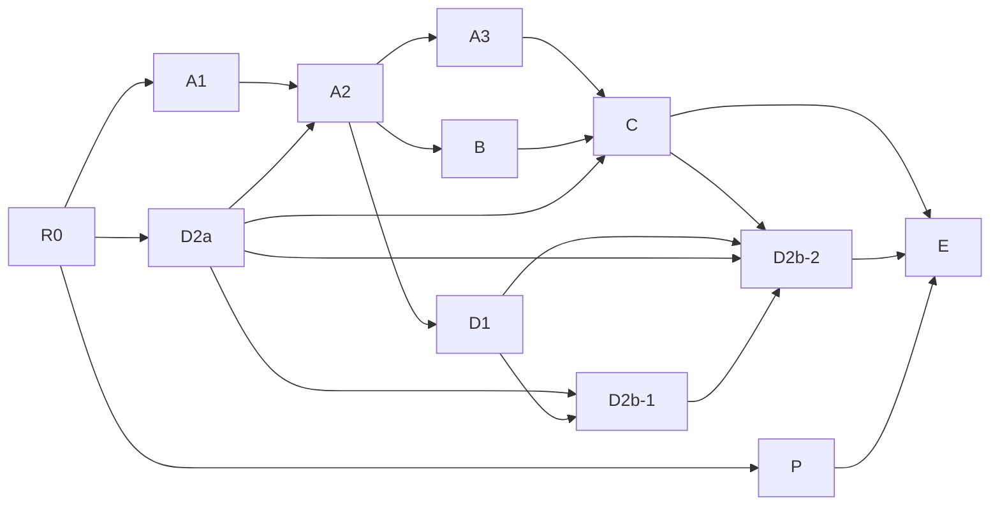

# NIR-1 L6〜L9 実行計画

更新日: 2026-10-14（初版: 2026-09-17）

初版基点: master@9f6aba5f
Tree: b7f97fc7dbbb5243da090b41dbc884ecfdc0ec2b

状態: 2026-09-17現在、#596/#597 foundations、#598 A3 review remediation、#599 typed Packing review remediationがmasterにある。Graph、Packing、AI dispatchは未activateで、Bはcapacity-remediation-in-progressである。proposal/5の契約は確認済みだが、supported capacityの数値、whole-project build、B activationは未完了である。downstream threat modelはdraft、NIR-1全体のruntime integration・activation・受入れは未完了である。#591のA2限定完了とR0台帳は履歴として保持する。

2026-09-22 B-close追記: #604を親とするstacked実装で、lifecycle SQL上界・WAL/journal/backup/Restore copyを含む総一時logical disk上界、必須lifecycle境界、数値容量契約とN/N+1検証を完了した。19-path / 114-childの測定と、確定値に対する8成功・4安全拒否のrelease childを分けて記録する。数値と適用範囲はユーザーが明示確認した。詳細は [B-close completion evidence](nir1-b-close-completion-2026-09-22.md)。Graph、Packing、AI dispatchは未activateで、NIR-1全体受入れは未完了。ユーザー指定により本候補のFull CI・独立受入れレビューは省略し、mergeは依頼範囲外として行っていない。

2026-09-24 post-#608現在地: #608の内部生成attempt／receipt／bounded recovery、canonical Graph reader、Source-backed Raw＋typed Revisionの共通snapshot Packing、標準ビルド証跡producerはmaster `fb967eb9` にマージ済み。上記の2026-09-17/22記録は当時の候補についての履歴であり、#608後のGraph・local送信が公開された証拠ではない。#608候補 `27ae54e` と旧候補 `cdc2580` のQuickを混同しない。次の最初の実装PRはR-hookであり、D-final内部接続とC-resource診断は並行可。[post-B実行計画](nir1-post-b-execution-plan.md)の依存と公開条件を維持する。

2026-10-01 #610数値契約の明示改訂（当時の履歴）: Graph input/aggregateは6 MiB (6,291,456 B)、worker Qは4.5 MiB (4,718,592 B)、Native regionは1.5 MiB (1,572,864 B)、Native admission-to-returned-result-leaseは16 ms。これだけを旧2 MiB／8 msから改訂し、512 charged records、100,000 SQLite steps、authorization/Gold、registration S/baseline、ownership/lifecycle、Graph非公開を維持する。古い測定・receipt・診断スコープは履歴のまま保持する。

2026-10-02 #610期限の明示改訂（当時の履歴）: parent admission-to-valid-Native-result-leaseは16 msから100 msへ改訂する。6 MiBの固定split、512 charged records、100,000 SQLite steps、authorization/Gold、registration S/baseline、ownership/lifecycleは維持し、registration/READYとstartup/retirement waitsをquery deadlineへ含めず、期限後の結果を拒否する。製品Graph入口は引き続き閉じる。

2026-10-04 post-B current contract: C-queryの6 MiB aggregate physical-memory cap/proof（worker Q 4.5 MiB／Native 1.5 MiB）とNative fixed-area packingは現行の受入れ条件ではない。whole-project B build/full-set maintenanceの独立したfixture-scoped resource measurement/accountingとcapacity criteriaは、B-closeで確認された別budgetとして維持する。日付付きの旧数値契約・測定は履歴として保持する。単一Revision validationの512 records/6 MiB、Packing、whole-project buildの別resource/semantic/lifecycle budgets、C-queryの512 admission・100,000 SQL steps・入力/frame/fixed-buffer safety・100 ms lease・所有権/終了条件は変更しない。aggregate physical-memory guaranteeや新しいbuild capacityは含意しない。

2026-10-12 K1追記（上の2026-10-01／10-02／10-04の改訂は当時の履歴としてそのまま残す）: これらの改訂は叙述だけで記録され、`draftRef` と `contractId` を名指した確認台帳の形式では確認されていなかった。2026-10-12に `nir1-l6-l9-contract-proposal/6` の `graph-limited-binding` と `nir1-defensive-resource-limits` が確認され（下の「契約別の確認台帳」）、次がproposal/6で正式化された。単一Revision validationの `512 records`／`6,291,456 B`（#610の作業中、2026-10-02のcommit `85898500` で共有定数が変わった値で、上の10-04の段落が前提にしている）。parent admission→valid Native result leaseの `100 ms`（10-02。registration／READYまでのstartupとcleanup／retirementの待ちを含めない）。query全体の物理メモリ上限とその証明（6 MiBのaggregate cap/proof、worker Q 4.5 MiB／Native 1.5 MiBの物理的な収まり）とNative fixed-area packingの削除（10-04）。10-01の値のうち、queryの入力と保持見積りの `6,291,456 B`、worker Qの固定allocator `4,718,592 B`、Native領域 `1,572,864 B` は、物理メモリの保証ではない「実装上の防御上限」として現行値のまま維持し、緩めるには再確認を要する。10-01の `16 ms` は10-02の `100 ms` で置き換わった。C-queryのper-Revision preflight（`2,097,152 B`）とPackingの `2 MiB` は変わらない。

2026-10-12 post-#629現在地: master `a153743b` には、#609（R-hook、`689261c3`）、#611（D-final内部候補とcurrent-turn Human capture、`902a7e79`）、#614（依存更新、`dd7d6599`）、#610（C-query worker、`13e3f6c6`）、#627（通常CIの自動実行とproduct journeyの並列化、`af13db45`）、#628（自動maintenanceの一時失敗をRecoveryRequiredにしない、`5d2a56eb`）、#629（journey shard 2〜7のXvfb wrapper）が入っている。#610で別processのC-query worker、Native owner、100 ms result lease、512／513、100,000 SQL stepsがmasterに入ったが、C-resourceの受入れと独立証明はHOLDで、製品Graph入口は `NIR1_GRAPH_NOT_ACTIVATED` のまま閉じている。local送信、履歴の実authority、Graph先本文の開示もHOLDである。#610は単一Revision validationの上限を2 MiBから6 MiBへ変えたが、確認台帳の形式では確認されていなかった。この値は2026-10-12にK1（`nir1-l6-l9-contract-proposal/6`）で確認し、確認台帳に記録した。2026-09-25/26のoff-master承認と未commit WIPは採用せず参照だけに使い、契約は最新master前提の新しいdraftRefとして起案し直す。ユーザー決定（逐語）、委任範囲、レーン、merge列、worktree台帳は [NIR-1続行計画の作業記録](nir1-continuation-2026-10.md) に記録する。Full admissionはGitHub-hosted job以外を拒否するため、canonical Fullはhostedの`canonical-ci.yml`で実行する。2026-10-13のU7（[作業記録](nir1-continuation-2026-10.md)）で、通常のPRのmerge gate MからFullを外した。

2026-10-13 CR-REC追記: C-resourceの受入れを [C-query受入れ台帳](nir1-c-query-acceptance-2026-10.md) に記録した。CR-1（#636）の試験とopt-in／lifecycle laneのrunを、CQ-1〜3と資源契約の各条件に対応づけ、対応する証跡が無い条件は未充足として残した。下の残HOLD表のC-resourceの行は、この台帳を根拠に解除済みである。条件：CR-1（#636）のmergeと最終headのQuick・PR checks・lane 6本のgreen（CR-1 の squash commit：750741183cf4d75ccf18b3904a5751b762284bda）。U7（2026-10-13のユーザー決定）により Full は merge 後の master で走らせる。台帳の未充足（G-1〜G-4）は別の行でHOLDのまま残す（後続はCR-2）。製品のGraph入口は閉じたまま（A-1）で、Graphの公開、local送信、固定値と閾値、確認台帳の各行は変えない。

2026-10-14 CR-2追記: C-resourceの残る境界（[C-query受入れ台帳](nir1-c-query-acceptance-2026-10.md) §7のG-1〜G-4）の試験を足し、台帳を更新した。writerのRevision上限のN／N+1と上限ちょうどの保存・A2の読取、per-Revision preflightのN／N+1と本番のworker構成（in-process）での正例・負例、SQLITE_BUSYでの待たないunavailable、unknown seed・3 hop・Entity 12・edge 144の試験が入り、下の残HOLD表の該当部分は解除する（条件：CR-2のmergeと最終headのPR checksのgreen）。Bの上限近傍のpublish（G-1）と、実worker（固定allocator）での上限近傍の候補（G-2）は、確認済みの契約と実装が食い違うため、[precheck] でHOLDのまま残す。Scene 8はCP-1の受入れに移す。通常のreaderは製品buildから外し、製品のqueryはworker経路だけにした。固定値と閾値、worker、NQG1、製品のGraph入口（A-1）、確認台帳の各行は変えない。

2026-10-14 CQ-MEM追記: C-resourceのG-2（[C-query受入れ台帳](nir1-c-query-acceptance-2026-10.md) §7.2）で、実worker（固定allocator）のregistrationとqueryのRust側の複製を減らした。Graphの読取がDecisionの本文を持たずtokenをstreamingにし、A2の読取を承認先行・借用parseにし、registrationのRevisionごとの資格確認をSのscopeで行い、`verify_complete_source_index`の結合順を固定し、長さのSQLを`octet_length`にした。Q（4,718,592 B）、S（64 MiB）、per-Revision preflight（2,097,152 B）、whole-set（16 MiB）の値は変えていない。decisionの形とenvelopeの形は、実workerで2,097,152 Bの正例と2,097,153 Bの全体拒否が通り、lifecycle laneに4 caseを配線した（条件：CQ-MEMのmergeと最終headのPR checksおよびlifecycle laneのgreen）。製品形（日本語のsummaryを持つRevision）は、SQLiteのJSONと応答frameの上限のため、成功する最大がA2の約1.13 MBで、2,097,152 Bに届かず、下の残HOLD表のG-2の行に[precheck]として残る。このNOMEMはregistrationで起き、per-Revision preflightの外にあって承認状態に関わらないので、下書きや却下の製品形（A2の約1.19 MB以上）でもworkerは起動時に終了する（台帳§7.2）。固定値と閾値、worker、NQG1、製品のGraph入口（A-1）、確認台帳の各行は変えない。

| post-#608の残HOLD | 閉じる実装スライス・受入れ境界 | 状態（2026-10-12） |
| --- | --- | --- |
| Open／Restoreの回復起動、同bindingの再入・取消とcaller outcome | R-hook。生成開始barrierの実消費はD-transport | 完了（#609）。barrierの実消費はDT-1で扱う |
| 実Source/Revisionからの最終payload・採用入力参照の同時確定 | D-final。履歴authorityや送信可能性は含めない | 内部候補はmaster（#611）。DF-01／DF-04のP2 HOLDは解消済み。資格refの完備規則、IP literal限定、SSEはD-final追補で扱う |
| 履歴tupleのfield/writer、immutable保存、Artifact producer関係 | H-store。未承認mappingは差分確認まで保存しない | HOLD。K4/3は2026-10-17に確認済み（確認台帳の2026-10-17補足）。HS-1はDF+-aとHP-1（#632でmaster）の後に通常の依存で着手する（実装前のためHOLDのまま） |
| 実authorityの毎turn再認可・正常な会話継続 | H-current。過去来歴／今回資格／今回requestを別々に検証 | HOLD。K4/3は2026-10-17に確認済み。HC-1はDF+-a、HS-1の後。HC-1aの実測と型付きRevision入力の再資格化の受入れはX1-3のmergeの後（K4/3の前提XP） |
| trusted local transport、回復barrier、一回限りdispatch・terminal保存 | D-transport。製品入口は閉じたまま | HOLD。DT-1〜3はU3委任の基盤でmaster（#634、#642、#637）。DT-2の再試行の上限（K1b規則7の再確認の対象）はSession B1の9文に含まれず未解決（続行計画§11）。K5/3は2026-10-17に2文とも確認済みで、DT-4は着手でき、DT-5はDF+-bの後。製品入口はPUB-Lまで閉じたまま |
| C-queryのfunctional/resource-safety・100 ms lease、SQL・cleanup | C-resource。aggregate physical-memory cap/proofは削除済み。Revision／Packing／whole-project-buildの別budgetは維持する。normal-build acceptanceと独立証明は台帳に記録した | 解除済み（CR-REC、2026-10-13）。worker・Native owner・100 ms leaseは#610でmaster、資源の固定値はK1（proposal/6）で確認済み。CR-1（opt-in／lifecycle lane、CQ-2、安全失敗）の試験とrunをCQ-1〜3と資源契約の各条件に対応づけ、独立受入れとともに [C-query受入れ台帳](nir1-c-query-acceptance-2026-10.md) に記録した。条件：CR-1（#636）のmergeと最終headのQuick・PR checks・lane 6本のgreen（CR-1 の squash commit：750741183cf4d75ccf18b3904a5751b762284bda）。U7（2026-10-13のユーザー決定）により Full は merge 後の master で走らせる。台帳の未充足は次の行でHOLDのまま。製品Graph入口は閉じたまま（A-1） |
| C-resourceの境界試験（台帳§7のG-1〜G-4） | writerのRevision上限（512 records／6,291,456 B）のN／N+1と上限ちょうどの保存・A2の読取、per-Revision preflight（2,097,152 B）のN／N+1と本番のworker構成（in-process、maintenance owner、SQL 100,000 steps）での正例・負例、DBのSQLITE_BUSY、proposal/5の負例（unknown seed、3 hop、Entity 12、edge 144） | 解除（CR-2、2026-10-14）。CR-2が試験を足し、[C-query受入れ台帳](nir1-c-query-acceptance-2026-10.md) の§2.6と§7に対応づけた。G-3は充足（rollback journalでのSQLITE_BUSY注入。WAL固有のbusyは対象外）。条件：CR-2のmergeと最終headのPR checksのgreen。worker・NQG1・固定値と閾値は変えない。12／13と144／145は、stepsの上限を外した条件を含む論理の試験（144本に届く形は本番ではstepsが先に効く）。残る部分は次の3行のとおり、2点は[precheck]でHOLDのまま、Scene 8はCP-1の受入れに移す |
| C-resourceのBの上限近傍のpublish（台帳§7.1のG-1） | 契約のRB-1の正例「512 records／6,291,456 Bの内のRevisionは、Bのwhole-setの内ならB buildでpublishされる」 | HOLD（[precheck]）。試験を足しても満たせない。writerが数える長さ（counted）とBが数える保存bytes（payloadとenvelopeを成分ごと）の単位が違う。保存されたenvelopeはcountedの約2倍（試験形2.03倍、製品形1.03〜1.06倍）になり、Bは成分guardとwhole-setでbuild全体を止める（B-GUARD、2026-10-14で、成分guardは承認済みの候補にだけ効くようにした。未承認・却下の候補は成分guardでは除かれるが、whole-setには従来どおり数える）。counted 2,621,440 Bはpublishされ、約3 MiB以上は成分guard、上限ちょうどはwhole-setで拒否される。数え方・値・文言のどれを変えるかはユーザーの確認が要る（選択肢は台帳§7.1）。2026-10-17（Session B2）に `nir1-l6-l9-contract-proposal/7#graph-limited-binding` で、writerに保存する payload と envelope の各 `6,291,456 B` の検査を足し、契約の正例を直す方針（P7-3 RB-1）が確認された。CQ-LIM-3（branch `claude/nir1-cq-lim`）がこの方針を実装した：typed Revisionのwriterが、保存するpayload_jsonとenvelope_jsonをそれぞれ`6,291,456 B`で保存前に検査し、超えたら保存せずtypedに拒否する（`NIR1_ENTITY_RELATION_STORED_PAYLOAD_LIMIT`／`NIR1_ENTITY_RELATION_STORED_ENVELOPE_LIMIT`。N／N+1と上限ちょうどを独立の試験で確かめた）。台帳§7.1の「proposal/7の後」に、RB-1の正例を契約の文言（countedが上限の内で、保存したpayloadとenvelopeがそれぞれ`6,291,456 B`以下、かつwhole-setの内ならpublish）に改めた。countedちょうど`6,291,456 B`のRevisionは、保存payloadがcountedより大きいため保存されなくなった（確認済みの1-Bと1-D）。この行の[precheck]は、実装した範囲で解消した。CQ-LIMのPR（CQ-LIM-1〜4）はX1-3のmergeの後の再測（RB-1の閾値を含む）を終えるまでmergeしないので、本行のHOLDの解除はそのmergeによる |
| C-resourceの実workerでの上限近傍の候補（台帳§7.2のG-2） | 契約のRB-2の正例「per-Revision preflight 2,097,152 Bの内のRevisionは通常どおりGraphに使われる」を、固定allocator（query 4,718,592 B）のworker binaryで確かめる | HOLD（[precheck]）。製品形で確認済みの固定値が両立しない。CQ-MEM（2026-10-14）の前は、ちょうど2,097,152 Bの候補を持つprojectで実workerが起動時のregistrationでSIGABRTし、約0.38 MB〜1.4 MBの候補ではquery中に、約1.7 MB以上では起動時に異常終了していた（Graphはunavailableで安全側）。CQ-MEMでRust側の複製を減らし（Decisionの絞込みとstreaming token、A2の借用parse、registrationのS scope、`verify_complete_source_index`のJSONのgate、octet_length）、decisionの形とenvelopeの形は実workerで2,097,152 Bの正例と2,097,153 Bの全体拒否が通り、lifecycle laneに4 caseを配線した（解除の条件：CQ-MEMのmergeと最終headのPR checksおよびlifecycle laneのgreen）。製品形（日本語のsummaryをpayload・envelope・live Sourceの3か所に持つRevision）は、SQLiteのJSON（registrationで約8.9倍、queryで約7倍）と応答frameの上限（約1.55 MB）のため、成功する最大がA2の約1.13 MBで、2,097,152 Bに届かない。registrationはper-Revision preflightを使わず、承認状態に関わらずcurrentなRevisionのpayloadをSQLiteのJSON（Q）で処理するので、下書きや却下の製品形（A2の約1.19 MB以上）でも同じNOMEMでworkerが起動時に終了する（台帳§7.2の表5）。そのためpreflightの値を下げる案(a)は、registration側の扱いか(b)／(c)と組み合わせない限り、起動時の終了を防がない。preflightの値、Q arenaとframeの上限、JSONの数え方の置換のどれで扱うかはユーザーの確認が要る（選択肢は台帳§7.2）。2026-10-17（Session B2）に `nir1-l6-l9-contract-proposal/7#graph-limited-binding` で、worker の Q `16 MiB`・Native 領域 `3 MiB`・registration の A2 bytes の検査（P7-2 案4。preflightの値は変えない）が確認された。CQ-LIM-2（branch `claude/nir1-cq-lim`）がQ 16 MiB・Native 3 MiB・registrationの検査を実装した。registrationの検査は、載せないRevisionを除いてREADYにする設計が成り立たず（roster全体のdigestとdependency edgesの照合は、Revisionごとのpayloadのparseを要し、印の保存はschemaの変更）、draftが確認済みのfail-safe（A2のadmission bytesが`2,097,152 B`を超える承認済みRevisionがあるprojectでは、workerをREADYにせず専用markerでexit 1。親は`registration-unavailable`に写す）に倒した。P7案4の効果（達しないseedはavailable）は未達で、案3より狭い帯域がある（cq-lim-decisions.mdのDR-CQL-4）。実workerの試験（CQ-LIM-2、lifecycle laneに配線）は、decision形・envelope形の`2,097,152 B`の正例と`2,097,153 B`の全体拒否、payload形の約2.03 MBの正例、製品形（Entity 12件、A2 `2,094,880 B`を含む複数Revision）のREADYが通った。これに基づき、RB-2の正例「`2,097,152 B`の内のRevisionは通常どおりGraphに使われる」の製品形の[precheck]は解除する（台帳§7.2の「proposal/7の後」。製品形でちょうど`2,097,152 B`の候補は作っていない。`2,094,880 B`まで）。CQ-LIMのPR（CQ-LIM-1〜4）はX1-3のmergeの後の再測を終えるまでmergeしないので、本行のHOLDの解除はそのmergeによる |
| Scene 8の上限（台帳§7.3のG-4） | proposal/5の負例のScene 8。CR-2の旧基点`fbdc8588`ではreaderの応答にSceneが無く、Scene joinはCP-1（#641）で接続された | 移管。C-resourceのHOLDからは外し、CP-1の受入れ（C-product）で確かめる。CP-1の実装は先頭8 Sceneの打切りと `scene_total` で、proposal/6の「同上」（超えたらquery全体を拒否）がScene 8にもかかるかをCP-1の受入れ記録で明示する |
| Graph先本文の独立した開示authority・正常開示 | C-body。作者宣言などの未確定契約は明示確認後 | HOLD。K2/4は2026-10-17に2文とも確認済み（確認台帳の2026-10-17補足〔Session B2〕）。CB-1〜CB-4は通常の依存で着手する（実装前のためHOLDのまま）。Graphの製品公開と宣言の入口の公開はPUB-G（Session C-1）の別の承認が要る。旧draft（master上の2本、2026-09-25のK2/1、未確認のK2/2とK2/3）はsuperseded |
| Related Scenes実接続、実Graph G-01〜G-08、P再評価 | C-product。成立後にGraphのみ公開、local送信は閉じる | HOLD。G-02〜G-08の事前固定はCP-0、接続はCR-1の後のCP-1〜CP-4。K2/4とproposal/7は2026-10-17（Session B2）に確認済みで、CP-3a／bはCB-4とDA-1の後、CP-4はCP-3a／b、X1-2とX1-3のmerge、CQ-LIM-4（G-03の再freeze。Graphの観測の前）を待つ（確認台帳のSession B2のlane snapshot）。実装前のためHOLDのまま。Graphの製品公開（PUB-G）には、Session C-1の承認に加え、2026-10-18のK3/3（Session B3）が加えたG-pub（3 OSのpackaged smokeでNegative (34)を示すこと。CP-2bの担当）も要る。2026-11-01追記: CP-4のGraph armは候補 `86427ee5` の測定でHOLD（DR-CP4-S6-1）。X1/3（`nir1-scene-scope-projection-proposal/3#scope-storage-authority`）が2026-11-01に確認され、CP-4はX1-5（未実装）のmergeを含む新しい候補で、凍結したtraceのfileとK6/2／K6/4の規則のまま全体を取り直す（X1/3の(d)-1。確認台帳の2026-11-01補足とlane snapshot）。実装前のためHOLDのまま |
| 最終request→local生成→次turn、P-01〜P-12 | D-dispatch。C-productと履歴・transportが揃った後に対応localのみ公開 | HOLD。DP-H、DD-1、PUB-L。K5/3とK6/2の `nir1-final-request-packing-eval` は2026-10-17に確認済み（公開にはSession C-2の承認が別に要る） |
| 固定比較と実製品Journey、全必須HOLDの独立受入れ | E-acceptance。HOLDが残ればNIR-1は未完了 | HOLD。E-1、E-2 |
| Revision上限の整合 | K1（`nir1-l6-l9-contract-proposal/6`）。#610で2 MiBから6 MiBになった単一Revision validationを確認台帳で確認する。C-queryのper-Revision preflightとPackingは2 MiBのまま | 解消（K1 確認）。2026-10-12に `nir1-l6-l9-contract-proposal/6#graph-limited-binding` で `512 records`／`6,291,456 B` を確認し、確認台帳に記録した |
| D2a activation | DA-1／DA-2（K3）。activationのtrigger・開示・順序・起動時gateと、restricted下のroute区分 | HOLD。K3/2は2026-10-17に確認済み。activationの実装と受入れはDA-1／DA-2で、未実装のためHOLDのまま。UIと開示の公開はSession C-1（PUB-G）の別の承認。DA-2が使うMG-1（CB-2）の確認の待ちは、K2/4の2026-10-17の確認で解けた（CB-2のmergeが次の待ち）。2026-10-18（Session B3）に `nir1-d2a-activation-proposal/3#caller-profile-egress`（K3/3。rendererの外向き通信〔WebRTCの接続と名前解決〕をMainのnetwork層で塞ぐ設計）が確認された。DA-1のST1・ST2・ST4とST3の開放の前は#676でmasterにある。ST3の開放commit（`own-data-read` を有効にするcommit）を止めていた[precheck]（Y-1の試走が見つけたWebRTCの外向き接続）は、確認された設計で解く。次の待ちはNC-1の実装とmerge、G-open（Linuxの実機。ST3の開放commitの条件）で、開放は未実装のまま。K3/3は開放そのもの、PUB-GとSession C-1の承認、新しいauthorityを許可しない（PUB-Gの条件にG-pub〔3 OSのpackaged smoke〕が加わる） |
| A3 consumer activation | CP-4。実製品経路で全Scope軸のpositive／negative／unavailable、非開示bridgeの禁止、再検証、fallbackを示す | HOLD。K2/4とproposal/7は2026-10-17に確認済み（実装未着手）。開始条件は確認台帳のSession B2のlane snapshot |
| AttemptBinding v2 | DT-3（U3委任）。版dispatcher、DBで検証するsessionとcaller bindingの分離、Scene incarnation／source token／body digestへの束縛、history slotの予約 | HOLD |
| D-final追補 | DF+-a（K4。資格refの完備規則）、DF+-b（K5。IP literal限定、SSE、Review） | HOLD。K4/3とK5/3は2026-10-17に確認済み。実装は通常の依存で着手する |
| DI-1（3分割） | DI-1c（handoff→persistと送信前の再確認）、DI-1a（Graph材料の再資格化）、DI-1b（historyの最終予算） | HOLD。K4/3とK6/2は2026-10-17に確認済み。DI-1cはDF+、DT-1〜3、HS-1の後、DI-1aはCP-1／2aの後、DI-1bはHC-1の後 |
| P-12の最終request baseline | K6とDP-H。Nativeの最終requestをRustのbaseline armと比べる。K6/2の `nir1-final-request-packing-eval`（2026-10-17に確認済み）が手順を定める | HOLD。HOLDを解くのはDD-1のDP-1がPASSした後 |

#609（R-hook）のmerge証跡。`nir1-r-hook` worktreeの `.artifacts/nir1-r-hook/merge-candidate-2a13e260.json`（SHA-256 `1b3700be6789cedc5379ed2128028d3c028a4dd5f1a92e6916cee6f4aa8cf3ec`）を読取だけで転記し、同じ記録が指す `full.json`／`quick.json` のSHA-256が記録値と一致することを確認した。#610より前のローカルFullであり、当時のhosted checksは0件だった。

| 項目 | 値 |
| --- | --- |
| candidate | base `fb967eb9b56caad536bd9589eb69df9a075f9a62`、head `2a13e2601b5ef276be9d60cbf8b14a29ae5b85ad`、tree `cf004de0d20756cb215e3205090aafdf0e924342`、clean |
| Full | run `005a8f33-d671-4ac0-8f2c-685cba06f872`（2026-09-24T19:32:21Z〜19:45:19Z）。stage 1からのcomplete、62 task passed、product journey 28/28 allPassed／allClean、直後のverify済み。`full.json` のSHA-256 `299644165509a12e42eb5996db86f6941e62b8f4008615d471e065ebb65622fa` |
| Quick | run `f5c5e1de-819d-4235-98bb-57627df088b5`。`quick.json` のSHA-256 `df550cd0b2503143ac8e085e8ef19f8a0814737c704a51066ee4bc1364278d9e` |
| release-only | `electron-windows-installer-contract` はWindowsの手動Full CI／tag releaseの別義務で、合格扱いにしない |
| 独立受入れ | candidate-untouched。clean candidateに束縛したbuild・Quick・Full・verifyを条件とするOK |
| merge | squash、expected head `2a13e2601b5ef276be9d60cbf8b14a29ae5b85ad`、merge commit `689261c3672963b5695a30df6d6a3b3691e35697`。first parentはapproved merge base `fb967eb9b56caad536bd9589eb69df9a075f9a62` と一致し、`origin/master` に含まれる |

## 概要

本書は、L0〜L5を引き継いでL6〜L9を実装するための実行契約である。統合計画の履歴的な設計・受入れ記録を置き換えず、実装順序、公開前提、境界、評価、完了判定を具体化する。

初期版の強い送信境界は、制限成立後、同一Electron profile内の全作品・全会話を継続的なlocal-only領域にする。NIR非対応の通常会話も例外にしない。通常操作による解除や、外部利用と併存する分離profileは初期版に含めない。reload、workspace切替、別窓、再起動後も制限を維持する。

## PR-R0 — 履歴台帳と評価契約の固定

この節の台帳、開始判定、ready状態は2026-09-13時点のR0記録であり、2026-09-16の現在スナップショットにあるA2限定完了を上書きしない。

R0は、#572の現在地、後続laneの境界、契約ごとの開始可否、評価条件をこの実行計画に固定する文書・品質契約の変更である。runtime、policy、activation、既存のL0〜L5評価fixtureは変更しない。確認基点は最新 `origin/master` の #572であり、下表のrefは実装・履歴の存在または記録した明示確認の範囲だけを示し、確認済みtyped /4のscopeを越えて新しいruntime／consumer資格を有効化したことを示さない。

| 項目 | R0で記録する値 |
| ---- | -------------- |
| requestedBase / resolvedBase | `master@68516b033f395f24f98c502c9fd2a715d7aec2af` / 同じ #572 を含む `origin/master` |
| Tree | `04c491c29627ecc840112ebe379a5363e16892ff` |
| candidateBranch | `codex/nir1-r0-contract-ledger` |
| plan / policy / threat refs | 本書、統合計画、ロードマップ、既存 quality manifest / impact map。下流 threat model は draft のまま |
| receipt boundary | 初回static draftの旧R0候補のfocused test／`verify:quality`／Quick＋verifyは無効。今後の実装候補は全PR共通 merge gate M（通常のPRはrebase済みclean candidateのQuick＋直後verifyと同じheadのPR checks、release PRはFull＋直後verify）で判定し、旧receiptを流用しない |

### #572の実装済み／未完了

| #572で確認できる実装 | 未完了・R0で公開しないもの |
| -------------------- | ----------------------------- |
| typed Scope / Entity / Relation / Evidence validation、Native所有のimmutable Revision保存と承認済みRevision reader | RevisionのSource Basis / Dependency / Generic Freshnessによるcanonical資格、全材料closure |
| request-local Graph primitive、Raw必須・非Raw atomic groupを扱うPacking primitive | canonical Graph Index、全Scope軸の開示、ContextPlan／dispatch／履歴への製品統合 |
| typed createとPacking helper、および境界の拒否を検証する既存契約 | 通常操作でのreview公開、D2a profile制限、D2b receipt／履歴再認可、L9 journey |
| typed writerのreconciliation envelope（現状NULLを含む）を保存 | NULL envelopeを後から適格化すること、#572のcatalog読取をGraph Indexへ昇格すること |

### writer・caller・plaintext・egress影響台帳

| ledgerId | writer / caller / 入口 | 現在の扱い | R0の判定 |
| -------- | ------------------------ | ---------- | --------- |
| `source-tree-scope` | 本文、tree、Scope registry、scene設定、incarnation | 正本authorityを再利用。設定・本文・復元は旧資格を失効させる対象 | A1/A3/B/D1で詳細ref確認まで未開始 |
| `proposal-revision` | typed Revision、Human Decision、Evidence、Dependency / Freshness | #572のwriterは保存まで。NULL envelopeは利用資格を証明しない | A2/B/C/D1で材料契約を閉じるまで未開始 |
| `human-decision` | review、承認、取消、差替え、import / undo / restore | currentかつ明示承認を独立軸として維持 | A2/B/Cで同一transactionの失効を確認するまで未開始 |
| `index-generation` | Chronicle / Graph build、publish、rebuild、sealed generation | Graphは独立Indexと限定bindingが必要。別authorityを作らない | B/Cでregistry・Freshness・D1 headを確認するまで未開始 |
| `renderer-typed-ipc` | renderer → preload / main → Native | renderer申告を認可根拠にしない。新IPCのactivationはR0で行わない | D2a/D2bがcaller epochとhandleを固定するまで未開始 |
| `ai-senders` | chat stream / single-shot / CLI / Codex App Server / background | local設定を含む旧経路をD2a後は拒否。停止経路を利用可能とは数えない | D2aのprofile-wide gateまで未開始 |
| `review-db-audit-event` | review表示、汎用DB、保存会話・audit、event配信 | 制限対象plaintextの全入口。未分類出口は許可しない | D2a後の公開条件を満たすまで未開始 |
| `mcp-generic-http-connection` | MCP / HTTP / proxy / redirect / 接続テスト | 新規外部送信や既存localの例外を作らない | D2a/D2b-1の拒否とlocal transport確認まで未開始 |

台帳にない出力入口を「通常機能」と推定して許可しない。R0では既存コードを変更せず、writerの境界とcaller／plaintext／egressの分類だけを固定する。

### profile状態遷移（計画上の開始条件）

| state | 意味 | 次へ進む条件 | R0時点 |
| ----- | ---- | ------------ | ------- |
| S0 | 既存L5と#572のtyped基盤runtime。NIR-1 L6〜L9のproduction runtime integration／activationなし | R0台帳が固定される | 現在地 |
| S1 | A1保存・incarnationと既存L5移行ガードの候補 | Scope authorityの詳細refとA1 focused受入れ | blocked |
| S2 | D2a profile-wide local-only制限の成立処理中 | 全旧caller・入口拒否、永続化、起動時gate | blocked |
| S3 | D2a成立後、D2b-2/P3前 | 旧localを含む旧送信拒否を維持し、新しい送信は公開しない | blocked |
| S4 | D2b-2/P3統合後の対応済みlocal経路だけ | handle、receipt、履歴再認可、最終requestの独立受入れ | blocked |

R0の `ready` は文書・評価契約を次のlaneへ引き渡せるという意味に限る。S1〜S4のruntime開始・activationを許可する意味ではない。

### 契約別の確認台帳

2026-09-22補足: 以下のproposal/5本文は確認時点の契約として保持する。未測定だったB full-set数値は、その後の測定とユーザーの別途明示確認により [B-close completion evidence](nir1-b-close-completion-2026-09-22.md) で確定した。この追加確認はRevision／queryの上限や製品activationの権限を変えない。

2026-10-12補足（K1、proposal/6）: `graph-limited-binding` の行を、proposal/5からproposal/6へ更新し、`nir1-defensive-resource-limits` の行を加えた。どちらも2026-10-12（JST 23:58受信、Session A）に、contractIdごとのユーザーのexact statementで確認された。確認されたdraftは `claude/nir1-contracts` の commit `ba7ceb46306ec48383a70e52951288ed8c7e960b` の `docs/plans/nir1-l6-l9-contract-proposal-6-draft.md` で、byte同一で取り込んだ [proposal/6 draft](nir1-l6-l9-contract-proposal-6-draft.md) のSHA-256は `5528f4e091ca087c0f1e071039c6bcede9d3d7cde1422ac1bfd852ee1d8d6b4b`。draftの「Status: draft／未確認」の行はbytesを変えないためにそのまま残し、確認状態は本台帳で表す。proposal/5の確認の記録（`confirmedRef=nir1-l6-l9-contract-proposal/5#graph-limited-binding`、exact statement: `I confirm draftRef nir1-l6-l9-contract-proposal/5 for contractId graph-limited-binding.`）は履歴としてここに残す。下のproposal/5本文とL7のresource unit表は確認時点（`13e3f6c6^`）の文面に戻した履歴で、資源の値はproposal/6の節が置き換える。proposal/5のその他の条項（三つのresource unit、whole-project build lifecycle、measurement／acceptance split、finalized P2 boundaries）は、proposal/6がそのまま保持する。

2026-10-17補足（Session B1。K3/2、K4/3、K5/3、K6/2、X1/1）: 次の9文が、contractIdごとのユーザーのexact statementで確認された。受信は2026-10-17（JST、Session B1）。最初のメッセージで8文が届き、9文目（X1/1の `typed-revision-material`）は、最初の送信では文中の空白の位置が改行になって届いたので確認として記録せず（無効）、同日にユーザーが1行で入力し直して確認された。確認された版は `claude/nir1-contracts` の commit `af643a93eeae7f937c9cd5a9dd87a6308c96fab6`（push済み。repository activityのserver側の記録で2026-10-17T02:13:10Z）。5本のdraftと、draftが引く設計メモ（[DSN](nir1-dsn-2026-10.md)。確認の対象ではない）と、版の照合に使う[manifest](nir1-session-b1-manifest.md)を、この版でbyte同一に取り込み、5本のdraftのSHA-256が下の値（manifestの値）と一致することを確かめた。draftの「Status: draft／未確認」の行はbytesを変えないためにそのまま残し、確認状態は本台帳で表す。X1/1が引くK2/3（`nir1-c-body-disclosure-proposal-3-draft.md`）とK4/2（`nir1-d2b-history-mapping-proposal-2-draft.md`）は確認されておらず（K2はSession B2でK2/4に改め、K4/2はK4/3が置き換える）、取り込まないので、X1/1の中のその2本へのlinkは切れたまま残る。9文の逐語は各draftの末尾の「確認文」と1字違わず、[続行計画の作業記録](nir1-continuation-2026-10.md)の§10.3に転記した。

| # | draftRef#contractId（略称） | 取り込んだdraft | SHA-256 |
| - | --------------------------- | --------------- | ------- |
| 1 | `nir1-d2a-activation-proposal/2#caller-profile-egress`（K3/2） | [nir1-d2a-activation-proposal-2-draft.md](nir1-d2a-activation-proposal-2-draft.md) | `a16e8b259f8b58e53152e5bb2e503f3cf995f979d85bf4922ccd420f6bf5fd30` |
| 2 | `nir1-d2b-history-mapping-proposal/3#history-reauthorization`（K4/3） | [nir1-d2b-history-mapping-proposal-3-draft.md](nir1-d2b-history-mapping-proposal-3-draft.md) | `f6a189371b4d793c0c440d2ee1d0c96d66c60069d35fa95d31e5c971701a99d7` |
| 3 | `nir1-d2b-local-send-proposal/3#nir1-local-product-send`（K5/3） | [nir1-d2b-local-send-proposal-3-draft.md](nir1-d2b-local-send-proposal-3-draft.md) | `5a8962cd9aa5525046349b31af825c4637dc152e2bb1c5d348fc2bc8fb576723` |
| 4 | `nir1-d2b-local-send-proposal/3#caller-profile-egress`（K5/3。B-1〜B-4） | 3と同じdraft | 3と同じ |
| 5 | `nir1-final-request-eval-proposal/2#nir1-final-request-packing-eval`（K6/2） | [nir1-final-request-eval-proposal-2-draft.md](nir1-final-request-eval-proposal-2-draft.md) | `4ccca08314c022fd969308fa969e6fcb3e2c439fe12757bfec0e901b905676f8` |
| 6 | `nir1-final-request-eval-proposal/2#g01-eval-revision`（K6/2。条件付き。事前の確認） | 5と同じdraft | 5と同じ |
| 7 | `nir1-final-request-eval-proposal/2#graph-eval-procedure`（K6/2。条件付き。事前の確認） | 5と同じdraft | 5と同じ |
| 8 | `nir1-scene-scope-projection-proposal/1#scope-storage-authority`（X1/1） | [nir1-scene-scope-projection-proposal-1-draft.md](nir1-scene-scope-projection-proposal-1-draft.md) | `a2d85d92f4f737405922c5fefbe9acf732a8d784a27c6a2f79894c6278dc6c5e` |
| 9 | `nir1-scene-scope-projection-proposal/1#typed-revision-material`（X1/1の2文目。再入力で確認） | 8と同じdraft | 8と同じ |

K6/2の条件付きの2行（6、7）の扱い: draftの「確認の扱い」は「条件が成立したときだけ、判定に使ったreceiptを添えて確認を求める。成立しなければ確認を求めず、台帳には『条件不成立・未提示』と記録する。行の内容が効くのは、条件が成立して確認された後に限る」と定める。今回は条件の成立前にユーザーが確認文を入力した。台帳には、事前の確認（条件は未成立）。行の内容は条件が成立するまで効かず、条件が成立したときのreceiptの照合（事前登録の凍結の照合3）はintegratorが行う、と記録する。receiptの照合は省かない。この事前の確認は、条件が成立したときの確認の代わりにならず、条件の判定に使うreceiptや診断の代わりにもならない。効力の発生条件は次の1通りに揃える（下の2行、続行計画§10.3も同じ）。条件が成立し、integratorが照合3を済ませたら、判定に使ったreceiptと診断、照合の結果を添えて、利用者へ改めて確認を求める（draftの規則どおり、確認は条件の成立後の1回）。行の内容が効くのは、その確認文が記録された後に限る。事前の確認は、利用者がdraftの規則の内容を読んで確認文を入力したという記録として残るが、効力の根拠にはしない。

K6/2の事前登録の凍結の記録: 凍結のcommitは `af643a93eeae7f937c9cd5a9dd87a6308c96fab6`、K6/2のSHA-256は上の5の値。`git ls-remote origin refs/heads/claude/nir1-contracts` の出力は `af643a93eeae7f937c9cd5a9dd87a6308c96fab6 refs/heads/claude/nir1-contracts`。pushの時刻は、自己申告が2026-10-17 11:13 JST（commitのauthor／committer時刻11:13:09 +0900）、repository activity（`gh api repos/{owner}/{repo}/activity` のうち `ref` が `refs/heads/claude/nir1-contracts`、`activity_type` が `push`、`after` が凍結のcommitのもの）のserver側の時刻が2026-10-17T02:13:10Z。PushEvent（events API）は、起案時に取った時点では現れていなかった。取り直した（2026-10-17T03:21Zごろ）が、このときも凍結のcommitのPushEventは現れず、events APIの最新のPushEventはこの時点で2026-10-14のものだった（events APIの遅れが続いている）。条件を判定する前（照合3の前）までに、凍結のcommitのPushEventかrepository activityを取り直して作業記録に書く。照合3(c)のpushの時刻には、PushEventが現れるまではrepository activityのtimestampを使う。

この9文は、Graphの製品公開、local送信の公開、activation UIの公開（PUB-G、PUB-L、Session C-1／C-2）、新しいauthority・保存先・送信先を許可しない。1文の確認はそのcontractIdの行だけを確認し、依存する契約を確認しない（K4/3は前提K5-1とXPを置くが、K5/3とX1/1の確認を代行しない。今回はK5/3とX1/1も別々の文で確認された）。K2/4（Session B2。`graph-target-scene-body-disclosure` と `scope-storage-authority` のC-body差分）は未確認で、X1/1の `scope-storage-authority` の行と互いを前提にしない。既存のproposal/3、proposal/4、proposal/6のrefは、下の表のとおり消さず、置き換えない。確認された行はR0 mergeと通常の依存を満たすまでlaneを完了へ進めない。

2026-10-17補足（Session B2。K2/4、proposal/7）: 次の3文が、contractIdごとのユーザーのexact statementで確認された。受信は2026-10-17（JST、Session B2）。3文は1つのメッセージで届き、各draftの末尾の「確認文」と1字違わない。確認された版は `claude/nir1-contracts` の commit `40d10adff87e19fcb364b624a1b422ba4890b3e0`（push済み）。2本のdraftと、proposal/7が引く測定の記録（[measurement-record.md](nir1-lane-decisions/proposal7-measurement/measurement-record.md)、`harness/`、生の出力 `raw.tar.gz`、`SHA256SUMS`）と、版の照合に使う[manifest](nir1-session-b2-manifest.md)を、この版でbyte同一に取り込んだ。2本のdraftのSHA-256が下の値（manifestの値）と一致すること、測定の記録の `SHA256SUMS` のSHA-256が `be8734432396fbbc98c7e6303e6edfbbd26f0c3a0735fd7ba59e11a16f1aeac6`（proposal/7の「測定の記録」の行とmanifestの値）と一致すること、`sha256sum -c SHA256SUMS` が全件通ることを確かめた。draftの「Status: draft／未確認」の行はbytesを変えないためにそのまま残し、確認状態は本台帳で表す。K2/4が引くK2/3（`nir1-c-body-disclosure-proposal-3-draft.md`）は確認されておらず（K2/4が置き換えた）、取り込まないので、K2/4の中のそのlinkは切れたまま残る。Session B1の補足の「K2/4は未確認」は、この確認で解けた。3文の逐語は各draftの末尾の「確認文」と1字違わず、[続行計画の作業記録](nir1-continuation-2026-10.md)の§10.4に転記した。

| # | draftRef#contractId（略称） | 取り込んだdraft | SHA-256 |
| - | --------------------------- | --------------- | ------- |
| B2-1 | `nir1-c-body-disclosure-proposal/4#graph-target-scene-body-disclosure`（K2/4） | [nir1-c-body-disclosure-proposal-4-draft.md](nir1-c-body-disclosure-proposal-4-draft.md) | `efc30cca32f2c91386baf3061836427ae7df3499c18188d31b5e2ba422a2fcfd` |
| B2-2 | `nir1-c-body-disclosure-proposal/4#scope-storage-authority`（K2/4。C-bodyの差分。X1/1の同じcontractIdの行とは別のdraftRef） | B2-1と同じdraft | B2-1と同じ |
| B2-3 | `nir1-l6-l9-contract-proposal/7#graph-limited-binding`（proposal/7。proposal/6の値の改訂） | [nir1-l6-l9-contract-proposal-7-draft.md](nir1-l6-l9-contract-proposal-7-draft.md) | `13fb0e6d410dbf073b219b9c1e384bfdc57239ac331434c6fe45aa0dad3aca29` |

3文の範囲: 各文はそのcontractIdの行だけを確認し、依存する契約を確認しない。確認文は各draftの推奨の組だけを確認する（推奨と違う選択は新しいdraftRef）。選択は推奨のままで、確認した範囲に含まれる。K2/4はK2-1 Option B（作者が本文全体を宣言する。Option Aは選ばない）、K2-2 2文とも確認、K2-3 取消の入口にgrantを要さない。proposal/7はP7-1 時間 `100 ms` を残す、P7-2 案4（worker の Q `16 MiB`、Native領域 `3 MiB`、registrationの検査）、P7-3 RB-1の検査を足す、P7-4 G-03のfixtureの作り直し。`nir1-defensive-resource-limits` は規則を変えないので確認文はなく、proposal/6の確認が有効なまま残る。B2-2の `scope-storage-authority`（K2/4）とX1/1の同じcontractIdの行（Session B1）は別々の差分で、互いを前提にせず、proposal/3の行とあわせて3つのrefは加算で並ぶ。

proposal/7の条件（draftの「確認の扱い」「受入れ」を写す）: B2-3の確認文は、X1/1のQ7（実測をX1-3の入った候補で取る）をこの実測が満たさないこと（実測はX1-3の前）を承知した確認として扱う。補うのはX1-3のmergeの後の再測で、proposal/7の実装（CQ-LIM-1〜4）は、その再測を終えるまでmergeしない。再測で、records・steps・Entity・edge・pagesのどれかの余裕が1.5倍を割る、50場面のseedがavailableでなくなる、registrationの使用量がQの85%を超える、frameが上限の85%を超える、RB-1の閾値（counted約3.05 MB／約6.15 MB）が確認時の説明と合わなくなる、のどれかなら、そのlaneは[precheck]で止まり、報告し、新しいdraftRef（proposal/8）を求める。B2-3の確認文はまた、G-03のfrontier-exceededの期待値の更新（発見16件→54件、`limit` 12→50。判定は変えない）を承知した確認として扱い、作り直したfixtureはGraphの観測の前に新しいfreezeと独立レビューを経る。時間は `100 ms` のままなので、50場面の主人公級はproposal/7の実装の後も拒否されうる（R+IRに戻る）。200 msにする選択、別のP7案、別の値は新しいdraftRefで、200 msはK6/2の窓外率の前提の見直しも要る。registrationの検査の効果は未測定で、実装後の試験で確かめる（確かめられなければworkerをREADYにしないtyped refusalに倒す）。

この3文は、Graphの製品公開、local送信の公開、activation UIの公開（PUB-G、PUB-L、Session C-1／C-2）、新しいauthority・保存先・送信先を許可しない。K2/4は作者の本文全体の宣言という新しいauthorityと、その保存（宣言の2列）を契約として確認するが、宣言の入口と取消の入口はPUB-Gまで Native のgateで閉じ、評価用のCI seamが有効な起動（packagedでない起動で `CI=true`、owner token、起動ごとのnonceがそろったとき）でだけ開く。K6/2の条件付きの2行（`g01-eval-revision`、`graph-eval-procedure`）はこの確認で変わらず、条件未成立のままである。既存のproposal/3、proposal/4、proposal/6、X1/1、K3/2、K4/3、K5/3、K6/2のrefは、下の表のとおり消さず、置き換えない。確認された行はR0 mergeと通常の依存を満たすまでlaneを完了へ進めない。

2026-10-18補足（Session B3。K3/3）: 次の1文が、contractIdごとのユーザーのexact statementで確認された。受信は2026-10-18（JST 18:25、Session B3）。1文は1つのメッセージで届き、draftの末尾の「確認文」と1字違わない。確認された版は `claude/nir1-contracts` の commit `14141248f09a97945eb5620cf1190d54dc7558e8`（push済み）。draftと、draftが引く測定の記録（[measurement-record.md](nir1-lane-decisions/webrtc-closure-measurement/measurement-record.md)、`harness/`、`records/`、`SHA256SUMS`）と、版の照合に使う[manifest](nir1-session-b3-manifest.md)を、この版でbyte同一に取り込んだ。draft（432行）のSHA-256が下の値（manifestの値）と一致すること、測定の記録の `SHA256SUMS` のSHA-256が `4ac3cc8a68d54ed5fe13b9b55ab4631174a5a01b87a9257dadb8ec561468f144`（K3/3の「測定の記録」の行とmanifestの値）と一致すること、`LC_ALL=C sha256sum -c SHA256SUMS` が130件すべて通ることを確かめた。draftの「Status: draft／未確認」の行はbytesを変えないためにそのまま残し、確認状態は本台帳で表す。K3/2のbytes（SHA-256 `a16e8b259f8b58e53152e5bb2e503f3cf995f979d85bf4922ccd420f6bf5fd30`）は変えておらず、再計算して一致を確かめた。1文の逐語はdraftの末尾の「確認文」と1字違わず、[続行計画の作業記録](nir1-continuation-2026-10.md)の§10.5に転記した。

経緯: DA-1のST1のY-1の試走が、rendererからのWebRTCの外向き接続（`RTCPeerConnection` の `iceServers` に `turn:`／`turns:` を渡すだけでChromiumが名前を解決して接続する）を見つけ、ST3の開放commitを[precheck]で止めた。ユーザーは2026-10-18に、構造的に塞ぐ設計を起案する案1を選んだ（逐語は[続行計画の作業記録](nir1-continuation-2026-10.md)の§1のSB-6。確認文ではない）。K3/3は、その設計をLinuxの実機で検証して起案した。

| # | draftRef#contractId（略称） | 取り込んだdraft | SHA-256 |
| - | --------------------------- | --------------- | ------- |
| B3-1 | `nir1-d2a-activation-proposal/3#caller-profile-egress`（K3/3。K3/2と同じcontractIdの新しいdraftRef） | [nir1-d2a-activation-proposal-3-draft.md](nir1-d2a-activation-proposal-3-draft.md) | `e5362f3e40e662781d57c46d20db617aded3c7d4cf72912c0d27991b0dbded11` |

1文の範囲: この文はdraft冒頭の「ユーザーが批准すること」の1〜9だけを批准する（範囲の正本。台帳は別の列挙を持たない）。内容は、NC-1（default sessionのblackholeのSOCKS5 proxyと `<-loopback>`、全webContentsの `disable_non_proxied_udp`、`host-resolver-rules`）、AL-0（直接通信を許す先は0件）、RS-1（名前解決を許す固定の4名。GitHubの更新の3 hostと `localhost`）、LS-1（Mainの `127.0.0.1` のlistener。同時256以下、保持5秒以下）、MD-1（modeを問わずunrestrictedにも及ぼす。default sessionの最初の接触で `initBackend` と最初の窓の前に完了する）、FC-1（起動前の失敗と起動前の共有の期限5秒の超過は窓を開かず固定コードをstderrに出して `app.quit()`）、unrestrictedの挙動への影響の13項目、Positive (9)・Negative (23)の置換・(29)〜(34)とゲート表、「変える点」の1〜9である。依存する契約（K2、K4、K5、K6、`graph-limited-binding`、`nir1-defensive-resource-limits`）は確認しない。draftの推奨の組だけを確認し、推奨と違う案（辞書を残す案、開示して受け入れる案、O-2をやめる案など）は確認していない。contractIdは `caller-profile-egress`（K3/2と同じ。`nir1-l6-l9-contract-proposal/7` が確認済みの `/6` の一部を同じcontractIdの新しいdraftRefで改訂した前例と同じ形）。

ゲート（draftのゲート表が正本。ここに条件を再掲しない）: **G-open**（`own-data-read` を開放するcommit。DA-1のST3。Linuxの最終候補）と **G-pub**（PUB-G。3 OSのpackaged smoke。CP-2bの範囲にY-1を各OSで行うことが加わる）。開放commitは、NC-1のmergeとG-openが通った記録の後でなければ入れない。開放の許可の出所はK3/2のO-2の確認に限り、K3/3は開放の前の条件を足すだけで、開放そのものを許可しない。release／tagは縛らない。

K3/3が許さないもの: `own-data-read` を開放するcommit（DA-1のST3）そのもの（K3/3は開放の前提であるY-1の外向き0を成立させる設計を確定するだけで、NC-1は未実装である）。PUB-GとSession C-1の承認（Graphの公開、activation UIの公開、開示の文言）。local送信（PUB-L）。許可先や名前解決を許す名前の追加、閉じた集合の外の新しいnetwork設定、閉じ込めを止める入口、新しいauthority・保存先・送信先。NC-1の実装、G-openとG-pubの通過は、このPRで行っていない。

2026-10-25補足（Session B4。K6/3）: 次の1文が、ユーザーのexact statementで確認された。受信は2026-10-25（JST。integratorが13:47ごろに処理した。正確な受信時刻は会話記録のtimestamp）。1文は1つのメッセージで届き、draftの末尾の「確認文」と1字違わない。確認された版は branch `claude/nir1-k6-3` の commit `ee4d5be29ba7033acbf77febc6a8a11cef216a12` の `docs/plans/nir1-final-request-eval-proposal-3-draft.md`。draftをこの版でbyte同一に取り込み（`git show <commit>:<path>` の出力をそのまま置いた）、`sha256sum` が下の値と一致することを確かめた。draftの「Status: draft／未確認」の行はbytesを変えないためにそのまま残し、確認状態は本台帳で表す。K6/2のbytes（SHA-256 `4ccca08314c022fd969308fa969e6fcb3e2c439fe12757bfec0e901b905676f8`）は変えていない。1文の逐語は[続行計画の作業記録](nir1-continuation-2026-10.md)の§10.6に転記した。

経緯: K3/3の引き継ぎH4（下の2026-10-18の注）により、DD-1はK6の確認者の判断まで着手を保留していた。ユーザーは2026-10-25に、K6の新しい版 /3 を起案する案Aを選んだ（「Aで」。逐語は続行計画の§1のSB-8。起案の指示で、確認文ではない）。K6/3は、K6/2のDD-1の「接続の試みの分類」をNC-1の下の3種の試みと両立させ、DP-Hの置換版に伴って版の番号を読み替える改訂として起案された。

| # | draftRef#contractId（略称） | 取り込んだdraft | SHA-256 |
| - | --------------------------- | --------------- | ------- |
| B4-1 | `nir1-final-request-eval-proposal/3#nir1-final-request-packing-eval`（K6/3。K6/2と同じcontractIdの新しいdraftRef） | [nir1-final-request-eval-proposal-3-draft.md](nir1-final-request-eval-proposal-3-draft.md) | `2ae123d2319bb0246045bebc39d2391add15deccfa0aa58d87dbfce3b8ecbf2b` |

1文の範囲: この文はdraft冒頭の「ユーザーが批准すること」の1〜9だけを批准する（範囲の正本。台帳は別の列挙を持たない）。内容は、K6/2のDD-1の「接続の試みの分類」の期待された通信に、(a) Chromium（default session）からLS-1への接続、(b) blackholeされた辞書の要求の試み、(c) datagramを送らないIPv6の到達性の確認のUDP connectを型と起点つきで加えること、その加え方の制約・LS-1のportの同定・件数と時刻と記録の規則、これがK6/2の文面より弱い読み（合格基準の緩和）であること、版の番号の読み替え、変えないもの、許さないもの、threat modelと受入れである。draftの「判断を求める点」の規則（推奨のまま確認文を打てば推奨が確認され、推奨と違う選択は新しいdraftRefで起案する）により、5点とも推奨が確認された: 1 N_bの上限は3、2 DP-1の証跡にするDD-1のrunはNC-1を当てた起動に限る、3 DP-Hの置換版を版2、DD-1の版を版3と読む、4 net logのcapture modeは `--net-log-capture-mode=Everything`（net logは `.artifacts/` の下だけに置く）、5 (c)を型つきで加える（K3/4で「続く通信」に加える代案は採らない。(c)はK6の出典の原則の唯一の例外）。ユーザーは代案を述べていない。contractIdは `nir1-final-request-packing-eval`（K6/2と同じ）。K6/2の「確認の扱い」（147行）の規則により、/3の行はK6/2の行を全体としてsupersedeし、内容は「K6/2の全文に/3の『変える点』の表を当てたもの」になる。K6/2の行と確認の記録は履歴として残す。

K6/3が許さないもの: draftの批准8のとおり、DD-1の実装と実行そのもの、DP-Hの置換版の作成そのもの、NC-1の挙動の変更、新しいauthority・保存先・送信先・製品の入口・評価専用の入口、Graphとlocal送信の公開、Session C-2の承認。依存する契約（K3/3を含む）と、K6/2の条件付きの2行（`g01-eval-revision`、`graph-eval-procedure`）は確認しない。DD-1の実装と実行、DP-Hの置換版の作成、DD-1のDP-1のPASS、PUB-Lは、この確認の記録で行っていない。

2026-10-26補足（Session B5。K6/4）: 次の承認が、ユーザーの構造化質問（AskUserQuestion）への回答で記録された。受信は2026-10-26（JST。integratorが00:41に処理した。正確な受信時刻は会話記録のtimestamp）。Confirmation protocol（2026-10-25の緩和の後）の (2) の構造化質問の形で、質問の文が `draftRef`（`nir1-final-request-eval-proposal/4`）、`contractId`（`graph-eval-procedure`）、draftのSHA-256（`d205b35f71da6db3fe94ae881e1e500941090a8261b95343a3a50def5f6323c3`）を名指し、ちょうど1つの `draftRef#contractId` を示した。選ばれた選択肢は明示の確認で、回答の逐語は「推奨のまま確認する」（推奨の選択肢。ほかの選択肢は「一部を変えて確認したい」と「まだ確認しない」）。ユーザーは代案も追記も述べていない。確認された版は branch `claude/nir1-k6-4` の commit `18ebc7b8de2d4f2701c573b5d91561a6cc852024` の `docs/plans/nir1-final-request-eval-proposal-4-draft.md`（329行）。draftをこの版でbyte同一に取り込み（`git show <commit>:<path>` の出力をそのまま置いた）、`sha256sum` が下の値と一致することを確かめた。draftの「Status: draft／未確認」の行はbytesを変えないためにそのまま残し、確認状態は本台帳で表す。K6/2（SHA-256 `4ccca08314c022fd969308fa969e6fcb3e2c439fe12757bfec0e901b905676f8`）とK6/3（SHA-256 `2ae123d2319bb0246045bebc39d2391add15deccfa0aa58d87dbfce3b8ecbf2b`）のbytesは変えていない。質問と回答の逐語は[続行計画の作業記録](nir1-continuation-2026-10.md)の§10.7に転記した。確認を求めるときに添えたH5とRS-JOINの結果（批准11）は、master に無い記録にある: H5は統合branch `claude/nir1-cp4` の `docs/plans/nir1-lane-decisions/cp4-decisions.md`（`d7521a12`。DR-CP4-S1C2-27、28と「H5の診断の結果」）、RS-JOINは `claude/nir1-join-opt` の `docs/plans/nir1-lane-decisions/rs-join-decisions.md`（`78916cb1`。DR-RSJ-8、9と測定の結果）。Confirmation protocolは変えない（この確認は2026-10-25の緩和の後の規則に従っただけで、規則を改めない）。

経緯: K6/2の `graph-eval-procedure` は事前の確認だけで（下の確認台帳の/2の行）、D′（CQ-DEFER。#715）の下では、K6/2の(a)（定常状態の窓外率）は構造上HOLDだった（Graphは常に最初の表示に遅れ、`graph-ready` の後の取り直し〔cache由来〕でだけrendererに届く）。ユーザーは2026-10-25に、K6/2の(a)について「K6/2はAで」と指示した（逐語は続行計画の§1のSB-12。Aは、再queryのcache由来の結果も一定時間内なら可用性に数える定義を持つ新しいK6のdraftを起案する案。起案の指示で、確認文ではない）。K6/4は、その定義（follow-upの可用性と表示の可用性）をK6/2の `graph-eval-procedure` に加え、可用性の判定を置き換える改訂として起案された。

| #    | draftRef#contractId（略称）                                                                                           | 取り込んだdraft                                                                            | SHA-256                                                            |
| ---- | --------------------------------------------------------------------------------------------------------------------- | ------------------------------------------------------------------------------------------ | ------------------------------------------------------------------ |
| B5-1 | `nir1-final-request-eval-proposal/4#graph-eval-procedure`（K6/4。K6/2の条件付きの行と同じcontractIdの新しいdraftRef） | [nir1-final-request-eval-proposal-4-draft.md](nir1-final-request-eval-proposal-4-draft.md) | `d205b35f71da6db3fe94ae881e1e500941090a8261b95343a3a50def5f6323c3` |

承認の範囲と効力: この承認はdraft冒頭の「ユーザーが批准すること」の1〜12だけを扱う（範囲の正本。台帳は別の列挙を持たない）。/4の行の内容は、K6/2の `graph-eval-procedure` の本文の全文に/4の「変える点」の1〜18を当てたもの（draftの「引き継ぐもの」の1）。効力は2つに分かれる（批准6）。(i) /4の行のうち(ii)以外のすべて（批准1〜5、7〜12〔批准5の候補の限定、批准7の凍結を含む〕、「変える点」の1〜18、threat modelの加算、受入れのK6/4-P1〜P3とK6/4-N1〜N40、R1〜R8、技術点1〜3、変えていないK6/2の本文〔619行のMandatory defenses、622〜624行の保存先・writer・失効、695〜737行の手順と(b)の判定の規則など〕）は、この承認で**確認**され（`confirmedRef` を持つ）、記録の時点から「条件が成立しない場合のCP-4の可用性」（K6/2の612行。/4の「変える点」の3）の判定に使う。緩和と、防御・候補の限定は、同時に同じ効力で効く。(ii) K6/2の614行のDelta（条件が成立して確認されたら、CP-4のG-caseをこの行の手順で測ること）、620行の末尾のLane unlocked、621行の受入れへの影響（実際の操作のtraceの窓外率を合否から外して開示に回すこと）に/4の読み替えを当てたものは、**事前の確認**にとどまり、条件の成立と改めての確認の後にだけ効く（下の確認台帳の/2の行の "ratifies nothing" と同じ扱い。効力の根拠にしない）。/4の条件の判定の規則（「変える点」の2と15を当てたもの）は、K6/2の140行と同じく、(ii)の改めての確認を求めるかどうかを決めるためだけに、凍結したbytesで使う（凍結はこの承認の後で、承認の前には使わない）。draftの「判断を求める点」の規則（推奨のまま承認すれば推奨が確認され、推奨と違う選択は新しいdraftRefで起案する）により、8点とも推奨が確認された: 1 first-renderを合否から外す（可用性は表示の可用性の欠落率で判定し、first-renderの窓外率は記録と開示だけ）、2 W_f（子のGraphの窓。新しい閾値）は100 ms（子の `t_raw_ready_c` から `t_graph_c` まで）、3 T_late は `t_notice − t_raw_ready ≤ 100 ms`、4 T_show は `t_follow − t_raw_ready ≤ 2 s`、5 欠落率の物差しは1%（定常状態は全caseのpool。表示されたsampleが無いcaseとpoolが0件のときはHOLD）、6 G-caseの品質をfollow-upの表示でも測る、7 効力は批准6の2段、8 (b)（実際の操作のtrace）でもfollow-upを数える（(ii)。W_fも当てる）。技術点1〜3（数える根拠は製品のrendererの経路の記録とownerのcounterとNativeのbeginの記録、R1とR4の待ちの上限は手順のファイルで固定し10 sを超えない、子のIRのdeadlineはDのまま）も推奨のまま確認された。これは合格基準の緩和（5点。批准5）である: (1) K6/2がPASSに求める「Rawと同時にGraphが届くこと」を、`graph-ready` の通知がT_late以内に届き、その後の製品の再queryでT_show以内に表示されることで代替する、(2) 子のGraphの窓をDからW_fに広げる、(3) 品質を子の表示でも測り、caseのHOLDの条件を「表示されたsampleが無い」に替える、(4) 実際の操作のtraceでもfollow-upを数える、(5) K6/2の608行がsampleごとに求めるGraphの結果の出所の記録を、子についてはcounterとbeginの記録からの推論で代える。最初の表示のD=10.84 ms、lease 100 ms、1%、「遅れた結果は既に公開した合流に混ぜない」は変えない。**この緩和は、D′の状態機械（DR-CQD-1〜4）、`graph-ready` を契機にした取り直しで表示中の一覧を保つhook（DR-RSJ-6と同等。RS-JOINの製品のPR #722はこの記録の時点で未merge）、W_fを製品に入れる変更（批准12。未実装）の3つをすべて含む候補に限る**。どれかを欠く候補にはK6/4の緩和を当てず、K6/2の文のまま扱う（D′の下では(a)が構造上HOLD）。今のmasterの候補は後の2つを含まないので、CP-4の可用性はHOLDのままである。contractIdは `graph-eval-procedure`（K6/2の条件付きの行と同じ）。K6/2の/2の行は事前の確認の履歴として残し（消さない）、`condition-not-met` のまま `confirmedRef` を持たない。条件の成立の後に改めて確認を求めるのは/4の行で、/2の行には求めない。

K6/4が許さないもの: draftの批准9のとおり、この確認そのものによる製品のコードの変更（批准12のW_fの変更は確認の後に別laneで、独立レビューと試験を経て行う）、批准12のほかの製品の変更をK6/4の名で行うこと（D、IRのdeadline、debounce、次query用のcache、D′の状態機械、`graph-ready` の通知、IPCのlane。RS-JOINの変更はRS-JOINのlaneのもの）、最初の表示のDの値の変更、G-caseのfixtureとsetupの変更（seedのpinを含む。要るならCP-0と `g01-eval-revision` の側で扱う）、新しいauthority・保存先・送信先・製品の入口、Graphの公開（PUB-G）とSession C-1の承認、条件の成立の判定そのもの。この確認は、Graphの製品公開、local送信の公開、activation UIの公開（PUB-G、PUB-L、Session C-1／C-2）を許可しない。依存する契約と、K6/2・K6/3のほかのcontractIdの行（`nir1-final-request-packing-eval`、`g01-eval-revision`）は確認しない。批准12の変更、/4の凍結（`claude/nir1-contracts` へのcommitと事前登録の凍結の記録）、G-caseのseedのpinの照合、CP-4の正式の窓、条件の判定は、この確認の記録で行っていない。

2026-10-27補足（Session B6。SP/1）: 次の承認が、ユーザーの構造化質問（AskUserQuestion、1回）への回答で記録された。確認の日時は2026-10-27 06:47 JST（integratorが伝えた日時。正確な受信時刻は会話記録のtimestamp）。Confirmation protocol（2026-10-25の緩和の後）の (2) の構造化質問の形で、質問が `draftRef`（`nir1-graph-case-seed-pin-proposal/1`）、`contractId`（`graph-case-seed-pin-setup`）、draftのSHA-256（`8ccdf5345a50ab710a61039e8abd09803086bef3f8337bb83667ea9274b4e547`）を名指し、ちょうど1つの `draftRef#contractId` を示した。質問が説明した内容は、integratorが伝えた要旨のとおり次である（質問の文の逐語は会話記録にあり、この記録は転記していない）。G-01〜G-08の問いの場面に予定した起点の人物へのpinを1つずつ、凍結したファイルを変えず評価の準備の手順（別ファイル）で足す。製品のコードは変えない。コードを読んだ限りRaw／IR／Graphの選び方は変わらない（integratorが引用箇所で確認。実測は評価の前）。G-01も同じ扱いで、元の設計書の「pinは1つだけ」の文を問いの場面のpinについてだけ読み替える。足したpinを使う評価のrunは照合と独立reviewerのレビューの後に限る。効力は承認の直後から。選択肢は、(1)「推奨のまま承認する（G-01 を含む）」、(2)「G-01 を外して承認する」、(3)「承認しない（pin を足さない）」。選ばれたのは (1) で、ユーザーの回答の逐語は「推奨のまま承認する（G-01 を含む）」。integratorが伝えた回答はこの選択だけで、代案や追記は伝えられていない。確認された版は branch `claude/seed-pin-draft` の commit `8ff7b848a676969feaaac6033d84ed6987e2334c` の `docs/plans/nir1-graph-case-seed-pin-proposal-1-draft.md`（238行）。draftをこの版でbyte同一に取り込み（`git show <commit>:<path>` の出力をそのまま置いた）、`sha256sum` が下の値と一致することを確かめた。draftの「Status: draft／未確認」の行はbytesを変えないためにそのまま残し、確認状態は本台帳で表す。K6/4（SHA-256 `d205b35f71da6db3fe94ae881e1e500941090a8261b95343a3a50def5f6323c3`）、K6/2、K2/4のbytesは変えていない。質問と回答は[続行計画の作業記録](nir1-continuation-2026-10.md)の§10.8にも転記した。Confirmation protocolは変えない（この確認は2026-10-25の緩和の後の規則に従っただけで、規則を改めない）。

経緯: K6/4の批准9は、G-caseのfixtureとsetupの変更（seedのpinを含む）をK6/4の外に置き、「要るならCP-0と `g01-eval-revision` の側で扱う」とした。K6/4のR5は、seedを製品の規則で決め、評価の前に問いの場面の最初のpinが予定の起点と一致することの照合を求める。凍結したG-case（G-01〜G-08）の問いの場面にはpinが無く、照合は8組すべてで一致しなかった（draftの「事実」の(e)）。SP/1は、この前提を満たす手段として、新しいcontractIdで起案された（draftの「系列の判断」。K2/4にもK6系列にも置かない）。起案はintegratorの指示によるもので、ユーザーがこの問題について選択肢を選んだ記録は、この質問より前には無い（draftの注記）。

| # | draftRef#contractId（略称） | 取り込んだdraft | SHA-256 |
| - | --------------------------- | --------------- | ------- |
| B6-1 | `nir1-graph-case-seed-pin-proposal/1#graph-case-seed-pin-setup`（SP/1。新規のcontractId） | [nir1-graph-case-seed-pin-proposal-1-draft.md](nir1-graph-case-seed-pin-proposal-1-draft.md) | `8ccdf5345a50ab710a61039e8abd09803086bef3f8337bb83667ea9274b4e547` |

承認の範囲と効力: この承認はdraft冒頭の「ユーザーが批准すること」の1〜8だけを扱う（範囲の正本。台帳は別の列挙を持たない）。8点は、(1) 選択肢A（問いの場面に、fixtureが宣言したmanual seedのEntityへのpinを1つ、製品のrendererのAPI `upsertScenePin` で書く「seedのpinの段」を、`setupOrder` の外の1段として足す）、(2) 判断2（G-01も対象に含め、候補§7の「唯一のpin」〔`docs/plans/nir1-c-scene-connection-candidate.md` の :219-220、:237〕を問いの場面のseedのpinについてだけ読み替える）、(3) 変えないもの（凍結したbytes、期待値、前提条件、`setupTimeline`、`measurementPoint`、K6/4の閾値・規則・基準、製品のコード）、(4) 段の置き場と記録、受入れのSP-P1〜SP-P5とSP-N1〜SP-N14、観測前に固定するものと独立reviewerに見せるもの、(5) threat model（新しいactor、受け手、保存先、authority、外への通信を足さない）、(6) K6/4のR5の照合をこの段の後のworkspaceで行い、matchのときだけK6/4の判定を始めること（K6/4のR5と批准9は変えない。SP/1はK6/4のいう「CP-0の側」の扱い）、(7) 照合や受入れが通らないとき（SP-N1〜SP-N14）はこの段を使った評価をせず `[precheck]` で止めること（pinを足すとRかR+IRが変わると分かった場合〔SP-N7〕は凍結のやり直し〔選択肢D1〕を別のdraftで提案する）、(8) 許さないもの。効力は承認の直後から始まり、条件の成立を待つ部分は無い。ただし、足したpinを使う評価のrunは、draftの「受入れ」の照合と、観測前のcommit（独立reviewerのレビューつき）の後に限る。この行の startStatus は、観測前のcommitとR5の照合のmatchまで `blocked`。

SP/1が許さないもの: draftの批准8のとおり、この確認そのものによる製品のコードの変更。harnessがseedを直接渡して判定に使うこと（K6/4のIn-scope attacksの9）。凍結したfileの書換え。問いの場面以外へのpinの追加と、fixtureのpinの変更。Graphの公開（PUB-G）とSession C-1の承認。K6/4、K6/2（`g01-eval-revision`、`graph-eval-procedure`）、K2/4の行の確認や変更。この確認は、Graphの製品公開、local送信の公開、activation UIの公開（PUB-G、PUB-L、Session C-1／C-2）を許可しない。addendumのfileの作成、観測前のcommit、R5の照合（`assertSeedPinsBeforeK64`）のmatch、SP-P4の診断、K6/4の凍結、CP-4のTASKへの写しは、この確認の記録で行っていない。

2026-11-01補足（X1/3）: 次の承認が、ユーザーの構造化質問（AskUserQuestion、2回）への回答で記録された。確認の日時は2026-11-01（JST。確認の記録は日付だけを書き、時刻を書かない。正確な受信時刻は会話記録のtimestamp）。確認の記録は `claude/nir1-contracts` の commit `b70f5f6ce4505de36644e185e6f62c902755ae66` の `docs/plans/nir1-cp4-records/user-confirmation-2026-11-01-x1-3.md`（この枝はmasterにmergeしないので、hashで引く）で、質問と回答の原文はこの記録による。記録が示す確認の対象は、draftRef `nir1-scene-scope-projection-proposal/3`、contractId `scope-storage-authority`、draftのSHA-256 `bf01f7bd6af21716ad27cb361ad4471483a3c72fb8b216699ef6ae3b5614f52f` の、ちょうど1つの `draftRef#contractId` である。記録に引用された質問の文は、draftRefとSHA-256を「X1 /3(… SHA-256 bf01f7bd…52f)」「X1 /3(SHA-256 bf01f7bd…52f)」と略記で書く（完全な値は記録の「対象」の行にある）。1回目の質問（選択肢は「推奨のまま確認する(推奨)」「一部を変えてから確認」「確認せず保留する」）への回答は、自由記述の「型付き Revision と判別不能ってのはどういうことですか？」で、用語の質問であり、確認として記録しない（記録の扱いのとおり。integratorが説明した）。説明の後の2回目の質問は「『型付き Revision』と『判別不能』の説明を踏まえて、X1 /3(SHA-256 bf01f7bd…52f)を確認しますか?」で、選択肢は「推奨のまま確認する(推奨)」「もう少し説明がほしい」「確認せず保留する」。回答の逐語は「推奨のまま確認する(推奨)」で、明示の確認である。ユーザーは(a)〜(e)について推奨と違う選択をしておらず、代案も追記も述べていない（記録の「確認の範囲」の1）。確認された版は branch `claude/x1-proposal-2-draft` の commit `0ab7f121158a608a7da409d9019d7ecb9cd157f3` の `docs/plans/nir1-scene-scope-projection-proposal-3-draft.md`（1009行）。draftをこの版でbyte同一に取り込み（`git show <commit>:<path>` の出力をそのまま置いた）、`sha256sum` が下の値と一致することを確かめた。draftの「Status: draft／未確認」の行はbytesを変えないためにそのまま残し、確認状態は本台帳で表す。/1（SHA-256 `a2d85d92f4f737405922c5fefbe9acf732a8d784a27c6a2f79894c6278dc6c5e`）のbytesは変えておらず、再計算して一致を確かめた。/2（`nir1-scene-scope-projection-proposal/2`。commit `a0553c76`、SHA-256 `0282f639264958998ea7c70c73e8faf172efdf2ab3ac6e3e2f05f0d14b735761`）は確認されておらず、取り込まず、台帳に行を加えない（bytesは `claude/x1-proposal-2-draft` に履歴として残る）。質問と回答は[続行計画の作業記録](nir1-continuation-2026-10.md)の§10.9にも転記した。Confirmation protocolは変えない（この確認は2026-10-25の緩和の後の規則に従っただけで、規則を改めない）。

経緯: CP-4の候補 `86427ee5` の編集中のtraceで失効率が200/201になり、事前登録の物差し1%を超えた（DR-CP4-S6-1。#771）。ユーザーは2026-11-01に、事前登録の3案のうち「案2:失効の範囲を絞る」を選んだ（`claude/nir1-contracts` の `57176fb1` の `user-confirmation-2026-11-01-lapse-scope.md`。方向の確認で、契約の確認ではない）。設計の読取調査（同 `dcd59cfa`）で、失効は承認の失効ではなくBのIndexのdirty（`i-b-seal`）で、効くのはX1/1のQ6（GraphのIndexのdirtyを絞るX1-5をX1に含めるか。/1の推奨は「含めない」）のX1-5だと分かった。/2と/3のdraftは、ユーザーがQ6で「含める」を選んだと書く（続行計画§1のSB-X1Q6。回答の逐語「X1-5 の形で起案を進める(推奨)」は `claude/nir1-contracts` の `bcfb4b0d` の `user-confirmation-2026-11-01-x1-5-direction.md`）。integratorはX1-5を本文にした/2を起案した。/2の確認の問いに、ユーザーは「(a)-1b も今含める」と答えた（続行計画§1のSB-X1A1B。`claude/nir1-contracts` の `6853d59867e1f5de19ab46ea0a88a1feb128eb82` の `user-confirmation-2026-11-01-x1-g04-spike.md`。/2の確認ではなく、/3を起案する指示と選択）。/3は、/2を土台にして(a)-1bを本文にした後継のdraftRefである。SB-X1Q6とSB-X1A1Bは確認文ではない。

| #      | draftRef#contractId（略称）                                                                                    | 取り込んだdraft                                                                                    | SHA-256                                                            |
| ------ | -------------------------------------------------------------------------------------------------------------- | -------------------------------------------------------------------------------------------------- | ------------------------------------------------------------------ |
| X1/3-1 | `nir1-scene-scope-projection-proposal/3#scope-storage-authority`（X1/3。X1/1と同じcontractIdの新しいdraftRef） | [nir1-scene-scope-projection-proposal-3-draft.md](nir1-scene-scope-projection-proposal-3-draft.md) | `bf01f7bd6af21716ad27cb361ad4471483a3c72fb8b216699ef6ae3b5614f52f` |

行のIDは、確認の記録がSessionの名前を持たないので、Sessionの番号を含まない `X1/3-1` にした。

承認の範囲と効力: この承認は `scope-storage-authority` の/3の行だけを確認する（範囲の正本はdraft冒頭の表の「確認を求めるもの」と「確認の扱い」。台帳は別の列挙を持たない）。/3の行の内容は、/1の同じ行（確認済み。/3の本文のDeltaの1〜7と、actor、攻撃、防御、受入れ）に、Deltaの8（X1-5。(a)-1bを含む）を足したものである。/3の確認で新しく効くのは、Deltaの8とその読み方（l6-l9@m:282、:825の「Index」と:846の「通常writer」。下の2026-11-01の注）と、それに関わるactor、攻撃、防御、受入れの追加（draftの「（/2）」「（/3）」と書いた項）だけで、/1から引き継いだ条項は/1の確認で効いている。Deltaの8は2つの経路を絞る。(1) change feedの経路: 本文だけのtransaction（Deltaの8の(b)の閉じた一覧）ではGraphのIndex（B）をdirtyにせず、ChronicleのIndexだけをdirtyにする。(2) Freshnessの経路（`suspend_current_revision_in_tx`。Deltaの8の(g)）: consumerのcurrentなproposal-revisionが既知のB以外のRevisionの閉じた一覧（今はChronicleのIRだけ）に当たると同じtransactionで示せたときだけChronicleだけをdirtyにし、Bの側のRevision（型付きRevision）、一覧に無いkind、示せないものは今どおり両方をdirtyにする。どちらも、分類できないものは両方をdirtyにする（fail-safe）。draftの「X1-5の選択」は、(a)が(a)-1b（SB-X1A1B）で、(b)〜(e)は推奨のまま確認された: (b)-1 Bのwake源と再構築の頻度はPUB-Gで決める、(c)-1 ChronicleのIndexは今どおり保存ごとにdirtyにする、(d)-1 (a)-1bを含むX1-5の新しい候補で、凍結済みのtraceのfile（`evals/nir1-graph/trace-editing.v1.json`、`trace-browsing.v1.json`）とK6/2／K6/4の規則のまま、CP-4全体を取り直す、(e)-1 見通しは推測として開示し、新しい候補の実測で置き換える。`typed-revision-material` は/3で変わらず、/1の確認（`nir1-scene-scope-projection-proposal/1#typed-revision-material`）がそのまま効く。/1の2行とK2/4の行の確認は置き換えず、取り消さない。行の内容に条件の成立を待つ部分は無い。ただし、確認しても実装は始まらない（質問の文に明記された）。X1-5はこの記録の時点で未実装で、実装は確認された本文の範囲内の技術判断として、mutationの前にX1-5のdecisions文書とPR本文に判断を記録し、実装、独立レビュー、CI、merge、新しい候補、再測定の順で進める（記録の「確認の範囲」の3。個別の確認は要らない）。

X1/3が許さないもの: 記録の「確認の範囲」の4とdraftの「確認の扱い」のとおり、IRのedgeを持つSceneを編集するtraceの新しい事前登録（/3の(d)は、製品の可用性の証拠にはそれが要ることを開示するだけで、要るか、いつ作るかはintegratorとユーザーが決める）、G-04のfixtureの新しい版（β。別の確認）、(a)の対案（(a)-1だけに戻す、(a)-2、(a)-3。/4以降の起案と確認が要る）。閾値（失効率と窓外率の物差し1%、K6/4の合格基準を含む）、Gold、評価の規則（K6/2、K6/4の凍結したbytes）、凍結済みのtraceのfile、G-caseのfixtureの変更。Deltaの8の(f)の一覧を広げる変更（P_bodyにpathを足す、既知のB以外のRevisionの一覧にkindを足すなど。`[precheck]` で止め、新しいdraftRefで起案する）。wakeを足すこと（(b)-2。このdraftの外のlaneの判断）。この確認そのものによる製品のコードの変更。この確認は、Graphの製品公開、local送信の公開、activation UIの公開（PUB-G、PUB-L、Session C-1／C-2）、新しいauthority・保存先・送信先を許可しない。依存する契約（`graph-limited-binding`、K2/4、K4/3、K6/2、K6/4）と、`typed-revision-material` の行は確認しない。X1-5の実装、X1-5のdecisions文書の作成、新しい候補の宣言、CP-4の取り直しは、この確認の記録で行っていない。

2026-11-04補足（SDEF/1）: 次の承認が、ユーザーの構造化質問（AskUserQuestion、1回）への回答と、続く通常の返答で記録された。確認の日時は2026-11-04（JST。確認の記録は日付だけを書く。正確な受信時刻は会話記録のtimestamp）。確認の記録は `claude/nir1-contracts` の commit `10d4a54ecbcf59c9320773dcf8afd3cc5f56fa73` の `docs/plans/nir1-cp4-records/user-confirmation-2026-11-04-scope-default-contract.md`（この枝はmasterにmergeしないので、hashで引く）で、質問と回答の原文はこの記録による。記録が示す確認の対象は、draftRef `nir1-scene-scope-default-proposal/1`、contractId `scope-storage-authority`、draftのSHA-256 `fa9cc9c784971e6a65f40b62a42f7aac84955912f2f55d5cca52cf3a7da17ede` の、ちょうど1つの `draftRef#contractId` である。質問の文は「契約の draft「nir1-scene-scope-default-proposal/1#scope-storage-authority」（contract-draft-v1.md、SHA-256 fa9cc9c784971e6a65f40b62a42f7aac84955912f2f55d5cca52cf3a7da17ede）を、この内容で確認して実装に進めますか？（既定の変更の履歴を残すこと＝保存範囲の追加も含む。公開・閾値・Gold の変更は含まない）」、選択肢は「確認して実装に進む (推奨)」「履歴は残さないで確認」「まだ確認しない」。回答の逐語は「確認して実装に進む (推奨)」で、明示の確認である。続く返答の逐語は「続けて」。確認された版は `claude/nir1-contracts` の commit `112970dd` の `docs/plans/nir1-fusion-records/scope-default-b-design-2026-11-04/contract-draft-v1.md`（145行）。draftをこの版でbyte同一に取り込み（`git show <commit>:<path>` の出力をそのまま置いた）、`sha256sum` が下の値と一致することを確かめた。draftの「Status: draft／未確認」の行はbytesを変えないためにそのまま残し、確認状態は本台帳で表す。Confirmation protocolは変えない。

経緯: CP-4の後の議論で、ユーザーは新しい場面のScopeの既定について案B（projectの既定を受け継ぐ）を選び（`claude/nir1-contracts` の `2cddfb14`。設計の着手の承認で、契約の確認ではない）、設計の確認点U1〜U3にすべて推奨で答えた（同 `fd06db06`。契約の確認ではない）。設計の理由は同じ枝の `docs/plans/nir1-fusion-records/scope-default-b-design-2026-11-04/design-rev2.md`（独立レビュー2回の後の改訂2）。

| #       | draftRef#contractId（略称）                                                                       | 取り込んだdraft                                                                              | SHA-256                                                            |
| ------- | ------------------------------------------------------------------------------------------------- | -------------------------------------------------------------------------------------------- | ------------------------------------------------------------------ |
| SDEF/1-1 | `nir1-scene-scope-default-proposal/1#scope-storage-authority`（SDEF/1。proposal/3と同じcontractIdの新しいdraftRef） | [nir1-scene-scope-default-proposal-1-draft.md](nir1-scene-scope-default-proposal-1-draft.md) | `fa9cc9c784971e6a65f40b62a42f7aac84955912f2f55d5cca52cf3a7da17ede` |

承認の範囲と効力: この承認は `scope-storage-authority` のSDEF/1の行だけを確認する（範囲の正本はdraftの§1〜§4と§6。台帳は別の列挙を持たない）。proposal/3（`nir1-l6-l9-contract-proposal/3#scope-storage-authority`）をbaselineとし、X1/1、X1/3、K2/4の同じcontractIdの行は置き換えず、この行を加算で並べる（互いを前提にしない）。確認されたもの: projectごとの場面のScopeの既定（新しい表 `narrative_scope_project_defaults`。R1〜R5）と、既定の変更の履歴（canonicalのchange event。変更前後の値・時刻・requestの識別子、本文なし）の保存、継承の判定（R6〜R9。閉じた3つのwriterだけ）、継承しない経路（R10、R11）、作成画面と取り込み（R12〜R14）、既存のデータ（R15、R16）、失効（R17〜R20）、変えない開示の防御（R21）、actorと攻撃の追加（§2）、Mandatory defenses MD1〜MD6、受入れA1〜A9。proposal/3の文の読み替えはdraftの§6の表のとおり（:870の「未設定」を「R7を満たさない」と読むなど）。行の内容に条件の成立を待つ部分は無い。実装は確認された本文の範囲内の技術判断として、mutationの前に [scope-default-decisions.md](nir1-lane-decisions/scope-default-decisions.md) に判断を記録し、PRを分けて独立レビューとCIを経てmergeまで進める（記録の「読みの根拠と範囲」）。

SDEF/1が許さないもの: draftのStatusと§5のとおり、Graph・local送信・activation UIの公開（PUB-G、PUB-L、Session C-1／C-2）、閾値・Gold・評価の規則・凍結済みのtraceの変更、新しい送信先、§5の範囲外の事項（復元・undoで元のScopeを保つこと、章ごとの既定と兄弟からの継承、人物をholder／audienceの既定にすること、materialをqueryと別の値にする既定、関連場面のwireの理由の集合の変更、新しい1 transactionの一括writer、サンプルの場面を本筋にすること、既存のprojectへの既定の自動投入、案γ、PUB-Gの開示文の確定）。依存する契約（proposal/3、X1/1、X1/3、K2/4）の行は確認も変更もしない。

2026-11-07補足（K6/5）: 次の承認が、ユーザーの構造化質問（AskUserQuestion、2回）への2回目の回答で記録された。確認の日時は2026-11-07（JST。確認の記録は日付だけを書く。正確な受信時刻は会話記録のtimestamp）。確認の記録は `claude/nir1-contracts` の commit `07fc80ec150f4fcab62fc6fce8d9e0d71d33c70f` の `docs/plans/nir1-cp4-records/user-confirmation-2026-11-07-k65-graph-eval-procedure.md`（この枝はmasterにmergeしないので、hashで引く）で、質問と回答の原文はこの記録による。1回目の質問は識別子（draftRef、contractId、SHA-256）を名指しておらず、確認としては扱わない（回答は「承認（T_late 100 ms）（推奨）」。2回目の前置きとして記録する）。2回目の質問の文が、draftRef `nir1-final-request-eval-proposal/5`、contractId `graph-eval-procedure`、draftのSHA-256 `1ad1088498e43dc3cd0deb1b7d74f18396eb3c07d4bd3834a8787de30ecd24a7`（contracts `96c657cf`、改訂5）を名指し、ちょうど1つの `draftRef#contractId` を示した。質問の文（逐語）は「台帳の規則で識別子を名指す必要があるので、確かめ直します。契約の draft「nir1-final-request-eval-proposal/5#graph-eval-procedure」（nir1-final-request-eval-proposal-5-draft.md、contracts 96c657cf、SHA-256 1ad1088498e43dc3cd0deb1b7d74f18396eb3c07d4bd3834a8787de30ecd24a7）を、この内容で確認しますか？ 内容：D を 10.84→40 ms、Hybrid p95 の上限を 65.04→94.2 ms。合格基準の緩和 5 つ（窓内の D、親と子の IR の締切、p95 の上限、D の後の Graph の違反の境界）。T_late は 100 ms のまま。P の評価の値は変えない。Chronicle の停止の扱いと G-01 は /5 に含めず手順の側で扱う。」、選択肢は「確認する（推奨）」と「まだ確認しない」、回答の逐語は「確認する（推奨）」で、明示の確認である。確認された版は `claude/nir1-contracts` の `docs/plans/nir1-final-request-eval-proposal-5-draft.md`（bytesは `96c657cf` で置かれ、確認の記録の commit `07fc80ec150f4fcab62fc6fce8d9e0d71d33c70f` までの間に変わっていない）。draftをこの版でbyte同一に取り込み（`git show 07fc80ec150f4fcab62fc6fce8d9e0d71d33c70f:<path>` の出力をそのまま置いた）、`sha256sum` が下の値と一致することを確かめた。draftの「Status: draft／未確認」の行はbytesを変えないためにそのまま残し、確認状態は本台帳で表す。確認の後、事前登録の凍結は済んでいる（凍結の commit は `07fc80ec150f4fcab62fc6fce8d9e0d71d33c70f`、凍結の記録は commit `109eb523` の `docs/plans/nir1-cp4-records/k65-freeze-record.md`）。Confirmation protocolは変えない。

経緯: K6/4（/4の行）の最初の表示のDは10.84 msだったが、製品のDは40 msに決まり（DR-IRW-1・2、2026-11-05。DR-IRW-3で製品の値がPの固定値を上書きした）、`irw-decisions.md:31` は手順の新しい版が要ると記録した。ユーザーは2026-11-07に、問1、U-1、U-2（とその再確認）、問3、問5で/5の内容を選んだ（起案の指示と選択で、確認ではない）。訂正の経緯: 最初の問2は「p95は補助記録だけ」、最初のU-2は「T_lateの余裕が縮む」という誤った説明で示し、どちらも訂正して聞き直した（記録は contracts の irw3 の手順の起案の追記、`f026d1f1`・`fdf1159d`）。誤った説明の下で得た回答は値の根拠にせず、訂正した説明の後の回答（U-1は94.2 ms、U-2はT_late 100 msのまま）を根拠にした。独立レビュー（Opusの敵対的レビュー、Fableの最終pass）を経て改訂5（`96c657cf`）が確認に出された。

| #      | draftRef#contractId（略称）                                                  | 取り込んだdraft                                                                              | SHA-256                                                            |
| ------ | ---------------------------------------------------------------------------- | -------------------------------------------------------------------------------------------- | ------------------------------------------------------------------ |
| K6/5-1 | `nir1-final-request-eval-proposal/5#graph-eval-procedure`（K6/5。/4と同じcontractIdの新しいdraftRef） | [nir1-final-request-eval-proposal-5-draft.md](nir1-final-request-eval-proposal-5-draft.md) | `1ad1088498e43dc3cd0deb1b7d74f18396eb3c07d4bd3834a8787de30ecd24a7` |

承認の範囲と効力: この承認はdraft冒頭の「ユーザーが批准すること」の1〜9だけを扱う（範囲の正本。台帳は別の列挙を持たない）。/5の行の内容は、/4の行（K6/2の `graph-eval-procedure` の本文の全文に/4の「変える点」の1〜18を当てたもの）に、/5の「変える点」の1〜7を当てたもの。最初の表示のDを40 ms（DR-IRW-1・2の製品の固定値。Pの式から導かない）とし、Dを参照する規則は文面を変えずに40 msで読む。CP-4の受入れ（K6/2の620行）のHybrid p95は、G-caseのCP-4のrunのR+IR armとR+IR+Graph armをarmごとにpoolしたnearest-rankのp95で、両armが94.2 ms（B=54.2 ms＋D=40 ms）以下。T_lateは100 msのまま。効力は2つに分かれる（批准7）。(i) /5の行のうち(ii)以外のすべては、この承認で**確認**され（`confirmedRef` を持つ）、記録の時点からCP-4の可用性と品質の判定に使う。/4の行に替わり、/4の行と/4の下のreceiptは履歴として残る（/4の行で新しい判定はしない）。(ii) K6/2の614行のDelta、620行の末尾のLane unlocked、621行の受入れへの影響に/4と/5の読み替えを当てたものは**事前の確認**にとどまり、条件の成立、診断とreceiptの照合、改めての確認の後にだけ効く。**合格基準の緩和（5つ。批准5）**: 窓内の判定のD、親のIRの締切（製品の既定の効果の引受け）、子のIRのdeadline（いずれも10.84→40 ms）、Hybrid p95の上限（65.04→94.2 ms）、「Dの後のGraphを表示に混ぜた」の違反の境界（Raw-ready＋10.84→＋40 ms）。緩和は、質問の文で示した上で確認された。W_f 100 ms、T_late 100 ms、T_show 2 s、1%、F1〜F7、X1〜X13、R1〜R8、受入れ、候補の限定の文面と値は/4のまま。/5の行は製品のDが40 msの候補にだけ当てる（「変える点」の6）。

K6/5が許さないもの: draftの批准9のとおり、この確認そのものによる製品のコードの変更、/5の後にDの値とHybrid p95の上限を変えること（広げるのも狭めるのも新しいdraftRefでだけ行う）、Pの評価（`nir1-retrieval`）とPの行の値の変更（食い違いは解かない）、C7とG-01相当（手順の側で扱う）、Gold・fixture・凍結済みtraceの変更、新しいauthority・保存先・送信先・製品の入口、Graphの公開（PUB-G）とSession C-1の承認。この確認は、Graphの製品公開、local送信の公開、activation UIの公開（PUB-G、PUB-L、Session C-1／C-2）を許可しない。依存する契約と、ほかのcontractIdの行（`nir1-final-request-packing-eval`、`g01-eval-revision`、`graph-limited-binding` のproposal/7の行）は確認しない。/5で判定する最初のrunの前に、harnessの実装、S2追補#14、S3、S4の6回目が要る（この記録では行っていない）。

2026-11-08補足（K6/6）: 次の承認が、ユーザーの構造化質問（AskUserQuestion、1回）への回答で記録された。確認の日時は2026-11-08（JST。確認の記録は日付だけを書く。正確な受信時刻は会話記録のtimestamp）。確認の記録は `claude/nir1-contracts` の commit `56fb4fad2eb1eb2e021dfd121ea073f9d263cb4d` の `docs/plans/nir1-cp4-records/user-confirmation-2026-11-08-k66-graph-eval-procedure.md`（この枝はmasterにmergeしないので、hashで引く）で、質問と回答の原文はこの記録による。質問の文が、draftRef `nir1-final-request-eval-proposal/6`、contractId `graph-eval-procedure`、draftのSHA-256 `58c634fa9b3d76803e486516c0e67444b74d4f5987cd851cd0857a25cc8945e7`（改訂3）を名指し、ちょうど1つの `draftRef#contractId` を示した。質問の文（逐語）は「K6/6 の確認です。draftRef「nir1-final-request-eval-proposal/6」、contractId「graph-eval-procedure」（nir1-final-request-eval-proposal/6#graph-eval-procedure、改訂 3、SHA-256 58c634fa9b3d76803e486516c0e67444b74d4f5987cd851cd0857a25cc8945e7）を、CP-4 の Graph の評価の手順として確認しますか？ (1) 緩める点：R-6（「測る前に準備済み」を「この sample のために準備が 1 回行われた」と読み替える）と R-7（鮮度の印が取れない stamp0-missing の親を ② を条件に数える）。数える親は品質 FAIL から測定へ移る。 (2) R-7 の実効：② は今の harness では合流した stamp0-missing の親を独立に落とさず、実効は unavailable を除くだけ。数える根拠はコードの読みで、印が取れない原因は混雑だけでなく transaction の中・commit の競合も含む。unavailable を除くのは安全上の差ではなく選択。 (3) 窓内に合流して Graph が表示に寄与した親が条件を 1 つでも欠くと、Scene の一覧が R+IR と同じでも品質は FAIL（1% の許容は効かない。unavailable と (c) の不一致の親も同じ）。ただし寄与の記録そのものが欠けた親は、欠落（1% の許容の内）に数える。 (4) 狭める点：FR-1〜FR-8、N-a〜N-d。 (5) D 40 ms、p95 の上限、T_late などの値、手順のファイル、follow-up の数え方は変えない。 (6) s6r1 は HOLD のまま。/6 の判定は /6 の凍結の後の run だけ。s6r1 に字義どおり当てると欠落 163。 (7) この改訂は s6r1 の結果を見た後に起案した。 (8) 確認の後の予行が落ちたら /7 と再確認。FR-7 を外す・緩めることはしない。 確認の前の非判定の予行（予行 5）：FR-7 と FR-1〜8 は 125/125、first-render 125、止める条件に当たらず。品質の予告の G-08/chronicle-index-unusable の FAIL は、予告の読みが品質判定 v2 の D3 を入れていなかったため（s6r1 と同じ形、precondition は保たれ、禁止された寄与は 0）で、文面は変えず、確認の後の harness の段で直します。」、選択肢は「確認する（推奨）」「鮮度の印の扱いを見直してから（再起案）」「もう少し詳しく」、回答の逐語は「確認する（推奨）」で、明示の確認である。確認された版は `claude/nir1-contracts` の `docs/plans/nir1-final-request-eval-proposal-6-draft.md`（bytesは `324c804f360b4bb7c87cb8f1fb94d24f134b6d78`〔改訂3〕で置かれ、確認の記録の commit `56fb4fad2eb1eb2e021dfd121ea073f9d263cb4d` までの間に変わっていない）。draftをこの版でbyte同一に取り込み（`git show 56fb4fad2eb1eb2e021dfd121ea073f9d263cb4d:<path>` の出力をそのまま置いた）、`sha256sum` が下の値と一致することを確かめた。draftの「Status: draft／未確認」の行はbytesを変えないためにそのまま残し、確認状態は本台帳で表す。確認の後、事前登録の凍結は済んでいる（凍結の commit は `56fb4fad2eb1eb2e021dfd121ea073f9d263cb4d`、凍結の記録は commit `d69c000bdb75cf6005a5be36a81ebcb0a87f6307` の `docs/plans/nir1-cp4-records/k66-freeze-record.md`）。品質判定の事前登録v2の草稿（contracts の `docs/plans/nir1-cp4-records/quality-verdict-prereg-v2-draft.md`、SHA-256 `41520857e22d8ac1c591a3fc259142480d8e9717f53df6acae75f8d5b1212838`）はintegratorが決めるもので、この確認の対象ではない。Confirmation protocolは変えない。

経緯: 正式run s6r1（候補master `a2309b95`、K6/5の凍結 `07fc80ec`）では、R1の下で定常状態のfirst-renderが構造的に数えられず（準備の句と鮮度の印の句の字義）、Gold のpoolの欠落が163/270で HOLD になった。ユーザーは2026-11-07に起案の続行と鮮度の印の句の扱い（R-6、R-7）を選んだ（contracts `1e6ede44`、`e704f28f`。起案の指示と選択で、確認ではない）。独立レビュー（Opus、Sonnetの4観点のレビューと反証、Fableの最終pass）を経て改訂3（`324c804f360b4bb7c87cb8f1fb94d24f134b6d78`）が確認に出された。確認の前に、非判定のdevの予行（予行1・3・4・5）でFR-7とFR-1〜FR-8を実証した（予行5は125/125）。

| #      | draftRef#contractId（略称）                                                  | 取り込んだdraft                                                                              | SHA-256                                                            |
| ------ | ---------------------------------------------------------------------------- | -------------------------------------------------------------------------------------------- | ------------------------------------------------------------------ |
| K6/6-1 | `nir1-final-request-eval-proposal/6#graph-eval-procedure`（K6/6。/5と同じcontractIdの新しいdraftRef） | [nir1-final-request-eval-proposal-6-draft.md](nir1-final-request-eval-proposal-6-draft.md) | `58c634fa9b3d76803e486516c0e67444b74d4f5987cd851cd0857a25cc8945e7` |

承認の範囲と効力: この承認はdraft冒頭の「ユーザーが批准すること」の1〜9だけを扱う（範囲の正本。台帳は別の列挙を持たない）。/6の行の内容は、/5の行に、/6の「変える点」の1〜8を当てたもの。定常状態のfirst-renderは、窓内に合流した親のうち、R1を満たし、そのsampleのための準備が1回だけ行われ、鮮度の印が `fresh` か（②を満たす）`stamp0-missing` で、FR-1〜FR-8を満たすものだけを数える。効力は2つに分かれる（批准7）。(i) /6の行のうち(ii)以外のすべては、この承認で**確認**され（`confirmedRef` を持つ）、記録の時点からCP-4の可用性と品質の判定に使う。/5の行に替わり、/5の行とs6r1のreceiptは履歴として残る（/5の行で新しい判定はしない）。(ii) K6/2の614行のDelta、620行の末尾のLane unlocked、621行の受入れへの影響に/4・/5・/6の読み替えを当てたものは**事前の確認**にとどまり、条件の成立、診断とreceiptの照合、改めての確認の後にだけ効く。**合格基準の緩和（2つ。批准6）**: 準備の句の読み（R-6。first-renderの候補だけ）、鮮度の印の句の(ii′)（R-7。②は今のharnessでは合流した親を独立に落とさず、実効は `unavailable` を除くだけ）。緩和は、質問の文で示した上で確認された。窓内に合流してGraphが表示に寄与した親がfirst-renderの条件を1つでも欠くと、Sceneの一覧がR+IRと同じでも品質はFAIL（可用性の1%の許容は効かない。寄与の記録そのものが欠けた親は欠落に数える）。D 40 ms、Hybrid p95の上限94.2 ms、T_late 100 ms、W_f 100 ms、T_show 2 s、1%、失効の読み、F1〜F7、X1〜X13、R1〜R6・R8の文面、手順のファイルv2、follow-upの数え方は/5のまま。s6r1はHOLDのままで、/6で判定するrunは/6の凍結の後に始めたものだけ。

K6/6が許さないもの: draftの批准9のとおり、この確認そのものによる製品のコードの変更（(ii-b)を含む。Nativeの②-1・②-2の記録の着手は許可しない）、/6の後にfirst-renderの条件を広げること（新しいdraftRefでだけ行う）、D、Hybrid p95の上限、T_late、W_f、T_show、1%、手順のファイルの値の変更、Gold・G-caseのfixtureとsetup（seedのpinを含む）・凍結済みtraceのfileの変更、dev予行で凍結のfixtureやその材料の写しを使うこと、新しいauthority・保存先・送信先・製品の入口、Graphの公開（PUB-G）、local送信の公開、activation UIの公開とSession C-1の承認、条件の成立の判定そのもの、/5の行と/6の行を結果を見て選び分けること、s6r1の受領書を/6の行で読み直して判定に使うこと。依存する契約と、ほかのcontractIdの行（`nir1-final-request-packing-eval`、`g01-eval-revision`）と `nir1-l6-l9-contract-proposal/7` の行は確認しない。/6で判定する最初のrunの前に、harnessの実装、試験と検出力の記録、品質判定v2の確定・実装・独立のコードレビュー、R1の下のdev fixtureでの予行、S2追補、S3、S4の7回目の凍結が要る（この記録では行っていない）。

2026-11-15補足（K6/7）: 次の承認が、ユーザーの構造化質問（AskUserQuestion、1回）への回答で記録された。確認の日時は2026-11-15T14:08Zごろ（23:08 JSTごろ。回答の直後に読んだ時計の値）。確認の記録は `claude/nir1-contracts` の commit `b9559a220c88eb2e7073b016244a9c45edf9b3be` の `docs/plans/nir1-cp4-records/user-confirmation-2026-11-15-k67-graph-eval-procedure.md`（この枝はmasterにmergeしないので、hashで引く。凍結の記録は `k67-freeze-record.md`、commit `ba1e1a05`）で、質問と回答の原文はこの記録による。質問の文が、draftRef `nir1-final-request-eval-proposal/7`、contractId `graph-eval-procedure`、draftのSHA-256 `7b8f81c71a2d7edca9dbef8bdfb7c81120d3873346289b156fc92fdc1d40424d`（改訂5。contracts `08b168c9` で置いたbytes）を名指し、ちょうど1つの `draftRef#contractId` を示した。選択肢は「承認する（推奨）」「承認しない（K6/6のまま。PR-3ではstampを消せない）」。回答の逐語は「承認する (Recommended)」で、明示の確認。

経緯: 製品から親の鮮度stampを消す（DB段1のPR-3）ため、first-renderの数え方を、stampの結果を持たず全sampleを②の項目（workerのdriftの検査、返却時の再検証、宣言used、合流）で判定する形に改める。2026-11-15のユーザーの決定（数え方だけを統一する、stampのkeyを消す、(ii-b)を同時に）と選択の段（contracts `5bbd6ebb`、問い直し `f628efb2`。確認ではない）、Opusの独立レビュー1・2、確認の前の非判定のdev試作（`claude/dev-k67-iib`）を経て、改訂5が最終確認に出された。質問の文は、合格基準の緩和5つと検査の削除1つを別項で示した。

| #      | draftRef#contractId（略称）                                                  | 取り込んだdraft                                                                              | SHA-256                                                            |
| ------ | ---------------------------------------------------------------------------- | -------------------------------------------------------------------------------------------- | ------------------------------------------------------------------ |
| K6/7-1 | `nir1-final-request-eval-proposal/7#graph-eval-procedure`（K6/7。/6と同じcontractIdの新しいdraftRef） | [nir1-final-request-eval-proposal-7-draft.md](nir1-final-request-eval-proposal-7-draft.md) | `7b8f81c71a2d7edca9dbef8bdfb7c81120d3873346289b156fc92fdc1d40424d` |

承認の範囲と効力: この承認はdraftの「確認の扱い」の1〜9と質問文の案、本文の「変える点」の1〜8を扱う（範囲の正本。台帳は別の列挙を持たない）。/7の行の内容は、/6の行に/7の変える点を当てたもの（/6の行は消さず、履歴として残す）。定常状態のfirst-renderは、窓内に合流した親のうち、R1を満たし、準備が1回だけ行われ（R-6）、②の項目（②-1〜②-3。(ii-b)の観測を含む）を全sampleで満たし、FR-1〜FR-8（FR-3・FR-8は/7の形）を満たすものだけを数える。**合格基準の緩和（5つ）**: R-8（`unavailable` だった親を②を通れば数える。2026-11-07に選ばなかった数え方と同じ）、R-9（stampの記録が無い親を②で数える）、R-10（`stale` だった親をworkerが答えて合流させうる。DR-CQD-8の窓はregistrationのpreflight以降に狭める）、R-12（窓内判定からstampの一致の条件を外す。R1の下で集合は変わらない）、R-13（K6/6のharnessの畳みの消去。主な理由が「なし」だった組が「その他」になる1組。過去24件で0件）。**検査の削除（1つ）**: FR-8の「staleで合流した記録は記録の誤りとして止める」（代わりの検査は無い）。窓外のqueryは理由で区分し、主な理由を過半数で決めた後、「鮮度」なら「その他」と読む（失効、設定の不備、「なし」〔伺って止まる〕は残る）。(ii-b)は②の結果を評価buildのNativeの記録に出し、欠ければ止める（数える集合は変えない）。評価feature限定のhookを `related_scenes/graph.rs` と `nir1_graph_product.rs` に入れ、許可リストに足すことの許可を含む。診断のstamp 4 keyとrecordの `freshnessStamp` は消し、時刻も残さない。integratorが決めた点（厳しい側）: (ii-b)の記録が無い・形が違うsampleと、合流した親で `workerDrift.result` が `clear` でない記録、`requalification.returned` がtrueでない記録は `[artifact]` で止める。寄与の記録が欠けた親は欠落（1%の許容の内）。s6r1・s7r1・s7r2は/7の判定に使わず、次のS4（9回目）の凍結の後の正式runで取り直す。窓内に合流して表示に寄与した親が条件を1つでも欠けば、品質はFAIL（1%の許容は効かない）。D 40 ms、Hybrid p95の上限94.2 ms、T_late 100 ms、W_f 100 ms、T_show 2 s、1%、失効の読み、手順のファイルv2、Gold・G-caseのfixture・poolの選び方、follow-upの数え方は/6のまま。新しい閾値は置かない。/6の凍結は済んでおり、/7の事前登録の凍結も済み（contracts `b9559a220c88eb2e7073b016244a9c45edf9b3be`、記録 `k67-freeze-record.md`。push 2026-11-15T14:08:45Z）。

K6/7が許さないもの: Graphの製品公開（`PRODUCT_GRAPH_PUBLISHED` はfalseのまま）とPUB-Gの承認、local送信の公開、activation UIの公開とSession C-1／C-2、新しいauthority・保存先・送信先・製品の入口、閾値・Gold・fixture・pool・手順のファイルの変更、/7の後にfirst-renderの条件を広げること（新しいdraftRefでだけ行う）。次のS4（9回目）の失効と再凍結の手順、R5の照合の記録の再利用か取り直しか、not-evaluableの受領書の拡張の保存範囲、PUB-G #15は個別に伺う（この確認に含まない）。製品の実装（PR-3、(ii-b)の本実装）とharnessの実装は、この記録では行っていない。確認の後の予行が落ちて本実装が試作と食い違えば/8と再確認になる。/7で判定できるのは、/7の凍結の後に始めたrunだけ。

2026-11-11補足（CAS/1）: 次の承認が、ユーザーの構造化質問（AskUserQuestion、1回・2問）への回答で記録された。確認の日時は2026-11-11（JST。確認の記録は日付だけを書く。正確な受信時刻は会話記録のtimestamp）。質問と回答の原文は会話記録による（この補足に逐語を写す）。確認の対象は、draftRef `nir1-chronicle-apply-keeps-secret-proposal/1`、contractId `chronicle-apply-secret-projection`（新しいcontractId。既存の行を置き換えない）の、ちょうど1つの `draftRef#contractId` である。1問目の文（逐語）は「抽出の提案を年表へ取り込むとき、版の secret の値に関わらず、年表の出来事は secret で作る、という規則に改めてよいですか？ 今は版の値どおりに書きます。設計案の §2（規則）と §5（信頬する側としない側、範囲内と範囲外の攻撃、必須の防御、受入れ）を合わせた確認です。実装の着手は、この回答とは別に伺います。」（「信頬」は原文のまま。「信頼」の誤字）、選択肢は「改める (推奨)」「設計案を読んでから決める」「改めない」、回答の逐語は「改める (推奨)」で、明示の確認である。2問目の文（逐語）は「review 画面のチェックボックスで作者が個別に secret を外した提案も、年表では secret で入れてよいですか？ 今は、外して取り込むと年表でも秘密でなくなります。「まとめて承認」が外した版と、作者が個別に外した版は、今のデータでは区別できません。」、選択肢は「区別しない (推奨)」「区別する」「設計案を読んでから決める」、回答の逐語は「区別しない (推奨)」。質問の文は識別子（draftRef、contractId、SHA-256）を名指していない。2026-10-25の緩和（確認文の正確な入力を求めない）の下で、質問の文が示した設計案（§2と§5）と会話記録からdraftを特定した。確認の時点のdraftは未commitで、最初のcommitは枝 `claude/unruffled-shamir-d6147f` の `501c4682`。会話記録の編集の履歴では、回答の後にこのdraftへ加えた変更はStatusの行（回答の記録）の1つだけで、§2と§5は回答の前後で変わっていない。draftを `501c4682` の版でbyte同一に取り込み、`sha256sum` が下の値と一致することを確かめた。draftのStatusの行はbytesを変えないためにそのまま残し、確認状態は本台帳で表す。Confirmation protocolは変えない。

経緯: 未reviewの提案を関連場面（IR）に届ける案を調べる中で、secretの印が3つの役（IRの関門、年表からAIへの秘密〔MCPを含む〕、Graphの本文の開示の拒否）を兼ねていると分かった。印を外す案と、secretのままIRへ通す案は、独立レビューで前提が崩れて取り下げた（`nir1-chronicle-bulk-approve-nonsecret-design-draft.md`、`nir1-chronicle-secret-reveal-admission-proposal-1-draft.md` の§9）。ユーザーは2026-11-11に「取り込みの決まりを変える」を選び（起案の指示で、確認ではない）、前提をコードで確かめた後のdraftが確認に出された。同日、実装の時期の問いに「今から始める」と答えた（取り込みの規則のPRから。QuickとCIが通ればmergeまで）。

| #     | draftRef#contractId（略称）                                                              | 取り込んだdraft                                                                                                | SHA-256                                                            |
| ----- | ---------------------------------------------------------------------------------------- | -------------------------------------------------------------------------------------------------------------- | ------------------------------------------------------------------ |
| CAS/1-1 | `nir1-chronicle-apply-keeps-secret-proposal/1#chronicle-apply-secret-projection`（CAS/1） | [nir1-chronicle-apply-keeps-secret-proposal-1-draft.md](nir1-chronicle-apply-keeps-secret-proposal-1-draft.md) | `031dbbc763889876cbae7fbab1b1da1ced4773088b1d3b42cf584d52205ddb5a` |

承認の範囲と効力: この承認は `chronicle-apply-secret-projection` のCAS/1の行だけを確認する（範囲の正本はdraftの§2、§4、§5。台帳は別の列挙を持たない）。確認されたもの: 取り込みの規則A1〜A5（抽出の提案を年表へ取り込むとき、版のsecretの値に関わらず年表の出来事はsecretで作る。revealとSceneへの結び付けは版から導く。画面側とNativeの組み立てを同時に改める。古い形式の抽出にもNativeで同じ規則を当てるか、取り込みを拒む。年表で秘密を外すのは作者が年表の画面で行う）、作者が個別にsecretを外した版を区別しないこと（§4。review画面のcheckboxの意味を「関連場面に出す」に改める。代償：その出来事が関わるSceneでGraphの本文の開示が拒否されるようになる）、§5の脅威モデル（信頼する側としない側、範囲内と範囲外の攻撃、必須の防御、受入れへの影響。漏れの許容は0）。実装は確認された本文の範囲内の技術判断として、mutationの前に `docs/plans/nir1-lane-decisions/chronicle-apply-secret-decisions.md`（DR-CAS。実装のPRで足す）に判断を記録して行う。このlaneはNIR-1の残レーンの委任の外で、規則・脅威モデル・着手はユーザーが個別に確認した。

CAS/1が許さないもの: draftのStatusのとおり、公開、閾値・Gold・評価の規則の変更、新しい送信先、新しい保存先。draftの§3の「まとめて承認」の操作の製品での開放（§7の4の評価の結果を見てから開ける）、§6の波及（chatのIRへ送る範囲の伺い直しなど）、提案の既定（`secret: true`）の変更、IR側の開示の判定の変更は、この確認に含まない。既存の出来事の書き換え（migration）も含まない。依存する契約と、ほかのcontractIdの行は確認も変更もしない。

2026-11-11補足（RR/1）: 次の承認が、ユーザーの構造化質問（AskUserQuestion、1回・3問）への回答で記録された。確認の日時は2026-11-11（JST。確認の記録は日付だけを書く。正確な受信時刻は会話記録のtimestamp）。質問と回答の原文は会話記録による（この補足に逐語を写す）。確認の対象は、draftRef `nir1-chronicle-review-reasons-proposal/1`、contractId `chronicle-apply-secret-projection`（CAS/1と同じcontractIdの新しいdraftRef。CAS/1の行を置き換えず、加算で並べる）の、ちょうど1つの `draftRef#contractId` である。1問目の文（逐語）は「「まとめて承認」から外して個別に見せる提案の条件を、次の 4 つにしてよいですか？ 回想・伝聞などの中の出来事／登場人物の発言の中の出来事／重要度が major／試みた・阻止された出来事。評価データでは約 4 分の 1（208／884 件、141／551 件）が個別に見る側になります。」、選択肢は「4 つとも入れる (推奨)」「語りの枠と発言だけ」「下書きを読んでから決める」、回答の逐語は「4 つとも入れる (推奨)」。2問目の文（逐語）は「この条件を製品で開ける前に、条件の付かなかった提案の中に「個別に見たかったもの」がどれだけ混じるかを、どう確かめますか？ AI の分類は誤りえます。」、選択肢は「AI の再判定＋少数の抜き取り (推奨)」「作者が 100 件を見る」「後で決める」、回答の逐語は「AI の再判定＋少数の抜き取り (推奨)」。3問目の文（逐語）は「「まとめて承認」の脅威モデルに、次を足してよいですか？ 範囲内の誤り：AI が発言や伝聞の中の出来事を地の文の出来事と分類し（本文に埋めた指示による誘導を含む）、条件が付かずにまとめて承認に入る。必須の防御：条件の判定を Native でも行い、判定できない提案は見せる側に倒す。承認で開くのは関連場面に出す資格だけで、年表の出来事は secret のままです。」、選択肢は「足す (推奨)」「下書きを読んでから決める」、回答の逐語は「足す (推奨)」で、明示の確認である。質問の文は識別子（draftRef、contractId、SHA-256）を名指していない。2026-10-25の緩和（確認文の正確な入力を求めない）の下で、質問の直前に示したdraft（作業ブランチの commit `527608e6`）を確認の対象として特定した。draftをその版でbyte同一に置き、`sha256sum` が下の値と一致することを確かめた。draftの「Status: draft／未確認」の行はbytesを変えないためにそのまま残し、確認状態は本台帳で表す。Confirmation protocolは変えない。

経緯: 今の「まとめて承認」の7つの条件は、評価データ（第6版のIRの評価の2作品）の全件が満たし、何も絞らない。ユーザーは2026-11-11に、設計の順として「理由で分ける案」を選び、「気づき」の最初の段（題名の一致の印）を取り下げて、発言・伝聞・回想の印をこの案に合流させた（起案の指示で、確認ではない）。材料（語りの枠、語り手、重要度、起こり方）が保存済みの版のEnvelopeにあること、secretだけを外した子の版が同じ値を持つこと、理由ごとの件数を、コードと評価DBで確かめた後のdraftが確認に出された。

| #    | draftRef#contractId（略称）                                                          | 取り込んだdraft                                                                                  | SHA-256                                                            |
| ---- | ------------------------------------------------------------------------------------ | ------------------------------------------------------------------------------------------------ | ------------------------------------------------------------------ |
| RR/1-1 | `nir1-chronicle-review-reasons-proposal/1#chronicle-apply-secret-projection`（RR/1） | [nir1-chronicle-review-reasons-design-draft.md](nir1-chronicle-review-reasons-design-draft.md) | `6c5795124e9431951e914c732d0ed23b5b9b55217bf1ac03dd52f51df1105307` |

承認の範囲と効力: この承認は `chronicle-apply-secret-projection` のRR/1の行だけを確認する（範囲の正本はdraftの§2、§5の確かめ方、§6。台帳は別の列挙を持たない）。確認されたもの: 見せる理由R1〜R4（語りの枠が `story-world` 以外、語り手が `narrator` 以外、重要度が `major`、起こり方が `attempted`／`prevented`）と、判定できない提案を見せる側に倒すR0。理由が1つでも付く提案は「まとめて承認」の対象から外す。「まとめて承認」の脅威モデル（CAS/1のdraftの§5）への追加（§6：範囲内の誤りと攻撃にAIの分類の誤りと本文に埋めた指示による誘導を足す、必須の防御に理由のNativeでの判定とR0を足す、受入れへの影響）。開ける前の確かめ方は、AI（subagent）の再判定と少数の抜き取り（食い違った件と無作為の約20件を表にして作者が見る。合格の線は置かず、結果を見て決める）。CAS/1の行は置き換えず、この行を加算で並べる。実装は確認された本文の範囲内の技術判断として、mutationの前に判断を記録して行う（「まとめて承認」のPR）。

RR/1が許さないもの: 公開、閾値・Gold・評価の規則の変更、新しい送信先、新しい保存先。「まとめて承認」の製品での開放（確かめた結果を見てから）、AIの振り分け（別の設計）、作者の見送りの保存とInbox、提案の中身（payload）の項目の追加、IR側の開示の判定の変更は、この確認に含まない。依存する契約と、ほかのcontractIdの行は確認も変更もしない。

2026-11-11補足（ERA/1）: 次の承認が、ユーザーの構造化質問（AskUserQuestion、1回・3問）への回答で記録された。確認の日時は2026-11-11（JST。確認の記録は日付だけを書く。正確な受信時刻は会話記録のtimestamp）。質問と回答の原文は会話記録による（この補足に逐語を写す）。1問目の文が、draftRef `nir1-chronicle-edited-revision-apply-proposal/1`、contractId `chronicle-edited-revision-apply`（新しいcontractId）、改訂3、commit `13da502a`、draftのSHA-256の先頭 `a520c4a9` を名指し、ちょうど1つの `draftRef#contractId` を示した。1問目の文（逐語）は「契約の draft「nir1-chronicle-edited-revision-apply-proposal/1#chronicle-edited-revision-apply」（改訂 3、commit 13da502a、SHA-256 a520c4a9…）の規則 E1〜E8 と §4 の脅威モデルを、この内容で確認しますか？ 内容：作者が編集した年表の提案を、AI の最初の版まで系譜を 1 段ずつ確かめられる場合に限って、年表に取り込めるようにする。編集できる項目は今と同じ 4 つ。出来事は secret で作る。画面側が 4 項目の範囲で版を作って承認まで進めることは範囲外（承認の記録を信頼する）。#566 の「AI の版だけ」の制限を変えます。」、選択肢は「確認する (推奨)」「下書きを読んでから決める」「確認しない」、回答の逐語は「確認する (推奨)」で、明示の確認である。2問目の文（逐語）は「残る制限を、この形で受け入れますか？ secret のまま reveal を別の場面に変えた提案は、その後に場面を足したり並べ替えたりすると取り込めなくなります。開示の項目（secret か reveal）を変えた提案は、reveal の場面を消すと取り込めなくなります。どちらも、その提案の開示の項目を編集し直すと直ります。」、選択肢は「受け入れる (推奨)」「並び替えで古くならない形を検討する」、回答の逐語は「受け入れる (推奨)」。3問目の文（逐語）は「実機（Electron）で「提案を編集 → 承認 → 取り込み」を通す検査を 1 本足してよいですか？ CI の検査の割り振りと、Full の資源の見積もりの固定値を 1 件分変えます（検査の基準や閾値は変えません）。」、選択肢は「足す (推奨)」「足さない」、回答の逐語は「足す (推奨)」。確認された版は、作業ブランチ `claude/chronicle-edited-apply-design` の commit `13da502a` の `docs/plans/nir1-chronicle-edited-revision-apply-proposal-1-draft.md`。draftをその版でbyte同一に置き、`sha256sum` が下の値と一致することを確かめた。draftの「Status: draft／未確認」の行はbytesを変えないためにそのまま残し、確認状態は本台帳で表す。Confirmation protocolは変えない。

経緯: CAS/1の実装（PR #858）の受入れ試験を作る中で、作者がreviewで編集した版（`human-derived`。secretを外した版を含む）は、今の製品では年表に取り込めないと分かった（`v2_apply_sources.rs` の `ensure_supported_intent`。#566で入った試行の制限）。編集して承認した提案が1件でもあると、その組の取り込みは全体が失敗し、画面は「抽出に失敗しました」と出していた（表示の暫定の案内はPR #857）。CAS/1のdraftの§4と★2の質問の「今は、外して取り込むと年表でも秘密でなくなる」は事実と違った（PR #858の判断の記録に訂正）。ユーザーは2026-11-11に「取り込めるようにする」を選び（方向の選択で、確認ではない）、独立レビュー（Opus、read-only）を2回経た改訂3が確認に出された。改訂1は、開示の項目を2回以上編集した版が文脈の検査で必ず拒まれること、場面の並び替えの後の制限、脅威モデルの文の誤りを指摘され、改訂2と改訂3で直した（draftの§9）。

| #     | draftRef#contractId（略称）                                                                | 取り込んだdraft                                                                                                      | SHA-256                                                            |
| ----- | ------------------------------------------------------------------------------------------ | -------------------------------------------------------------------------------------------------------------------- | ------------------------------------------------------------------ |
| ERA/1-1 | `nir1-chronicle-edited-revision-apply-proposal/1#chronicle-edited-revision-apply`（ERA/1） | [nir1-chronicle-edited-revision-apply-proposal-1-draft.md](nir1-chronicle-edited-revision-apply-proposal-1-draft.md) | `a520c4a976edc902893cbaed71744510fc10c3b0e34516ac983282bc42854638` |

承認の範囲と効力: この承認は `chronicle-edited-revision-apply` のERA/1の行だけを確認する（範囲の正本はdraftの§2、§3、§4、§7。台帳は別の列挙を持たない）。確認されたもの: 取り込みの規則E1〜E8（`human-derived` の版を受け付ける。変更の種類は `add` だけのまま。条件は、その版から最初のAIの版までの系譜の検証が通ること。受領書の照合と、文脈と依存の対応の検査は、最初のAIの版のEnvelopeとその版自身の材料に対して行う。材料の今の値との照合は取り込む版で行う。操作はNativeが組み立て直して照合し、出来事はsecretで作る。受け付ける編集の項目〔題、メモ、secret、revealの場面〕は広げない。規則が入ったら表示の暫定の案内を外す）、§4の脅威モデル（信頼する側としない側、範囲内の攻撃、範囲外〔画面側が4項目の範囲で版を作って承認まで進めること。承認の記録を信頼する〕、必須の防御、受入れへの影響。漏れの許容は0）、§3の残る制限（secretのままrevealを別の場面に変えた版は、場面の追加・並び替えでrevealの場面の順位が変わると取り込めない。開示の項目を変えた版は、revealの場面か根拠の場面を消すと取り込めない。開示の項目を別の値に編集し直すと直る）、実機（Electron）の検査を1本足すこと（CIの検査の割り振りと、Fullの資源の見積もりの固定値を1件分変える。検査の基準と閾値は変えない）。#566の「AIの版だけ」の制限をこの範囲で変える。実装は確認された本文の範囲内の技術判断として、mutationの前に判断を記録して行う。このlaneはNIR-1の残レーンの委任の外で、規則・脅威モデル・残る制限はユーザーが個別に確認した。

ERA/1が許さないもの: 公開、閾値・Gold・評価の規則の変更、新しい送信先、新しい保存先。受け付ける編集の項目の拡大、変更の種類（`revise`、`retract`、`merge`、`split`）の受け付け、古い形式の年表の抽出の取り込み、IR側の開示の判定の変更、取り込みのときにscopeを取り直す扱い、「まとめて承認」の製品での開放（RR/1のとおり、確かめた結果を見てから）は、この確認に含まない。依存する契約と、ほかのcontractIdの行（CAS/1、RR/1を含む）は確認も変更もしない。

2026-11-11補足（SSE/1）: 次の承認が、ユーザーの構造化質問（AskUserQuestion、1回・2問）への回答で記録された。確認の日時は2026-11-11（JST。確認の記録は日付だけを書く。正確な受信時刻は会話記録のtimestamp）。質問と回答の原文は会話記録による（この補足に逐語を写す）。1問目の文が、draftRef `nir1-chronicle-scene-scoped-extraction-proposal/1`、contractId `chronicle-scene-scoped-extraction`（新しいcontractId）、改訂3、commit `6d695712`、draftのSHA-256の先頭 `10fa19f9` を名指し、ちょうど1つの `draftRef#contractId` を示した。1問目の文（逐語）は「契約の draft「nir1-chronicle-scene-scoped-extraction-proposal/1#chronicle-scene-scoped-extraction」（改訂 3、commit 6d695712、SHA-256 10fa19f9…）の規則 S1〜S10（S8b を含む）、§3 の残る制限、§4 の脅威モデルを、この内容で確認しますか？ 内容：年表の AI 抽出で「今の場面」1 つを対象に選べるようにする。対象の持ち方と Native は変えない。画面側の検査は、年表の場面 1 つの抽出のときだけ「要求した場面がそのフォルダの直接の子で読める」ことを確かめる形にし（フォルダのほかの場面は読まず、待たない）、フォルダの抽出と人物・設定の抽出は今のまま。選べるのはフォルダに入っている場面だけ。本文が空なら始めず、6,000 字超は知らせて始められる。前の組の提案が残るとき・同じ場面に承認済みで未取り込みの提案があるときは、始める前に知らせる（止めない）。実機の検査を 1 本足す。」、選択肢は「確認する (推奨)」「直してほしい点がある」「まだ確認しない」、回答の逐語は「確認する (推奨)」で、明示の確認である。2問目の文（逐語）は「§3 の残る制限を、この形で受け入れますか？ 主なもの：(1) 6,000 字以下でも、AI の出力の修復が走った抽出の提案は関連場面に届かない（第 6 版の記録では 224 回に 1 回）。画面はそれを知らせない。(2) 画面が開く確認は、いちばん新しい組だけ。組を選ぶ操作は足さない。(3) 同じ場面を抽出し直しても、前の提案を自動では取り下げない（知らせるだけ）。(4) フォルダに入っていない場面は対象にできない。」、選択肢は「受け入れる (推奨)」「先に直したいものがある」、回答の逐語は「受け入れる (推奨)」。確認された版は、作業ブランチ `claude/scene-scoped-extraction-docs` の commit `6d695712` の `docs/plans/nir1-chronicle-scene-scoped-extraction-design-draft.md`。draftをその版でbyte同一に置き、`sha256sum` が下の値と一致することを確かめた。draftの「Status: `[precheck]` の draft」の行はbytesを変えないためにそのまま残し、確認状態は本台帳で表す。Confirmation protocolは変えない。

経緯: 区切りが3つ以上になる抽出の提案はIRの対象に入らないので、3場面以上のフォルダから抽出した提案は関連場面に届かない。ユーザーは2026-11-11に「抽出を場面ごとに分ける」「段1だけ」を選び、改訂1の問いに、検査の変更は「改める」、長い場面は「知らせるだけ」と答え、実装の時期に「今から始める」を選んだ（どれも方向の選択で、文面の確認ではない）。実装の前に前提をコードで確かめ直すと、改訂1の前提が崩れていた（検査は2か所ではなく3か所と待ち1か所、同じ検査を人物・設定の抽出も通る、「6,000字以下は届く」は条件が足りない、画面が持つ本文の長さは区切りの計算と違う）。同日夜の構造化質問（1回・3問）で、ユーザーは、前の組の確認が残るときに「知らせて進める (推奨)」、フォルダに入っていない場面に「対象外にする (推奨)」、実機の検査の追加に「足す (推奨)」を選んだ（方向の選択）。独立レビュー（Opus、read-only）は改訂2を「直してから出す」とし（外部ファイルを取り込んだフォルダでS4が必ず失敗する、前の組へ戻る条件、IRの資格に取り込みは要らない、抽出し直しで新旧の提案の両方が使われる、ほか）、直した改訂3が確認に出された（draftの§8）。

| #     | draftRef#contractId（略称）                                                                | 取り込んだdraft                                                                                                      | SHA-256                                                            |
| ----- | ------------------------------------------------------------------------------------------ | -------------------------------------------------------------------------------------------------------------------- | ------------------------------------------------------------------ |
| SSE/1-1 | `nir1-chronicle-scene-scoped-extraction-proposal/1#chronicle-scene-scoped-extraction`（SSE/1） | [nir1-chronicle-scene-scoped-extraction-design-draft.md](nir1-chronicle-scene-scoped-extraction-design-draft.md) | `10fa19f9028210f43e4304cdfe7e82dc63894d251e754ebbb0cc143daf82f709` |

承認の範囲と効力: この承認は `chronicle-scene-scoped-extraction` のSSE/1の行だけを確認する（範囲の正本はdraftの§2、§3、§4、§7。台帳は別の列挙を持たない）。確認されたもの: 規則S1〜S10とS8b（対象の持ち方〔フォルダのidと場面のidの列〕、Native、抽出の形式、封印済みの値は変えない。画面側の検査に「要求した場面だけ」を確かめる形を足し、年表の場面1つの抽出だけが明示して使う。既定は今の完全一致のままで、フォルダの抽出と人物・設定の抽出の挙動は変えない。その形では、本文の読み込みと外部ファイルの待ち・照合を要求した場面のファイルだけにする。抽出の画面の対象の選択に「今の場面」を足す。選べるのは、開いている対象が場面でフォルダに入っているときだけ。始める前に区切りの計算と同じ本文で長さを見て、空なら始めず、6,000字超は知らせる。前の組の提案が残るとき、同じ場面に承認済みで取り込んでいない提案があるときは、始める前に知らせて止めない。再開の候補の表示と破棄の後の選択。実機〔Electron〕の検査を1本足し、CIの検査の割り振りとFullの資源の見積もりの固定値を1件分変える。検査の基準と閾値は変えない）、§4の脅威モデル（今の抽出の脅威モデルから変えるのは、検査の緩和、待つ範囲、知らせだけ。確かめなくなるのは、フォルダのほかの場面が対象に入っていないこと、兄弟の側の木の整合、外部ファイルを取り込んだフォルダに未取り込みのファイルが無いこと。漏れの許容は0のまま）、§3の残る制限（フォルダに入っていない場面は対象にできない。6,000字超は届かないことがある。修復の段が走った抽出の提案は届かず、画面は知らせない。画面が開くreviewはいちばん新しい組だけで、組を選ぶ操作は足さない。承認済みの提案は画面に出ていない組からも関連場面に使われる。抽出し直しで前の提案を自動では取り下げない）。実装は確認された本文の範囲内の技術判断として、mutationの前に判断を記録して行う。このlaneはNIR-1の残レーンの委任の外で、規則・脅威モデル・残る制限はユーザーが個別に確認した。

SSE/1が許さないもの: 公開、閾値・Gold・評価の規則の変更、新しい送信先、新しい保存先、新しいIPC。Nativeの対象の形の変更、フォルダの抽出と人物・設定の抽出の検査の変更、IRの資格の判定と材料の再生の条件の変更、フォルダを選んで場面ごとに順に抽出する操作、組を選んでreviewする操作、フォルダに入っていない場面の抽出、抽出し直しのときの前の提案の自動の取り下げ、「まとめて承認」の製品での開放（RR/1）は、この確認に含まない。依存する契約と、ほかのcontractIdの行（CAS/1、ERA/1、RR/1を含む）は確認も変更もしない。

2026-11-12補足（BAO/1）: 次の承認が、ユーザーの構造化質問（AskUserQuestion、1回・3問）への回答で記録された。確認の日時は2026-11-12（JST。確認の記録は日付だけを書く。正確な受信時刻は会話記録のtimestamp）。質問と回答の原文は会話記録による（この補足に逐語を写す）。1問目の文が、draftRef `nir1-chronicle-bulk-approve-operation-proposal/1`、contractId `chronicle-bulk-approve-operation`（新しいcontractId）、改訂3、commit `b1f69c40`、draftのSHA-256の先頭 `292aa73c` を名指し、ちょうど1つの `draftRef#contractId` を示した。1問目の文（逐語）は「契約の draft「nir1-chronicle-bulk-approve-operation-proposal/1#chronicle-bulk-approve-operation」（改訂 3、commit b1f69c40、SHA-256 292aa73c…）の規則 B1〜B11、§3 の残る制限、§4 の脅威モデルを、この内容で確認しますか？ 内容：「まとめて承認」の操作そのものの確認を含む。画面と Native の間の契約に操作（command）を 1 つ足す。対象は Native だけが判定する（未 review・未取り込み、AI が出した最初の版のまま、重複なし、根拠が封印済みの記録と対応、見せる理由が無い、印を外した版を今作れる）。画面が渡した一覧の中で、今も対象の提案だけを、提案ごとに「秘密の印だけを外した版を作る＋作者の承認を記録」をひとまとめで行う。失敗した提案は飛ばして続ける。今あるボタン「安全な提案をまとめて承認」を置き換える（秘密のまままとめて承認する操作は無くなり、1 件ずつの承認は今のまま）。新しい保存先・送信先は足さない。」、選択肢は「確認する (推奨)」「直してほしい点がある」「まだ確認しない」、回答の逐語は「確認する (推奨)」で、明示の確認である。2問目の文（逐語）は「merge の前の測定（§6）を、この形で行い、結果を見てから merge を判断しますか？ 内容：評価のデータ（2 作品の DB の写し）で、操作 1 回で対象になる割合、対象の提案が関連場面の資格を通る割合、数百件のときの時間、漏れが 0 件であること、場面を足す・並べ替えた後の挙動を測る。写しの場面には、測定のために「本筋」の設定を入れる。製品の DB と凍結した評価の材料は変えない。合格の線は置かず、結果を見て決める。」、選択肢は「行う (推奨)」「測る項目を変えたい」、回答の逐語は「行う (推奨)」。3問目の文（逐語）は「見せる理由の判定の確かめは、これまでの分で足りるとしますか？（AI による再判定で、理由なしの 1,086 件のうち 11 件が「場面の外の出来事」と判定され、その 11 件を見ていただきました。理由なしの提案からの無作為の抜き取り（約 20 件）は、行っていません）」、選択肢は「足りるとする (推奨)」「無作為の 20 件を見たい」、回答の逐語は「足りるとする (推奨)」。確認された版は、作業ブランチ `claude/bulk-approve-operation-design` の commit `b1f69c40` の `docs/plans/nir1-chronicle-bulk-approve-operation-design-draft.md`。draftをその版でbyte同一に置き、`sha256sum` が下の値と一致することを確かめた。draftの「Status: `[precheck]` の draft／未確認」の行はbytesを変えないためにそのまま残し、確認状態は本台帳で表す。Confirmation protocolは変えない。

経緯: 年表の抽出の提案はsecretの印つきで出て、印が付いている間はIRの資格を持たない。「まとめて承認」の操作（CAS/1のdraftの§3、O1〜O5）は、CAS/1の確認（§2、§4、§5）に含まれていなかった。ユーザーは2026-11-11に、RR/1の確かめの結果（AIによる再判定で、理由なしの1,086件のうち11件）を見て「まとめて承認に入って構いません」と述べ、2026-11-12の構造化質問（1回・2問）で、処理の置き場に「Native に新しい操作を足す (推奨)」、今あるボタンに「置き換える。測ってから入れる (推奨)」を選んだ（どれも方向の選択で、文面の確認ではない）。実装の前に前提をコードで確かめると、今ある「安全な提案をまとめて承認」のボタンは製品に出ていてsecretを外さないこと、子の版の作成と承認を1つのtransactionにまとめる今あるcommandはV2の版を拒むこと、画面は版の系譜とEnvelopeの語りの枠・語り手を受け取っていないことが分かった。独立レビュー（Opus、read-only）は改訂1を「直してから出す」とし（画面とNativeが別々に判定すると食い違いで操作が使えなくなる、1件の失敗で止まり続ける、最初の版の定義、根拠の条件の定義、CAS/1の確認の範囲の書き違い、測定の手順、ほか）、改訂2にも3点を指摘し、直した改訂3が確認に出された（draftの§9）。

| #     | draftRef#contractId（略称）                                                                | 取り込んだdraft                                                                                                      | SHA-256                                                            |
| ----- | ------------------------------------------------------------------------------------------ | -------------------------------------------------------------------------------------------------------------------- | ------------------------------------------------------------------ |
| BAO/1-1 | `nir1-chronicle-bulk-approve-operation-proposal/1#chronicle-bulk-approve-operation`（BAO/1） | [nir1-chronicle-bulk-approve-operation-design-draft.md](nir1-chronicle-bulk-approve-operation-design-draft.md) | `292aa73c1bce5fcce46f96ac74ba5096b98920d88ecb6913fd3344b0d8ccd56f` |

承認の範囲と効力: この承認は `chronicle-bulk-approve-operation` のBAO/1の行だけを確認する（範囲の正本はdraftの§2、§3、§4、§6、§7。台帳は別の列挙を持たない）。確認されたもの: 規則B1〜B11（画面とNativeの間の契約にcommandを1つ足す。入力は、project、抽出、作者に見せた対象の一覧〔提案のidと現行の版のid〕で、版の中身・secretの値・actorは入力に無い。対象かどうかはNativeだけが判定する：未review・未取り込み、現行の版がV2のAIが出した最初の版そのもの〔版のidで判定〕、抽出のときの重複の判定が重複なし、根拠が1件以上あり全件が封印済みの根拠の記録と1対1に対応する、RR/1の見せる理由が1つも付かない〔4つの値はEnvelopeから読む〕、読めない版と古い形式の版は対象にしない、secretを外した子の版を今作れる。Nativeはreviewの読み出しの応答で提案ごとの可否と理由を返し、画面は自分では計算しない。Nativeは、渡された一覧の中で、書く直前の判定で今も対象の提案だけを処理し、一覧に無い提案は処理しない。提案ごとに、secretだけを外した子の版を作り、その版に承認を記録する。2つは1つのtransactionである。子の版は今ある版の作成と同じ検査とscopeの取り直しを通る。承認は今と同じ作者の操作として1件ずつ残し、新しいactor・権限は作らない。1件が失敗しても飛ばして続け、理由を返す。終了とworkspaceの切り替えと調停する。今あるボタン「安全な提案をまとめて承認」を置き換える。1件ずつの承認と、1件ずつsecretを外す操作は今のまま。新しい保存先・送信先・新しい種類の記録は足さない。PR #864と#866の後にmergeする）、§4の脅威モデル（新しいcommandが開くのは今ある2つのcommandで既にできることだけ。範囲内の誤りと攻撃、必須の防御、受入れ。漏れの許容は0のまま）、§3の残る制限（1件ずつの経路は今のまま開いている。見せる理由の判定の材料はmodelの分類で誤りうる。作者が1度でも編集した提案と、secretのまま承認済みの提案は対象にならない。見せる理由の付く提案と対象でない提案を1件ずつ決め終えるまで、その組は年表に取り込めない。場面のscopeが未設定の場面からは関連場面に届かない。重複の判定は抽出の時点の出来事に対するもの。ほか）、§6の測定を行い、結果を見てからmergeを判断すること（合格の線は置かない）、見せる理由の判定の確かめは、AIによる再判定と、挙がった11件を作者が見たことで足りるとすること（RR/1の確かめ方にあった、理由なしの提案からの無作為の約20件の抜き取りは行わない）。「まとめて承認」の操作の確認は、この行による（CAS/1のdraftの§3は、この行のdraftの規則が置き換える）。実装は確認された本文の範囲内の技術判断として、mutationの前に判断を記録して行う。このlaneはNIR-1の残レーンの委任の外で、規則・脅威モデル・残る制限はユーザーが個別に確認した。

BAO/1が許さないもの: 公開、閾値・Gold・評価の規則の変更、新しい送信先、新しい保存先。§6の測定の結果をユーザーが見て判断する前のmerge（「まとめて承認」の製品での開放）。1件ずつの承認と版の作成のcommandの変更、受け付ける編集の項目の拡大、IRの資格の判定の変更、見せる理由（RR/1のR0〜R4）の変更、提案の既定（`secret: true`）の変更、chatのIRでproviderへ送る範囲の変更（その経路を開けるときに伺い直す）、AIの振り分け、作者の見送りの保存とInboxは、この確認に含まない。依存する契約と、ほかのcontractIdの行（CAS/1、RR/1、ERA/1、SSE/1を含む）は確認も変更もしない。

2026-11-12補足（MW/1）: 次の承認が、ユーザーの構造化質問（AskUserQuestion、1回・1問）への回答で記録された。確認の日時は2026-11-12（JST。確認の記録は日付だけを書く。正確な受信時刻は会話記録のtimestamp）。質問と回答の原文は会話記録による（この補足に逐語を写す）。質問の文が、draftRef `nir1-multi-window-recipe-delta/1`、contractId `multi-window-root-replay`（新しいcontractId）、改訂3、commit `9d8e793f`、draftのSHA-256の先頭 `3bd22003` を名指し、ちょうど1つの `draftRef#contractId` を示した。質問の文（逐語）は「契約の draft「nir1-multi-window-recipe-delta/1#multi-window-root-replay」（改訂 3、commit 9d8e793f、SHA-256 3bd22003…）の規則 M1〜M8、§3 の残る制限、§4 の脅威モデルを、この内容で確認しますか？ 内容：材料の再生が受け付ける抽出を、区切り 2 つまで（nir1-two-window-recipe-delta/1）から、区切り 1 つ以上に広げる。再生の検査（必須の区切りの全部の照合、選ばれなかった区切りも材料に保つ）、関連場面の資格の判定、保存の形式は変えない。修復が走った抽出と、同じ観測が重なった抽出は、範囲外のまま。再生の処理を同じ計算を繰り返さない形に直す（merge の前提）。区切りの数の上限は置かず、merge の前に時間と記憶を測る。既に保存されている提案にも効く（更新の後、条件を満たす過去の提案が関連場面に出始める）。確認済みの SSE/1 の S7 のうち、抽出の前の「長い場面」の知らせを外す。」、選択肢は「確認する (推奨)」「直してほしい点がある」「まだ確認しない」、回答の逐語は「確認する (推奨)」で、明示の確認である。確認された版は、作業ブランチ `claude/multi-window-recipe-design` の commit `9d8e793f` の `docs/plans/nir1-multi-window-recipe-delta-1-draft.md`。draftをその版でbyte同一に置き、`sha256sum` が下の値と一致することを確かめた。draftの「Status: `[precheck]` の draft／未確認」の行はbytesを変えないためにそのまま残し、確認状態は本台帳で表す。Confirmation protocolは変えない。

経緯: 材料の再生（Root material replay）は、ユーザーが承認した `nir1-two-window-recipe-delta/1`（`nir1-product-impact-matrix.md` の「Approved two-window replay delta / 1」）の範囲で、区切り2つまでの抽出を受け付け、3つ以上、修復、同一でない統合を範囲外としていた。そのため、約12,000字を超える場面と、3場面以上のフォルダの抽出の提案は、IRの対象に入らなかった。ユーザーは2026-11-12に「区切りが 3 つ以上の抽出をやって欲しい」と述べ、構造化質問（1回・2問）で、範囲に「フォルダの抽出を届かせる方も調べる」、上限に「測ってから決める (推奨)」を選んだ（方向の選択で、文面の確認ではない）。前提をコードと評価のデータ（保存済みの値）で確かめると、数を限る検査は1か所で、区切りごとの処理は数に依らない作りだった（実行では確かめていない）。独立レビュー（Opus、read-only）は改訂1を「直してから出す」とし（遅さは区切りの数の2乗より急に増える、3場面以上のフォルダと既に保存されている提案にも効くことの明記、長い場面の知らせの扱い、区切り2つの確認で必須とした確かめの引き継ぎ、資源の上限の規則との関係）、改訂2にも2点を指摘し、直した改訂3が確認に出された（draftの§9）。フォルダの抽出の提案を根拠の場面より後ろから見えるようにする変更（提案ごとの記録を、modelが実際に見た場面に絞る）は、ユーザーが同日に方向として選んだが、この確認には含まない（別の設計として起こす）。

| #     | draftRef#contractId（略称）                                                                | 取り込んだdraft                                                                                                      | SHA-256                                                            |
| ----- | ------------------------------------------------------------------------------------------ | -------------------------------------------------------------------------------------------------------------------- | ------------------------------------------------------------------ |
| MW/1-1 | `nir1-multi-window-recipe-delta/1#multi-window-root-replay`（MW/1） | [nir1-multi-window-recipe-delta-1-draft.md](nir1-multi-window-recipe-delta-1-draft.md) | `3bd2200321f5067825c9f759f4c2825315c9ede6549f28b21b508d2661b9bebe` |

承認の範囲と効力: この承認は `multi-window-root-replay` のMW/1の行だけを確認する（範囲の正本はdraftの§2、§3、§4、§5、§7。台帳は別の列挙を持たない）。確認されたもの: 規則M1〜M8（材料の再生は、区切りの数が1つ以上の抽出を受け付ける。0は今と同じく対象に入らない。再生の検査は変えない：区切りごとの要求と合成の要求を組み直して封印済みの受領書と照合し、必須の区切りの全部がそろわなければ通さず、合成が選ばなかった区切りと文脈も材料に保つ。修復が走った抽出、同じ観測が重なってまとめられた抽出、合成が成功で終わらなかった抽出、受け付けていない形式の抽出は、今と同じく対象に入らない。IRの資格の判定と保存の形式は変えない。新しい保存先・送信先・IPCは足さない。既に保存されている区切り3つ以上の抽出の提案は、更新の後、条件を満たせばIRの対象に入る。再生の処理を、1回の読み取りの中で、抽出ごとに、区切りごとの材料と照合を1回だけ作る形に直し、これをmergeの前提にする。結果〔通るか通らないか、材料の中身〕は変えない。区切りの数の上限は置かず、mergeの前に時間と記憶を測り、足りなければ上限の数を案として伺う。上限を置く場合は今ある資源の上限の規則に従う。区切り3つ以上の試験用のデータを通常の抽出の経路で作り、Nativeの試験と画面側の独立の照合の試験を足す。区切り2つの確認で必須とした確かめを区切り3つ以上で行う。SSE/1のS7のうち、抽出の前の「長い場面」の知らせを外す。本文の長さを測ることと、空の場面は始めない規則は残す）、§4の脅威モデル（`nir1-two-window-recipe-delta/1` の脅威モデルを区切りの数だけ広げる。信頼する側としない側は変えない。範囲内の誤りと攻撃、必須の防御、受入れ。漏れの許容は0のまま）、§3の残る制限（フォルダの抽出の提案は、フォルダの最後の場面より後ろの場面からしか見えない。複数の場面にまたがる出来事は届かない。修復が走った抽出と同じ観測が重なる抽出は対象に入らない。時間と記憶は測って決める）。`nir1-two-window-recipe-delta/1` の範囲外の項目のうち「three-or-more windows」を、この行が範囲に入れる。Repairとnonidentity mergeは範囲外のままである。SSE/1のS7のうち、長い場面の知らせの部分を、この行のM8が置き換える。実装は確認された本文の範囲内の技術判断として、mutationの前に判断を記録して行う。このlaneはNIR-1の残レーンの委任の外で、規則・脅威モデル・残る制限はユーザーが個別に確認した。

MW/1が許さないもの: 公開、閾値・Gold・評価の規則の変更、凍結した評価の定義の編集、新しい送信先、新しい保存先、新しいIPC。修復が走った抽出と、同じ観測が重なった抽出の受け付け、材料を合成が選んだ区切りだけに縮めること、提案ごとの記録（source basisと依存の宣言）を絞る変更（別の設計として起こして伺う）、IRの資格と開示の判定の変更、区切りの数の上限を置くこと（測定の結果を見て、別に伺う）は、この確認に含まない。依存する契約と、ほかのcontractIdの行（`typed-revision-material`、`graph-limited-binding`、`nir1-defensive-resource-limits`、SSE/1、BAO/1を含む）は、M8がSSE/1のS7の一部を置き換えることを除き、確認も変更もしない。

2026-11-12補足（DMS/1）: 次の承認が、ユーザーの構造化質問（AskUserQuestion、1回・1問）への回答で記録された。確認の日時は2026-11-12（JST。確認の記録は日付だけを書く。正確な受信時刻は会話記録のtimestamp）。質問と回答の原文は会話記録による（この補足に逐語を写す）。質問の文が、draftRef `nir1-chronicle-declared-material-scope-proposal/1`、contractId `chronicle-declared-material-scope`（新しいcontractId）、改訂3、commit `9179b425`、draftのSHA-256の先頭 `116cf701` を名指し、ちょうど1つの `draftRef#contractId` を示した。質問の文（逐語）は「契約の draft「nir1-chronicle-declared-material-scope-proposal/1#chronicle-declared-material-scope」（改訂 3、commit 9179b425、SHA-256 116cf701…）の規則 D1〜D9、§3 の残る制限、§4 の脅威モデル（残る信頼の前提を含む）を、この内容で確認しますか？ 内容：年表の抽出の提案ごとの材料の記録を、「抽出の全部の場面」から、「その提案の出来事にまとめられた観測の、全部が出た場面」に絞る。絞る単位は、合成の要求に入った観測の全部で決め、model の答えや根拠の場面だけには絞らない。決められないときは保存しない。画面側も保存の前に下限を確かめる。Native の検査、材料の再生、関連場面の資格の判定、保存の形式は変えない。既に保存されている提案と、場面 1 つの抽出の記録は変えない。確認済みの nir1-two-window-recipe-delta/1 の、記録を作る側の形（合成の要求に観測が入らなかった場面も宣言する）を変える。残る信頼の前提：Native が確かめるのは画面側が記録した要求で、実際に送った要求ではない。記録を絞ると、同じ抽出の中でもこの前提に依るようになる。MW/1 の実装の後に merge する。」、選択肢は「確認する (推奨)」「直してほしい点がある」「まだ確認しない」、回答の逐語は「確認する (推奨)」で、明示の確認である。確認された版は、作業ブランチ `claude/declared-material-scope-design` の commit `9179b425` の `docs/plans/nir1-chronicle-declared-material-scope-proposal-1-draft.md`。draftをその版でbyte同一に置き、`sha256sum` が下の値と一致することを確かめた。draftの「Status: `[precheck]` の draft／未確認」の行はbytesを変えないためにそのまま残し、確認状態は本台帳で表す。Confirmation protocolは変えない。

経緯: フォルダ（複数の場面）を1回で抽出すると、提案ごとに、抽出の全部の場面が材料として記録され、IRは、材料の場面のすべてが問い合わせる場面より前にあるときだけ提案を出すので、提案はフォルダの最後の場面より後ろの場面からしか見えなかった。ユーザーは2026-11-12に、MW/1の方向の質問で「フォルダの抽出を届かせる方も調べる」を選び、調査の結果（全部の場面が材料になる原因は画面側の記録の付け方で、Nativeは下限だけを検査している。modelが実際に見る本文は、観測の段は区切りごと、合成の段は出来事ごとの観測だけ）を見て、「A で進める (推奨)」（提案ごとの記録を、AIが実際に見た場面に絞る）を選んだ（どちらも方向の選択で、文面の確認ではない）。独立レビュー（Opus、read-only）は、中心の主張（記録を絞っても、後ろの場面の本文の内容が提案に入らない）を、要求の組み立てから保存までたどって確かめ、崩す経路は見つからないとした。そのうえで改訂1を「直してから出す」とし（Nativeが照合するのは画面側が記録した要求で、実際に送った要求ではないこと、下限の検査が走るのはIRの資格の判定のときだけであること、確認済みのtwo-window deltaの記録を作る側の形を変えることの明記）、改訂2にも1点（画面側の不具合を範囲内の誤りとして扱うこと）を指摘し、直した改訂3が確認に出された（draftの§9）。

| #     | draftRef#contractId（略称）                                                                | 取り込んだdraft                                                                                                      | SHA-256                                                            |
| ----- | ------------------------------------------------------------------------------------------ | -------------------------------------------------------------------------------------------------------------------- | ------------------------------------------------------------------ |
| DMS/1-1 | `nir1-chronicle-declared-material-scope-proposal/1#chronicle-declared-material-scope`（DMS/1） | [nir1-chronicle-declared-material-scope-proposal-1-draft.md](nir1-chronicle-declared-material-scope-proposal-1-draft.md) | `116cf701deef5558183f7870c6b0697f0d7049e842e849254c7d397f1dbbb426` |

承認の範囲と効力: この承認は `chronicle-declared-material-scope` のDMS/1の行だけを確認する（範囲の正本はdraftの§2、§3、§4、§7。台帳は別の列挙を持たない）。確認されたもの: 規則D1〜D9（提案ごとの材料の記録に入れる場面を、その提案の出来事にまとめられた観測の全部が出た区切りの場面とする。抽出の封印の項目は今のまま入れる。絞る単位は、合成の要求に入った観測の全部で決め、modelが提案に使ったと答えた観測や根拠の場面だけには絞らない。決められないときは保存せず、広い記録に戻して保存することもしない。画面側は保存の前に、Nativeの下限の検査と同じ条件を自分でも確かめる。Nativeの検査、材料の再生、IRの資格の判定、保存の形式は変えない。新しい保存先・送信先・IPCは足さない。読む側が封印済みの材料を縮めない規則は変えない。既に保存されている提案は変えない。場面1つの抽出の記録は変わらない。古い形式の抽出と、人物・設定の抽出の記録は変えない。絞った記録の提案を、Nativeの保存、材料の再生、IRの資格の判定、取り込みまで通して確かめる。MW/1の実装の後にmergeする）、§4の脅威モデル（守るものと、信頼する側としない側は変えない。画面側が作る材料の記録が狭まり、IRが提案を出す範囲がその分だけ広がる。範囲内の誤りと攻撃、必須の防御、受入れ。漏れの許容は0のまま。残る信頼の前提：Nativeが確かめるのは画面側が記録した要求で、実際に送った要求ではない。記録を絞ると、同じ抽出の中でもこの前提に依るようになる。画面側の不具合で記録と違う要求を送ることは範囲内の誤りとして扱い、防御は、記録する要求と送る要求を同じ値から作る作りを保つことと、それを試験で固定することである。Nativeの下限の検査は、IRに出すときにだけ走る）、§3の残る制限（修復が走った抽出は、その抽出の提案の全部が対象に入らない。場面をまたいで観測がまとまった出来事の提案は、その全部の場面より後ろからしか見えない。根拠が2つ以上の場面にある提案は届かない。前に行った抽出の記録は変わらない。今ある年表との照合と順序の番号は、材料の記録に入らない）。`nir1-two-window-recipe-delta/1` の、通常の抽出の記録を作る側の形（その出来事の観測が合成の要求に入らなかった場面も、材料として宣言する）を、この行が変える。読む側の規則（A reader must not shrink sealed effective material）は変えない。実装は確認された本文の範囲内の技術判断として、mutationの前に判断を記録して行う。Nativeの変更が要ると分かった場合は、実装を止めて別に伺う。このlaneはNIR-1の残レーンの委任の外で、規則・脅威モデル・残る制限はユーザーが個別に確認した。

DMS/1が許さないもの: 公開、閾値・Gold・評価の規則の変更、凍結した評価の定義の編集、新しい送信先、新しい保存先、新しいIPC。Nativeの製品コードの変更、材料の再生の条件の変更（MW/1の範囲を除く）、読む側で材料を縮めること、材料の記録をmodelの答えや根拠の場面だけに絞ること、既に保存されている提案の記録の書き換え、IRの資格と開示の判定の変更、修復が走った抽出の受け付け、フォルダを選んで場面ごとに順に抽出する操作は、この確認に含まない。依存する契約と、ほかのcontractIdの行（`typed-revision-material`、MW/1、SSE/1、BAO/1を含む）は確認も変更もしない。

2026-11-17補足（GDV/1）: 次の承認が、ユーザーの構造化質問（AskUserQuestion、1回・1問）への回答で記録された。確認の日時は2026-11-17（JST。確認の記録は日付だけを書く。正確な受信時刻は会話記録のtimestamp）。質問と回答の原文は確認の記録による（`claude/nir1-contracts` の commit `9b6eab1958a94510d2247d04640a2e76a381843e` の `docs/plans/nir1-pubg-records/user-confirmation-2026-11-17-gdv1-graph-limited-binding.md`。この枝は master に merge しないので hash で引く）。確認の記録は、対象をdraftRef `nir1-graph-dirty-binding-verify-proposal/1`、contractId `graph-limited-binding`（/7と同じcontractIdの新しいfamily）、改訂6、draftのSHA-256 `b1fa766b2cd37a24777f953b1b823f5541223f7f8bac2208939201d0c4ff660a` として、ちょうど1つの `draftRef#contractId` を示す。選択肢は「承認（K-2は(b)）」「承認（K-2は(a)）」「承認しない」、回答の逐語は「承認（K-2 は (b)）(Recommended)」で、明示の確認である。K-2は(b)が選ばれた（`VERIFY_CONTRACT_VERSION` などの契約の座標は上げない。他のprojectの結果をbyteで同じに保つことを、実装の拘束にする）。確認された版は、確認の記録が示す `/home/grimodex/fusion-eval-data/pubg-a/05-iii-contract-draft.md`（contractsの外の材料。写しは同じフォルダの `.r6.md`で同じ値）で、`docs/plans/nir1-graph-dirty-binding-verify-proposal-1-draft.md` にbyte同一で置き、`sha256sum` が下の値と一致することを確かめた。draftの「Status: draft／未確認」の行はbytesを変えないためにそのまま残し、確認状態は本台帳で表す。Confirmation protocolは変えない。

経緯: B（whole-projectのGraph Index build）が容量で再構築を拒否すると、declared Graph bindingがdirtyのまま残り、Verifyがそれをmanualの欠陥として扱うか、GraphのSource全体を読もうとして容量で落ちた。そのprojectの自動の保守（依存検証とその先の連鎖）が止まり、自動では戻らなかった（V0の観測。合成データ）。Verifyが通っても、その先のRebuild-DerivedのV2 shadowが同じSourceを読んで容量で落ちる経路もあった。Bは製品で公開していないので、今の利用者への影響は無い。PUB-G #5のQ1の回答（`ed90f78b`。「(iii) を起案する」）を受けて起案し、Opusの独立レビュー1の後に3案を比べ直した。選択の段の回答（`b8a9ea86`）は、案B（＋案C）、実装は次のS4（9回目）のPRの後、契約の改訂（GDV/1）として確認する、だった。選択の段の記録は確認ではない。その後、Opusの独立レビュー2（必須3）、改訂3、dev試作（枝 `claude/gdv1-dev` `2a01e0cc`、pushなし。凍結の外、判定外）、改訂4、Opusの独立レビュー3（必須2）、改訂5（GDV-R9を狭める(x)）、試作r5（同じ枝 `ec550a58`、pushなし）、Opusの独立レビュー4（必須0）、改訂6を経て、最終確認に出された。integratorは、改訂6の§11の数字を試作r5の記録と照合してから伺った。実装の時期の条件（#923＝DB段1のPR-3のmerge `cc8c69b9` の後）は満たされている。9回目の正式runはGDV/1なしの挙動を測る。

| #     | draftRef#contractId（略称）                                                                | 取り込んだdraft                                                                                                      | SHA-256                                                            |
| ----- | ------------------------------------------------------------------------------------------ | -------------------------------------------------------------------------------------------------------------------- | ------------------------------------------------------------------ |
| GDV/1-1 | `nir1-graph-dirty-binding-verify-proposal/1#graph-limited-binding`（GDV/1。/7と同じcontractIdの新しいfamily。dirtyなdeclared Graph bindingを、Verifyとその完了証跡のdigestとRebuildの観測が、recognized unavailableとして扱う） | [nir1-graph-dirty-binding-verify-proposal-1-draft.md](nir1-graph-dirty-binding-verify-proposal-1-draft.md) | `b1fa766b2cd37a24777f953b1b823f5541223f7f8bac2208939201d0c4ff660a` |

承認の範囲と効力: この承認は `graph-limited-binding` のGDV/1の行だけを確認する（範囲の正本はdraftの§3、§4、§5、§6、§8。§7の案Cは下のとおり。台帳は別の列挙を持たない）。確認されたもの: 新しい読み（Verify、その完了証跡のdigest、Rebuild-DerivedのV2 shadowは、coherentでcurrentでないdeclared Graph bindingを、consumer contractがすでに書く「recognized unavailable（rebuildable-not-query-usable）」として扱う。そのGraphのedgeをunresolvableやSourceの欠落の検査の対象にせず、GraphのSource〔whole-projectのeligibility〕を読まない。「coherent」はreaderの構造の読み〔`read_internal(…, true, true, …)`〕と同じ条件で、「currentでない」は、今のSemantic Epochがあり、かつFreshnessがcurrent〔`evidence_freshness = fresh`・`build_action = none`・今のepoch〕でない、またはdirtyであること。eligibilityはどの制御の下でも読まない。今のSemantic Epochが無い形は今のままfull validationに渡す。bindingは消さず、Graphは再publishされるまでunavailableのまま〔R+IRに戻る。今と同じ〕）、緩和GDV-R1〜R9（下の表）、決めた点K-1〜K-4とK-2の(b)の拘束（report の新しい欄は `#[serde(default, skip_serializing_if = "Vec::is_empty")]` で対象外が無いprojectのserializeはbyteで同じ、S-4はrecognized not-currentのGraphのedgeの `resolvedSource` だけを固定の印に置き換えtop-levelのkeyを足さない、`VERIFY_CONTRACT_VERSION` と `REBUILD_CONTRACT_VERSION` を変えない、bindingの無いprojectとcurrentなbindingのprojectで `serde_json::to_value(report)` と `durable_graph_state_digest` が変更の前後でbyte同一）、変えないもの（データの書込み、writer、D1、generation、policyのfile、B-closeの数値と句、閾値、Gold、評価の手順、UI、reader、incoherentなbindingの扱い、保存の超過の前検査）、脅威モデル（§6。actorと防御と受入れは/5・/6・/7を保持し、差分だけを足す。漏れの許容は0のまま）、受入れ（§8。実装のPRで示す）、残る止まりと開示（§5。改訂の前にVerifyが容量でfailedになったprojectは、同じSemantic Epochの間は自動では戻らない〔評価・開発のDBだけの見込み〕。Edge Stateがstaleか別epochの形はcurrentと分類されmanualのまま、Bも直さない。B-ROUTEのmainのwake〔DR-BSEAM-1 (b)〕の前提「制御なしのplannerはsealedなbindingで `context-unavailable` になる」がnot-currentのbindingでは成り立たなくなる〔GDV-R3〕。cutoverの前のDB〔markerなし〕で作り直し待ちのGraphがあるとC2-ZCのcutoverは進まないが、自動の保守はIdleに達しRunの数は増え続けない。digestの値が変わるのはK-2の(b)ではrecognized not-currentのbindingを持つprojectだけで、完了済みのVerifyが1回やり直しになる。既存の試験3件〔dirtyなGraphの旧い扱いをassertするもの〕は実装のPRで書き換える）。足す名前（外から見えるもの）: Repairの拒否のcode `NEX_REPAIR_VERIFY_GRAPH_RECOGNIZED_UNAVAILABLE`、C2ZのreadinessのVerifyのgateのreason `verify-graph-recognized-unavailable`（cutoverの `NEX_C2ZC_CUTOVER_NOT_READY` のmessageにも出る）、Verifyのreportの欄 `consumersExcludedNotCurrent`、S-4の印 `{"status":"recognized-unavailable"}`、V2 shadowのdiagnosticsのcode `NEX_V2_SHADOW_REBUILD_RECOGNIZED_UNAVAILABLE`。readerの理由の集合と画面の文言は変えない。案C（Bのgateが開いているprojectで、Graphのbindingがcurrentでないとき、main由来のdurableのworkより先にcycleがBの判定を通す）は、委任の内のlifecycleの技術判断で、契約の文（draftの§3）と止まらないことは案Cの有無によらず変わらない。**案CのDRの形（C-1 試作の形のまま・C-2 狭める・C-3 やめる。draftの§7）は、実装のPRのDRで決める。この確認では決めない。** どの形でも、request の item の reasons のどれかが `before-cutover` か `before-cutover-follow-up` のprojectは判定しない（拘束）。DR-PUBG-5-nに、owner／lifecycleと信頼境界を、mutationの前に残す。実装の時期は次のS4（9回目）のPRのmergeの後（条件は満たされている）。実装のPRは§8の受入れで、試作が実施しなかった項目（draftの§10.3、§8の【新規】）を確かめる。§8のどれかが通らず§3・§5の文（緩和・開示・残る止まり）と食い違えば、実装を止め、新しい版のbytesとSHA-256で改めて伺う。確認されたbytesは直さない。契約の改訂として確認したのは、Verifyの挙動を変え、検査の対象を減らす緩和があるため（draftの§1.4）。規則・緩和・開示・脅威モデル・K-2の座標は、ユーザーが個別に確認した。

GDV/1が許さないもの: この確認は PUB-G・Graph の公開・新しい authority・保存先・送信先を許可しない。policy の file（consumer contract、POL-SC、producer registry）を変えない。Verifyの契約の座標は、選ばれたK-2の案のとおり（(b)を選んだので変えない。(a)〔`VERIFY_CONTRACT_VERSION` だけを `"10"` に上げる〕は選ばれていない）。閾値・Gold・評価の規則の変更、凍結した評価の定義の編集、データの書込みやwriter・D1・generationの変更、Repairのsealと C2Zのreadinessとその先のC2-ZCの不可逆なcutoverを作り直し待ちのGraphがある間に開くこと（GDV-R9は(x)のまま閉じる）、readerの理由の集合・画面の文言・UIの変更、Chronicleのbindingの扱いの変更、改訂の前にVerifyが容量でfailedになったprojectの自動の回復を足すこと（terminal failureのlifecycleの変更になる）、`discover_all` のErrの封じ込め（別の委任の内の技術判断）、案CのDRの形をこの確認で決めること、PUB-Gの承認と製品の公開は、この確認に含まない。依存する契約と、ほかのcontractIdの行、および `graph-limited-binding` の既存の行（proposal/5、/6、/7の行と記録は消さず、置き換えない。加算で並ぶ）は確認も変更もしない。

2026-11-20補足（K2/5、K3/2のGraphの行の改訂）: 次の3行が、ユーザーの構造化質問（AskUserQuestion）への回答で記録された。確認の日時は2026-11-20（JST。確認の記録は日付だけを書く。正確な受信時刻は会話記録のtimestamp）。質問と回答の原文は確認の記録による（`claude/nir1-contracts` の commit `11dc9eda4502a76c642779c569dc759aaf91c71c` の `docs/plans/nir1-pubg-records/user-confirmation-2026-11-20-pubg-pivot-confirmations.md`。この枝はmasterにmergeしないのでhashで引く）。確認の記録は、確認1（本文の宣言の廃止）、確認2（Graphの制限の解除）、確認3（AIへの開示の範囲と印の強さ。ADR 013のJ1・J2。台帳の行にはしない）、確認4（IMEの読みの一括推定からhiddenを外す）の4点を、問いの要旨と回答で記す。確認文は、点検の指摘（技術語を減らす、二重の確認をやめる、重要な変更に絞る）に合わせてintegratorが平易にまとめた。Confirmation protocol（2026-10-25の緩和の後）の (2) の構造化質問の形で、正確な入力は要らず、同意の回答を確認として扱う。確認1の回答の逐語は「この内容で確認する（推奨）」で、確認文は contractId ごとに1段落とし、同じ回答が `graph-target-scene-body-disclosure` と `scope-storage-authority` の2つに及ぶ。確認2の回答の逐語は「確認し、D2a の前提も外す（推奨）」で、明示の確認である。ユーザーに示したのは草案v2（contractsの外の `/home/grimodex/fusion-eval-data/design-notes/pubg-pivot-2026-11-19/` の `declaration-abolition-draftref-v2.md`〔SHA-256 `836cf9787db6ef0e7338b6a7b41312296004263dcce5f3f817da1eccd312237d`〕と `graph-restricted-draftref-v2.md`〔`315470f6938ef3fb4fc21fdc12b00d5edb0736879f7008eea981e7c991835b33`〕）の内容を、integratorが平易にまとめた問いの要旨である。下の表のSHA-256は、確認の後に、整合の点検（`consistency-check-v2.md`）の指摘を反映して最終形にしたbytesのもので、v2とは同一でない。確認の範囲は確認の記録の問いの要旨と回答を正本とし、2本のdraftはその要旨に合わせて直した（ユーザーが最終形のbytesそのものを見たわけではない）。draftの「Status」は確認の後の状態（確認済み）を書く。K2/4とK3/2のdraftのbytesは変えていない。

経緯: 2026-11-19深夜に、ユーザーは「画面は全部開示してよい」「全部開示、作者の印は守る」と答えた（contracts `5e02e4f2`、決定記録の回答1〜3）。それを受けて、本文の宣言と veto の廃止と、Graph の restricted 条件の解除（案A）を起案し、2026-11-20未明の追記で A1（Scene Scopeの一致）を残すこと、#968を閉じること、撤去をPUB-Gの後にすることが回答された。整合の点検（`consistency-check-v2.md`）で、確認文を contractId ごとに1段落にすること、「秘密の印とPOV記録の判定をしない（読む順の判定は残る）」と書くこと、§4.1が fixture の数え上げで実行の確認でないことを確認文でも同じ強さで書くこと、PR-1のmergeとS4の枝のmergeの間のmasterのCIの確かめを項目にすること、D2aの文を直すこと、を指摘され、draftに反映した。

| # | draftRef#contractId（略称） | 取り込んだdraft | SHA-256 |
| - | --------------------------- | --------------- | ------- |
| K2/5-1 | `nir1-c-body-disclosure-proposal/5#graph-target-scene-body-disclosure`（K2/5。K2/4の同じcontractIdの行を置き換える） | [nir1-c-body-disclosure-proposal-5-draft.md](nir1-c-body-disclosure-proposal-5-draft.md) | `b337d975e02935c6e15db60833ddf522a04f7a2a4e9161d6f6dc8fb0e4716424` |
| K2/5-2 | `nir1-c-body-disclosure-proposal/5#scope-storage-authority`（K2/5。K2/4の Scene Scope v2 の差分の行を置き換える） | K2/5-1と同じdraft | K2/5-1と同じ |
| K3/2R-1 | `nir1-d2a-graph-unrestricted-proposal/1#caller-profile-egress`（K3/2のGraphの行の改訂。K3/2・K3/3・K5/3の行は変えない） | [nir1-d2a-graph-unrestricted-proposal-1-draft.md](nir1-d2a-graph-unrestricted-proposal-1-draft.md) | `148fc9952e694b5035bb78d669ca34d77c96171e6fb6cb203742bae0d474826a` |

承認の範囲と効力: K2/5-1とK2/5-2は、draft冒頭の表と§8（確認の記録）が正本で、台帳は別の列挙を持たない。確認されたもの: 本文の宣言とveto（secretのforeshadow・Chronicle event、SceneとbeatのPOVの記録による拒否）の廃止、Graph-only targetの追加1枠を作者の操作なしで出す条件（liveでarchiveされていないSceneであること、読む順で前であること、A1〔今の場面と同じ時間軸・世界線・語りの層・材料として見せる範囲・知っている人・読み手。公開の後に見直す〕、結果の整合性の判定〔frame、pin、path、返却時とclick時の再検証〕、追加枠の条件）、出すのはtitle・本文の先頭の1行・その位置への移動だけでAIのrequest・Packing・履歴・export・auditには載せないこと、path側の規則（secretなforeshadow、POV、hidden、phase）とIR admissionは変えないこと、宣言の2列は残して使わずmigrationをしないこと、writer・UI・grant・seamの撤去はPUB-Gの後でそれまではgateで閉じたままであること。K3/2R-1は、Graphの行を「PUB-Gのgateが開いていて、unrestrictedまたはrestrictedで停止確認済みのときにGraphを出す」に改め（`!restricted || in_flight_stopped`）、Graphの公開条件から D2a の前提を外す（A3＋B＋C）。Graphの応答は画面だけに使い、AI送信・Packing・履歴・export・auditに載せない。restrictedの挙動、D-finalとlocal生成のrestricted限定、外へ出す経路の閉鎖、IPCの台帳、閾値は変えない。

2026-11-20の確認が許さないもの: PUB-Gの公開とGraphの製品公開（Session C-1）、AIへの送信、新しい送信先・保存範囲、閾値（Gold、P、24件とG-01〜G-08、K1の値）の変更、最後の凍結の開始、IR admissionとGraphのpath規則の変更、関連シーンの未来の場面（J10）。K2/5の評価への影響（G-01〜G-08の追加の場面が入れ替わらない見込み）は、fixtureの読みと機械的な数え上げで、Graphもreaderも実行して確かめておらず、実行での確認は最後の凍結で行う。K3/2R-1の実装の前に確かめる点（finishの失敗後のclick handle、cache key、activationをまたぐoperation、理由コード、unavailableなprofile、S4が pin するfileの範囲）はdraftの§5にあり、問題があれば実装を止めて新しい版で改めて伺う。PR-1のmergeからS4の枝のmergeまでのmasterのCIが通るかは、PR-1の前に確かめる（K2/5のdraftの§5）。ADR 013（`docs/adr/013-ai-disclosure-policy.md`。J1・J2は確認3で確認、J3(1)とJ4(b)は別に確認する）と確認4（IMEの読みの一括推定からhiddenを外す）は、台帳の行にしない。

2026-11-22補足（SRA/1、CED/1、CPL/1、EET/1）: 次の8行が、ユーザーの構造化質問（AskUserQuestion）への回答で記録された。行の確認の日時は2026-11-22（JST。正確な受信時刻は会話記録のtimestamp）。質問と回答の原文は確認の記録による（`claude/nir1-contracts` の commit `c42008878f0dacea6e5cc74cb2585407e42a1c8f` の `docs/plans/nir1-pubg-records/user-confirmation-2026-11-22-chronicle-scene-review-apply.md`。最初の記録は commit `e69df2e16d91b975dd170aaabc732fae374d9253`、追記は `38207868eaf2d6a8c3b6d1431dece9a9b53926a5` と `c42008878f0dacea6e5cc74cb2585407e42a1c8f`。この枝はmasterにmergeしないのでhashで引く）。確認の記録は、2026-11-21〜22の問いと選択肢と回答の53件を、会話記録から機械的に取り出した原文で記し、後の回答が前の回答を改めた所の表と、問いの本文に書かなかった一覧（14点、「4 本で決まること」の11項目、12点）を添える。4本の全体の確認は確認46で、問いの文（逐語）は「4 本の起案の全体（規則、残る制限、防御の変更）を、確認いただけますか？ 中身は、先ほどの「4 本で決まること」の 11 項目に、今回の 2 点（開示の場面の欄は残して AI に渡す、推定の 2 つの形を測定で比べる）を反映したものです。実装の前にコードを読み直し、起案と違う点が見つかれば、その都度伺います。」、選択肢は「確認する (Recommended)」「先に起案を読む」「まだ気になる点がある」、回答の逐語は「確認する (Recommended)」で、明示の確認である。確認事項は、確認37（14点。回答の逐語は「全部、推奨のとおり (Recommended)」）と確認47（12点。CED/1の◇11と、EET/1の▲1〜▲11。回答の逐語は「全部、推奨のとおり (Recommended)」）による。個別の決定は確認1〜45による。確認48・49は、確認46の後の問い（日時の推定を、道具を呼べる形にするか）への回答で、EET/1の形を変えないことを確かめた（EET/1の§10）。行の確認は、確認50〜53による。確認46の問いは、draftRefとcontractIdとSHA-256を挙げていなかった（問いは「4 本の起案」と書く。4本の名前は、その前の会話の説明で挙げた。会話記録による）。Confirmation protocolの (2) は、構造化質問の文が、draftRefとcontractIdとdraftのSHA-256を名指しすることを求めるので、起案ごとに1問ずつ、これらを挙げて、あらためて伺った（AskUserQuestion、1回・4問）。問いの前に、中身は確認46で確認いただいたものと同じであること、変わったのは下の2点（EET/1の§10の追記と、SRA/1の冒頭の1行）だけであること、contractIdの名前は台帳に載せるために起案者が付けたこと、SRA/1は新しい名前1つのほかに以前の4つの決まりの一部を改めるので5つの名前に掛かることを説明した。確認50の問いの文（逐語）は「起案「場面の節で承認し、その 1 件を年表に入れ、関連する過去シーンにも使う」を、この内容で確認しますか？ draftRef は nir1-chronicle-scene-review-apply-proposal/1、SHA-256 は d2b8880c1bf7bd52c54553ea661b4a5db8eaad66db0c4e3807f9cfebe920be7f です。contractId は、新しい chronicle-scene-review-apply と、以前の決まりの一部を改める 4 つ（chronicle-apply-secret-projection、chronicle-bulk-approve-operation、chronicle-edited-revision-apply、chronicle-scene-scoped-extraction）です。中身は、ご確認済みの規則・残る制限・防御の変更のままです。」、確認51は「起案「年表の出来事は必ず日時を持ち、前後は日時で比べる」を、この内容で確認しますか？ draftRef は nir1-chronicle-event-date-required-proposal/1、contractId は新しい chronicle-event-date-required、SHA-256 は 0a45925cc53d132795e656cec5217d55d04cf139b1885b4b1ea6d5d244725388 です。本文は、ご確認いただいたときのままです。」、確認52は「起案「年表の出来事に、これまで／これからの区別を付けて AI に渡す」を、この内容で確認しますか？ draftRef は nir1-chronicle-position-label-proposal/1、contractId は新しい chronicle-position-label、SHA-256 は a420893be520366fb46da2e8544774afcacf0312c3f7060a275df60831c08326 です。本文は、ご確認いただいたときのままです。」、確認53は「起案「抽出のときに、AI が出来事の日時を推定する」を、この内容で確認しますか？ draftRef は nir1-chronicle-extraction-event-time-proposal/1、contractId は新しい chronicle-extraction-event-time、SHA-256 は 9ea9ac318f4bfeaeeded7d7af3a22477d2aaf07a328b680d79432af00a09e4a1 です。ご確認済みの本文に、追記（今の形のまま測ってから決める、別の言い方で出来事を指す件数も数える、多ければ最大 2 往復の形を足す）を足したものです。」である。選択肢は、どの問いも「確認する (Recommended)」「まだ確認しない」で、回答の逐語は、4問とも「確認する (Recommended)」である。明示の確認である。確認50の問いは、1つのdraftRefと5つのcontractIdを挙げていて、1つの回答が、下の表のSRA/1-1〜SRA/1-5の5つの `draftRef#contractId` に及ぶ（2026-11-20補足のK2/5-1とK2/5-2と同じ形である）。確認53の問いの「多ければ最大 2 往復の形を足す」は、確認49の選択肢の文面で、その形の規則はEET/1に無い。確認46で示した内容を起案に入れたのは、作業ブランチ `claude/chronicle-scene-review-apply-draft` の commit `e60b284dddc2ae73c9a03def8207f631638543f1` である。それに確認済みの印を足した commit `f2c405dcba5fd84633ce68f59535ee2e638c8b6a` が、PR #1008でmasterの `65ff07aed8b8d83bdd99c1e719a6664286bfcbea` にsquash mergeした版と同じ内容である。下のSHA-256は、その版に、この補足と同じPRで足した2点（EET/1の§10＝確認48・49の結果の追記と、SRA/1の冒頭の表の「もとになった決定」の行に確認の記録の所在を書いた1行）を当てたbytesで取った。確認50〜53の問いが挙げたSHA-256と、同じ値である。CED/1とCPL/1は、`65ff07ae` のbytesのままである。この補足の後は、4本のdraftの本文を変えない。読み替えは、新しいdraftか判断の記録に書く。4本の本文には、確認の後に古くなった文が残る（CED/1の§0の形3の「年表の画面で今見えている位置を、そのまま日時にする」、§1.1の「まだ伺っていない（◇11）」と§6の末尾の「残るのは、◇1 と ◇11 である」、CPL/1の§5の末尾の「残るのは、◆1 と、測定の後の ◆6 である」、CED/1の§7とCPL/1の§6の「もう一度の点検を受けていない」）。これらより、各draftの確認事項の表の「ユーザー確認済み」の印と、確認の記録の「後の回答で改められたもの」の表が優先する。移行で入れる日時の順は、確認40のとおり、作った順である。

経緯: 2026-11-21に、ユーザーは、今の場面に追随する情報をエディタに統合すること（ADR 014）と、その節「この場面の解釈」で提案を承認できるようにし、公開（PUB-G）の前に入れることを決めた（確認1）。年表への取り込みは、製品では閉じていた（既定が確認のみで、切り替える画面が無い）。承認した1件を年表に入れ、関連する過去シーンにも使うことを成り立たせるために、取り込みの単位、年表全体との照合、取り消し、秘密の印の扱いを起案した（SRA/1）。承認して入れた出来事がAIに渡る経路を調べる中で、AI向けの前後の判定が裏の並び（ordinal）を使い、画面の作成はその値を既定の同じ値で入れるので、判定がほぼ全部を「これまで」に入れる見込みであることが分かった（コードの読み。実行での再現は、実装の最初に行う）。ユーザーは、比べ方を日時にそろえ（確認23）、日時の無い出来事を禁止し（確認24）、既にある分に移行で日時を与える（確認28・40）と決めた（CED/1）。位置の区別と確度と開示の場面をAIに渡すこと（CPL/1）、抽出のときにAIが日時を推定すること（EET/1）も、同じ流れで決まった。4本は、read-onlyの点検（規則を具体例で反証する点検と、起案どうしの整合・ユーザーの決定との照合）を受け、確認に出すのを止めるべき指摘を反映してから、確認に出した。評価の凍結との関係は、integratorが確かめた（日時の移行と、取り込みで日時を決める変更は、CP-4の評価に触れない。EET/1は、閉じた状態で入れる間、評価に影響しない）。

| # | draftRef#contractId（略称） | 取り込んだdraft | SHA-256 |
| - | --------------------------- | --------------- | ------- |
| SRA/1-1 | `nir1-chronicle-scene-review-apply-proposal/1#chronicle-scene-review-apply`（SRA/1。新しいcontractId。場面の節で承認し、その1件を年表に入れ、関連する過去シーンにも使う） | [nir1-chronicle-scene-review-apply-design-draft.md](nir1-chronicle-scene-review-apply-design-draft.md) | `d2b8880c1bf7bd52c54553ea661b4a5db8eaad66db0c4e3807f9cfebe920be7f` |
| SRA/1-2 | `nir1-chronicle-scene-review-apply-proposal/1#chronicle-apply-secret-projection`（SRA/1の§2.8のCAS/1の行とRR/1の行。CAS/1の規則A1・A5と、RR/1の「出す」の手段を改める。CAS/1・RR/1の行は消さず、加算で並ぶ） | SRA/1-1と同じdraft | SRA/1-1と同じ |
| SRA/1-3 | `nir1-chronicle-scene-review-apply-proposal/1#chronicle-bulk-approve-operation`（SRA/1の§2.8のBAO/1の行。BAO/1の行は消さず、加算で並ぶ） | SRA/1-1と同じdraft | SRA/1-1と同じ |
| SRA/1-4 | `nir1-chronicle-scene-review-apply-proposal/1#chronicle-edited-revision-apply`（SRA/1の§2.8のERA/1の行。ERA/1の行は消さず、加算で並ぶ） | SRA/1-1と同じdraft | SRA/1-1と同じ |
| SRA/1-5 | `nir1-chronicle-scene-review-apply-proposal/1#chronicle-scene-scoped-extraction`（SRA/1の§2.8のSSE/1の行。SSE/1の行は消さず、加算で並ぶ） | SRA/1-1と同じdraft | SRA/1-1と同じ |
| CED/1-1 | `nir1-chronicle-event-date-required-proposal/1#chronicle-event-date-required`（CED/1。新しいcontractId。年表の出来事は必ず日時を持ち、前後は日時で比べる） | [nir1-chronicle-event-date-required-design-draft.md](nir1-chronicle-event-date-required-design-draft.md) | `0a45925cc53d132795e656cec5217d55d04cf139b1885b4b1ea6d5d244725388` |
| CPL/1-1 | `nir1-chronicle-position-label-proposal/1#chronicle-position-label`（CPL/1。新しいcontractId。年表の出来事に位置の印・確度・開示の場面を付けてAIに渡す） | [nir1-chronicle-position-label-design-draft.md](nir1-chronicle-position-label-design-draft.md) | `a420893be520366fb46da2e8544774afcacf0312c3f7060a275df60831c08326` |
| EET/1-1 | `nir1-chronicle-extraction-event-time-proposal/1#chronicle-extraction-event-time`（EET/1。新しいcontractId。抽出のときに、AIが出来事の日時を推定する） | [nir1-chronicle-extraction-event-time-design-draft.md](nir1-chronicle-extraction-event-time-design-draft.md) | `9ea9ac318f4bfeaeeded7d7af3a22477d2aaf07a328b680d79432af00a09e4a1` |

承認の範囲と効力: 範囲の正本は、各draftの規則・残る制限・脅威モデル・確認事項の節である（SRA/1は§2〜§7、CED/1は§2〜§6、CPL/1は§2〜§5、EET/1は§2〜§8と§10。台帳は別の列挙を持たない。SRA/1の§6は、順序の条件〔年表への取り込みを既定で有効にする段は、SRA/1の§6の4と、CED/1の§5の2〜6と、CPL/1の道具の返り値がmasterに入った後に開ける。S4がpinするfileは製品のPRに入れない〕を範囲に含む。§6の【報告】の一覧とPRの分け方は、実装の前に読み直す事実と技術判断である。CPL/1の§3のL3と§4.1の3と§4.2は、M5〔「これからの出来事」の欄〕に関わる所で、M5と同じく未確認である。EET/1の§10のうち、確認されたのは「ユーザー確認済み」の見出しの下の4点だけで、「起案者の読みと予定」「調査で分かったこと」「抽出を取りまとめる agent との関係」は、確認の範囲に含めない）。確認されたものの要旨は、確認の記録の「4 本で決まること」の11項目に、確認42〜45の2点を当てたものである。(1) エディタのサイドペインに節「この場面の解釈」を足し、提案を1件ずつ承認する。承認した1件は、年表に入り、関連する過去シーンにも使われる。(2) 年表への取り込みを、既定で有効にする（人の承認が要る形）。(3) 承認して年表に入れた出来事に、秘密の印を付けない。位置で絞らず、今ある経路（チャットの道具とMCP）のままAIに渡る。(4) 年表の出来事は、必ず日時を持つ。画面、AI、MCP、原稿の読み込みのどれでも、日時の無い出来事は作れなくなる。(5) 既にある日時の無い出来事に、移行で日時を入れる（作った順、確度は「不明」。保存の形の版を1つ上げる）。(6) 出来事の前後は、日時で比べる。保存済みの裏の並びは書き換えない。同じ日時の出来事は、同時進行として扱う。(7) 確度が「不明」の出来事は、場面の「作中の現在地」の材料にしない（出来事が全部「不明」で、作中日付のある場面も無い作品に限り、材料にする）。整合の検査と、人物の生死の導出からも外す。(8) 年表の出来事に、位置の印（これまで／今の場面／同時進行／これから／不明）と確度を付けてAIに渡す。今の場面の題と作中の日時、視点の人物、暦の要約、開示の場面も渡す。(9) 抽出のときに、AIが出来事の日時を推定する。要約を作る呼び出しとは別の、道具を持たない1回の呼び出しで、閉じた状態で入れる。要約と日時を同じ呼び出しで答えさせる形は、評価の中だけで組んで比べ、結果を見て、どちらを使うかを決める。(10) 画面から、複数の出来事の日付をまとめて消す操作、出来事の日付の欄の「なし」、提案カードの秘密の印の切替、「関連には使うが年表には入れない」承認が無くなる。提案カードの「開示の場面」の欄は残す。(11) 防御の変更。取り込みの前の年表全体の照合（NIR-0の認証の防御の1つ）を、年表の抽出の取り込みについて、取り込む時点の重複の調べ直しに置き換える。取り込み済みの提案に、作者の却下を足せるようにする。移行で、日時を入れた出来事の、変更の記録の印を消す。保存の形そのものには、日時が必須という制約を入れない。抽出の中に、受領書を持たない（Nativeが後から照合できない）AIの呼び出しを1つ置く。抽出の実行の記録に、AIに見せた参照の候補と答えが残る（EET/1の▲6。保存の範囲は、この記録の分だけ広がる）。Nativeの再開の検査に、記録の種類を1つ足す（EET/1のTE17・▲11）。既にある品質の規則2つに、この呼び出しについての例外が要る（EET/1の§0・▲1。評価の閾値・Gold・評価の規則の変更ではない）。SRA/1-2〜SRA/1-5は、SRA/1の§2.8の表の「改める文」の列が書く範囲だけを改め、「改めない文」の列は変えない。AIに渡る範囲は広がるが、送信先は増えない。保存する列と表は足さない。ADR 013の「送信量を増やす変更は測定の後」は、(3)の変更に当てない（確認13。SRA/1の決定16。範囲はSRA/1の★7のとおりで、(3)だけである）。(8)のうち、確度、暦の要約、位置の印、今の場面の題と作中の日時、視点の人物は、測定を待たずに入れる（確認37の14点の12）。開示の場面を添えること（CPL/1のW6〜W8・M1b。確認42・44）には、CPL/1は測定の条件を付けていない。実装は、確認された本文の範囲内の技術判断として行う。起案の事実には、起案者が基点のコードを読んだもの（【読んだ】）と、read-onlyの調査・点検の報告のままのもの（【報告】）がある。実装の前に、基点のコードで読み直す。起案と違う点が見つかれば、その都度、ユーザーに伺う（確認46の問いに書いた約束）。このlaneはNIR-1の残レーンの委任の外で、規則・脅威モデル・残る制限はユーザーが個別に確認した。

2026-11-22の確認が許さないもの: PUB-Gの公開、最後の凍結の開始、閾値・Gold・評価の規則の変更、凍結した評価の定義の編集。自動のまとめに「これからの出来事」の欄を入れること（CPL/1のM5。測定の結果を見せた後に、あらためて伺う）。抽出のときのAIの推定を開けること（EET/1のTE21。日時の推定の質を測った結果を見せた後に、あらためて伺う）。要約と日時を同じ呼び出しで答えさせる形を、製品に入れること（評価の中だけで組んで比べる）。「最大 2 往復」の形を製品に入れること（確認49の選択肢は「多ければ、最大 2 往復の形を足します」と書くが、その規則はdraftに無い。測定の結果を見せ、あらためて起案して、確認をいただく）。AIが道具を自由に呼ぶ形と、抽出を取りまとめるagent（EET/1の§10。この確認に含まない）。サイドペインの幅の既定の見直し（SRA/1の★4。測ってから伺う）。MCPの一覧に位置の印を付けること（公開の後に別に起案する）。場面ごとの時制の設定欄。起案に書いていない、新しい送信先、保存する列・表の追加。起案が、実装の前に確かめると書いた次の変更は、確かめた結果をユーザーに見せ、あらためて確認するまで入れない（台帳は、起案の「あらためて伝える」「あらためて決める」を、確認が要るものとして読む。SRA/1のP3は、起案が試験を通すとだけ書くが、台帳は、版を上げるなら見せて確認する扱いにする）：SRA/1のR3の索引と、それに伴うschemaの版上げ。SRA/1のP3の読み替えでschemaの版を上げること。抽出の途中の検査を、調べ直しに寄せること（SRA/1の§3）。CED/1のI5で、印の値を計算し直せないときに、小さな記録を足す案。EET/1で、実行の定義に参照の指紋の欄を足せないときの、封じ方の変更（EET/1の§9）。作者が付ける印（Codexのhidden、年表の秘密の印）の守りの変更、IRのadmissionの規則の変更、ADR 013のJ3 (1)とJ4 (b)。依存する契約と、ほかのcontractIdの行は、SRA/1の§2.8が改めると書いた文を除き、確認も変更もしない。CAS/1、RR/1、ERA/1、SSE/1、BAO/1の行と記録は消さず、置き換えない（加算で並ぶ）。

2026-11-23補足（CSR/1、FSR/1、HSR/1、SRD/1、AWA/1）: 次の21行が、ユーザーの構造化質問（AskUserQuestion、8問）への回答で記録された。行の確認の日時は2026-11-23（JST。確認135〜138は07:17、確認139〜142は08:59。正確な受信時刻は会話記録のtimestamp）。質問と回答の原文は確認の記録による（`claude/nir1-contracts` の commit `2778cf5abbbc25114b40c9ce8e1233543515ddc8` の `docs/plans/nir1-pubg-records/user-confirmation-2026-11-22-chronicle-scene-review-apply.md` の確認135〜142。この枝はmasterにmergeしないのでhashで引く）。8問は、起案ごと・行ごとに、draftRefとcontractIdとdraftのSHA-256を名指しし（Confirmation protocolの (2)）、選択肢は「確認する (Recommended)」「まだ確認しない」の2つで、回答の逐語は8問とも「確認する (Recommended)」で、明示の確認である。下書き5本は #1032（master `d0373d5ac`）で `docs/plans/` に入り、問いのSHA-256は、そのmasterのblobのバイト列から問いの直前に取った値で、この台帳の取り込みの基点（origin/master `974153016`）の同じfileの `sha256sum` と一致する。問いの文は、各draftの§8の帰結を確認50の形に圧縮したもので、全文は各draftの§8にあり、それも確認の対象である。確認と行の対応は次のとおり（括弧内は、問いが「ご確認済み」として挙げた個別の決定の確認番号）。確認135＝CSR/1（確認93〜112・127・128。6つのcontractIdに及ぶ1問。確認50と同じ形）、確認136＝FSR/1（確認102・105・118〜120・123・129・130。4つに及ぶ1問）、確認137＝HSR/1（確認106・131。3つに及ぶ1問。確認131のQ9・Q7の前提の再確認を含む）、確認138＝SRD/1-1だけ（確認54・57・58・59・60・65・78・87・88）、確認139＝SRD/1-2と加算の3行（SRD/1-2a・1-2b・1-2c。4つのcontractIdに及ぶ1問。確認64・75・78・79・80・84・85・133）、確認140＝SRD/1-3だけ（確認56・59・133）、確認141＝AWA/1-1だけ（確認63・66・74・77・86・87・88・133）、確認142＝AWA/1-2だけ（確認67・70・73・74・76・77・87・132）。SRD/1-1・SRD/1-2・SRD/1-3の確認は互いにほかの行の確認にならず、AWA/1-1とAWA/1-2も互いの確認にならない（Confirmation protocolの「Confirming one row does not confirm its dependencies」）。

経緯: 2026-11-22〜23に、ユーザーは、年表の「AIに秘匿」と伏線の「AIにこの伏線を見せない（ネタバレ防止）」をAIへの渡し方についてやめること（CSR/1、FSR/1）、執筆の記録の「どの場面か」が場面の削除・スナップショットの復元で空になる件を、控えの列で直すこと（HSR/1）、承認して取り込んだ出来事が年表で無くなったときの承認の扱い、承認し直し、取り込みのある作品の削除（SRD/1）、AIとMCPが作者の出来事を更新・削除するときの承認（AWA/1）を、上の確認番号で個別に決めた。下書き5本は、それらの決定のとおりに起案され、read-onlyの点検を受けて、問いに出された。この補足は、その台帳の行の確認を記録する。CSR/1とFSR/1は、公開版（release）に入れることを、測定の結果をユーザーに見せるまで止める（version・tagも作らない。実装とmergeは止めない）。HSR/1は、待ちの許容などの確認（HSR/1-4）の後までmergeしない部分がある。SRD/1-2の確認は、ADR 014 のD6・D10への1行ずつの追補を「この問いで名指したもの」として含む（台帳に行が無いADRの追補。この補足は台帳の行だけを足し、各draftの§2が置くADRの追補は足さない）。

| # | draftRef#contractId（略称） | 取り込んだdraft | SHA-256 |
| - | --------------------------- | --------------- | ------- |
| CSR/1-1 | `nir1-chronicle-event-secret-retire-proposal/1#chronicle-event-secret-retire`（CSR/1。新しいcontractId。年表の「AIに秘匿」をやめ、出来事は全部AIに渡す） | [nir1-chronicle-event-secret-retire-proposal-1-draft.md](nir1-chronicle-event-secret-retire-proposal-1-draft.md) | `7eea7040e8b03d66699398af57069ead166ffa6082030e26531698cf331a2759` |
| CSR/1-2 | `nir1-chronicle-event-secret-retire-proposal/1#chronicle-apply-secret-projection`（CAS/1・RR/1・SRA/1-2の読み替えの加算。CAS/1・RR/1・SRA/1-2の行は消さず、並べる） | CSR/1-1と同じdraft | CSR/1-1と同じ |
| CSR/1-3 | `nir1-chronicle-event-secret-retire-proposal/1#chronicle-position-label`（CPL/1-1の読み替えの加算。CPL/1-1の行は消さず、並べる） | CSR/1-1と同じdraft | CSR/1-1と同じ |
| CSR/1-4 | `nir1-chronicle-event-secret-retire-proposal/1#chronicle-extraction-event-time`（EET/1-1のTE4・TE6の加算。EET/1-1の行は消さず、並べる） | CSR/1-1と同じdraft | CSR/1-1と同じ |
| CSR/1-5 | `nir1-chronicle-event-secret-retire-proposal/1#chronicle-scene-review-apply`（SRA/1-1のD4・D4a・D4bなどの読み替えの加算。SRA/1-1の行は消さず、並べる） | CSR/1-1と同じdraft | CSR/1-1と同じ |
| CSR/1-6 | `nir1-chronicle-event-secret-retire-proposal/1#chronicle-event-date-required`（CED/1-1のZ6の加算。CED/1-1の行は消さず、並べる） | CSR/1-1と同じdraft | CSR/1-1と同じ |
| FSR/1-1 | `nir1-foreshadow-secret-ai-side-retire-proposal/1#foreshadow-secret-ai-side-retire`（FSR/1。新しいcontractId。伏線の「AIにこの伏線を見せない」を、AIへの渡し方についてだけやめる） | [nir1-foreshadow-secret-ai-side-retire-proposal-1-draft.md](nir1-foreshadow-secret-ai-side-retire-proposal-1-draft.md) | `eab0567e8af6841590355e95d321e0252ac4e2b8e3681ba1a9cf3850ee552412` |
| FSR/1-2 | `nir1-foreshadow-secret-ai-side-retire-proposal/1#ai-default-secret-foreshadow`（ADR 013のJ3 (1)。F3。既存のcontractIdへの加算） | FSR/1-1と同じdraft | FSR/1-1と同じ |
| FSR/1-3 | `nir1-foreshadow-secret-ai-side-retire-proposal/1#ai-author-mark-strength`（ADR 013のJ2。F1・F2。既存のcontractIdへの加算） | FSR/1-1と同じdraft | FSR/1-1と同じ |
| FSR/1-4 | `nir1-foreshadow-secret-ai-side-retire-proposal/1#foreshadow-settled-list-on-request`（新しいcontractId。F9。回収済みの伏線を、AIが求めたときに一覧の道具で渡す） | FSR/1-1と同じdraft | FSR/1-1と同じ |
| HSR/1-1 | `nir1-change-event-scene-ref-proposal/1#change-event-scene-ref`（HSR/1。新しいcontractId。執筆の記録の「どの場面か」の控えの列と、場面の削除でそれを写す仕組み） | [nir1-change-event-scene-ref-proposal-1-draft.md](nir1-change-event-scene-ref-proposal-1-draft.md) | `4a10fd047736858b1379aaab5bf0982aeec47dafb0c4f344d44cafd7da5d8c5d` |
| HSR/1-2 | `nir1-change-event-scene-ref-proposal/1#change-event-scene-ref-repair`（H3・H8。すでに空の記録の修復と印。Q10・Q11で決まる部分を含まない） | HSR/1-1と同じdraft | HSR/1-1と同じ |
| HSR/1-3 | `nir1-change-event-scene-ref-proposal/1#change-event-scene-ref-export`（H4・H5。読み手の写像と書き出し） | HSR/1-1と同じdraft | HSR/1-1と同じ |
| SRD/1-1 | `nir1-chronicle-scene-review-apply-delta/1#chronicle-event-existence-sync`（SRD/1。新しいcontractId。年表で、取り込んだ出来事が無くなったら、その提案の承認を外す） | [nir1-chronicle-scene-review-apply-delta-proposal-1-draft.md](nir1-chronicle-scene-review-apply-delta-proposal-1-draft.md) | `bb7bfbb90ca9dece6e409fc70c73ae7a378742f31b129da371419230b5518c4b` |
| SRD/1-2 | `nir1-chronicle-scene-review-apply-delta/1#chronicle-applied-proposal-redecide`（新しいcontractId。出来事を消して承認が外れた提案を、出来事が年表にあるときに限り、作者が承認し直せる） | SRD/1-1と同じdraft | SRD/1-1と同じ |
| SRD/1-2a | `nir1-chronicle-scene-review-apply-delta/1#chronicle-scene-review-apply`（SRA/1-1の読み替えの加算。SRA/1-1の行は消さず、並べる） | SRD/1-1と同じdraft | SRD/1-1と同じ |
| SRD/1-2b | `nir1-chronicle-scene-review-apply-delta/1#chronicle-edited-revision-apply`（SRA/1-4〔ERA/1〕の読み替えの加算。SRA/1-4の行は消さず、並べる） | SRD/1-1と同じdraft | SRD/1-1と同じ |
| SRD/1-2c | `nir1-chronicle-scene-review-apply-delta/1#caller-profile-egress`（K3/3の `own-data-read` の区分の命令の数の加算。新しい命令2本。既存のrefは消さず、並べる） | SRD/1-1と同じdraft | SRD/1-1と同じ |
| SRD/1-3 | `nir1-chronicle-scene-review-apply-delta/1#chronicle-project-delete-with-applications`（新しいcontractId。取り込みの記録がある作品も「プロジェクトを削除」で削除できる） | SRD/1-1と同じdraft | SRD/1-1と同じ |
| AWA/1-1 | `nir1-agent-event-write-approval-proposal/1#agent-event-write-approval`（AWA/1。新しいcontractId。アプリ内のAIが作者の出来事を更新・削除するときの承認） | [nir1-agent-event-write-approval-proposal-1-draft.md](nir1-agent-event-write-approval-proposal-1-draft.md) | `1dd0fdf64700393b0b8d6a9e5c7034f14edddf7be9dcf6dc87a4f8b31a650d0e` |
| AWA/1-2 | `nir1-agent-event-write-approval-proposal/1#mcp-author-event-write`（新しいcontractId。外部のAI〔MCP〕が、1つの作品に固定した接続で、作者の出来事を承認なしで更新・削除する） | AWA/1-1と同じdraft | AWA/1-1と同じ |

承認の範囲と効力: 範囲の正本は、各draftの規則・残る制限・脅威モデル・確認事項の節と、各draftの§8の行への割り当てである（CSR/1は§2〜§5、FSR/1は§2〜§5〔FSR/1-1は§4のC8を除きC9を含む、FSR/1-4は§4のC7・C8〕、HSR/1は§2〜§6、SRD/1は§2〜§4と§6〜§8、AWA/1は§2〜§4と§6〜§8。台帳は別の列挙を持たない）。各問いが「ご確認済み」として挙げた内容と、draftの§8の帰結の全文が、確認されたものである。要旨は次のとおり。(1) 確認135（CSR/1）: 年表の出来事をAIから隠す判定を、アプリ内のAI・MCP・取り込みの全部の経路から外し、全部AIに渡す。守る印はCodexのhiddenだけ。開示シーンは残り、作者が選んだ出来事にだけ「まだ明かされていない」の印が付く。取り込みは開示シーンを入れず、提案カードの「開示の場面」の欄を外す（台帳の2026-11-22補足の「承認の範囲と効力」の (10) の最後の一文「提案カードの「開示の場面」の欄は残す。」は、CSR/1-3・CSR/1-5の行が「外す」と読み替える。既存の文は変えない）。すでに「AIに秘匿」を付けた出来事は、知らせずに（更新の説明にだけ書く）切り替えの時点からAI（外部の提供者を含む）に渡る。出来事ごとにAIから隠す手段は無くなる。MCPのAIにも出来事が全部見え、書き換え・削除もできる。アプリ内の年表の道具のhiddenは、場面ごとの切り替え（Phase）まで計算する（確認127）。凍結済みの評価の手順文は編集せず、食い違いを記録に残す（確認128）。順番は実装→測定→公開で、測定の結果をお見せするまで公開版もversion・tagも作らない。(2) 確認136（FSR/1）: 伏線の「AIにこの伏線を見せない」を、AIへの渡し方についてだけやめる。外部のAIの提供者とMCPに、未回収の伏線の題と意図が全部渡り、すでに印が付いていた伏線も切り替えの時点から渡る（画面では知らせず、リリースノートにだけ書く）。AIとMCPの道具から、この指定を付け外しする入口を無くす。関連する過去シーンの判定と「本文の宣言」の拒否は、すでに印のある伏線について今までどおり残る（画面から外せない。確認105・129）。新しい伏線には印が付かない。回収済みの伏線は、AIが求めたときに、今ある一覧の道具（MCPにも）で渡し、自動では渡さない。自動で渡す一覧は約1,000 tokenの枠で、超えると重要度の高い伏線だけになり、省いたときは1行が付く（確認123・130）。同梱サンプル作品の伏線は5件で全部回収済みで、以前の「3件が渡る」は誤りと訂正した。公開版に入れる前に測り、結果をお見せするまで、この変更を含む公開版もversion・tagも作らない。(3) 確認137（HSR/1）: 執筆の記録に「どの場面か」の控えの列と、場面の削除でそれを写す仕組みを足し、すでに空の記録も戻せるものは戻す。公開版を初めて開くとき、全作品の過去の記録を1回書き換える（作品を開く操作がその間待たされる。長さは未測定。アプリの起動は待たされない）。書き直しが失敗したときは「やり残し」の印を書いて作品を開く。復元の処理（確認115の戻し）に、復元で場面が無くなる記録の元の「どの場面か」を控えの列へ書き残す1文を足す（確認131のQ9。復元の処理が「どの場面か」の欄以外の列に書く初めての書き込みで、新しい書き込みの権限。書く値は元の値だけで、鎖の値は変えない。この書き込みの守りは、`validate-native-writer-ownership` に頼らず、復元の書き換えの文の完全一致を固定する試験と、鎖の値の再計算である。復元の書き換えを守る試験には、文字列を組み立てて書くSQLと、テスト用の塊の後ろに置いた本番のコードは読めない穴が残る）。AI監査の書き出しと検証用の書き出しの `sceneId` が、空になった記録にも元の場面idを出す（確認131のQ7。キー名と列の構成は今のまま）。ゴミ箱から戻した場面の削除前の記録は旧いidのままで、履歴が2つに分かれる。場面・章の削除と復元が少し重くなる（目安 +10〜35％。メモリ上のDBでの測定で、実機は未測定）。削除した場面のidが記録に残り続ける。タイムラプスの書き出しに削除済み・復元後の場面の記録も戻る。(4) 確認138（SRD/1-1）: 年表で、取り込んだ出来事が無くなったら、その提案の承認を外す（誰が消しても）。承認を外す記録が書けなければ、削除・復元・取り込みの取り消しを失敗させ、元に戻す・やり直すが失敗しても履歴は保つ。出来事が戻っても承認は自動では戻らない。旧版のアプリのデータで提案の記録が食い違っている出来事は、削除が通り、承認は外れずに残る（確認78）。この規則が入る前に消された出来事の提案は承認のまま残り、後追いの移行は入れない。復元の後に取り込みの取り消しを通すのは、確かめた種類（出来事の作成、Codexの項目の作成・patch、場面のChronicle patch）だけで、確かめていない種類は復元の後は拒む（確認88。外すかはあらためて伺う）。復元の後は、復元の前の操作を元に戻す・やり直すことはできない。(5) 確認139（SRD/1-2と加算3行）: 出来事を消して承認が外れた提案を、出来事が年表にあるときに限り、作者が「承認し直す」で戻せる（1件ずつ、場面の節の「この場面の分」、作品全体の「全部」。まとめて押せるボタンを置く。年表の「AI抽出」の画面にも「却下（出来事を消したため）」の表示と1件ずつのボタン、その画面に出ている分の「まとめて承認し直す」を置く）。見せる理由のある提案・編集してから承認した提案も含める。復元の確認の文に、承認が実際に外れる解釈の数を出す（0件なら出さず、数えている間は「復元する」を押せず、数えられなければ「確かめられませんでした」と出して押せる。件数は開いたときの値）。確認の文を挟むのは「全部」だけで、承認し直しの対象は出来事を消したことで外れた承認だけ。作者が呼べる却下の入口は作らない。承認は自動では戻らない。意図して消した出来事と間違えて消した出来事を区別できず、復元で古い出来事がまとめて戻った後に「全部」を押すと、開いていない場面の分も含めて、意図して外した解釈が1回で承認される（確認75は推奨と違う選択だった）。作品全体の一覧を引く読み取りを1本足し（命令の41本目）、命令の数を改める。ADR 014のD6・D10への1行ずつの追補は、この問いが名指した。「全部」と作品全体の一覧も公開の前に入れ、公開がこの作業の完成に左右される（確認80）。(6) 確認140（SRD/1-3）: 取り込みの記録がある作品も「プロジェクトを削除」で削除できるように直す（確認56）。取り込みの記録も消え、戻せない。確認の文に「取り込みの記録も消えて戻せない」と書き（どの作品でも同じ文。確認133）、追加の確認画面は足さず、AIの監査の記録は残す。作品の削除は取り消せない。取り込みが作る表の削除が、初めて実運用で通る。画面のコードが人の操作を名乗れば、確認ダイアログなしに削除できる。ZIPの書き出しは取り込みの記録を含まないので、「書き出して残してから削除」では保全できない。(7) 確認141（AWA/1-1）: 作者の出来事に触れる更新・削除は、チャットのカードで1回ずつ承認する（AIが自分で作った出来事の更新は承認なし。AI自作の出来事の削除は、作者の出来事との因果を消すときだけ承認）。OSの別窓の確認は足さない。AIの削除は、SRD/1の「出来事が無くなったら承認を外す」規則の入口が全部入ってから開け、間に合わなければ閉じたまま公開する。明示ロックの付いた項目は、承認があってもAIは変えられない。承認のカードの細部（1回の応答5件・全部で5分・カードの中で値を直せない・再起動で承認待ちが消える ほか）は起案のとおり。新しく置く値は、1回の応答の承認5件、承認待ち同時16件（確認133の文言は「1つのwindowで」。本文は接続元ごとに数え、windowと接続元の対応は起案者の読み）、承認してから60秒。作者の画面のまとめ編集も欄の持ち主を「作者」と記録するように直す。(8) 確認142（AWA/1-2）: MCPは、設定で許した、1つの作品に固定した接続だけ、作者の出来事を承認なしで更新・削除できる（全部の作品を扱える接続 `--all-projects` は今までどおり拒む）。MCPが作者の出来事の開示の場面を、承認なしで置いたり変えたりできる（秘密の印そのものは変えられない）。MCPが置いた・変えた開示の場面に、作者に気づく手がかり（画面の印・承認）は足さない（確認132）。MCPが書いた項目の持ち主は作者のままで、変更の記録にMCPの印を残す。MCPの更新は、承認の仕組みと同時に公開の前に入れ、MCPの削除は「出来事が無くなったら承認を外す」規則が入ってから開ける（間に合わなければ閉じたまま公開する）。各問いが「起案者の読み（まだお選びいただいていません）」「お伝えした点」と書いた点は、ユーザーが選んだ点ではなく、伝えた点であり、この補足はそれを新しい決定として扱わない（実装の前に読み直す点は各行のremainingDeltaに置く）。

2026-11-23の確認が許さないもの: 公開（CSR/1・FSR/1の公開版への組み込みは、測定の結果をユーザーに見せるまで止める。version・tagも作らない）、最後の凍結の開始、閾値・Gold・評価の規則の変更、凍結した評価の定義の編集（CSR/1の取り込みのPRは、retrievalとrecoveryのworkloadの手順文を編集しない）、新しい送信先、新しい保存先・保存する列や表の追加（HSR/1が足す列 `scene_ref` と、移行・trigger・markerを除く。draftの§2）、自動のまとめの「これからの出来事」の欄を入れること（CPL/1のM5）、MCPの一覧に位置の印を付けること（公開の後に別に起案する）、ADR 013のJ3 (1)とJ4 (b)のうち、年表の出来事の分（CSR/1）と伏線の一覧の分（FSR/1）以外、Codexのhiddenの守りの変更。CSR/1は、伏線の渡し方（FSR/1）と自動のまとめの「これから」の欄を含まない。FSR/1は、関連する過去シーン側の変更、「本文の宣言」の拒否の撤去（K2/5のPR-2）、年表の変更、DBの列DEFAULTの変更、B（A3）の変更を含まない。HSR/1は、待ちの許容の秒数・超えたときの扱い・AI監査の記録を戻す源に入れるか・候補の上限（測定の後、修復のPRをmergeする前に、HSR/1-4として別に伺う。それまでmergeしない）、記録の鎖の値・順序・idの変更、新しい表、版番号を47に上げること、検査の画面、起動時の別の処理の新設、既存の閾値の緩和、確認115の範囲を超える復元の書き込み（確認131のQ9の1文を除く）を含まない。SRD/1は、AI・MCPが出来事を更新・削除する規則（AWA/1）を含まず、SRD/1-1・SRD/1-2・SRD/1-3は互いの確認にならない。作者が呼べる却下の入口、取り込みの記録の書き出しの道、AIの監査の記録の削除を足さない。AWA/1は、参加者・場面との結び付き・因果の道具を承認の対象に足さず（作者のものへは今までどおり拒む。MCPでも承認なしにしない）、OSの別窓の確認、Mastraの脅威モデルの変更とU-8の答え（MP-6で伺う）、全部の作品を扱える接続の免除を含まない。AWA/1-1とAWA/1-2は互いの確認にならない。依存する契約と、ほかのcontractIdの行は、各draftの§2が改めると書いた文を除き、確認も変更もしない。CAS/1、RR/1、SRA/1、CED/1、CPL/1、EET/1、K3/3の行と記録は消さず、置き換えない（加算で並ぶ）。この確認は、NIR-1の残レーンの委任の外である。

`draftRef` はレビュー対象の提案版、`confirmedRef` は明示確認済みの批准refであり、同じ値や提案の存在を確認と読み替えない。四つのproposal/3行は確認済みbaselineとして保持し、typed Revisionの `nir1-l6-l9-contract-proposal/4` Option B rowと、容量境界のmaterial deltaを含む `nir1-l6-l9-contract-proposal/5` `graph-limited-binding` rowも、ユーザーのexact statementにより `draftRef#contractId` の形式で明示確認済みとして記録する。proposal/5の確認は三つのresource unit、whole-project lifecycle、測定／受入れ分離を契約化するが、supported capacityの数値やruntime／consumer activationを許可しない。資源の上限を防御用に簡素化する `nir1-l6-l9-contract-proposal/6` の `graph-limited-binding` row（proposal/5の資源の値と受入れの改訂）と、新しい `nir1-defensive-resource-limits` rowも、ユーザーのexact statementにより `draftRef#contractId` の形式で明示確認済みとして記録する。proposal/6の確認は固定値、削除する要件、今後の上限に共通の規則を契約化するが、Graphの製品公開、local送信、新しいauthority・保存先・送信先を許可しない。confirmed行もR0 mergeと通常依存、capacity remediationの受入れを満たすまでlaneを完了へ進めない。

| contractId | draftRef | confirmedRef | confirmedScope | remainingDelta | affectedLanes | startStatus | blockedReason | unblockingEvidence |
| ---------- | -------- | ------------ | -------------- | -------------- | ------------- | ----------- | ------------- | ------------------ |
| `scope-storage-authority` | `nir1-l6-l9-contract-proposal/3` | `nir1-l6-l9-contract-proposal/3#scope-storage-authority` | proposal/3 scope only: L0〜L5の `nir1-product-tm/1` と既存Scope vocabulary＋記載したL6〜L9保存delta | none — proposal/3 confirmed; implementation／acceptance remains dependency-gated | A1、A2、A3、B、D1 | ready-after-R0-merge | none — explicit user confirmation recorded; R0 merge／normal dependencies still gate start | `confirmedRef=nir1-l6-l9-contract-proposal/3#scope-storage-authority`; exact row only; start after R0 merge／normal dependencies |
| `caller-profile-egress` | `nir1-l6-l9-contract-proposal/3` | `nir1-l6-l9-contract-proposal/3#caller-profile-egress` | proposal/3 scope only: L0〜L5の `nir1-product-tm/1` boundary＋記載したL6〜L9 egress delta | none — proposal/3 confirmed; implementation／acceptance remains dependency-gated | D2a、A2、C、D2b | ready-after-R0-merge | none — explicit user confirmation recorded; R0 merge／normal dependencies still gate start | `confirmedRef=nir1-l6-l9-contract-proposal/3#caller-profile-egress`; exact row only; start after R0 merge／normal dependencies |
| `typed-revision-material` | `nir1-l6-l9-contract-proposal/4` | `nir1-l6-l9-contract-proposal/4#typed-revision-material` | proposal/4 scope only: Option B independent Entity／Relation-only assertion family `nir1.entity-relation@1`、L0〜L5の `nir1-product-tm/1`＋既存Revision/Freshness vocabularyと記載したdelta。generic consumer／authorityへの拡張なし | none — proposal/4 Option B is explicitly ratified and effective; implementation／acceptance remains dependency-gated | A2、A3、B、C、D1 | ready-after-R0-merge | none — exact user confirmation is recorded; A1／D2a／normal dependencies still gate implementation／acceptance | `confirmedRef=nir1-l6-l9-contract-proposal/4#typed-revision-material`; exact statement: "I confirm draftRef nir1-l6-l9-contract-proposal/4 for contractId typed-revision-material."; this independently ratifies only this row |
| `graph-limited-binding` | `nir1-l6-l9-contract-proposal/6` | `nir1-l6-l9-contract-proposal/6#graph-limited-binding` | proposal/6 confirmed scope: proposal/5の資源の値と受入れだけを改訂し、proposal/5のその他の条項（三つのresource unit、whole-project build lifecycle、measurement／acceptance split、finalized P2 boundaries）とproposal/3のGraph binding／query protectionsを保持する。固定値はRevision `512 records`／`6,291,456 B`、C-query per-Revision preflight `2,097,152 B`、read／admission `512`、batch `16x32`、SQL `100,000 VM steps`（`1,000` stepsごと）、parent admission→valid Native result lease `100 ms`、reader／busy wait `0`、2hop／12／144／8。B-closeの数値とPackingの `2 MiB` は変えず、query全体の物理メモリ上限とその証明、Native fixed-area packing、B容量の再認定は求めない。L0〜L5の `nir1-product-tm/1` scope、既存dependency／Source／D1 authorityは変更しない | none — proposal/6 is explicitly confirmed; B full-set numbers ratified on 2026-09-22 stay unchanged; implementation defensive limits stay at their current values and relaxing them requires reconfirmation; product activation is not ratified | B、C | b-close-complete | exact confirmation is recorded; B implementation and required focused evidence are complete; C-resource acceptance remains HOLD until CR-REC binds the CQ-1〜3 evidence and independent acceptance (CR-REC bound them in the [C-query acceptance ledger](nir1-c-query-acceptance-2026-10.md) on 2026-10-13; the release condition, the CR-1 merge and the green final-head Quick, PR checks and lanes, was met by the CR-1 squash commit 750741183cf4d75ccf18b3904a5751b762284bda, Full runs on master after the merge by U7, and the ledger's unmet items stay HOLD); C remains gated by its contract, normal dependencies and product activation | `confirmedRef=nir1-l6-l9-contract-proposal/6#graph-limited-binding`; exact statement: `I confirm draftRef nir1-l6-l9-contract-proposal/6 for contractId graph-limited-binding.`; confirmed 2026-10-12 (Session A, received 23:58 JST); draft `docs/plans/nir1-l6-l9-contract-proposal-6-draft.md` at commit `ba7ceb46306ec48383a70e52951288ed8c7e960b`, SHA-256 `5528f4e091ca087c0f1e071039c6bcede9d3d7cde1422ac1bfd852ee1d8d6b4b`; this independently ratifies only this row; the proposal/5 record above is history |
| `nir1-defensive-resource-limits` | `nir1-l6-l9-contract-proposal/6` | `nir1-l6-l9-contract-proposal/6#nir1-defensive-resource-limits` | proposal/6 scope only: NIR-1の残レーンで今後追加する資源の上限（どれだけ読む・待つ・保持するか）に共通の規則1〜8（有限、取消できる、allocationの前に検査、fail-safe、integratorが実測から選んで記録、厳しくするのは自由、merge後に緩めるときは再確認、物理的な証明は求めない）。何を読む・保存する・送るか（authority、保存範囲、送信先、同意、開示）は決めない | none — proposal/6 is explicitly confirmed; existing fixed values (P, Gold, the `graph-limited-binding` fixed values, Packing `2 MiB`, B-close numbers) are outside this rule and still need individual confirmation to change; product activation is not ratified | C-body、C-product、H-store／H-current、D-transport | rule-effective | none for the rule — exact confirmation is recorded; each affected lane remains gated by its own contracts (K2〜K5 are not confirmed), normal dependencies and product activation; each new limit needs boundary tests and a recorded value／measurement in the PR body and the work record | `confirmedRef=nir1-l6-l9-contract-proposal/6#nir1-defensive-resource-limits`; exact statement: `I confirm draftRef nir1-l6-l9-contract-proposal/6 for contractId nir1-defensive-resource-limits.`; confirmed 2026-10-12 (Session A, received 23:58 JST); draft `docs/plans/nir1-l6-l9-contract-proposal-6-draft.md` at commit `ba7ceb46306ec48383a70e52951288ed8c7e960b`, SHA-256 `5528f4e091ca087c0f1e071039c6bcede9d3d7cde1422ac1bfd852ee1d8d6b4b`; this independently ratifies only this row |
| `native-generation-receipt` | `nir1-l6-l9-contract-proposal/3` | `nir1-l6-l9-contract-proposal/3#native-generation-receipt` | proposal/3 scope only: L0〜L5の `nir1-product-tm/1` boundary＋記載したreceipt delta | none — proposal/3 confirmed; implementation／acceptance remains dependency-gated | D2b-1、D2b-2 | ready-after-R0-merge | none — explicit user confirmation recorded; R0 merge／normal dependencies still gate start | `confirmedRef=nir1-l6-l9-contract-proposal/3#native-generation-receipt`; exact row only; start after R0 merge／normal dependencies |
| `history-reauthorization` | `nir1-l6-l9-contract-proposal/3` | `nir1-l6-l9-contract-proposal/3#history-reauthorization` | proposal/3 scope only: L0〜L5の `nir1-product-tm/1`＋既存Scope／Revision vocabularyと記載したlineage delta | none — proposal/3 confirmed; implementation／acceptance remains dependency-gated | D2b-2、E | ready-after-R0-merge | none — explicit user confirmation recorded; R0 merge／normal dependencies still gate start | `confirmedRef=nir1-l6-l9-contract-proposal/3#history-reauthorization`; exact row only; start after R0 merge／normal dependencies |
| `caller-profile-egress` | `nir1-d2a-activation-proposal/2` | `nir1-d2a-activation-proposal/2#caller-profile-egress` | proposal/3の範囲とK3/2の差分。draftの「baseline から変える点」の1〜7（外へ出す経路を通した漏れの読み、rendererの隔離の仕組み、分類ledgerによる許可と拒否、開くのは読取だけ、状態ファイルの保護SF-1と外部folderのmountの範囲E-3、Recoveryの読み、external sendの読み）と、「選択肢と推奨」の推奨案（T-1、R-1、O-2、Q-1、RW-1、G-2、SF-1、Y-1、E-3、L-1、N-1、F-1、J-1、W-1、P-1、X-1）、DA-2の待ちの上限（participantの停止と停止barrierのdrainは各30 s以下でfail-closed）。activationは利用者の明示操作の後にMainの確認dialog（既定は取消）と一回限りの `ProfileActivation` grantの消費を経たときだけ起こし、順序は「grantの消費→Mainの同期閉鎖→main participantの停止→restrictedの永続化→Nativeの停止barrier→Mainの更新→callerの再登録と新しい区分の開放」。restricted下はroute区分（`internal`、`nir1-publication`、`nir1-restricted-only`、読取専用の `own-data-read`、`license-control`）、外へ出す経路の台帳（外部AI、旧send、CLI、Codex、MCP、外部URL、Vivliostyle、接続試験は閉じたまま）、行を挿入しないtypedなchat writer（CW）、既存機能の対処表を契約化する。Graphの公開、activation UIの公開、local送信、依存する契約（K2、K4、K5、K6、`graph-limited-binding`、`nir1-defensive-resource-limits`）は確認しない | none — K3/2 is explicitly confirmed; implementation／acceptance remains dependency-gated. 表にない機能はDA-1／DA-2が同じ規則で分類して記録し、`own-data-read` の台帳にcommandか表を足すには新しいdraftRefが要る。規則で分類が決まらない機能は[precheck]で止める | D2a、DA-1、DA-2、CP-3a、PUB-G、DD-1 | ready-after-normal-dependencies | none — explicit user confirmation recorded; normal dependencies and product activation still gate completion. DA-1は通常の依存だけで着手できる。DA-2の通常の依存には、DA-1に加えてMG-1（CB-2。K2/4待ち）とCP-3aが含まれる（MG-1のMain grantの基盤を使う）。activation UIと開示の文言の公開はSession C-1（PUB-G）の別の承認が要る。本文の宣言の入口はK2/4（Session B2）の確認を要する | `confirmedRef=nir1-d2a-activation-proposal/2#caller-profile-egress`; exact statement: `I confirm draftRef nir1-d2a-activation-proposal/2 for contractId caller-profile-egress.`; confirmed 2026-10-17 (Session B1, JST); draft `docs/plans/nir1-d2a-activation-proposal-2-draft.md` at commit `af643a93eeae7f937c9cd5a9dd87a6308c96fab6`, SHA-256 `a16e8b259f8b58e53152e5bb2e503f3cf995f979d85bf4922ccd420f6bf5fd30`; this independently ratifies only this row; the proposal/3 ref in this contractId stays as baseline and is not replaced, and the K5/3 ref (`nir1-d2b-local-send-proposal/3#caller-profile-egress`) stays beside this row as a parallel delta to the same contractId (the three refs are additive; see the 2026-10-17 ledger note); `nir1-d2a-activation-proposal/1` was never submitted for confirmation and is superseded (reference only) 【2026-11-20の注】Graphの行は `nir1-d2a-graph-unrestricted-proposal/1#caller-profile-egress` の改訂で置き換え（本文は書き換えない。2026-11-20補足と下の台帳の注を参照） |
| `caller-profile-egress` | `nir1-d2a-activation-proposal/3` | `nir1-d2a-activation-proposal/3#caller-profile-egress` | K3/3の範囲: draft冒頭の「ユーザーが批准すること」の1〜9の全項目（この一覧が範囲の正本で、台帳は別の列挙を持たない）。NC-1／AL-0／RS-1／LS-1／MD-1／FC-1（rendererの外向き通信〔WebRTCの接続と名前解決、dns-prefetchを含む〕をMainのnetwork層で塞ぐ。default sessionのblackholeのSOCKS5 proxyと `<-loopback>`、全webContentsの `disable_non_proxied_udp`、`host-resolver-rules`、Mainの `127.0.0.1` のlistener〔同時256以下、保持5秒以下〕。直接通信を許す先は0件、名前解決を許すのはGitHubの更新の3 hostと `localhost` の固定の4名と、許容集合Aの固定のsentinel名・`127.0.0.1`〔別形式を含む〕だけ。modeを問わずunrestrictedにも適用し、default sessionの最初の接触で `initBackend` と最初の窓の前に完了する。起動前の失敗と起動前の共有の期限5秒の超過は窓を開かず固定コードをstderrに出して `app.quit()`）、unrestrictedの挙動への影響の13項目（主なものはspellcheckerの辞書の自動取得〔default sessionの分〕が止まること、更新がGitHubの3 hostの名前に結びつくこと、proxyのhostがRS-1の名前と `127.0.0.1` の外のOS／環境のproxyの利用者は自動更新が止まること）、Positive (9)・Negative (23)の置換・(29)〜(34)とゲート表（G-openはST3の開放commitの条件、G-pubはPUB-Gの条件）、「変える点」の1〜9（K3/2の記述の具体化。**1・6・9はK3/2の文面より弱い読み、4はK3/2のX-1と異なる読み**）。K3/2の他の全部（区分、`own-data-read` の台帳、Q-1、RW-1、G-2、SF-1、E-3、L-1、N-1、F-1、J-1、W-1、P-1、activationの順序、待ちの上限、受入れの数値）は変えない。新しいauthority、保存先、AIの送信先、schema、状態ファイルの形、解除の操作は加えない。Graphの公開、activation UIの公開、local送信、依存する契約（K2、K4、K5、K6、`graph-limited-binding`、`nir1-defensive-resource-limits`）は確認しない | none — K3/3の差分は確認済み。実装と受入れ（Negative (23)・(29)〜(34)）はDA-1とCP-2bに残る。NC-1は未実装（DA-1の実装段に加わる）。備考（契約の条件ではない。integratorの運用）: DD-1はK6の確認者への照会（draftの引き継ぎH4。K6/2のDD-1の分類がK3の「続く通信」に加えた2項目と両立するか）まで着手を保留する（2026-10-25追記: H4は `nir1-final-request-eval-proposal/3#nir1-final-request-packing-eval` の確認で解けた。K3/3のbytesと行の確認範囲は変えない） | K3/2の行のD2a、DA-1、DA-2、CP-3a、PUB-G、DD-1にCP-2bを加える | ready-after-normal-dependencies（K3/2の行のまま。ST1は#676でmerge済みで、NC-1の実装はDA-1の実装段に加わる） | none — explicit user confirmation recorded; PUB-GはG-pubが通るまで止まる。ST3の開放commit（`own-data-read` を有効にするcommit）はG-openが通るまで入れない（開放は未実装）。activation UIと開示の文言の公開はSession C-1（PUB-G）の別の承認が要る | `confirmedRef=nir1-d2a-activation-proposal/3#caller-profile-egress`; exact statement: `I confirm draftRef nir1-d2a-activation-proposal/3 for contractId caller-profile-egress.`; confirmed 2026-10-18 (Session B3, JST); draft `docs/plans/nir1-d2a-activation-proposal-3-draft.md` at commit `14141248f09a97945eb5620cf1190d54dc7558e8`, SHA-256 `e5362f3e40e662781d57c46d20db617aded3c7d4cf72912c0d27991b0dbded11`; measurement record `docs/plans/nir1-lane-decisions/webrtc-closure-measurement/` (`SHA256SUMS` SHA-256 `4ac3cc8a68d54ed5fe13b9b55ab4631174a5a01b87a9257dadb8ec561468f144`); this independently ratifies only this row; the proposal/3 ref (`nir1-l6-l9-contract-proposal/3#caller-profile-egress`), the K3/2 ref (`nir1-d2a-activation-proposal/2#caller-profile-egress`, SHA-256 `a16e8b259f8b58e53152e5bb2e503f3cf995f979d85bf4922ccd420f6bf5fd30`) and the K5/3 ref (`nir1-d2b-local-send-proposal/3#caller-profile-egress`) stay beside this row and are not replaced (the refs are additive, except that items 1, 4, 6 and 9 of the K3/3 change table are weaker or different readings; see the 2026-10-18 ledger note for Session B3); the K3/2 bytes are unchanged; this does not permit opening `own-data-read`, PUB-G or Session C-1, or a new authority |
| `caller-profile-egress` | `nir1-d2b-local-send-proposal/3` | `nir1-d2b-local-send-proposal/3#caller-profile-egress` | proposal/3の範囲と、K5/3のB-1〜B-4（`nir1-local-product-send` のrouteに限る）。B-1: `ai-settings.json` の接続先と `projects.ai_policy` の内容を利用者の送信の意思表示として使い、乗っ取られたrendererによる設定とポリシーの書換え後の送信と、設定を変えずに入力へ平文を載せる送信を残余に移す（外部へ送らないことを定める語句は、Grimodex自身のdispatchはloopbackのIP literalのportだけという読み方で保つ）。B-2: Nativeが会話のprojectのAI使用ポリシーを認可の入力に読む。B-3: 設定がD2aのgateを開けず、このrouteが「localの設定」を理由とする例外でないという解釈。B-4: 送信のたびの確認を取らず、開示を設定画面などの常設の表示に置く。新しいauthority、保存先、schema、送信先は加えない | none — B-1〜B-4 confirmed. 適用先は `nir1-local-product-send` のrouteだけで、このrow単独では何も開かない。K3/2の同じ行への差分とは加算で、互いを弱めない（K5/3の「K3 の proposal/2 との合成」） | D2b-2、DF+-b、DT-4、DT-5、DD-1、PUB-L | applies-to-registered-route-only | none — explicit user confirmation recorded. 適用先のrouteは、登録とPUB-L（Session C-2）の公開、A-1（製品入口は閉じたまま）を満たすまで製品で働かない。DD-1とPUB-Lの契約適合の独立受入れはB-1〜B-4を基準に審査する | `confirmedRef=nir1-d2b-local-send-proposal/3#caller-profile-egress`; exact statement: `I confirm draftRef nir1-d2b-local-send-proposal/3 for contractId caller-profile-egress.`; confirmed 2026-10-17 (Session B1, JST); draft `docs/plans/nir1-d2b-local-send-proposal-3-draft.md` at commit `af643a93eeae7f937c9cd5a9dd87a6308c96fab6`, SHA-256 `5a8962cd9aa5525046349b31af825c4637dc152e2bb1c5d348fc2bc8fb576723`; this independently ratifies only this row; the SHA-256 is the same as the `nir1-local-product-send` row; the proposal/3 ref stays as baseline and the K3/2 ref stays beside this row as a parallel delta to the same contractId (the three refs are additive; see the 2026-10-17 ledger note); the ledger note below records which wording B-1〜B-4 take precedence over |
| `nir1-local-product-send` | `nir1-d2b-local-send-proposal/3` | `nir1-d2b-local-send-proposal/3#nir1-local-product-send` | K5/3のB-1〜B-4を除く全体。localの生成の送信先（`127.0.0.1`／`[::1]` のOpenAI互換 `POST /v1/chat/completions`）、wire（SSE）と終端の規則、client（HTTP/1.1）の規則、purpose、監査（full-observable。rendererの汎用appendからこのrouteのpathとIDを外す）、routeの登録、同意の取り方（Mainのdialogを置かず、利用者のAI使用ポリシーと接続先の設定を同意とみなす。GDX-AI-CONSENT-001をElectronに広げない）、ポリシーの検査の項目・読む者と時点・読めない値の扱い、進行中の生成をポリシーの変更で取消さないこと、modelの名前の最小の規則、開示の項目と置き場、監査の書込みの閉じ方、IPCのcommand（6件）、このrouteの会話の範囲と読取面、journey seamの条件、DT-5のowner/lifecycle matrixの性質。Ollamaは後続。利用規約§4.3とプライバシー通知§5の約束をこのrouteの要件にしないことと、規約とプライバシー通知をこのrouteについて改めるまでこのrouteを公開しないことを含む | 規約とプライバシー通知の改訂の文言と、規約の改訂が規約§7.3の実質的な改訂に当たるかの判断は、ユーザーが確認する（遅くともPUB-Lの承認〔Session C-2〕の前）。当たれば規約とプライバシー通知の版と `EULA_VERSION` の更新と起動時の再同意もPUB-Lの条件。製品での送信は始まらない（PUB-Lの承認とPackingの公開条件C＋D1＋D2a＋D2b-1＋D2b-2が別に要る） | DF+-b、DT-4、DT-5a／b、DD-1、PUB-L | ready-after-normal-dependencies | none — K5/3の2文（このrowと `caller-profile-egress` のB-1〜B-4）がそろって記録されたのでlaneは開く。DT-5はDF+-bとDT-1〜3（master）の後、DD-1とPUB-Lは通常の依存とSession C-2の承認が要る | `confirmedRef=nir1-d2b-local-send-proposal/3#nir1-local-product-send`; exact statement: `I confirm draftRef nir1-d2b-local-send-proposal/3 for contractId nir1-local-product-send.`; confirmed 2026-10-17 (Session B1, JST); draft `docs/plans/nir1-d2b-local-send-proposal-3-draft.md` at commit `af643a93eeae7f937c9cd5a9dd87a6308c96fab6`, SHA-256 `5a8962cd9aa5525046349b31af825c4637dc152e2bb1c5d348fc2bc8fb576723`; this independently ratifies only this row; the SHA-256 is the same as the K5/3 `caller-profile-egress` row; `nir1-d2b-local-send-proposal/1` (not adopted, U1) and `/2` (replaced by `/3`, never confirmed) are reference only |
| `history-reauthorization` | `nir1-d2b-history-mapping-proposal/3` | `nir1-d2b-history-mapping-proposal/3#history-reauthorization` | K4/3の差分: 確認済みの記録項目と毎turnの再認可を、既存の保存先・writer・readerに対応付ける規則。保存先（turnに一つの固定長の文脈 `HistoryTurnContextV1` をDT-3が予約した `binding_json` のslotに置く。入力ごとの証跡は既存の入力行と資格行の、版を上げた閉じた形のJSON。上限を超えるときは文脈なしでattemptを作りhistoryに使わない。schemaは変えない）、候補の列挙の鍵（attemptの既存の `session_id` 列をDBで検証したchat session IDにする）、資格の完備規則とtyped N/A、軸の取得源と比べ方（witnessにprojectのscope authorityの版とstoryの順位を入れない）、auto・phase・reveal、input-use・send・purposeの分類、範囲（同じchat sessionで同じtarget Scene〔同じincarnation〕のturnに限る）、過去のHumanと生成出力（1つのHumanのversionにattemptは生涯1件まで）、durable workspace identityとrestore epoch、有効期間30日、除外とturnの停止、writer、失効、型付きRevision入力の再資格化（Q8、Q9。対象Scene自身の本文Sourceは生成出力の資格の依存に数えない）、DT-2／DT-3のうちdraftが規則として前提にする点、Mandatory defenses（claimでのcaptureの再確認、createとclaimでのScope binding tokenとrestore epochの再確認、作成時刻のNative時計での決定、capture取消とownerの `cancel()` の結束の責務をDI-1cとDD-1に置くこと）、確認済み行の文の読み方（draftの「確認を求めるもの」の(1)(2)(4)）。前提K5-1（route会話の範囲とpurpose照合）とXP（X1の確認とX1-1〜X1-3のmerge）に依存することを含み、K3/2には前提を置かない。K1bの数値、Graph由来のPendingの解除、local送信の公開は確認しない | none — K4/3 confirmed; implementation／acceptance remains dependency-gated. 前提XP: X1/1は同じSessionで確認され、X1-1は#662でmasterにあり、X1-2とX1-3は未mergeで、可用性と受入れの記述（HC-1aの実測、型付きRevisionの再資格化）はその後。前提K5-1: K5/3は同じSessionで確認された。DSNのretry行の追随（DD-1のTASK.mdを作る前の前提条件）は提示版のDSNで済んでいる。Graph由来のPendingは別のdraftRefの確認まで残る | D2b-2、DF+-a、HS-1、HC-1a／b、DI-1b、DI-1c、E | ready-after-normal-dependencies | none — explicit user confirmation recorded. HS-1はDF+-aとHP-1（#632でmaster）の後、HC-1はHS-1の後。HC-1aの実測と型付きRevisionの再資格化の受入れはX1-3のmergeの後。draftの `[precheck]` 条件（XPが外れる、K5-1が弱まる、attemptを1件に限る前提が崩れる、など）に当たれば新しいdraftRefを起案する | `confirmedRef=nir1-d2b-history-mapping-proposal/3#history-reauthorization`; exact statement: `I confirm draftRef nir1-d2b-history-mapping-proposal/3 for contractId history-reauthorization.`; confirmed 2026-10-17 (Session B1, JST); draft `docs/plans/nir1-d2b-history-mapping-proposal-3-draft.md` at commit `af643a93eeae7f937c9cd5a9dd87a6308c96fab6`, SHA-256 `f6a189371b4d793c0c440d2ee1d0c96d66c60069d35fa95d31e5c971701a99d7`; this independently ratifies only this row; the proposal/3 ref (`nir1-l6-l9-contract-proposal/3#history-reauthorization`) stays as baseline; `nir1-d2b-history-mapping-proposal/1` and `/2` were never confirmed (superseded, reference only); the X1/1 confirmations (`#scope-storage-authority`, `#typed-revision-material`) are recorded in their own rows and the XP prerequisite is met only when X1-2 and X1-3 are merged |
| `nir1-final-request-packing-eval` | `nir1-final-request-eval-proposal/2` | `nir1-final-request-eval-proposal/2#nir1-final-request-packing-eval` | K6/2の `nir1-final-request-packing-eval`: DP-1のP-01〜P-12を、Nativeの最終request（D-finalが作るcanonical payload）で測る評価の手順と、それに伴う受入れ。2つのarm（candidateは製品の経路。P-12のbaselineはcandidateと同じcaptured turn・user message・snapshot・候補集合・estimator・予算・measureを使い、`selectContextItems` の除去順をRustの評価専用armに移したもので、選択の後に同じNative rendererで1回だけ描画し、slotはpayloadを固定の規則で切り出す）、variantの区分（DP-Hは正例variantと、不適格なRevisionを含むrequestをtypedに拒否される拒否variant。DD-1は適格と不適格を同じrequestに置く混在variant）、setupの前提とhistory枠（tree・2軸・Codexの書込みをRevisionの最初の準備より前に終える）、評価専用の呼び出し口（製品buildに無いことの検査）、caseごとの材料と測る時期、DI-1の3分割、D-finalでのGraphの到達。D1 fixtureの結果はDP-1の証跡にしない。`g01-eval-revision` と `graph-eval-procedure`、K3/2とK5/3の確認は含まない | none — packing-eval confirmed; implementation／acceptance remains dependency-gated. DP-Hで実行するcase（P-01、P-02、P-04〜P-08、P-10、P-11）とDD-1の受入れ（P-03、P-09、P-12と混在variant）の分担はK6/2のとおり。P-12のHOLDはDD-1のDP-1がPASSした後に解く | DP-H、DD-1、PUB-L | ready-after-normal-dependencies | none — explicit user confirmation recorded. DP-HはCP-0（master）の上で着手できる。DD-1とPUB-LはK3/2、K4/3、K5/3の実装、Session C-2の承認など通常の依存が要る | `confirmedRef=nir1-final-request-eval-proposal/2#nir1-final-request-packing-eval`; exact statement: `I confirm draftRef nir1-final-request-eval-proposal/2 for contractId nir1-final-request-packing-eval.`; confirmed 2026-10-17 (Session B1, JST); draft `docs/plans/nir1-final-request-eval-proposal-2-draft.md` at commit `af643a93eeae7f937c9cd5a9dd87a6308c96fab6`, SHA-256 `4ccca08314c022fd969308fa969e6fcb3e2c439fe12757bfec0e901b905676f8`; this independently ratifies only this row; `nir1-final-request-eval-proposal/1` was never confirmed (superseded, no ledger row) |
| `nir1-final-request-packing-eval` | `nir1-final-request-eval-proposal/3` | `nir1-final-request-eval-proposal/3#nir1-final-request-packing-eval` | K6/3の範囲: draft冒頭の「ユーザーが批准すること」の1〜9の全項目（この一覧が範囲の正本で、台帳は別の列挙を持たない）。DD-1の「接続の試みの分類」に、(a) Chromium（default session）からLS-1への接続、(b) blackholeされた辞書の要求の試み、(c) datagramを送らないIPv6の到達性の確認のUDP connectを、型と起点つきで期待された通信として加える（(a)は(b)を運ぶ接続に限る。M_a = 1、N_b ≤ 3、N_c ≤ 2、ε ≤ 100 ms、localのportとpacketの数とcapture modeは必須、観測の後は狭める方向だけ。LS-1のportはnet logとOSのsocket表のsnapshotで同定する。DP-1の証跡にするrunはNC-1を当てた起動で `diagLengthMs` 以内に限る）。DP-Hの版1が失効した場合、置換版を版2、DD-1の版を版3と読む（命名と引く先だけ。材料の除外は全版）。(c)はK3の一覧の外で、K6の出典の原則の唯一の例外。threat modelの6要素と受入れを含む。**K6/2の文面より弱い読み**（「変える点」の1〜4と15）。K6/2のほかの全部は変えず、/3が引き継ぐ（DP-Hの記録は /2 のまま）。`g01-eval-revision`、`graph-eval-procedure`、K3/3を含む依存する契約は確認しない。「判断を求める点」の5点は推奨のまま確認された（ユーザーは代案を述べていない） | none — 差分は確認済み。DD-1のharnessの実装（分類器、snapshot、対応づけ、(c)の判定、診断のrunとN_b・N_c、合成の記録、版の検査、/3を受けるvalidator）と受入れはDD-1に、置換版の作成はDP-Hに残る | DP-H（置換版の命名）、DD-1、PUB-L（Session C-2の提示） | ready-after-normal-dependencies（K6/2の行のまま） | none — explicit user confirmation recorded. DD-1のH4による保留は解け、DP-Hは置換版を置ける。DD-1とPUB-LはK6/2の行と同じ通常の依存が要る | `confirmedRef=nir1-final-request-eval-proposal/3#nir1-final-request-packing-eval`; exact statement: `I confirm draftRef nir1-final-request-eval-proposal/3 for contractId nir1-final-request-packing-eval.`; confirmed 2026-10-25 (Session B4, JST; processed by the integrator around 13:47, exact receipt time in the conversation record timestamp); draft `docs/plans/nir1-final-request-eval-proposal-3-draft.md` at commit `ee4d5be29ba7033acbf77febc6a8a11cef216a12` (branch `claude/nir1-k6-3`), SHA-256 `2ae123d2319bb0246045bebc39d2391add15deccfa0aa58d87dbfce3b8ecbf2b`; this independently ratifies only this row; per K6/2's own rule (line 147) it supersedes the K6/2 row as a whole, with content equal to K6/2 plus the /3 delta; the K6/2 ref is kept as history; the user's earlier choice “Aで” (2026-10-25) was a drafting instruction and is not a confirmation |
| `g01-eval-revision` | `nir1-final-request-eval-proposal/2` | none（事前の確認のみ。`nir1-final-request-eval-proposal/2#g01-eval-revision` は、条件の成立後に改めて確認されたときに批准される） | 事前の確認（条件は未成立）。行の内容は条件が成立するまで効かない。条件が成立し、判定に使ったreceiptの照合が済み、receiptと照合の結果を添えた改めての確認が記録された後に限り、draftの `g01-eval-revision` の規則（G-01のv2を1回だけ作る改訂。区分1か区分2のとき。事前登録の規則）が効く。事前の確認は効力の根拠にしない | 条件（事前登録の凍結の後に要件を満たして取ったreceiptの組の区分が、区分1か区分2）は未成立・未判定。条件が成立したときのreceiptの照合（事前登録の凍結の照合3）はintegratorが行い、結果を作業記録に書く。照合を省かない。照合の後、receiptと結果を添えて改めて確認を求める。条件が成立しないあいだ、この行は何も効かない | G01-RM、DA-1（最終候補）、CP-4（G-01） | condition-not-met | 条件が未成立。ユーザーの確認文は条件の成立前に入力された事前の確認で、行の内容は条件が成立するまで効かない。条件の成立後に改めて確認を求める。事前の確認は参考として残る。K2でOption Aが選ばれた場合のG-01の改訂は、この行の範囲外（新しいdraftRef） | `preConfirmationRef=nir1-final-request-eval-proposal/2#g01-eval-revision` (not a confirmedRef); exact statement: `I confirm draftRef nir1-final-request-eval-proposal/2 for contractId g01-eval-revision.`; confirmed 2026-10-17 (Session B1, JST); draft `docs/plans/nir1-final-request-eval-proposal-2-draft.md` at commit `af643a93eeae7f937c9cd5a9dd87a6308c96fab6`, SHA-256 `4ccca08314c022fd969308fa969e6fcb3e2c439fe12757bfec0e901b905676f8`; this records only this pre-confirmation and ratifies nothing; the condition was not met when the statement was typed, and the row takes effect only after the condition is met, the integrator has completed the receipt check (the pre-registration freeze check 3), and the user has confirmed again with the receipt and the check result attached |
| `graph-eval-procedure` | `nir1-final-request-eval-proposal/2` | none（事前の確認のみ。`nir1-final-request-eval-proposal/2#graph-eval-procedure` は、条件の成立後に改めて確認されたときに批准される） | 事前の確認（条件は未成立）。行の内容は条件が成立するまで効かない。条件が成立し、判定に使った診断とreceiptの照合が済み、診断とreceiptと照合の結果を添えた改めての確認が記録された後に限り、draftの `graph-eval-procedure` の規則（Graphの定常状態の窓外率と、実際の操作のtraceの窓外率・失効率を測る診断の手順と物差し〔選択肢A: 1%以下〕。CP-4の可用性の判定）が効く。事前の確認は効力の根拠にしない | 条件（診断で(a)の定常状態の窓外率が物差しの内側、かつ(b)がworkerの鮮度と判定されること）は未成立・未判定。条件が成立したときの診断とreceiptの照合（事前登録の凍結の照合3）はintegratorが行い、結果を作業記録に書く。照合を省かない。照合の後、診断とreceiptと結果を添えて改めて確認を求める。条件が成立しないあいだ、この行は何も効かない。既存の条件のCP-4は、K6/2の「条件が成立しない場合のCP-4の可用性」に従う（2026-10-26追記: K6/4の確認の後は、/4の「変える点」の3の読み（(a)は表示の可用性の欠落率、(b)の窓外率は/4の15の読み）で従う。この読みは、D′の状態機械、取り直しで一覧を保つhook（DR-RSJ-6と同等）、W_fを製品に入れた候補に限り、それ以外の候補はK6/2の文のまま。この行は事前の確認の履歴として残り、条件の成立の後に改めて確認を求めるのは下の/4の行） | CP-2a以降の診断、CP-4、PUB-G | condition-not-met | 条件が未成立。ユーザーの確認文は条件の成立前に入力された事前の確認で、行の内容は条件が成立するまで効かない。条件の成立後に改めて確認を求める。事前の確認は参考として残る。X1-2とX1-3のmergeまでは、編集中のtraceの失効率はX1の前の挙動で決まり、診断は[precheck]に回る（K6/2の「確認の扱い」の「承認の失効への対応」） | `preConfirmationRef=nir1-final-request-eval-proposal/2#graph-eval-procedure` (not a confirmedRef); exact statement: `I confirm draftRef nir1-final-request-eval-proposal/2 for contractId graph-eval-procedure.`; confirmed 2026-10-17 (Session B1, JST); draft `docs/plans/nir1-final-request-eval-proposal-2-draft.md` at commit `af643a93eeae7f937c9cd5a9dd87a6308c96fab6`, SHA-256 `4ccca08314c022fd969308fa969e6fcb3e2c439fe12757bfec0e901b905676f8`; this records only this pre-confirmation and ratifies nothing; the condition was not met when the statement was typed, and the row takes effect only after the condition is met, the integrator has completed the receipt check (the pre-registration freeze check 3), and the user has confirmed again with the receipt and the check result attached |
| `graph-eval-procedure` | `nir1-final-request-eval-proposal/4` | `nir1-final-request-eval-proposal/4#graph-eval-procedure`（批准6の(i)についてだけ。(ii)は `preConfirmationRef` で、効力の根拠にしない） | K6/4の範囲: draft冒頭の「ユーザーが批准すること」の1〜12の全項目（この一覧が範囲の正本で、台帳は別の列挙を持たない）。/4の行の内容は、K6/2の `graph-eval-procedure` の本文の全文に/4の「変える点」の1〜18を当てたもの。(i)（確認）: /4の行のうち(ii)以外のすべて（批准1〜5、7〜12〔批准5の候補の限定、批准7の凍結を含む〕、「変える点」の1〜18、threat modelの加算、受入れのK6/4-P1〜P3とK6/4-N1〜N40、R1〜R8、技術点1〜3、変えていないK6/2の本文）。記録の時点から「条件が成立しない場合のCP-4の可用性」（K6/2の612行。「変える点」の3）の判定に使う。(ii)（事前の確認）: K6/2の614行のDelta、620行のLane unlocked、621行の受入れへの影響に/4の読み替えを当てたもの。内容は、「follow-upの可用性」（q1〜q4、T_late 100 ms、W_f 100 ms〔新しい閾値〕、T_show 2 s、F1〜F7、X1〜X13）と「表示の可用性」の欠落率（物差し1%、定常状態は全caseのpool、traceはtraceごと）で可用性を判定し、first-renderの窓外率は記録と開示だけにすること、品質を表示されたsampleの表示の結果で測ること、(b)でもfollow-upを数えること（判断8の(ii)）、測定の手順の読み替えR1〜R8、W_fを製品に入れる変更の要件（批准12）。最初の表示のD=10.84 ms、lease 100 ms、1%、「遅れた結果は既に公開した合流に混ぜない」は変えない。**「変える点」の2、3、5、7、8、15、17、18はK6/2の文面より弱い読み**（合格基準の緩和5点。批准5）。緩和は、D′の状態機械、取り直しで一覧を保つhook（DR-RSJ-6と同等）、W_fを製品に入れた変更の3つをすべて含む候補に限り、それ以外の候補はK6/2の文のまま扱う。「判断を求める点」の1〜8と技術点1〜3は推奨のまま確認された（ユーザーは代案も追記も述べていない）。`nir1-final-request-packing-eval`（K6/2、K6/3の行）、`g01-eval-revision`、依存する契約は確認しない | (i)は確認済み。(ii)は、/4の条件（「変える点」の2と15を当てたもの）の成立、診断とreceiptの照合（事前登録の凍結の照合3。integratorが行い、結果を作業記録に書く。省かない）、それらを添えた改めての確認の後にだけ効く。/4の条件の判定の規則は、凍結したbytesで(ii)の改めての確認を求めるかを決めるためだけに使う。/4の凍結（`claude/nir1-contracts` へのcommitとpush、K6/2の「事前登録の凍結」の1〜7の記録）は未実施で、条件の判定に使う診断と(i)で判定するCP-4のrunは、凍結の後に始めたものに限る（receiptの先頭にこの凍結のcommitとSHA-256を書く。それより前の観測は予告）。G-caseのseedのpinの照合（R5）は凍結の前の前提で、取れなければK6/4の判定を始めずCP-0の側で扱う。批准12の製品の変更は未実装で、確認の後に別laneで独立レビューと試験を経て行う | CP-4、W_fの製品の変更（新しいlane）、RS-JOIN（批准5の(b)の前提。製品のPRは別途）、PUB-G（Session C-1の開示の項目） 2026-11-07 追記（K6/5）: /5 の確認の後、CP-4 の判定は /5 の行で行い、この行で新しい判定はしない（/4 と /5 を結果を見て選び分けることを防ぐ）。この行の下で取った receipt は、その時点の候補の記録として残る | condition-not-met（(ii)について。(i)は確認済みで記録の時点から効く。一部だけの `confirmedRef` は新しい形で、下の2026-10-25以降の注〔K6/4〕を参照） | (ii)の条件が未成立。(i)は確認済みだが、批准5の候補（D′〔#715でmaster〕、RS-JOINのhook〔PR #722。この記録の時点で未merge〕、批准12のW_fの変更〔未実装〕をすべて含む候補）がまだ無いので、K6/4の緩和を当てられる候補が無く、CP-4の可用性はHOLDのまま。この確認は、Graphの製品公開、local送信の公開、activation UIの公開（PUB-G、PUB-L、Session C-1／C-2）、新しいauthority・保存先・送信先・製品の入口を許可しない | `confirmedRef=nir1-final-request-eval-proposal/4#graph-eval-procedure` (ratification 6 (i) only); `preConfirmationRef=nir1-final-request-eval-proposal/4#graph-eval-procedure` for ratification 6 (ii) (not a confirmedRef; it ratifies nothing until the condition is met, the integrator has completed the receipt check and the user has confirmed again); confirmed 2026-10-26 (Session B5, JST; processed by the integrator at 00:41, exact receipt time in the conversation record timestamp) by an answer to a structured question (AskUserQuestion) whose text named the draftRef, the contractId and the draft's SHA-256; chosen option verbatim: 「推奨のまま確認する」; draft `docs/plans/nir1-final-request-eval-proposal-4-draft.md` at commit `18ebc7b8de2d4f2701c573b5d91561a6cc852024` (branch `claude/nir1-k6-4`), SHA-256 `d205b35f71da6db3fe94ae881e1e500941090a8261b95343a3a50def5f6323c3`; this independently ratifies only this row; the K6/2 row above (`nir1-final-request-eval-proposal/2#graph-eval-procedure`) is kept as pre-confirmation history and stays `condition-not-met` without a `confirmedRef`; the user's earlier instruction “K6/2はAで” (2026-10-25) was a drafting instruction and is not a confirmation |
| `graph-eval-procedure` | `nir1-final-request-eval-proposal/5` | `nir1-final-request-eval-proposal/5#graph-eval-procedure`（批准7の(i)についてだけ。(ii)は `preConfirmationRef` で、効力の根拠にしない） | K6/5の範囲: draft冒頭の「ユーザーが批准すること」の1〜9の全項目（この一覧が範囲の正本で、台帳は別の列挙を持たない）。/5の行の内容は、/4の行（K6/2の `graph-eval-procedure` の本文の全文に/4の「変える点」の1〜18を当てたもの）に、/5の「変える点」の1〜7を当てたもの。最初の表示のDを40 ms（DR-IRW-1・2の製品の固定値。Pの式から導かない）とし、Dを参照する規則（窓内の判定、親と子のIRの締切、graph-lateの親の公開の時刻ほか）は文面を変えずに40 msで読む。CP-4の受入れ（K6/2の620行）のHybrid p95は、G-caseのCP-4のrunのR+IR armとR+IR+Graph armをarmごとにpoolしたnearest-rankのp95で、両armが94.2 ms（B=54.2 ms＋D=40 ms。BはDから逆算しない）以下。T_lateは100 msのまま（K6/4の判断3）。**合格基準の緩和（5つ）**: 窓内の判定のD、親のIRの締切（製品の既定の効果の引受け）、子のIRのdeadline（いずれも10.84→40 ms）、Hybrid p95の上限（65.04→94.2 ms）、「Dの後のGraphを表示に混ぜた」の違反の境界（K6/4:163、K6/4-N1、N29、禁止寄与の(b)。Raw-ready＋10.84→＋40 ms）。/5の行は製品のDが40 msの候補にだけ当てる（「変える点」の6）。W_f 100 ms、T_late 100 ms、T_show 2 s、1%、F1〜F7、X1〜X13、R1〜R8、受入れ、批准5の候補の限定の文面と値は/4のまま（Dを参照する項目〔F3の公開の時刻、F6、X11、K6/4:163、N1、N29、N30、N32、N39ほか〕はDを40 msで読む）。Pの評価（`nir1-retrieval` のmanifestとharness）とPの行の値、C7とG-01相当（手順の側）、依存する契約、`nir1-final-request-packing-eval`、`g01-eval-revision`、proposal/7の行は確認しない | (i)は確認済みで、記録の時点からCP-4の可用性と品質の判定に使う（/4の行に替わる。/4の行と、/4の下のreceiptは履歴として残し、/4の行で新しい判定はしない）。(ii)は/4の行と同じく、条件の成立、診断とreceiptの照合、改めての確認の後にだけ効く。/5の凍結（`claude/nir1-contracts` へのcommitとpush、K6/2の「事前登録の凍結」の1〜7の記録）の前に始めたrunは/5の判定に使わない。この確認は、Graphの製品公開、local送信の公開、activation UIの公開、新しいauthority・保存先・送信先・製品の入口を許可しない | CP-4、PUB-G（Session C-1の開示の項目） 2026-11-08 追記（K6/6）: /6 の確認の後、CP-4 の判定は /6 の行で行い、この行で新しい判定はしない（/5 と /6 を結果を見て選び分けることを防ぐ）。この行の下で取った receipt（s6r1 を含む）は、HOLD の記録として残る | condition-not-met（(ii)について。(i)は確認済みで記録の時点から効く。/4の行と同じ形） | (ii)の条件が未成立。(i)は確認済みで、記録の時点からCP-4の可用性と品質の判定に使う（/4の行に替わる）。/5の事前登録の凍結は済み（`claude/nir1-contracts` の commit `07fc80ec150f4fcab62fc6fce8d9e0d71d33c70f`、凍結の記録 `k65-freeze-record.md` は commit `109eb523`）。harnessの実装、S2追補#14、S3、S4の6回目、正式runは未実施で、/5の凍結の後に始めたrunだけを/5の判定に使う。この確認は、Graphの製品公開、local送信の公開、activation UIの公開（PUB-G、PUB-L、Session C-1／C-2）、新しいauthority・保存先・送信先・製品の入口を許可しない | `confirmedRef=nir1-final-request-eval-proposal/5#graph-eval-procedure` (ratification 7 (i) only); `preConfirmationRef=nir1-final-request-eval-proposal/5#graph-eval-procedure` for ratification 7 (ii) (not a confirmedRef; it ratifies nothing until the condition is met, the integrator has completed the receipt check and the user has confirmed again); confirmed 2026-11-07 (JST; the record states the date only, exact receipt time in the conversation record timestamp) by an answer to a structured question (AskUserQuestion, second ask) whose text named the draftRef, the contractId and the draft's SHA-256 (the first ask did not name the identifier and is not treated as a confirmation); chosen option verbatim: 「確認する（推奨）」; draft `docs/plans/nir1-final-request-eval-proposal-5-draft.md` at commit `07fc80ec150f4fcab62fc6fce8d9e0d71d33c70f` (branch `claude/nir1-contracts`; the confirmed bytes were first placed at `96c657cf68cdc509326254243a9d273615ed51c5`), SHA-256 `1ad1088498e43dc3cd0deb1b7d74f18396eb3c07d4bd3834a8787de30ecd24a7`; this independently ratifies only this row; the /4 row above is kept as confirmation history and is not used for new determinations; the user's 2026-11-07 choices (question 1, U-1 and U-2 after corrected re-asks, question 3, question 5) were drafting instructions and are not a confirmation |
| `graph-eval-procedure` | `nir1-final-request-eval-proposal/6` | `nir1-final-request-eval-proposal/6#graph-eval-procedure`（批准7の(i)についてだけ。(ii)は `preConfirmationRef` で、効力の根拠にしない） | K6/6の範囲: draft冒頭の「ユーザーが批准すること」の1〜9の全項目（この一覧が範囲の正本で、台帳は別の列挙を持たない）。/6の行の内容は、/5の行に/6の「変える点」の1〜8を当てたもの。定常状態のfirst-renderは、窓内に合流した親のうち、R1を満たし、そのsampleのための準備が1回だけ行われ（ownerの `preparesStarted`・`preparesReady` の差分1ほか）、stampが `fresh` か `stamp0-missing`（②の項目は合流した親では実質無条件）で、counter・宣言・公開・通知・子・寄与の条件（FR-1〜FR-8）を満たすものだけを数える。`unavailable` は数えず、`stale` は[artifact]。窓内に合流してGraphが表示に寄与したのに数えない親は、Sceneの一覧によらず品質FAIL（K6/4:171。可用性の1%の許容は効かない）。**合格基準の緩和（2つ）**: 準備の句の読み（R-6。first-renderの候補だけ）、鮮度の印の句の(ii′)（R-7）。D 40 ms、Hybrid p95の上限94.2 ms、T_late 100 ms、W_f 100 ms、T_show 2 s、1%、失効の読み、F1〜F7、X1〜X13、R1〜R6・R8の文面、手順のファイルv2、follow-upの数え方は/5のまま。(b)の規則、Gold、fixture、trace、(ii-b)の製品の記録、依存する契約、ほかのcontractIdの行、proposal/7の行は確認しない | (i)は確認済みで、記録の時点からCP-4の可用性と品質の判定に使う（/5の行に替わる。/5の行とs6r1のreceiptは履歴として残し、/5の行で新しい判定はしない）。(ii)は/4・/5の行と同じく、条件の成立、診断とreceiptの照合、改めての確認の後にだけ効く。/6の凍結（`claude/nir1-contracts` へのcommitとpush、K6/2の「事前登録の凍結」の1〜7の記録）の前に始めたrunは/6の判定に使わない。この確認は、Graphの製品公開、local送信の公開、activation UIの公開、新しいauthority・保存先・送信先・製品の入口、製品のコードの変更を許可しない | CP-4、PUB-G（Session C-1の開示の項目） | condition-not-met（(ii)について。(i)は確認済みで記録の時点から効く。/5の行と同じ形） | (ii)の条件が未成立。(i)は確認済みで、記録の時点からCP-4の可用性と品質の判定に使う（/5の行に替わる）。/6の事前登録の凍結は済み（`claude/nir1-contracts` の commit `56fb4fad2eb1eb2e021dfd121ea073f9d263cb4d`、凍結の記録 `k66-freeze-record.md` は commit `d69c000bdb75cf6005a5be36a81ebcb0a87f6307`）。harnessの実装、試験と検出力の記録、品質判定v2、R1の下のdev fixtureでの予行、S2追補、S3、S4の7回目、正式runは未実施で、/6の凍結の後に始めたrunだけを/6の判定に使う。s6r1はHOLDのまま。この確認は、Graphの製品公開、local送信の公開、activation UIの公開（PUB-G、PUB-L、Session C-1／C-2）、新しいauthority・保存先・送信先・製品の入口を許可しない | `confirmedRef=nir1-final-request-eval-proposal/6#graph-eval-procedure` (ratification 7 (i) only); `preConfirmationRef=nir1-final-request-eval-proposal/6#graph-eval-procedure` for ratification 7 (ii) (not a confirmedRef; it ratifies nothing until the condition is met, the integrator has completed the receipt check and the user has confirmed again); confirmed 2026-11-08 (JST; the record states the date only, exact receipt time in the conversation record timestamp) by an answer to a structured question (AskUserQuestion) whose text named the draftRef, the contractId and the draft's SHA-256; chosen option verbatim: 「確認する（推奨）」; draft `docs/plans/nir1-final-request-eval-proposal-6-draft.md` at commit `56fb4fad2eb1eb2e021dfd121ea073f9d263cb4d` (branch `claude/nir1-contracts`; the confirmed bytes were first placed at `324c804f360b4bb7c87cb8f1fb94d24f134b6d78`), SHA-256 `58c634fa9b3d76803e486516c0e67444b74d4f5987cd851cd0857a25cc8945e7`; this independently ratifies only this row; the /5 row above is kept as confirmation history and is not used for new determinations; the user's 2026-11-07 choices (`1e6ede44`, `e704f28f`) were drafting instructions and are not a confirmation; the integrator's non-determining dev rehearsals before the confirmation (rehearsals 1, 3, 4, 5) are not used for the /6 determination |
| `graph-eval-procedure` | `nir1-final-request-eval-proposal/7` | `nir1-final-request-eval-proposal/7#graph-eval-procedure`（批准7の(i)についてだけ。(ii)は `preConfirmationRef` で、効力の根拠にしない） | K6/7の範囲: draftの「確認の扱い」の1〜9と質問文の案、本文の「変える点」の1〜8（この一覧が範囲の正本で、台帳は別の列挙を持たない）。/7の行の内容は、/6の行に/7の「変える点」を当てたもの。親の鮮度stampを製品から消す（PR-3）ので、定常状態のfirst-renderは、窓内に合流した親のうち、R1を満たし、準備が1回だけ行われ（R-6）、②の項目（②-1〜②-3。(ii-b)の観測を含む）を全sampleで満たし、FR-1〜FR-8（FR-3・FR-8は/7の形）を満たすものだけを数える。**合格基準の緩和（5つ）**: R-8（`unavailable` だった親を②を通れば数える）、R-9（stampの記録が無い親）、R-10（`stale` の親が製品の挙動の変更としてworkerで答えうる）、R-12（K6/2の字義の窓内判定のstampの一致の条件を外す。R1の下で集合は変わらない）、R-13（K6/6のharnessの畳みの消去。主な理由が「なし」だった組が「その他」になる1組。過去24件で0件）。検査の削除: FR-8の `stale` の検査。窓外のqueryは理由で区分し、主な理由を過半数で決めた後に「鮮度」を「その他」と読む。評価featureのNativeの変更（(ii-b)）を含む。D 40 ms、Hybrid p95の上限94.2 ms、T_late 100 ms、W_f 100 ms、T_show 2 s、1%、失効の読み、手順のファイルv2、Gold・G-caseのfixture・poolの選び方、follow-upの数え方は/6のまま。製品の公開、新しいauthority・保存先・送信先は確認しない | (i)は確認済みで、記録の時点からCP-4の可用性と品質の判定に使う（/6の行に替わる。/6の行とs6r1・s7r1・s7r2のreceiptは履歴として残し、/6の行で新しい判定はしない）。(ii)は/4〜/6の行と同じく、条件の成立、診断とreceiptの照合、改めての確認の後にだけ効く。/7の凍結（contracts `b9559a22`、`k67-freeze-record.md`）の前に始めたrunは/7の判定に使わない。この確認は、Graphの製品公開、local送信の公開、activation UIの公開、新しいauthority・保存先・送信先・製品の入口を許可しない | CP-4、PUB-G（Session C-1の開示の項目） | condition-not-met（(ii)について。(i)は確認済みで記録の時点から効く。/6の行と同じ形） | (ii)の条件が未成立。(i)は確認済みで、記録の時点からCP-4の可用性と品質の判定に使う（/6の行に替わる）。/7の事前登録の凍結は済み（`claude/nir1-contracts` の commit `b9559a220c88eb2e7073b016244a9c45edf9b3be`、凍結の記録 `k67-freeze-record.md` は commit `ba1e1a05`）。製品のPR-3、harnessの実装、試験と検出力の記録、S2追補、S3、次のS4（9回目）の凍結、取り直しの正式runは未実施で、/7の凍結の後に始めたrunだけを/7の判定に使う。この確認は、Graphの製品公開、local送信の公開、activation UIの公開（PUB-G、PUB-L、Session C-1／C-2）、新しいauthority・保存先・送信先・製品の入口を許可しない | `confirmedRef=nir1-final-request-eval-proposal/7#graph-eval-procedure` (ratification 7 (i) only); `preConfirmationRef=nir1-final-request-eval-proposal/7#graph-eval-procedure` for ratification 7 (ii) (not a confirmedRef; it ratifies nothing until the condition is met, the integrator has completed the receipt check and the user has confirmed again); confirmed 2026-11-15T14:08Z or so (23:08 JST or so; the clock value read right after the answer) by an answer to a structured question (AskUserQuestion) whose text named the draftRef, the contractId and the draft's SHA-256; chosen option verbatim: 「承認する (Recommended)」; draft `docs/plans/nir1-final-request-eval-proposal-7-draft.md` at commit `b9559a220c88eb2e7073b016244a9c45edf9b3be` (branch `claude/nir1-contracts`; the confirmed bytes were first placed at `08b168c9562ff13c314a77f2d03b8a4550774d7f`, revision 5), SHA-256 `7b8f81c71a2d7edca9dbef8bdfb7c81120d3873346289b156fc92fdc1d40424d`; this independently ratifies only this row; the /6 row above is kept as confirmation history and is not used for new determinations; the 2026-11-15 selection-stage answers (`5bbd6ebb`, `f628efb2`) were not a confirmation; the integrator's non-determining dev prototype before the confirmation (`claude/dev-k67-iib`) is not used for the /7 determination; s6r1, s7r1 and s7r2 are not used for the /7 determination |
| `graph-case-seed-pin-setup` | `nir1-graph-case-seed-pin-proposal/1` | `nir1-graph-case-seed-pin-proposal/1#graph-case-seed-pin-setup` | SP/1の範囲: draft冒頭の「ユーザーが批准すること」の1〜8の全項目（この一覧が範囲の正本で、台帳は別の列挙を持たない）。内容は、凍結したG-case（G-01〜G-08）の全variantの問いの場面に、fixtureが宣言した予定のseedのEntityへのpinを1つ、製品のrendererのAPI `upsertScenePin` で足すsetupのaddendum（`setupOrder` の外の1段。凍結したfile、期待値、前提条件、`setupTimeline`、`measurementPoint` は変えない）。G-01を含み、候補§7の「唯一のpin」（:219-220、:237）は問いの場面のseedのpinについてだけ読み替える。受入れのSP-P1〜SP-P5とSP-N1〜SP-N14、threat model、K6/4のR5の照合をこの段の後のworkspaceで行うこと、止める条件、許さないもの。K6/4、K6/2、K2/4の行は確認せず、変えない | none — 範囲の外の残りは無い（addendumのfileの内容は観測前のcommitが決め、独立reviewerが確かめる） | CP-4（Graph armの観測前のcommit）、CP-0の側（setupのaddendum）、PUB-G（評価の証跡） | blocked（効力は2026-10-27の承認の直後から。観測前のcommitとR5の照合のmatchまで開始しない） | addendumのfileと観測前のcommit（独立reviewerのレビューつき）が未作成。R5の照合（`assertSeedPinsBeforeK64`）のmatchが未取得。SP-P4の診断（pinがRとR+IRを変えないことの実測）が未実施。凍結した G-case のsetupを実Electronで作ることは未確認。この確認は、Graphの製品公開、local送信の公開、activation UIの公開（PUB-G、PUB-L、Session C-1／C-2）、新しいauthority・保存先・送信先・製品の入口を許可しない | `confirmedRef=nir1-graph-case-seed-pin-proposal/1#graph-case-seed-pin-setup`; confirmed 2026-10-27 06:47 JST (Session B6, as reported by the integrator; exact receipt time in the conversation record timestamp) by an answer to a structured question (AskUserQuestion) whose text named the draftRef, the contractId and the draft's SHA-256; chosen option verbatim: 「推奨のまま承認する（G-01 を含む）」; draft `docs/plans/nir1-graph-case-seed-pin-proposal-1-draft.md` at commit `8ff7b848a676969feaaac6033d84ed6987e2334c` (branch `claude/seed-pin-draft`), SHA-256 `8ccdf5345a50ab710a61039e8abd09803086bef3f8337bb83667ea9274b4e547`; this independently ratifies only this new row; the K6/4 row (`nir1-final-request-eval-proposal/4#graph-eval-procedure`), the K6/2 conditional rows (`g01-eval-revision`, `graph-eval-procedure`) and the K2/4 rows are unchanged and not re-confirmed |
| `scope-storage-authority` | `nir1-scene-scope-projection-proposal/1` | `nir1-scene-scope-projection-proposal/1#scope-storage-authority` | X1/1の差分(1): Sceneのscope世代（`narrative_scene_scope_bindings` の `version`）を進める編集の閉じた一覧（POVの値の変更にCodexの人物の削除による外部キーのNULL化を含む。holderとaudienceの人物の参照はundo journalの経路でも持ち越さず、参照されている間の削除と型の変更を拒否して戻しでA1を無効化する〔方式J1〕。project snapshotの本文のrestoreはbindingを作り直す）、進めない編集（本文と表示の更新はその本文Sourceのtokenだけを進め、`version` を進めないwriterを含めて、同じrestore epochの中での単調な変化をNativeが保証する）、型付きRevisionのScopeのSourceをanchor（Entityの `scope.reading` が指すScene）ごとのScene Scope投影（Source kind `scene-scope-projection-v1`）にすること、投影に入れる情報と入れない情報、完全なSourceとしての登録、project Scope authorityをrequestの文脈に限ること（authority tokenの読み方は下の注）、版1の型付きRevisionをunavailableにすること。推奨案（設計B、Q2: registry変更は全件失効のまま、Q3: 版1はunavailableにして作り直しを求める、Q6: Graph Indexのdirtyを絞るX1-5はX1に含めない）を確定する。schemaは変えない。X1-1（#662でmaster）は確認を待たずに進んだ委任判断で、この確認の対象ではない。K2/4のC-body差分は含まない | none — X1/1 `scope-storage-authority` confirmed; implementation／acceptance remains dependency-gated. K2/4（Session B2。C-body差分）の同じcontractIdの行が後から並んでも、互いを前提にしない。X1-5、Q2／Q3の対案、設計Aは、別のdraftRef（/2）の確認が要る | X1-2、X1-3、X1-4、A2、A3、B、C、D2b-2（K4/3の前提XP）、CP-4 | ready-after-normal-dependencies | none — explicit user confirmation recorded. X1-2は着手できる。X1-3は `typed-revision-material` のX1/1の行と合わせて2文がそろい、X1-2のmergeなど通常の依存で待つ。X1-4はX1-3の後 | `confirmedRef=nir1-scene-scope-projection-proposal/1#scope-storage-authority`; exact statement: `I confirm draftRef nir1-scene-scope-projection-proposal/1 for contractId scope-storage-authority.`; confirmed 2026-10-17 (Session B1, JST); draft `docs/plans/nir1-scene-scope-projection-proposal-1-draft.md` at commit `af643a93eeae7f937c9cd5a9dd87a6308c96fab6`, SHA-256 `a2d85d92f4f737405922c5fefbe9acf732a8d784a27c6a2f79894c6278dc6c5e`; this independently ratifies only this row; the proposal/3 ref (`nir1-l6-l9-contract-proposal/3#scope-storage-authority`) stays as baseline and is not replaced; the C-body difference (K2) will sit beside this row as a separate row |
| `typed-revision-material` | `nir1-scene-scope-projection-proposal/1` | `nir1-scene-scope-projection-proposal/1#typed-revision-material` | X1/1の差分(2): proposal/4の `typed-revision-material` が照合する「current Scope token」の読み方だけ。writerとreaderが照合するScope tokenを、Entityごとのanchorの投影のtokenにし、material basisのScopeのSourceを `scene-scope-projection-v1` にする（`scope.authorityRevision` はそのEntityのanchorの投影のtokenになる）。materialのcomponent contractを版2にし、版1の行はunavailableとして読んで書き換えず、版1と版2が混ざったbasisもunavailableにする。版2のRevisionのmaterial basisのScopeのSourceに入れるのは投影だけで、`project-scope-authority` は入れない。payloadの形、materialの境界、Decision、canonical Freshness、IndexとPackingへの流入の条件、`scene-event@1` への読み替えの禁止は変えない。generic consumer／authorityへの拡張はない | none — the narrow X1/1 delta is explicitly confirmed and effective; implementation／acceptance remains dependency-gated. X1-3の実装はX1-2のmergeなど通常の依存で待つ（CQ-OPT、B-GUARD、CQ-AVAIL、CQ-MEMはmaster）。既存の版1のRevisionは再準備と再承認が要る | X1-3、X1-4、A2、A3、B、C、D2b-2（HC-1b） | ready-after-normal-dependencies | none — explicit user confirmation recorded. X1-3は `scope-storage-authority` のX1/1の行と合わせて2文がそろったので、X1-2のmergeなど通常の依存だけが待ちになる。X1-4はX1-3の後 | `confirmedRef=nir1-scene-scope-projection-proposal/1#typed-revision-material`; exact statement: `I confirm draftRef nir1-scene-scope-projection-proposal/1 for contractId typed-revision-material.`; confirmed 2026-10-17 (Session B1, JST); draft `docs/plans/nir1-scene-scope-projection-proposal-1-draft.md` at commit `af643a93eeae7f937c9cd5a9dd87a6308c96fab6`, SHA-256 `a2d85d92f4f737405922c5fefbe9acf732a8d784a27c6a2f79894c6278dc6c5e`; this independently ratifies only this row; the first transmission of this statement arrived with a newline in place of a space and was not recorded; the user re-typed it on one line the same day and that statement is the confirmation; the proposal/4 ref (`nir1-l6-l9-contract-proposal/4#typed-revision-material`) stays as baseline |
| `scope-storage-authority` | `nir1-scene-scope-projection-proposal/3` | `nir1-scene-scope-projection-proposal/3#scope-storage-authority` | X1/3の範囲: /1の行（`nir1-scene-scope-projection-proposal/1#scope-storage-authority`）に、Deltaの8（X1-5。(a)-1b）を足したもの。新しく効くのはDeltaの8とその読み方だけ（範囲の正本はdraft冒頭の表の「確認を求めるもの」。台帳は別の列挙を持たない）。Deltaの8: (1) change feedの経路で、本文だけのtransaction（(b)の閉じた一覧。causeがforwardでoriginがhumanかai-apply、eventはP_bodyの `scene` の `content` の `update` と本文の宣言だけ）ではGraphのIndex（B。index key `nir1-reviewed-entity-relation:v1`）をdirtyにせず、ChronicleのIndexだけをdirtyにする。(2) Freshnessの経路（`suspend_current_revision_in_tx`。(g)）で、consumerのcurrentなproposal-revisionが既知のB以外のRevisionの閉じた一覧（今はChronicleのIR。set_kind `chronicle.extract.review@1` かつsurface path `chronicle.extract`）に当たると同じtransactionで示せたときだけChronicleだけをdirtyにし、Bの側のRevision、一覧に無いkind、示せないものは今どおり両方をdirtyにする。判定とBのrosterの候補のSQLは1つの述語を共有する。l6-l9@m:282、:825の「Index」は「その編集が入力を変えるIndex」、:846の「通常writer」は「Bの入力を書くwriter」と読む（下の2026-11-01の注）。選択は(a)-1b、(b)-1、(c)-1、(d)-1、(e)-1。Chronicleのdirty、change feedの外のほかの経路、公開の再検証、dirty・unknown・digest不一致でのwhole-Graph unavailable（:323、:846）、融合の規則（:868）、閾値、Gold、評価の規則、凍結済みのtraceのfileは変えない。schemaと保存範囲は変えない。`typed-revision-material` とK2/4のC-body差分は含まない | none — X1/3 `scope-storage-authority` confirmed; implementation／acceptance remains dependency-gated. X1-5は未実装。(a)-1だけに戻す案、(a)-2、(a)-3、Deltaの8の(f)の一覧を広げる変更は、別のdraftRef（/4以降）の確認が要る。IRのedgeを持つSceneを編集するtraceの新しい事前登録と、G-04のfixtureの新しい版は、この行の範囲の外 | X1-5、CP-4（(d)-1の取り直し）、PUB-G（(b)-1のwake源、(e)-1の開示） | ready-after-normal-dependencies | none — explicit user confirmation recorded. X1-5は着手できる（X1-3はmaster。ほかの開始条件は無い）。実装は、mutationの前にX1-5のdecisions文書とPR本文に判断を記録してから行う。この確認は、Graphの製品公開、local送信の公開、activation UIの公開（PUB-G、PUB-L、Session C-1／C-2）、新しいauthority・保存先・送信先を許可しない | `confirmedRef=nir1-scene-scope-projection-proposal/3#scope-storage-authority`; confirmed 2026-11-01 (JST; the confirmation record gives the date only; exact receipt time in the conversation record timestamp) by the answer to the second of two structured questions (AskUserQuestion); the confirmation record (`claude/nir1-contracts` commit `b70f5f6ce4505de36644e185e6f62c902755ae66`, `docs/plans/nir1-cp4-records/user-confirmation-2026-11-01-x1-3.md`) names the target as draftRef `nir1-scene-scope-projection-proposal/3`, contractId `scope-storage-authority` and SHA-256 `bf01f7bd6af21716ad27cb361ad4471483a3c72fb8b216699ef6ae3b5614f52f`, and its quoted question texts abbreviate the draftRef and the SHA-256 as 「X1 /3(SHA-256 bf01f7bd…52f)」; chosen option verbatim: 「推奨のまま確認する(推奨)」; the first answer (the free-text terminology question 「型付き Revision と判別不能ってのはどういうことですか？」) was not a confirmation and is not recorded as one; draft `docs/plans/nir1-scene-scope-projection-proposal-3-draft.md` at commit `0ab7f121158a608a7da409d9019d7ecb9cd157f3` (branch `claude/x1-proposal-2-draft`), SHA-256 `bf01f7bd6af21716ad27cb361ad4471483a3c72fb8b216699ef6ae3b5614f52f`; this independently ratifies only this row; the /1 rows (`nir1-scene-scope-projection-proposal/1#scope-storage-authority`, `#typed-revision-material`), the K2/4 row and the proposal/3 baseline stay and are not replaced; `nir1-scene-scope-projection-proposal/2` was not confirmed and has no row |
| `graph-target-scene-body-disclosure` | `nir1-c-body-disclosure-proposal/4` | `nir1-c-body-disclosure-proposal/4#graph-target-scene-body-disclosure` | K2/4のOption B（K2-1。作者が本文全体を宣言する）のうち、Graphだけが追加するScene（Graph-only target）の本文を開示するauthority（この契約は新規で、確認済みのbaselineはない）。作者の本文全体（titleを含む）の宣言を、Graph-only targetの本文を開示する唯一のauthorityとして新しく置く。宣言はMainの一回限りの確認（`BodyDeclaration` のgrant）を経てNativeのwriterだけが保存し（保存は `scope-storage-authority` のK2/4の行）、取消はgrantを要さない（K2-3）。利用時はparentのreaderが、frameのtokenと宣言の束縛にexactに一致することを確かめてから判定する。開示するのはRelated Scenesの共通追加1枠のtitle、本文の先頭の非空行のexcerpt、そのanchorへの遷移だけで、AI送信、Packing、履歴、exportには使わない。v1で宣言できる値はG-01 subset（story・auto・phaseはindependent、revealはnon-secret、POVはindependent）に限る。veto（targetに掛かるsecretのforeshadow、targetをrevealのSceneに指定したかtargetに結ばれたsecretなChronicle event、SceneとbeatのPOV）、返却時とclick時の再検証、Graph-onlyの候補の失敗は追加1枠を出さないだけ（R+IRとそのpathの付加、Graph全体の理由codeは変えない）。PUB-Gまでは宣言と取消の入口をNativeのgateで閉じ、評価用のCI seamが有効な起動でだけ開く。owner tokenとnonceは秘密ではなく、env をそろえた者はダイアログなしで宣言を承認できるが、その者は同じ権限でDBを直接書けるので残余として受け入れる。COMMITの結果が分からなければ読み直し、決まらなければ再起動までそのworkspaceの宣言の書込みと開示を止める（pending markerは作らない）。評価のsetupのaddendumは、G-01と、CP-0が固定したG-02、G-07、G-08の追加Scene（`g01-mira`、`g02-tamsin-first`、`g07-pell-dock`、`g08-cass-attic`）を宣言し、観測前のcommit（CP-4）で固定する。資源は `nir1-defensive-resource-limits` の規則と確認済みの `graph-limited-binding` の版の値に従い、この行で固定するのは確認の期限60秒、同時の確認1件、queryごとの本文の読取は最大1件、excerptは先頭の非空行だけ。renderer が表示したexcerptを利用者の入力として送ることは、この契約では防がない（K5/3のB-1の残余の(3)と同じ） | none — K2/4のこの行は確認済み・有効。実装と受入れは通常の依存で待つ。Option A（fail-closedのまま、G-01の評価を改訂する）は選ばれず、`g01-eval-revision` の指標の変更の新しいdraftRefは起案しない。宣言の入口とGraph-onlyの表示の製品公開、AI送信・Packing・履歴・exportへの開示は確認しない（A-1。PUB-Gの承認は別）。v1で受け付けない値（条件付きのstory、auto、phase、revealの条件、特定の人物のPOV）の意味の設計は求めない。K1bの数値（本文の読取のbytes、veto行の件数、宣言のJSONのbytes、parentの判定のSQL stepsと期限、DB mutexとbusyの待ち、writerの操作ごとの期限、COMMITの読み直しの期限）はintegratorが実測から選んでPRに記録し、緩めるには再確認を要する | CB-2（MG-1を含む）、CB-3、CB-4、DA-2、CP-3a／b、CP-4、PUB-G | ready-after-normal-dependencies | none — explicit user confirmation recorded. CB-2〜CB-4は、`scope-storage-authority` のK2/4の行（B2-2）とあわせた2文がそろったので開く。通常の依存：DT-1〜3とCP-1はmaster。CB-2はCB-1のmergeの後、CB-3はCB-2と並行、CB-4はCB-1とCP-1の後に並行して作りCB-2の後にmerge。DA-2はDA-1のmerge、MG-1（CB-2）、CP-3aの後。G-01の正例と追加Sceneの測定には、B-ROUTE（#643でmaster）によるBのsealed bindingの確立と、X1-2とX1-3のmergeもさらに要る（CP-4の開始条件）。Graphの製品公開にはA3＋B＋C＋D2aとSession C-1の承認が別に要る | `confirmedRef=nir1-c-body-disclosure-proposal/4#graph-target-scene-body-disclosure`; exact statement: `I confirm draftRef nir1-c-body-disclosure-proposal/4 for contractId graph-target-scene-body-disclosure.`; confirmed 2026-10-17 (Session B2, JST); draft `docs/plans/nir1-c-body-disclosure-proposal-4-draft.md` at commit `40d10adff87e19fcb364b624a1b422ba4890b3e0`, SHA-256 `efc30cca32f2c91386baf3061836427ae7df3499c18188d31b5e2ba422a2fcfd`; this independently ratifies only this row; the SHA-256 is the same as the K2/4 `scope-storage-authority` row; `nir1-c-body-disclosure-proposal/1` (2026-09-25, off-master confirmation not adopted by U1), `/2` and `/3` (never confirmed) are reference only, and the link to `/3` inside the imported draft stays broken because `/3` is not imported 【2026-11-20の注】この行はK2/5（`nir1-c-body-disclosure-proposal/5#graph-target-scene-body-disclosure`）で置き換え（宣言とvetoの廃止。本文は書き換えない。2026-11-20補足と下の台帳の注を参照） |
| `scope-storage-authority` | `nir1-c-body-disclosure-proposal/4` | `nir1-c-body-disclosure-proposal/4#scope-storage-authority` | proposal/3の範囲とK2/4の差分（Scene Scope v2。C-bodyの差分）。既存のSceneごとのbindingの行（`narrative_scene_scope_bindings`）に、作者の本文全体の宣言を表すnullableの2列（宣言のcanonical JSONとそのtoken）を足す。v1のbinding、reader、tokenの計算、A1の保存のpayloadは変えない。宣言、取消、クリアの書込みは宣言の2列だけを書き、行のほかの列（v1のversion、source token、`updated_at` を含む）をbyte同一に残し、`scope_extension_digest` の入力を変えない。宣言の変化はA1とは別のobject kind（Sourceを持たない既知のkind。`scopeAuthorityChanged` を入れない）のfeed eventで知らせ、そのkindのeventだけのtransactionはChronicleとGraphのIndexをdirtyにしない（今のコードはkindを問わずdirtyにするので外す。ほかのkindを含むtransactionは今どおりdirty）。非NULLにできるのはMainの確認を消費した宣言のwriterだけで、取消（確認を要さない。K2-3）とrestore・Safe Modeからのrestoreのクリアは2列をNULLにするだけ。宣言のIDと時刻はwriterが生成する。本文、excerpt、proof、grantは保存せず、canonical locatorはdigestで保存する。migrationは非昇格で既存の行はNULLのまま（backfillなし）、schemaの版は1つ上がり、mergeの時にintegratorが採番する（既定はv43）。宣言は本文、title、A1、incarnation、workspaceのどれかが変わると束縛の不一致で失効し（X1-2の前はv1のtokenと本文Sourceのtoken、X1-2の後は本文Sourceのtokenとtitleのdigest）、生きたSceneを含む章（folder）の組み替えとtimeline・worldline・layerのregistryの変更でも失効する。restoreは宣言をReadyの前に消す。X1/1の差分（v1を進めるwriterの範囲、本文Sourceのtokenの単調な変化、Scene Scope投影）とは互いを前提にしない | none — K2/4のこの行は確認済み・有効。実装と受入れは通常の依存で待つ。X1/1の `scope-storage-authority` の行（X1-1〜X1-4）とは並列の加算の差分で、どちらの順でも合わさる。後にmergeする側が先に入った側の試験を通す（X1/1の試験14のwriterの網羅とK2/4の失効の試験。XK-1、XK-5、XK-6）。X1-5（Graph Indexのdirtyを絞る）はK2/4に含めない。CB-1かCB-2でv1の列のどれかを書き換える必要が生じたら[precheck]で止め、新しいdraftRefで起案する | CB-1、CB-2、CB-3、CB-4、X1-2、X1-3、CP-4 | ready-after-normal-dependencies | none — explicit user confirmation recorded. CB-1（schema、migration、クリア、feedのkindの登録、宣言のkindのeventだけのtransactionをIndexのdirtyから外す変更）は着手でき、mergeはこの確認の記録（LEDGER-1）のmergeの後。CB-2〜CB-4は `graph-target-scene-body-disclosure` のK2/4の行（B2-1）の確認もそろっているので、CB-1のmerge、DT-1〜3とCP-1（master）などの通常の依存で待つ | `confirmedRef=nir1-c-body-disclosure-proposal/4#scope-storage-authority`; exact statement: `I confirm draftRef nir1-c-body-disclosure-proposal/4 for contractId scope-storage-authority.`; confirmed 2026-10-17 (Session B2, JST); draft `docs/plans/nir1-c-body-disclosure-proposal-4-draft.md` at commit `40d10adff87e19fcb364b624a1b422ba4890b3e0`, SHA-256 `efc30cca32f2c91386baf3061836427ae7df3499c18188d31b5e2ba422a2fcfd`; this independently ratifies only this row; the SHA-256 is the same as the K2/4 `graph-target-scene-body-disclosure` row; the proposal/3 ref (`nir1-l6-l9-contract-proposal/3#scope-storage-authority`) stays as baseline and the X1/1 ref (`nir1-scene-scope-projection-proposal/1#scope-storage-authority`) stays beside this row as a parallel delta to the same contractId (the three refs are additive; see the 2026-10-17 ledger note for Session B2) 【2026-11-20の注】Scene Scope v2 の差分はK2/5（`nir1-c-body-disclosure-proposal/5#scope-storage-authority`）で置き換え（本文は書き換えない） |
| `scope-storage-authority` | `nir1-scene-scope-default-proposal/1` | `nir1-scene-scope-default-proposal/1#scope-storage-authority` | SDEF/1の範囲: proposal/3の行に、projectごとの場面のScopeの既定を加算で足したもの（範囲の正本はdraftの§1〜§4と§6。台帳は別の列挙を持たない）。新しい表 `narrative_scope_project_defaults`（SCHEMA 44。`state` は `set`／`none`、query identityの3軸とmaterial制約はexactで同じ値、holderとaudienceはreader、OCCの `version`、`source_token`）と、既定の変更のcanonicalのchange event（変更前後の値・時刻・requestの識別子、本文なし）を保存する。既定はregistry、binding、projectのScope authorityのtokenに入らず、narrativeのfeedを書かない。継承は閉じた3つのwriter（`tree_node_create_with_authority`、`apply_ai_tree_plan`、`promote_sticky`）だけで、R7の(a)〜(d)をすべて満たすときNativeが `explicit`（既定の値、version 1、新しいincarnation）を書き、それ以外は `unknown`（migrationのbackfillは `legacy-absent`）。registryのwriterは既定が使うrefを消す更新を拒否する。registryを初めて作るときは本筋の語彙（`timeline:main`／`worldline:prime`／`layer:manuscript`）を入れる。既定を初めて書くのは `project_create` のoptionalなtyped field `sceneScopeDefault: "main-line"` だけ。既存のprojectに既定を入れず、bindingを変えない。既定の設定・変更では何も失効しない。開示の防御（R21）は変えない | none — SDEF/1 `scope-storage-authority` confirmed; implementation／acceptance remains dependency-gated. PR-1（Nativeと保存）とPR-2（IPC・renderer・画面・取り込みのループ・既定を当てる操作）に分けて実装する。draftの§5は範囲の外 | A1（Scope storage）、C-product（関連場面の材料が増える）、CP-4の評価（A9。CP-4の取り直しの候補には含めない〔rev2 T7〕）、PUB-G（開示文） | ready-after-normal-dependencies | none — explicit user confirmation recorded. 実装は、mutationの前に [scope-default-decisions.md](nir1-lane-decisions/scope-default-decisions.md) に判断を記録してから行う。この確認は、Graphの製品公開、local送信の公開、activation UIの公開（PUB-G、PUB-L、Session C-1／C-2）、閾値・Gold・評価の規則の変更、新しい送信先を許可しない | `confirmedRef=nir1-scene-scope-default-proposal/1#scope-storage-authority`; confirmed 2026-11-04 (JST; the confirmation record gives the date only) by the answer to one structured question (AskUserQuestion) and the following reply; the confirmation record (`claude/nir1-contracts` commit `10d4a54ecbcf59c9320773dcf8afd3cc5f56fa73`, `docs/plans/nir1-cp4-records/user-confirmation-2026-11-04-scope-default-contract.md`) names the target as draftRef `nir1-scene-scope-default-proposal/1`, contractId `scope-storage-authority` and SHA-256 `fa9cc9c784971e6a65f40b62a42f7aac84955912f2f55d5cca52cf3a7da17ede`; chosen option verbatim: 「確認して実装に進む (推奨)」; following reply verbatim: 「続けて」; draft `docs/plans/nir1-fusion-records/scope-default-b-design-2026-11-04/contract-draft-v1.md` at commit `112970dd` (branch `claude/nir1-contracts`), imported byte-identically as `docs/plans/nir1-scene-scope-default-proposal-1-draft.md`; this independently ratifies only this row; the proposal/3 baseline, the X1/1 rows, the X1/3 row and the K2/4 row stay and are not replaced |
| `graph-limited-binding` | `nir1-l6-l9-contract-proposal/7` | `nir1-l6-l9-contract-proposal/7#graph-limited-binding` | proposal/7 confirmed scope: proposal/6の `#graph-limited-binding` をbaselineとし、資源の値とそれに伴う防御と受入れだけを改訂する。固定値はproposal/6の確認済みの名前で次のとおり（対応はproposal/7の「確認済みの固定値の名前との対応」）。seed-local queryのread／admission `512`→`2,048`、batch `16x32`→`16x128`（1 page 16件のまま、query全体で32 pageから128 pageまで）、SQL `100,000 VM steps`→`600,000 VM steps`（`1,000` stepsごとの取消の確認は変えない）、2hop／Entity／edge展開／Scene `2hop／12／144／8`→`2hop／50／512／8`（2hopとSceneは変えない）、workerの固定allocatorのquery（実装上の防御上限）`4,718,592 B`→`16 MiB`、Native領域（実装上の防御上限）`1,572,864 B`→`3 MiB`。変えない値：lease `100 ms`（P7-1。時間を残す）、reader／busy wait `0`、Revision `512 records`／`6,291,456 B`、C-queryのper-Revision preflight `2,097,152 B`、queryの入力と保持見積りの論理上限 `6,291,456 B`、registration scratch S `64 MiB`、Bのwhole-set、B-closeの数値、Packing `2 MiB`、fail-safe、G-01〜G-08の判定、Gold、P。`MAX_GRAPH_RECORDS` はRevision用とquery用に分け、Revisionは `512 records`／`6,291,456 B` のまま。加えて、保存範囲とfail-safeの範囲を変えるもの（緩和ではない）：(1) registrationの検査（P7案4）：READYの前に、Revisionごとのreaderが数えるA2のadmission bytes（payload・envelope・decisionとその付随の行のbytes）をparseとQの確保の前にchecked arithmeticで数え、`2,097,152 B` を超えるRevisionをQに載せない。そのRevisionに達するqueryは全体をtyped unavailableにしてGraphの寄与を0にしR+IRに戻し、達しないseedはavailable。載せないRevisionが、それを通るseedの結果から何も言わずに欠けることはない。確かめられない設計は採らず、workerをREADYにしないtyped refusalにする。(2) RB-1：writerが、保存するpayload_jsonとenvelope_jsonがそれぞれ `6,291,456 B` 以下かを検査し、超えるものを保存せずtypedに拒否する（数値は変えない）。保存範囲が狭まり（countedが上限の内でも保存形が超えると保存できない。試験形でcounted約3.05 MB超、製品形で約6.15 MB超。この閾値はX1-3で変わりうるので再測の対象）、契約の正例は「countedが上限の内で、保存したpayloadとenvelopeがそれぞれ `6,291,456 B` 以下、かつwhole-setの内ならpublishされる」に直る。検査は新しく保存するものにだけ効き、保存済みのRevisionとB-GUARDは変えない。`typed-revision-material` の行は変えない。(3) G-03の凍結済みのfixtureのfrontier-exceededの作り直し（発見16件→54件、`limit` を50に、edge展開は512の内。判定は変えない）。作り直したfixtureは、Graphの観測の前に新しいfreezeと独立レビューを経る（`evals/nir1-graph` のfreeze、schema、README、reviewを更新する）。proposal/6のその他の条項（proposal/5から保持している三つのresource unit、whole-project build lifecycle、measurement／acceptance split、finalized P2 boundaries、proposal/3のGraph binding／query protections）は保持する。proposal/6の値は履歴として残し、消さない | none for the values — proposal/7 is explicitly confirmed. 条件：(a) X1/1のQ7（実測をX1-3の入った候補で取る）は、この実測（X1-3の前）が満たさないことを承知した確認で、X1-3のmergeの後の再測（表A・表C、RB-1の閾値）を終えるまでproposal/7の実装（CQ-LIM-1〜4）はmergeしない。(b) 再測で、records・steps・Entity・edge・pagesのどれかの余裕が1.5倍を割る、50場面のseedがavailableでなくなる、registrationの使用量がQの85%を超える、frameが上限の85%を超える、RB-1の閾値が確認時の説明と合わなくなる、のどれかなら、そのlaneは[precheck]で止まり、報告し、新しいdraftRef（proposal/8）を求める。(c) 時間 `100 ms` を残すので、50場面の主人公級はなお拒否されうる（R+IRに戻る）。200 msにする、別のP7案を採る、別の値にする選択は新しいdraftRef。(d) registrationの検査の効果（超過Revisionのあるprojectでworkerが起動し、達しないqueryがavailableになる）は未測定で、実装後の試験で確かめる。(e) 未測定を受入れに加える：製品形・payload形のRevisionが複数あるproject（Entityが場面ごとに違うprojectを含む）、大castと2000字の組合せのpeakとframe。(f) `nir1-defensive-resource-limits` は規則を変えない | B、C、CQ-LIM-1〜4、CP-4、PUB-G 2026-11-07 の注: proposal/7 の 31 行の『D=10.84 ms。K6/2』は窓外率の用語の説明で、窓の値の正本は `graph-eval-procedure` の行（K6/5 の後は 40 ms）。この注は proposal/7 の行の確認を変えない | ready-after-normal-dependencies（着手はX1-3と並行してよい。mergeはX1-3のmergeの後の再測を終えてから） | none for start — explicit user confirmation recorded. mergeはX1-3のmergeと再測の後（左の列の条件）。CQ-LIM-4（G-03の再freeze）は、CP-4のG-03のGraph観測の前と、K2/4のaddendumを作るCP-4の観測前のcommitの前に終える（`evals/nir1-graph/freeze.v1.json` のsha256が変わり、K2/4のaddendumが新しいfreezeのshaを引くため）。registrationの検査が使う読取の関数はBと共有のindexにあるので、Bへの影響をlaneの確認項目にする。product activation is not ratified | `confirmedRef=nir1-l6-l9-contract-proposal/7#graph-limited-binding`; exact statement: `I confirm draftRef nir1-l6-l9-contract-proposal/7 for contractId graph-limited-binding.`; confirmed 2026-10-17 (Session B2, JST); draft `docs/plans/nir1-l6-l9-contract-proposal-7-draft.md` at commit `40d10adff87e19fcb364b624a1b422ba4890b3e0`, SHA-256 `13fb0e6d410dbf073b219b9c1e384bfdc57239ac331434c6fe45aa0dad3aca29`; measurement record `docs/plans/nir1-lane-decisions/proposal7-measurement/` (`SHA256SUMS` SHA-256 `be8734432396fbbc98c7e6303e6edfbbd26f0c3a0735fd7ba59e11a16f1aeac6`); this independently ratifies only this row; the proposal/6 row above (`nir1-l6-l9-contract-proposal/6#graph-limited-binding`, SHA-256 `5528f4e091ca087c0f1e071039c6bcede9d3d7cde1422ac1bfd852ee1d8d6b4b`) and the proposal/5 record stay as history and baseline and are not replaced; the product code keeps the proposal/6 values until CQ-LIM-1〜3 are merged |
| `nir1-defensive-resource-limits` | `nir1-l6-l9-contract-proposal/6`（proposal/7は規則を変えない） | none（Session B2に新しい確認はない。`nir1-l6-l9-contract-proposal/6#nir1-defensive-resource-limits` が有効なまま） | proposal/7が `graph-limited-binding` の固定値を改訂しても、規則1〜8は変わらない。規則7（merge後に緩めるときは再確認）が求める変更前後・理由・実測は、proposal/7が示した（`graph-limited-binding` の固定値は、その行の確認によってだけ確定する）。上のproposal/6の行の範囲を広げない | none — 確認文は置かない（proposal/7の「確認の扱い」）。proposal/7の実装（CQ-LIM-1〜4）で足す上限は、この規則に従って値と実測をPRに記録する | C-body、C-product、H-store／H-current、D-transport、CQ-LIM-1〜4 | rule-effective | none — 新しい確認を要さない。各laneは自分の契約と通常の依存でゲートされる | `confirmedRef` は新しく作らない。proposal/6の行（`nir1-l6-l9-contract-proposal/6#nir1-defensive-resource-limits`）が有効なままで、消さず、置き換えない |
| `graph-limited-binding` | `nir1-graph-dirty-binding-verify-proposal/1` | `nir1-graph-dirty-binding-verify-proposal/1#graph-limited-binding` | GDV/1の範囲: coherentでcurrentでないdeclared Graph bindingを、Verify（S-1〜S-3）、完了証跡のdigest（S-4）、Rebuild-DerivedのV2 shadow（S-5）が「recognized unavailable（rebuildable-not-query-usable）」として扱う新しい読み（draftの§3）、緩和GDV-R1〜R9（§5）、変えないもの（§4）、脅威モデル（§6）、受入れ（§8）。K-2は(b)（`VERIFY_CONTRACT_VERSION` などの契約の座標は上げない。他のprojectの結果をbyteで同じに保つことが実装の拘束）。Repairのseal、C2Zのreadiness、C2-ZCのcutoverは作り直し待ちのGraphがある間も閉じたまま（GDV-R9の(x)）。足す名前は `NEX_REPAIR_VERIFY_GRAPH_RECOGNIZED_UNAVAILABLE`、`verify-graph-recognized-unavailable`、`consumersExcludedNotCurrent`、`{"status":"recognized-unavailable"}`、`NEX_V2_SHADOW_REBUILD_RECOGNIZED_UNAVAILABLE`。範囲の正本はdraftで、台帳は別の列挙を持たない。proposal/5・/6・/7の行は消さず、加算で並ぶ | none for the values — GDV/1 is explicitly confirmed. 実装のPR（DR-PUBG-5-n）: 判定のhelper（`nir1_entity_relation_index.rs`）、`restore_rebuild.rs` と `verify_coverage.rs` の内側の変更（K-4）、下流のgateの検査（`repair.rs`、`c2z_preparation.rs`）、既存の試験3件の書き換え、§8の受入れ（試作が実施しなかった項目〔§10.3〕を含む）。案CのDRの形（C-1〜C-3）は実装のPRのDRで決める。§8が通らず§3・§5の文と食い違えば実装を止め、新しい版で改めて伺う | Verify・full-set maintenance・Rebuild-Derivedの観測、B-ROUTEとBSEAMのwake（DR-BSEAM-1 (b)の前提の変化）、Repairのsealと C2Zのreadinessの拒否のcode、C2-ZCのcutover（作り直し待ちのGraphがあるcutoverの前のDBでは進まない）、評価のDBのmaintenance（Verifyのやり直しとdigestの変化）、案C（`maintenance_runtime.rs`）、PUB-G #5の開示（DR-PUBG-5-12） | ready-after-normal-dependencies（実装は次のS4〔9回目〕のPRのmergeの後。#923の `cc8c69b9` で条件は満たされている。9回目の正式runはGDV/1なしで測る） | none for start — explicit user confirmation recorded. この確認は、PUB-G、Graphの公開、新しいauthority・保存先・送信先を許可しない。policyのfileを変えない。product activation is not ratified | `confirmedRef=nir1-graph-dirty-binding-verify-proposal/1#graph-limited-binding`; confirmed 2026-11-17 (JST; the confirmation record gives the date only) by the answer "承認（K-2 は (b)）(Recommended)" to one structured question (AskUserQuestion), recorded in `claude/nir1-contracts` commit `9b6eab1958a94510d2247d04640a2e76a381843e` (`docs/plans/nir1-pubg-records/user-confirmation-2026-11-17-gdv1-graph-limited-binding.md`) and summarized in the 2026-11-17 supplement above; draft SHA-256 `b1fa766b2cd37a24777f953b1b823f5541223f7f8bac2208939201d0c4ff660a` (draft revision 6); the proposal/5, /6 and /7 `graph-limited-binding` rows above stay as history and baseline and are not replaced; the selection-stage answer (`b8a9ea86`) is not a confirmation |
| `chronicle-apply-secret-projection` | `nir1-chronicle-apply-keeps-secret-proposal/1` | `nir1-chronicle-apply-keeps-secret-proposal/1#chronicle-apply-secret-projection` | CAS/1の範囲: 取り込みの規則A1〜A5、作者が個別にsecretを外した版を区別しないこと、脅威モデル（範囲の正本はdraftの§2、§4、§5。台帳は別の列挙を持たない）。新しい保存先・IPC・送信先は足さない。既存の出来事は書き換えない | none — CAS/1 `chronicle-apply-secret-projection` confirmed. 取り込みの規則のPRと、checkboxの文言のPRに分けて実装する。「まとめて承認」（draftの§3）と場面1つの抽出（`nir1-chronicle-scene-scoped-extraction-proposal/1`）は別のPR | Chronicleの抽出の取り込み（commit）、年表からAIへの秘密、Graphの本文の開示の拒否（C-body）、関連場面のIR（材料が届くようになる。判定は変えない）、CP-4の評価（harnessは取り込みを呼ばない。候補が変わる） | ready-after-normal-dependencies | none — explicit user confirmation recorded. 実装は、mutationの前に判断の記録（DR-CAS）を残してから行う。この確認は、公開、閾値・Gold・評価の規則の変更、新しい送信先・保存先を許可しない | `confirmedRef=nir1-chronicle-apply-keeps-secret-proposal/1#chronicle-apply-secret-projection`; confirmed 2026-11-11 (JST; the confirmation record gives the date only) by the answers to two structured questions (AskUserQuestion) recorded verbatim in the 2026-11-11 supplement above; draft SHA-256 `031dbbc763889876cbae7fbab1b1da1ced4773088b1d3b42cf584d52205ddb5a` |
| `chronicle-apply-secret-projection` | `nir1-chronicle-review-reasons-proposal/1` | `nir1-chronicle-review-reasons-proposal/1#chronicle-apply-secret-projection` | RR/1の範囲: CAS/1の行に、「まとめて承認」から外して個別に見せる提案の条件（R1〜R4とR0）と、脅威モデルへの追加を加算で足したもの（範囲の正本はdraftの§2、§5の確かめ方、§6。台帳は別の列挙を持たない）。材料は保存済みの版のEnvelopeの値で、新しい保存先・送信先・AIの呼出しは足さない | none — RR/1 `chronicle-apply-secret-projection` confirmed. 「まとめて承認」のPRで実装する。製品で開ける前に、AIの再判定と少数の抜き取りの結果を作者に見せる | Chronicleの抽出のreview（「まとめて承認」の対象）、関連場面のIR（材料が届く範囲。判定は変えない） | ready-after-normal-dependencies | none — explicit user confirmation recorded. この確認は、公開、閾値・Gold・評価の規則の変更、新しい送信先・保存先を許可しない | `confirmedRef=nir1-chronicle-review-reasons-proposal/1#chronicle-apply-secret-projection`; confirmed 2026-11-11 (JST; the confirmation record gives the date only) by the answers to three structured questions (AskUserQuestion) recorded verbatim in the 2026-11-11 supplement above; draft SHA-256 `6c5795124e9431951e914c732d0ed23b5b9b55217bf1ac03dd52f51df1105307` |
| `chronicle-edited-revision-apply` | `nir1-chronicle-edited-revision-apply-proposal/1` | `nir1-chronicle-edited-revision-apply-proposal/1#chronicle-edited-revision-apply` | ERA/1の範囲: 作者が編集した年表の提案（`human-derived` の版）の取り込みの規則E1〜E8、脅威モデル、残る制限、実機の検査の追加（範囲の正本はdraftの§2、§3、§4、§7。台帳は別の列挙を持たない）。新しい保存先・IPC・送信先は足さない | none — ERA/1 `chronicle-edited-revision-apply` confirmed. Nativeの取り込みの検証、試験、実機の検査を1つのPRで実装し、表示の暫定の案内（PR #857）を外す | Chronicleの抽出の取り込み（commit）、「まとめて承認」（RR/1）の前提、関連場面のIR（判定は変えない）、Graphの本文の開示の拒否（C-body。secretを外した提案の出来事が関わる場面で拒否が掛かるようになる）、product journey（1本追加）とFullの資源の見積もり | ready-after-normal-dependencies（CAS/1の実装〔PR #858〕の後） | none — explicit user confirmation recorded. 実装は、mutationの前に判断の記録を残してから行う。この確認は、公開、閾値・Gold・評価の規則の変更、新しい送信先・保存先を許可しない | `confirmedRef=nir1-chronicle-edited-revision-apply-proposal/1#chronicle-edited-revision-apply`; confirmed 2026-11-11 (JST; the confirmation record gives the date only) by the answers to three structured questions (AskUserQuestion) recorded verbatim in the 2026-11-11 supplement above; draft SHA-256 `a520c4a976edc902893cbaed71744510fc10c3b0e34516ac983282bc42854638` |
| `chronicle-scene-scoped-extraction` | `nir1-chronicle-scene-scoped-extraction-proposal/1` | `nir1-chronicle-scene-scoped-extraction-proposal/1#chronicle-scene-scoped-extraction` | SSE/1の範囲: 年表のAI抽出で場面1つを対象にする規則S1〜S10とS8b、脅威モデル、残る制限、実機の検査の追加（範囲の正本はdraftの§2、§3、§4、§7。台帳は別の列挙を持たない）。Native、対象の形、抽出の形式は変えない。新しい保存先・IPC・送信先は足さない | none — SSE/1 `chronicle-scene-scoped-extraction` confirmed. 画面側の検査（`projectSnapshotAdapter`）と抽出の画面、試験、実機の検査を実装する | Chronicleの抽出の開始（画面側の検査と待ち）、抽出の画面、関連場面のIR（判定は変えない。届く提案が増える）、Codexの構造の抽出（同じ検査を通る。挙動は変えない）、product journey（1本追加）とFullの資源の見積もり、CP-4の評価の候補 | ready-after-normal-dependencies（ERA/1の実装〔PR #864、#866〕の後） | none — explicit user confirmation recorded. 実装は、mutationの前に判断の記録を残してから行う。この確認は、公開、閾値・Gold・評価の規則の変更、新しい送信先・保存先を許可しない | `confirmedRef=nir1-chronicle-scene-scoped-extraction-proposal/1#chronicle-scene-scoped-extraction`; confirmed 2026-11-11 (JST; the confirmation record gives the date only) by the answers to two structured questions (AskUserQuestion) recorded verbatim in the 2026-11-11 supplement above; draft SHA-256 `10fa19f9028210f43e4304cdfe7e82dc63894d251e754ebbb0cc143daf82f709` |
| `chronicle-bulk-approve-operation` | `nir1-chronicle-bulk-approve-operation-proposal/1` | `nir1-chronicle-bulk-approve-operation-proposal/1#chronicle-bulk-approve-operation` | BAO/1の範囲: 「まとめて承認」の操作をNativeの新しいcommandとして置く規則B1〜B11、脅威モデル、残る制限、mergeの前の測定（範囲の正本はdraftの§2、§3、§4、§6、§7。台帳は別の列挙を持たない）。新しい保存先・送信先は足さない | none — BAO/1 `chronicle-bulk-approve-operation` confirmed. Nativeのcommand（対象の判定、子の版と承認の合成）、reviewの読み出しの応答、画面のボタンの置き換え、試験を実装し、mergeの前に§6の測定の結果をユーザーに見せる | Chronicleの抽出のreview（承認、版の作成）、画面とNativeの間の契約（commandを1つ追加）と関連のpolicyの一覧、関連場面のIR（判定は変えない。資格を持つ提案が増える）、年表への取り込み（ERA/1。変えない）、CP-4の評価の候補 | ready-after-normal-dependencies（ERA/1の実装〔PR #864、#866〕と、SSE/1の実装の後） | §6の測定の結果をユーザーが見て判断するまで、mergeしない。この確認は、公開、閾値・Gold・評価の規則の変更、新しい送信先・保存先を許可しない | `confirmedRef=nir1-chronicle-bulk-approve-operation-proposal/1#chronicle-bulk-approve-operation`; confirmed 2026-11-12 (JST; the confirmation record gives the date only) by the answers to three structured questions (AskUserQuestion) recorded verbatim in the 2026-11-12 supplement above; draft SHA-256 `292aa73c1bce5fcce46f96ac74ba5096b98920d88ecb6913fd3344b0d8ccd56f` |
| `multi-window-root-replay` | `nir1-multi-window-recipe-delta/1` | `nir1-multi-window-recipe-delta/1#multi-window-root-replay` | MW/1の範囲: 材料の再生が受け付ける抽出を、区切り2つまでから区切り1つ以上に広げる規則M1〜M8、脅威モデル、残る制限、mergeの前の測定（範囲の正本はdraftの§2、§3、§4、§5、§7。台帳は別の列挙を持たない）。保存の形式は変えない。新しい保存先・送信先・IPCは足さない | none — MW/1 `multi-window-root-replay` confirmed. 材料の再生の数の検査、再生の処理の直し、区切り3つ以上のfixtureとgolden、Nativeと画面側の試験、実機の検査と抽出の画面（長い場面の知らせ）の直しを実装し、mergeの前に§5の測定の結果をユーザーに見せる | 材料の再生（Root material membership）、関連場面のIRのindexのbuild（時間と記憶）、既に保存されている提案（更新の後にIRの対象に入るものが増える）、抽出の画面（SSE/1のS7の長い場面の知らせ）、product journey（区切りの数の確かめ）、CP-4の評価の候補 | ready-after-normal-dependencies（SSE/1の実装〔PR #872〕の後） | none — explicit user confirmation recorded. mergeの前に§5の測定を行い、結果をユーザーに見せる。上限を置く場合は別に伺う。この確認は、公開、閾値・Gold・評価の規則の変更、新しい送信先・保存先を許可しない | `confirmedRef=nir1-multi-window-recipe-delta/1#multi-window-root-replay`; confirmed 2026-11-12 (JST; the confirmation record gives the date only) by the answer to one structured question (AskUserQuestion) recorded verbatim in the 2026-11-12 supplement above; draft SHA-256 `3bd2200321f5067825c9f759f4c2825315c9ede6549f28b21b508d2661b9bebe` |
| `chronicle-declared-material-scope` | `nir1-chronicle-declared-material-scope-proposal/1` | `nir1-chronicle-declared-material-scope-proposal/1#chronicle-declared-material-scope` | DMS/1の範囲: 年表の抽出の提案ごとの材料の記録（source basisと依存の宣言）を、その提案の出来事にまとめられた観測の全部が出た場面に絞る規則D1〜D9、脅威モデル（残る信頼の前提を含む）、残る制限（範囲の正本はdraftの§2、§3、§4、§7。台帳は別の列挙を持たない）。Nativeの製品コードと保存の形式は変えない | none — DMS/1 `chronicle-declared-material-scope` confirmed. 画面側の記録の作り方（`chronicleV2Production`、`extractionCoordinator`）、保存の前の下限の検査、絞った記録をNativeの保存・再生・資格の判定・取り込みまで通す試験と正本、送る要求と記録する要求の一致の試験を実装する | 年表の抽出の提案の記録（Envelopeのsource basisと依存の宣言）、関連場面のIR（判定は変えない。フォルダの抽出の提案が見える範囲が広がる）、鮮度と取り込み（関係のない場面の編集で古くならない）、two-window deltaの正常のfixtureの前提、product journey（年表の抽出の3本が対象になる）、CP-4の評価の候補 | ready-after-normal-dependencies（MW/1の実装の後） | none — explicit user confirmation recorded. Nativeの変更が要ると分かった場合は、実装を止めて別に伺う。この確認は、公開、閾値・Gold・評価の規則の変更、新しい送信先・保存先を許可しない | `confirmedRef=nir1-chronicle-declared-material-scope-proposal/1#chronicle-declared-material-scope`; confirmed 2026-11-12 (JST; the confirmation record gives the date only) by the answer to one structured question (AskUserQuestion) recorded verbatim in the 2026-11-12 supplement above; draft SHA-256 `116cf701deef5558183f7870c6b0697f0d7049e842e849254c7d397f1dbbb426` |
| `graph-target-scene-body-disclosure` | `nir1-c-body-disclosure-proposal/5` | `nir1-c-body-disclosure-proposal/5#graph-target-scene-body-disclosure` | K2/5の範囲: 本文の宣言とveto（secretのforeshadow・Chronicle event、SceneとbeatのPOVの記録による拒否）の廃止。Graph-only targetの追加1枠を作者の操作なしで出す条件はliveでarchiveされていないScene・読む順で前・A1（今の場面と同じ時間軸・世界線・語りの層・材料として見せる範囲・知っている人・読み手。公開の後に見直す）・結果の整合性の判定・追加枠の条件だけ。出すのはtitle・本文の先頭の1行・その位置への移動だけで、AIのrequest・Packing・履歴・export・auditには載せない（Mandatory defense 2のまま）。path側の規則（secretなforeshadow、POV、hidden、phase）とIR admissionは変えない。範囲の正本はdraftの§0、§2、§3、§8。K2/4のこの行を置き換える（K2/4の本文は書き換えない） | none — K2/5 is explicitly confirmed. 実装はPR-1（reader）→S4の枝（harness、evals、S2の改版。merge commitで取り込む）→PUB-G→PR-2（撤去）の順。PR-1の前に、PR-1のmergeからS4の枝のmergeまでのmasterのCI（observation-prep.test、診断の試験）が通るかを確かめる（draftの§5）。§4.1の「入れ替わらない」はfixtureの数え上げで、実行の確認は最後の凍結で行う。閾値は変えない | CB-4、CP-4（S4の枝）、PUB-G、DA-2 | ready-after-normal-dependencies | none — explicit user confirmation recorded. Graphの製品公開（PUB-G）、AI送信、閾値の変更、最後の凍結の開始は許可しない | `confirmedRef=nir1-c-body-disclosure-proposal/5#graph-target-scene-body-disclosure`; confirmed 2026-11-20 (JST; the confirmation record gives the date only) by the answer 「この内容で確認する（推奨）」（確認1） to the structured question (AskUserQuestion) recorded in `claude/nir1-contracts` の commit `11dc9eda4502a76c642779c569dc759aaf91c71c` の `docs/plans/nir1-pubg-records/user-confirmation-2026-11-20-pubg-pivot-confirmations.md`; draft `docs/plans/nir1-c-body-disclosure-proposal-5-draft.md`, SHA-256 `b337d975e02935c6e15db60833ddf522a04f7a2a4e9161d6f6dc8fb0e4716424`; the user was shown draft v2 and the plain-language summary recorded in the confirmation record, and the SHA-256 is of the final bytes that incorporate the consistency-check fixes (not the v2 bytes); this independently ratifies only this row; the SHA-256 is the same as the K2/5 `scope-storage-authority` row; the K2/4 row (`nir1-c-body-disclosure-proposal/4#graph-target-scene-body-disclosure`) stays as history and is replaced by this row |
| `scope-storage-authority` | `nir1-c-body-disclosure-proposal/5` | `nir1-c-body-disclosure-proposal/5#scope-storage-authority` | K2/5の範囲: K2/4の Scene Scope v2 の差分（宣言のnullableな2列、その writer、feedのkind、失効の規則）の改訂。2列は残して使わない（どのreaderも読まない）。migrationはしない。writer・UI・grant・seamの撤去はPUB-Gの後で、それまではgateで閉じたまま（PUB-Gの承認はこのgateを開けない）。Scene Scopeのbinding・registry・projectの既定は変えない。保存の範囲は広がらない。範囲の正本はdraftの§2.2、§2.3、§8。X1/1・X1/3・SDEF/1・K2/4の同じcontractIdの行は消さず、K2/4のScene Scope v2の差分だけを置き換える | none — K2/5 is explicitly confirmed. 列のDROPはPR-3（任意、公開の後）。実装の順は `graph-target-scene-body-disclosure` のK2/5の行と同じ | CB-4、PUB-G、PR-2 | ready-after-normal-dependencies | none — explicit user confirmation recorded. 新しいauthority・保存先・送信先は許可しない | `confirmedRef=nir1-c-body-disclosure-proposal/5#scope-storage-authority`; confirmed 2026-11-20 (JST; the confirmation record gives the date only) by the answer 「この内容で確認する（推奨）」（確認1） to the structured question (AskUserQuestion) recorded in `claude/nir1-contracts` の commit `11dc9eda4502a76c642779c569dc759aaf91c71c` の `docs/plans/nir1-pubg-records/user-confirmation-2026-11-20-pubg-pivot-confirmations.md`; draft `docs/plans/nir1-c-body-disclosure-proposal-5-draft.md`, SHA-256 `b337d975e02935c6e15db60833ddf522a04f7a2a4e9161d6f6dc8fb0e4716424`; the user was shown draft v2 and the plain-language summary recorded in the confirmation record, and the SHA-256 is of the final bytes that incorporate the consistency-check fixes (not the v2 bytes); this independently ratifies only this row; the SHA-256 is the same as the K2/5 `graph-target-scene-body-disclosure` row; the K2/4 `scope-storage-authority` row stays as history and its Scene Scope v2 delta is replaced by this row |
| `caller-profile-egress` | `nir1-d2a-graph-unrestricted-proposal/1` | `nir1-d2a-graph-unrestricted-proposal/1#caller-profile-egress` | K3/2R-1の範囲: K3/2のGraphの行の改訂だけ。Native が Graph を出す条件を「PUB-Gのgateが開いていて、unrestrictedまたはrestrictedで停止確認済み」（制限なし、または制限中なら停止確認済み）にする。Graphの公開条件から D2a の前提を外す（A3＋B＋C。D2aはlocal生成とD-finalの前提として残る）。Graphの応答は画面だけに使い、AI送信・Packing・履歴・export・auditに載せない。IPCの区分、restrictedの挙動、D-finalとlocal生成のrestricted限定、外へ出す経路の閉鎖、閾値は変えない。範囲の正本はdraftの§1、§3。K3/2の他の行、K3/3、K5/3の行は変えない（加算で並ぶ） | none — K3/2R-1 is explicitly confirmed. 実装の前にdraftの§5（finishの失敗後のclick handle、cache key、activationをまたぐoperation、理由コード、unavailableなprofile、S4が pin するfileの範囲）を確かめ、問題があれば止めて新しい版で改めて伺う。最後の凍結で unrestricted の Graph の parity を測り足す（閾値は変えない） | D2a、DA-2、CP-3a、CP-4（S4の枝）、PUB-G | ready-after-normal-dependencies | none — explicit user confirmation recorded. Graphの公開（PUB-G、Session C-1）、AI送信への利用、新しい送信先・保存範囲は許可しない | `confirmedRef=nir1-d2a-graph-unrestricted-proposal/1#caller-profile-egress`; confirmed 2026-11-20 (JST; the confirmation record gives the date only) by the answer 「確認し、D2a の前提も外す（推奨）」（確認2） to the structured question (AskUserQuestion) recorded in `claude/nir1-contracts` の commit `11dc9eda4502a76c642779c569dc759aaf91c71c` の `docs/plans/nir1-pubg-records/user-confirmation-2026-11-20-pubg-pivot-confirmations.md`; draft `docs/plans/nir1-d2a-graph-unrestricted-proposal-1-draft.md`, SHA-256 `148fc9952e694b5035bb78d669ca34d77c96171e6fb6cb203742bae0d474826a`; the user was shown draft v2 and the plain-language summary recorded in the confirmation record, and the SHA-256 is of the final bytes that incorporate the consistency-check fixes (not the v2 bytes); this independently ratifies only this row; the K3/2 (`nir1-d2a-activation-proposal/2#caller-profile-egress`) Graph row stays as history and is replaced by this row for the Graph condition only; the other K3/2, K3/3 and K5/3 refs stay beside it |
| `chronicle-scene-review-apply` | `nir1-chronicle-scene-review-apply-proposal/1` | `nir1-chronicle-scene-review-apply-proposal/1#chronicle-scene-review-apply` | SRA/1の範囲: 場面の節で提案を承認し、その1件を年表に入れ、関連する過去シーンにも使う規則（節S、読み取りR、承認A、取り込みD、取り消しU、既定P、ほかの入口E）、残る制限、脅威モデルH1〜H5、承認の途中で失敗したときの扱い、順序の条件（範囲の正本はdraftの§2〜§7。§6は、既定を開ける段の条件と、S4がpinするfileを製品のPRに入れないことを含む。§6の【報告】の一覧とPRの分け方は、実装の前に読み直す事実と技術判断である。台帳は別の列挙を持たない）。年表への取り込みを既定で有効にする（人の承認が要る形）。画面とNativeの間の命令を1本足す。新しい送信先と、保存する列・表は足さない | none — SRA/1 `chronicle-scene-review-apply` confirmed. 取り込みの単位、取り消し、場面から提案を引く読み取り、印、既定、画面、評価の道具の追従を、draftの§6の順で実装する。サイドペインの幅（★4）は、測ってから伺う | Chronicleの抽出のreviewと取り込み（commit）、年表からAIへの秘密、エディタのサイドペイン、関連場面のIR（判定は変えない。資格を持つ提案が増える）、取り込みの設定（`narrative_runtime_policy`）、product journey、CP-4の評価の道具の追従 | ready-after-normal-dependencies（Mastraのlaneの#1007のmergeの後のmasterから。取り込みの単位・取り消し・読み取り〔SRA/1の§6の1〜3〕は、NativeとIPCだけで、CED/1と並べて進められる。年表の出来事の印〔4〕は、CED/1の取り込みの日時〔G1〜G9〕と合わせる。既定を開ける段〔5〕は、4と、CED/1の§5の2〜6と、CPL/1の道具の返り値がmasterに入った後） | none — explicit user confirmation recorded. 実装の前に、基点のコードで【報告】の事実を読み直し、起案と違う点はユーザーに伺う。この確認は、公開、閾値・Gold・評価の規則の変更、新しい送信先・保存する列や表の追加を許可しない | `confirmedRef=nir1-chronicle-scene-review-apply-proposal/1#chronicle-scene-review-apply`; confirmed 2026-11-22 (JST) by the answer to a structured question (AskUserQuestion) whose text named this draftRef, the contractIds and the draft SHA-256 (confirmation 50 in the confirmation record cited in the 2026-11-22 supplement above; the content was first confirmed as a whole in confirmation 46, with 37 and 47 for the listed points); draft SHA-256 `d2b8880c1bf7bd52c54553ea661b4a5db8eaad66db0c4e3807f9cfebe920be7f` |
| `chronicle-apply-secret-projection` | `nir1-chronicle-scene-review-apply-proposal/1` | `nir1-chronicle-scene-review-apply-proposal/1#chronicle-apply-secret-projection` | SRA/1-2の範囲: SRA/1の§2.8のCAS/1の行とRR/1の行だけ。CAS/1の規則A1（取り込みは、年表の出来事を常に秘密の印つきで作る）とそれを強制するNativeの検査を、今の形式の取り込みについて、SRA/1のD4・D4aに置き換える。CAS/1の規則A5は向きが逆になる（印を付けるのが、作者の操作になる）。CAS/1の負例と「漏れの許容 0」は、SRA/1のH5の受入れに置き換える。RR/1の「出す」の手段を、1件ずつの承認そのものに改める。CAS/1のA2・A3、A4のうち古い形式の取り込みの検査、取り込み直後の値を記録しやり直し（redo）がその値から作り直すこと、RR/1の見せる理由の定義と判定、見せる理由のある提案をまとめて承認の対象から外すことは変えない | none — confirmed. SRA/1の取り込みのPRで、画面の側の組み立てとNativeを同じPRで改める。CAS/1の番号と原文の対応は【報告】で、実装の前にCAS/1の原文と照らす | Chronicleの抽出の取り込み（commit）、年表からAIへの秘密、ADR 013のJ3 (2)（追補） | ready-after-normal-dependencies（SRA/1-1と同じ） | none — explicit user confirmation recorded（SRA/1-1と同じ確認）. CAS/1・RR/1の行と記録は消さず、加算で並ぶ | `confirmedRef=nir1-chronicle-scene-review-apply-proposal/1#chronicle-apply-secret-projection`; same confirmation (50; one answer covers the five contractIds named in the question) and draft SHA-256 as SRA/1-1 |
| `chronicle-bulk-approve-operation` | `nir1-chronicle-scene-review-apply-proposal/1` | `nir1-chronicle-scene-review-apply-proposal/1#chronicle-bulk-approve-operation` | SRA/1-3の範囲: SRA/1の§2.8のBAO/1の行だけ。「年表に入れたいだけで、関連場面には出したくない提案は、1 件ずつ承認すれば今と同じになる」という文と、「まとめて承認」は承認だけを行い年表に入れない、という前提と、「取り込みのあった組には、この操作は使えない」を改める（1つのボタンで年表まで入れる）。対象の判定はNativeだけが行い、画面はidだけを渡すことは変えない | none — confirmed. SRA/1のdraftの§6の順で実装する | Chronicleの抽出のreview（まとめて承認）、年表への取り込み | ready-after-normal-dependencies（SRA/1-1と同じ） | none — explicit user confirmation recorded（SRA/1-1と同じ確認）. BAO/1の行と記録は消さず、加算で並ぶ | `confirmedRef=nir1-chronicle-scene-review-apply-proposal/1#chronicle-bulk-approve-operation`; same confirmation (50; one answer covers the five contractIds named in the question) and draft SHA-256 as SRA/1-1 |
| `chronicle-edited-revision-apply` | `nir1-chronicle-scene-review-apply-proposal/1` | `nir1-chronicle-scene-review-apply-proposal/1#chronicle-edited-revision-apply` | SRA/1-4の範囲: SRA/1の§2.8のERA/1の行だけ。取り込み済みの提案は再決定できない、のうち、作者の却下1件を足せるようにする。取り込み済みの提案は編集できないことと、編集した版の取り込みの規則は変えない | none — confirmed. SRA/1の取り消しのPRで実装する | Chronicleの抽出のreview（決定の記録）、取り消し | ready-after-normal-dependencies（SRA/1-1と同じ） | none — explicit user confirmation recorded（SRA/1-1と同じ確認）. ERA/1の行と記録は消さず、加算で並ぶ | `confirmedRef=nir1-chronicle-scene-review-apply-proposal/1#chronicle-edited-revision-apply`; same confirmation (50; one answer covers the five contractIds named in the question) and draft SHA-256 as SRA/1-1 |
| `chronicle-scene-scoped-extraction` | `nir1-chronicle-scene-review-apply-proposal/1` | `nir1-chronicle-scene-review-apply-proposal/1#chronicle-scene-scoped-extraction` | SRA/1-5の範囲: SRA/1の§2.8のSSE/1の行だけ。組・前の組・再開の知らせ（組が利用者に見える単位である、という前提）を改める。今の場面1つを対象に抽出できることは変えない | none — confirmed. SRA/1の画面のPRで実装する | 抽出の画面、エディタのサイドペイン | ready-after-normal-dependencies（SRA/1-1と同じ） | none — explicit user confirmation recorded（SRA/1-1と同じ確認）. SSE/1の行と記録は消さず、加算で並ぶ | `confirmedRef=nir1-chronicle-scene-review-apply-proposal/1#chronicle-scene-scoped-extraction`; same confirmation (50; one answer covers the five contractIds named in the question) and draft SHA-256 as SRA/1-1 |
| `chronicle-event-date-required` | `nir1-chronicle-event-date-required-proposal/1` | `nir1-chronicle-event-date-required-proposal/1#chronicle-event-date-required` | CED/1の範囲: 日時の必須化（N）、前後の比べ方（K）、承認して年表に入れる出来事の日時（G）、移行（I）、確度と「作中の現在地」（C）、日時の無い出来事が戻ったとき（B）、残る制限、脅威モデル、順番（範囲の正本はdraftの§2〜§6。台帳は別の列挙を持たない）。保存の形の版を1つ上げる移行を含む。保存の形そのものには、日時が必須という制約を入れない。保存済みの裏の並びは書き換えない。新しい送信先と、保存する列・表は足さない | none — CED/1 `chronicle-event-date-required` confirmed. draftの§5の順（新しい関数、入口の変更、Nativeの検査と取り込みの日時、切り替え、移行）で実装する。最初に、AI向けの判定がほぼ全部を「これまで」に入れることを、試験で再現する | 年表の画面と出来事を作る入口（画面、アプリ内のAI、MCP、原稿の読み込み、古い抽出とscan）、AI向けの年表のまとめと「作中の現在地」（renderer と `grimodex-mcp` の写し）、整合の検査、年表への取り込み（SRA/1）、DBのmigration、Mastraのlaneが移した年表のfile | ready-after-normal-dependencies（Mastraのlaneの#1007のmergeの後のmasterから） | none — explicit user confirmation recorded. 実装の前に、基点のコードで【報告】の事実を読み直し、起案と違う点はユーザーに伺う。この確認は、公開、閾値・Gold・評価の規則の変更、新しい送信先・保存する列や表の追加を許可しない | `confirmedRef=nir1-chronicle-event-date-required-proposal/1#chronicle-event-date-required`; confirmed 2026-11-22 (JST) by the answer to a structured question (AskUserQuestion) whose text named this draftRef, the contractId and the draft SHA-256 (confirmation 51 in the confirmation record cited in the 2026-11-22 supplement above; the content was first confirmed as a whole in confirmation 46, with 37 and 47 for the listed points); draft SHA-256 `0a45925cc53d132795e656cec5217d55d04cf139b1885b4b1ea6d5d244725388` |
| `chronicle-position-label` | `nir1-chronicle-position-label-proposal/1` | `nir1-chronicle-position-label-proposal/1#chronicle-position-label` | CPL/1の範囲: 位置の印と開示の場面（W）、自動のまとめ（M。M5を除く）、道具（T）、視点・日時・時制（V）、MCP（X）、残る制限と脅威モデル（L3＝M5を除く）、順番（§4.1の3＝M5と、§4.2の測定を除く）（範囲の正本はdraftの§2〜§5。台帳は別の列挙を持たない）。AIに渡る範囲は広がる（位置の印、確度、開示の場面、今の場面の題と作中の日時、視点の人物。暦の要約は、CED/1のN7が足す）。送信先は増えない。出来事を絞る規則は変えない | 自動のまとめの「これからの出来事」の欄（M5）は未確認。測定（draftの§4.2）の手順と費用を始める前に見せ、結果を見せてから伺う。それ以外は none — CPL/1 `chronicle-position-label` confirmed. draftの§4.1の順（視点の人物、道具とまとめ）で実装する | アプリ内のAIの年表を読む道具の返り値と説明（道具の定義の期待値と品質ゲートが対象）、チャットの自動のまとめ、年表の画面の「開示の場面」の欄、ADR 013のJ4 (a)（追補） | ready-after-normal-dependencies（Mastraのlaneの#1007のmergeの後のmasterから。視点の人物〔V1・V2〕は、ほかに依存しない。位置の印・自動のまとめ・道具の返り値〔W・M1〜M4・T・X1〕は、CED/1の§5の5〔比べ方の切り替え〕の後） | M5は、測定の結果をユーザーが見て判断するまで、masterに入れない。この確認は、公開、閾値・Gold・評価の規則の変更、新しい送信先・保存する列や表の追加、MCPの一覧への位置の印を許可しない | `confirmedRef=nir1-chronicle-position-label-proposal/1#chronicle-position-label`; confirmed 2026-11-22 (JST) by the answer to a structured question (AskUserQuestion) whose text named this draftRef, the contractId and the draft SHA-256 (confirmation 52 in the confirmation record cited in the 2026-11-22 supplement above; the content was first confirmed as a whole in confirmation 46, with 37 for the listed points and 42 and 44 for the reveal scene); draft SHA-256 `a420893be520366fb46da2e8544774afcacf0312c3f7060a275df60831c08326` |
| `chronicle-extraction-event-time` | `nir1-chronicle-extraction-event-time-proposal/1` | `nir1-chronicle-extraction-event-time-proposal/1#chronicle-extraction-event-time` | EET/1の範囲: 抽出のときに、AIが出来事の日時を推定する規則TE1〜TE21（要約を作る呼び出しとは別の、道具を持たない1回の呼び出し。参照の候補を開始のときに封じる。答えは決まった形で、日数への計算と確度はコード。提案の形の版は上げず、任意の欄を足す。受領書は作らない）、AIに送る内容の一覧、残る制限、脅威モデル、評価と費用、順番（範囲の正本はdraftの§2〜§8と§10。§10のうち確認されたのは「ユーザー確認済み」の見出しの下の4点だけで、起案者の読みと【報告】は範囲に含めない。台帳は別の列挙を持たない）。コードの中の切替で、閉じた状態で入れる。抽出の実行の記録に、AIに見せた参照の候補と答えが残る（保存の範囲は、この記録の分だけ広がる。列・表は足さない）。確認済みの版の一覧と、要約を作る指示は変えない | 推定を開けること（TE21）は未確認。日時の推定の質の評価（40件）と、2つの形の比較（同じ呼び出しの形は評価の中だけで組む）、別の言い方で出来事を指していて基準にできなかった件数（§10）の結果を見せてから伺う。その件数が多ければ「最大 2 往復」の形を足す（確認49の選択肢の文面）が、その規則はdraftに無いので、あらためて起案し、確認をいただく。評価の費用は合計5ドル以下で、超えそうなら超える前に伺う。それ以外は none — EET/1 `chronicle-extraction-event-time` confirmed. draftの§7の順で実装する | Chronicleの抽出（合成のtaskの中の2つ目の呼び出し）、抽出の実行の記録、提案の形（任意の欄）、年表への取り込み（CED/1のG3）、AIの経路の一覧、ADR 013の抽出の経路の説明（追補）、評価の準備（閉じている間は変わらない） | ready-after-normal-dependencies（CED/1の取り込みの日時〔G〕の後。開けるのは、評価の結果をユーザーが見て判断した後で、最後の凍結の前） | 推定は、評価の結果をユーザーが見て判断するまで、開けない。この確認は、公開、閾値・Gold・評価の規則の変更、新しい送信先・保存する列や表の追加、要約と日時を同じ呼び出しで答えさせる形・最大2往復の形・道具を呼ぶ形を製品に入れることを許可しない | `confirmedRef=nir1-chronicle-extraction-event-time-proposal/1#chronicle-extraction-event-time`; confirmed 2026-11-22 (JST) by the answer to a structured question (AskUserQuestion) whose text named this draftRef, the contractId and the draft SHA-256 (confirmation 53 in the confirmation record cited in the 2026-11-22 supplement above; the content was first confirmed as a whole in confirmation 46, with 47 for the listed points and 48 and 49 for the section 10 addendum); draft SHA-256 `9ea9ac318f4bfeaeeded7d7af3a22477d2aaf07a328b680d79432af00a09e4a1` |
| `chronicle-event-secret-retire` | `nir1-chronicle-event-secret-retire-proposal/1` | `nir1-chronicle-event-secret-retire-proposal/1#chronicle-event-secret-retire` | CSR/1の範囲（CSR/1-1）: 年表の出来事をAIから隠す判定を、アプリ内のAI・MCP・取り込みの全部の経路から外し、全部AIに渡す。規則N1〜N11、残る制限§3、脅威モデル§4、順番§5（範囲の正本はdraftの§2〜§5。名指しで含めた帰結(1)〜(16)はdraftの§8）。守る印はCodexのhiddenだけ。開示シーンは残り、作者が選んだ出来事にだけ「まだ明かされていない」の印が付く。取り込みは開示シーンを入れず、提案カードの「開示の場面」の欄を外す。すでに「AIに秘匿」を付けた出来事は、知らせずに（更新の説明にだけ書く）切り替えの時点からAI（外部の提供者を含む）に渡る。出来事ごとにAIから隠す手段は無くなる。MCPのAIにも出来事が全部見え、書き換え・削除もできる。確認127（アプリ内の年表の道具のhiddenはPhaseまで計算）と確認128（凍結済みの評価の手順文は編集せず、食い違いを記録に残す）の決定を含む。版の印・Scope・本文の宣言は変えない。秘匿の列と既存の値は残り、移行しない（画面から見えず外せない）。順番は実装→測定→公開 | N11の測定の結果の提示（公開の前）、N9（chat IRを開ける前）、§7の実装の前に読み直す点（portの2実装の同値、PR-8の仕組みの形、`resolveCodexForAi`の費用）。確認の範囲を狭めない（実装の前に伺う点は0）。確認135の問いが「まだお選びいただいていません」と書いた起案者の読み（先の出来事の題がAIに渡る2か所、自動のまとめの枠の取り合い、MCPがPhaseを解決しないこと、印は保存値で読むこと、hiddenの人物の扱い、カードの「secret」チェックが決定17の実装まで残ること、凍結済みの手順文の食い違い）は、ユーザーが選んだ点ではなく、伝えた点 | 年表の画面、アプリ内のAIの年表の道具とまとめ（道具の定義の期待値と品質ゲート）、MCP、Nativeの書き込み、年表への取り込み、ADR 013（追補）、SRA/1・CPL/1・CED/1・EET/1の改める文（draftの§2の表）、AWA/1・SRD/1（draftの§5） | ready-after-normal-dependencies（SRA/1のD4・D4a、CPL/1のW6〜W8・M1b、EET/1のTE4・TE6の実装の前に確定する。CED/1の取り込みの日時と合わせる。製品の変更は、最後の凍結の前にmasterに入れる。実装とmergeは、この値のまま進める。確認99） | 公開版（release）に入れること: N11の測定（CPL/1の§4.2の測定に、秘匿だった出来事の3条件を足したもの。FSR/1の伏線の条件と合わせて見せる）の結果を、ユーザーに見せるまで止める。versionの更新とtagも、その間は作らない（R6。別件のreleaseも、この変更を含むので止まる）。実装とmergeは止めない。「結果が悪い」の基準は、測定の前の別の文書で先に見せ、測定の後に変えない（閾値の緩和・黙示の変更をしない）。止まりの確かめ方: version・tagを止める機械的な仕組みは無く、`bump-version` の手順の約束だけである（読み）。台帳のこの欄を `bump-version` の手順の最初（version・release notes・tagの前）に読む、と置く（skillに足すかは実装のPRで決める技術判断。足さなければ、releaseの前に台帳を読む人〔統合者〕が確かめる） | `confirmedRef=nir1-chronicle-event-secret-retire-proposal/1#chronicle-event-secret-retire`; confirmed 2026-11-23 (JST) by the answer to a structured question (AskUserQuestion) whose text named this draftRef, the contractIds and the draft SHA-256 (confirmation 135 in the confirmation record cited in the 2026-11-23 supplement above; one answer covers the six contractIds named in the question); draft SHA-256 `7eea7040e8b03d66699398af57069ead166ffa6082030e26531698cf331a2759`. 公開版への組み込みを開ける証跡は、測定の結果をユーザーに見せた記録（見せた日と、結果の文書の所在） |
| `chronicle-apply-secret-projection` | `nir1-chronicle-event-secret-retire-proposal/1` | `nir1-chronicle-event-secret-retire-proposal/1#chronicle-apply-secret-projection` | CSR/1-2の範囲: CAS/1・RR/1・SRA/1-2の行の読み替え（N6）。CAS/1の規則A1・A5と、A2の開示の場面の部分（確認104）を、CSR/1の規則に改める。CAS/1・RR/1・SRA/1-2の行と記録は消さず、置き換えず、加算で並ぶ | CSR/1-1と同じ（確認の範囲を狭めない。実装の前に伺う点は0） | CSR/1-1と同じ | ready-after-normal-dependencies（CSR/1-1と同じ） | CSR/1-1と同じ（公開版への組み込みは、N11の測定の結果をユーザーに見せるまで止める。versionの更新とtagも作らない。実装とmergeは止めない） | `confirmedRef=nir1-chronicle-event-secret-retire-proposal/1#chronicle-apply-secret-projection`; same confirmation (135; one answer covers the six contractIds named in the question) and draft SHA-256 as CSR/1-1 |
| `chronicle-position-label` | `nir1-chronicle-event-secret-retire-proposal/1` | `nir1-chronicle-event-secret-retire-proposal/1#chronicle-position-label` | CSR/1-3の範囲: CPL/1-1の読み替え。CPL/1のW6の「決まっているとき」を「作者が開示シーンを選んだとき」と読む（確認98）。X2を開示シーンの印について改める（確認101）。決定10・◆7の「提案カードの「開示の場面」の欄は、残す」を「外す」に読み替える（確認112）。CPL/1-1の行は消さず、置き換えず、加算で並ぶ | CSR/1-1と同じ（確認の範囲を狭めない。実装の前に伺う点は0）。自動のまとめの「これから」の欄の測定の形（CPL/1側）は、CSR/1の確認の外 | CSR/1-1と同じ | ready-after-normal-dependencies（CSR/1-1と同じ） | CSR/1-1と同じ（公開版への組み込みは、N11の測定の結果をユーザーに見せるまで止める。versionの更新とtagも作らない。実装とmergeは止めない） | `confirmedRef=nir1-chronicle-event-secret-retire-proposal/1#chronicle-position-label`; same confirmation (135; one answer covers the six contractIds named in the question) and draft SHA-256 as CSR/1-1 |
| `chronicle-extraction-event-time` | `nir1-chronicle-event-secret-retire-proposal/1` | `nir1-chronicle-event-secret-retire-proposal/1#chronicle-extraction-event-time` | CSR/1-4の範囲: EET/1-1のTE4・TE6の読み替え。EET/1-1の行は消さず、置き換えず、加算で並ぶ | CSR/1-1と同じ（確認の範囲を狭めない。実装の前に伺う点は0）。EET/1のTE21（抽出のときの推定を開けること）は、CSR/1の確認の外 | CSR/1-1と同じ | ready-after-normal-dependencies（CSR/1-1と同じ） | CSR/1-1と同じ（公開版への組み込みは、N11の測定の結果をユーザーに見せるまで止める。versionの更新とtagも作らない。実装とmergeは止めない） | `confirmedRef=nir1-chronicle-event-secret-retire-proposal/1#chronicle-extraction-event-time`; same confirmation (135; one answer covers the six contractIds named in the question) and draft SHA-256 as CSR/1-1 |
| `chronicle-scene-review-apply` | `nir1-chronicle-event-secret-retire-proposal/1` | `nir1-chronicle-event-secret-retire-proposal/1#chronicle-scene-review-apply` | CSR/1-5の範囲: SRA/1-1の読み替え。SRA/1のD4・D4a（「開示の場面は、印の有無に関わらず、今までどおり付ける。」を含む）・D4b、決定17の「開示の場面」の欄の文と保存の一文を、CSR/1の規則に改める。台帳の2026-11-22補足の「承認の範囲と効力」の (10) の最後の一文「提案カードの「開示の場面」の欄は残す。」を、「外す」と読み替える（確認112。(10) のほかの部分は変えず、既存の文は消さない）。SRA/1-1の行は消さず、置き換えず、加算で並ぶ | CSR/1-1と同じ（確認の範囲を狭めない。実装の前に伺う点は0） | CSR/1-1と同じ | ready-after-normal-dependencies（CSR/1-1と同じ） | CSR/1-1と同じ（公開版への組み込みは、N11の測定の結果をユーザーに見せるまで止める。versionの更新とtagも作らない。実装とmergeは止めない） | `confirmedRef=nir1-chronicle-event-secret-retire-proposal/1#chronicle-scene-review-apply`; same confirmation (135; one answer covers the six contractIds named in the question) and draft SHA-256 as CSR/1-1 |
| `chronicle-event-date-required` | `nir1-chronicle-event-secret-retire-proposal/1` | `nir1-chronicle-event-secret-retire-proposal/1#chronicle-event-date-required` | CSR/1-6の範囲: CED/1-1のZ6の読み替え。CED/1-1の行は消さず、置き換えず、加算で並ぶ | CSR/1-1と同じ（確認の範囲を狭めない。実装の前に伺う点は0） | CSR/1-1と同じ | ready-after-normal-dependencies（CSR/1-1と同じ） | CSR/1-1と同じ（公開版への組み込みは、N11の測定の結果をユーザーに見せるまで止める。versionの更新とtagも作らない。実装とmergeは止めない） | `confirmedRef=nir1-chronicle-event-secret-retire-proposal/1#chronicle-event-date-required`; same confirmation (135; one answer covers the six contractIds named in the question) and draft SHA-256 as CSR/1-1 |
| `foreshadow-secret-ai-side-retire` | `nir1-foreshadow-secret-ai-side-retire-proposal/1` | `nir1-foreshadow-secret-ai-side-retire-proposal/1#foreshadow-secret-ai-side-retire` | FSR/1の範囲（FSR/1-1）: 伏線の「AIにこの伏線を見せない（ネタバレ防止）」を、AIへの渡し方についてだけやめる。規則F1〜F4・F6・F7・F10、残る制限§3、脅威モデル§4（C8を除く。C9を含む）、順番§5の1〜5・7（範囲の正本はdraftの§2〜§5。名指しで含めた帰結はdraftの§8）。外部のAIの提供者とMCPに、未回収の伏線の題と意図が全部渡る（すでに印が付いていた伏線も、画面では知らせず、リリースノートにだけ書いて、切り替えの時点から）。AIとMCPの道具から、この指定を付け外しする入口を無くす（付けることも外すこともエラーになる）。関連する過去シーンの判定と「本文の宣言」の拒否は、すでに印のある伏線について今までどおり残り、画面から外せない（F4 (ii)。確認105・129）。新しい伏線には印が付かない。自動で渡す一覧は約1,000 tokenの枠で、超えると重要度の高い伏線だけになり、省いたときは1行が付く（F10。道具を呼べるチャットは確認123の文のとおり、呼べないチャットは「ほかにn件あります。」まで。確認130）。題・意図・メモの文中の、hiddenにした項目の名前は、そのまま渡る。J4 (b) のうち伏線の一覧の分だけを、この確認で許可する（F7。順番は実装→測定→公開）。ADR 013の契約の表のJ4の行は足さず、その確認の状態は変えない。同梱サンプル作品の伏線は5件で全部回収済みで、以前の「3件が渡る」は誤りと訂正した | F10の英語の文（実装の前に決める。道具の句あり・なしの2本。`grimodex-author`・`grimodex-impact-gate` を通す）、本文の宣言の拒否の撤去（K2/5のPR-2。凍結の直前。この案は先取りしない）、Bの見直し（公開の後）、§7の実装の前に読み直す点。確認の範囲を狭めない（伺う点は0）。起案者の読み・伝えた点（AIの応答の点検がまだ無いこと、書き出しfileの「secret: true」の意味の変化、測定の結果を見せるまで公開版を作らないこと）は、ユーザーが選んだ点ではない | 伏線の編集の画面、アプリ内のAIの伏線の道具と自動の文脈（道具の定義の期待値と品質ゲート）、MCP、Nativeの書き口、共有Rustの AIの入口（`agent_writes.rs`）、undo・ゴミ箱の復元、browser-mock、ADR 013（追補）、Mastraのread coreの固定の試験とgolden（grimodex-32）、CSR/1（測定・ADRの追補） | ready-after-normal-dependencies（製品の変更は、最後の凍結の前にmasterに入れる。実装は、Mastraの担当のarchivedの修正〔#1027〕のmergeの後のmaster〔`8b7df6adb` 以降〕を基点にする〔満たされた。draftの§5の(vii)〕。releaseはF7の測定の後） | 公開版（release）に入れること: F7の測定の結果を、ユーザーに見せるまで止める。versionの更新とtagも、その間は作らない（R7。CSR/1のR6と同じ。ユーザーに伝えた点で、選ばれたものではない。U4）。実装とmergeは止めない | `confirmedRef=nir1-foreshadow-secret-ai-side-retire-proposal/1#foreshadow-secret-ai-side-retire`; confirmed 2026-11-23 (JST) by the answer to a structured question (AskUserQuestion) whose text named this draftRef, the contractIds and the draft SHA-256 (confirmation 136 in the confirmation record cited in the 2026-11-23 supplement above; one answer covers the four contractIds named in the question); draft SHA-256 `eab0567e8af6841590355e95d321e0252ac4e2b8e3681ba1a9cf3850ee552412`. 公開版への組み込みを開ける証跡は、測定の結果をユーザーに見せた記録（見せた日と、結果の文書の所在） |
| `ai-default-secret-foreshadow` | `nir1-foreshadow-secret-ai-side-retire-proposal/1` | `nir1-foreshadow-secret-ai-side-retire-proposal/1#ai-default-secret-foreshadow` | FSR/1-2の範囲: ADR 013のJ3 (1)に当たるF3（FSR/1-1の範囲に含まれる）。既存のcontractIdへの加算で、既存の行は消さず、置き換えない | FSR/1-1と同じ（確認の範囲を狭めない。伺う点は0） | FSR/1-1と同じ | ready-after-normal-dependencies（FSR/1-1と同じ） | FSR/1-1と同じ（公開版への組み込みは、F7の測定の結果をユーザーに見せるまで止める。versionの更新とtagも作らない。実装とmergeは止めない） | `confirmedRef=nir1-foreshadow-secret-ai-side-retire-proposal/1#ai-default-secret-foreshadow`; same confirmation (136; one answer covers the four contractIds named in the question) and draft SHA-256 as FSR/1-1 |
| `ai-author-mark-strength` | `nir1-foreshadow-secret-ai-side-retire-proposal/1` | `nir1-foreshadow-secret-ai-side-retire-proposal/1#ai-author-mark-strength` | FSR/1-3の範囲: ADR 013のJ2に当たるF1・F2（FSR/1-1の範囲に含まれる。ADR 013の契約の表の同名の行と同じ名前）。既存のcontractIdへの加算で、既存の行は消さず、置き換えない | FSR/1-1と同じ（確認の範囲を狭めない。伺う点は0） | FSR/1-1と同じ | ready-after-normal-dependencies（FSR/1-1と同じ） | FSR/1-1と同じ（公開版への組み込みは、F7の測定の結果をユーザーに見せるまで止める。versionの更新とtagも作らない。実装とmergeは止めない） | `confirmedRef=nir1-foreshadow-secret-ai-side-retire-proposal/1#ai-author-mark-strength`; same confirmation (136; one answer covers the four contractIds named in the question) and draft SHA-256 as FSR/1-1 |
| `foreshadow-settled-list-on-request` | `nir1-foreshadow-secret-ai-side-retire-proposal/1` | `nir1-foreshadow-secret-ai-side-retire-proposal/1#foreshadow-settled-list-on-request` | FSR/1-4の範囲: F9、§3の13、§4のC7・C8、§5の6（確認119の (1)〜(4)）。回収済みの伏線の題・意図が、AIが求めたときに、今ある一覧の道具（MCPにも）で渡る（今ある道具に指定を足す。自動では渡さない。詳細は元から番号で渡る）。題・意図・メモの文中の、hiddenにした項目の名前は、そのまま渡る。放棄は含めない。別のPRで、同じ公開版に入る | Nativeのwireへの足し方（引数か別の命令か。IPCの形の変更）、またはcoreのDrizzleで読む形（R16）、§7のF9の範囲。確認の範囲を狭めない | アプリ内のAIの道具の定義と4つのgolden、Nativeのwire（IPCの契約・napi）、main、read core、MCP、Mastraの固定の試験（grimodex-32） | ready-after-normal-dependencies（Mastraのarchivedの修正〔#1027〕はmerge済み。F1〜F4・F6のPRとは別のPRで、F1のmergeの後） | 公開版への組み込み: 同じ公開版に入るので、FSR/1-1と同じく、F7の測定の結果をユーザーに見せるまで止める（versionの更新とtagも作らない。U4）。実装とmergeは止めない | `confirmedRef=nir1-foreshadow-secret-ai-side-retire-proposal/1#foreshadow-settled-list-on-request`; same confirmation (136; one answer covers the four contractIds named in the question) and draft SHA-256 as FSR/1-1 |
| `change-event-scene-ref` | `nir1-change-event-scene-ref-proposal/1` | `nir1-change-event-scene-ref-proposal/1#change-event-scene-ref` | HSR/1の範囲（HSR/1-1）: 執筆の記録（change_events）の「どの場面か」の控え。規則H1・H2・H6・H7（範囲の正本はdraftの§2〜§6。名指しで含めた帰結(1)〜(12)はdraftの§8）。change_eventsの最後の列に控え `scene_ref`（外部キーなし）を足し、場面の削除でそれを写すtriggerを足す。checkpointの判定に列とtriggerと印（marker）を足す。保存の形の版は46のまま上げない案。HashInput・hash・prev_hash・sequence・id・event_uidと書き手2か所のコードは変えない。表は新しく作らない。新しい送信先は無く、AIに渡る範囲は変えない。確認131のQ1〜Q9の決定を含む。Q9＝復元の処理（確認115の戻し）の2本目に、場面が無くなる記録の元の「どの場面か」を控えの列へ書き残す1文を足す（draftの§2.1・§2.2。復元の処理が「どの場面か」の欄以外の列に書く初めての書き込みで、書く値は元の値だけ。鎖の値は変えない。守りは、復元の書き換えの文の完全一致を固定する試験と、鎖の値の再計算で、`validate-native-writer-ownership` は安全網に数えない）。この1文は、draftの§8がHSR/1-1〜3のどの行にも割り当てておらず、確認137の問いの【あらためて前提を見ていただく点】(1) が名指しで含めた（復元の書き換えを守る試験には、文字列を組み立てて書くSQLと、テスト用の塊の後ろに置いた本番のコードは読めない穴が残る。確認137の問いがあらためて伺った点で、この穴を含めて確認された） | Q10・Q11（待ちの許容の秒数、超えたときの扱い〔候補の上限など。上限はこの確認では許さない〕、AI監査の記録を戻す源に入れるか）は、確認の範囲の外。測定の後、修復のPR（draftの§5のstep 3）をmergeする前に、測った値を添えて、別の確認（HSR/1-4）として伺う。待ちの長さは未測定。実装の前に、T19（タイムラプスの実表示の確認）を実行して結果をお見せする | 執筆の記録（change_events。書き手は変えない）、場面・章の削除とスナップショットの復元（`change_events.rs`の戻しの処理。確認115のPR-A〔#1029。merge済み〕の後ろ）、DBのmigrationとcheckpoint、Drizzleのmirror・契約・browser-mockのDB、`validate-semantic-core-boundary.mjs` の注記（draftの§5・§8から。§8は列を指定していない） | 実装は未着手。draftの§5の順（1 測定の土台、2 列・trigger・checkpoint・契約の再生成・Drizzleのmirrorを1つのPRで、3 修復とmarker、4 読み手の写像と書き出し、5 復元の1文〔3と同じPRか、2の後で3より前〕）。公開の前までに入れる（確認106） | 修復のPR（draftの§5のstep 3）は、Q10・Q11の確認（HSR/1-4）の前にmergeしない。そのほかはnone — explicit user confirmation recorded。この確認は、公開、閾値の緩和、検査の画面、版番号を47に上げること、新しい表、記録の鎖の値・順序・idの変更、評価の凍結、確認115の範囲を超える書き込み（確認131のQ9の1文を除く）を許可しない | `confirmedRef=nir1-change-event-scene-ref-proposal/1#change-event-scene-ref`; confirmed 2026-11-23 (JST) by the answer to a structured question (AskUserQuestion) whose text named this draftRef, the contractIds and the draft SHA-256 (confirmation 137 in the confirmation record cited in the 2026-11-23 supplement above; one answer covers the three contractIds named in the question); draft SHA-256 `4a10fd047736858b1379aaab5bf0982aeec47dafb0c4f344d44cafd7da5d8c5d` |
| `change-event-scene-ref-repair` | `nir1-change-event-scene-ref-proposal/1` | `nir1-change-event-scene-ref-proposal/1#change-event-scene-ref-repair` | HSR/1-2の範囲: H3・H8（すでに空の記録の修復と印。marker id `change-events-scene-ref-repair` とやり残しの `change-events-scene-ref-repair-incomplete`、版は `contract_version`。判定は `settled(R)`）。公開版を初めて開くとき、全作品の過去の記録を1回書き換える（場面が今ある記録は元の値を「どの場面か」の欄へ、無い記録は控えの列へ。書く値は鎖の値が合うと検算した元の値だけ。鎖の値は変えない）。作品を開く操作がその間待たされ（アプリの起動は待たされない。長さは未測定）、失敗したときは「やり残し」の印を書いて作品を開く（画面には出ない）。戻せない行は戻らず、画面にも件数にも出ない。後の公開版が戻す源を足したときに、版つきの印でもう1回走る。Q10・Q11で決まる部分（待ちの許容・候補の上限・源 (l)＝AI監査）を含まない（draftの§6.1）。既存の行は消さず、置き換えない | Q10・Q11の答え（別の確認 HSR/1-4）。測定の後、修復のPRをmergeする前。それまでmergeしない | HSR/1-1と同じ（修復のmigration、checkpointの印、公開版の初回の起動） | 実装は未着手（draftの§5のstep 3。step 2の後。復元の1文が同じPRか先に入っていること） | 修復のPR（step 3）は、Q10・Q11の確認（HSR/1-4）の前にmergeしない。そのほかはnone — explicit user confirmation recorded。この確認は、待ちの長さの許容と候補の上限を許可しない | `confirmedRef=nir1-change-event-scene-ref-proposal/1#change-event-scene-ref-repair`; same confirmation (137; one answer covers the three contractIds named in the question) and draft SHA-256 as HSR/1-1 |
| `change-event-scene-ref-export` | `nir1-change-event-scene-ref-proposal/1` | `nir1-change-event-scene-ref-proposal/1#change-event-scene-ref-export` | HSR/1-3の範囲: H4・H5（読み手の写像 `hashedSceneId()` とloaderの引数、書き出し。確認131のQ3・Q7の決定を含む）。AI監査の書き出し（change_events.jsonl）と検証用の書き出し（chain.json）の `sceneId` に、削除や復元で「どの場面か」が空になった記録にも元の場面idが出る（キー名と列の構成は今のまま。控えの列は出さない。すでに出した書き出しは変わらない）。タイムラプスの書き出しに、削除済み・復元後の場面の記録も戻る（画面で見える変化。表示は実装の前に実行で確かめてお見せする）。ゴミ箱から戻した場面の削除前の記録は旧いidのままで、履歴が2つに分かれる。既存の行は消さず、置き換えない | 実装の前に、T19（タイムラプスの実表示の確認）を実行して結果をお見せする。確認の範囲を狭めない | 書き出し（AI監査の書き出し、検証用の書き出し）、タイムラプス、読み手の写像（draftの§5・§8から） | 実装は未着手（draftの§5のstep 4。Q3・Q7の答えに従う） | none — explicit user confirmation recorded。この確認は、検査の画面を作ることを許可しない（将来作る場合は別の確認） | `confirmedRef=nir1-change-event-scene-ref-proposal/1#change-event-scene-ref-export`; same confirmation (137; one answer covers the three contractIds named in the question) and draft SHA-256 as HSR/1-1 |
| `chronicle-event-existence-sync` | `nir1-chronicle-scene-review-apply-delta/1` | `nir1-chronicle-scene-review-apply-delta/1#chronicle-event-existence-sync` | SRD/1-1の範囲: X1〜X5（draftの§2.1。X6はSRD/1-2）、HK1〜HK4（§2.4）、H2′のXの分（§4。受け入れる残りの1・4・5・8・9を含む。8は、決定の数に上限を置かないこと）、§2.6のXの分（ADR 004・005・006〔ADR 004:288-290の例外と、ADR 006の不変条件8・11〕、Gate B2、適用後の撤回の禁止を言う4文書、ADR 011とNIR0-CERT:156の読み）、SRA/1のU1・U1a（X1が包含。台帳の行はSRD/1-2aが持つ）、§3のXの残る制限（復元で却下になること、復元で戻した出来事の編集と復元の後は復元の前の操作を元に戻せないこと〔取り込みの取り消しを除く〕、Xの書き込みの失敗、旧データで承認が残ること〔確認78 (2)〕、決定の数、本体の却下のactor）。年表で、取り込んだ出来事が無くなったら、その提案の承認を外す（画面での削除、まとめ削除、元に戻す・やり直す、スナップショットの復元、取り込みの取り消し。誰が消しても）。承認を外す記録が書けなければ、その操作を失敗させ、元に戻す・やり直すが失敗しても履歴は保つ。出来事が戻っても承認は自動では戻らない。旧版のアプリのデータで提案の記録が食い違っている出来事は、削除が通り、承認は外れずに残る（確認78 (2)）。AI・MCPは今は取り込んだ出来事を消せない見込みで、消せるようになっても同じ規則が働く（確認57）。復元の後に取り込みの取り消しを通すのは、確かめた種類（出来事の作成、Codexの項目の作成・patch、場面のChronicle patch）だけ（確認88。専用の守りの試験で確かめてから入れ、確かめられなければあらためて伺う） | 実装（draftの§5の0・1・4 (a)）と受入れ。ADR 004・005・006、Gate B2の追補は、確認の後のdocsのPR。AI・MCPの更新・削除（AWA/1）と、復元の不具合の直し（draftの§1.8）は含まない。確認138の問いが書いた起案者の読み（取り込みの取り消しにも「書けなければ失敗」を及ぼすこと、設計の記録への例外・追補の置き場、元に戻す・やり直すで履歴を保つのは承認を外す記録の書き込みの失敗だけであること、決定の記録は1件ずつ増え上限を置かないこと、本体が書く却下の行の書き手の種類はaiであること、ワークスペースのバックアップ復元とSafe Modeの復元候補の復元は対象にしないこと）は、ユーザーが選んだ点ではなく、伝えた点 | 場面の節のPR（SRA/1の§6の4・6）、既定を開ける段（SRA/1の§6の5）、PUB-G（確認77）、AWA/1（`agent_writes.rs` の同じ削除のwriterに掛かる。Xの削除への配線が先、AWA/1の削除のwriterへ免除を通すPRが後。AI・MCPの削除をXの後に開けることは、ユーザーが選んだ：確認74・77）、復元の不具合のPR（#1026・#1029。merge済み。この案の実装は、その後ろのmasterに載る） | 実装は未着手（draftの§5の順） | none — explicit user confirmation recorded（確認138）。draftの§5の0の検査・試験は未了なので、実装の前に実行で確かめる。この確認は、公開、閾値の緩和、新しい送信先・保存する列や表の追加を許可しない | `confirmedRef=nir1-chronicle-scene-review-apply-delta/1#chronicle-event-existence-sync`; confirmed 2026-11-23 (JST) by the answer to a structured question (AskUserQuestion) whose text named this draftRef, the contractId and the draft SHA-256 (confirmation 138 in the confirmation record cited in the 2026-11-23 supplement above; this row only); draft SHA-256 `bb7bfbb90ca9dece6e409fc70c73ae7a378742f31b129da371419230b5518c4b`. draftの§5の0の結果: 人の承認で取り込んだ出来事が、MCP・アプリ内AIから消せないこと（実行で確かめる）。評価のpinに触れないこと（統合者の確認） |
| `chronicle-applied-proposal-redecide` | `nir1-chronicle-scene-review-apply-delta/1` | `nir1-chronicle-scene-review-apply-delta/1#chronicle-applied-proposal-redecide` | SRD/1-2の範囲: X6（作者が呼べる却下の入口は作らない）、RA1〜RA7（RA2′を含む。draftの§2.2。RA1とRD3の命令の名前を本文に固定した）、RD1〜RD6（§2.3。作品全体の一覧の読み取りと、抽出の確認画面のbundleに付ける2項目と、復元のcontextの応答に足す件数の欄〔RD6。確認84 (b)〕を含む）、H2′のRAの分とH4′（§4。H2′の受け入れる残りの2・3・6・7・10・11と、H4′の受け入れる残りの1〜5を含む）、§3のRA・RD3・「AI抽出」の画面・取り込みの取り消しの残る制限（意図して外した解釈の承認し直し〔確認75の帰結の具体例〕、解釈が使われない状態が続くこと、見せる理由・編集済みの提案の承認〔RA2′〕、年表の「AI抽出」の画面の表示とボタン〔確認79・84 (a)〕、復元の確認の件数〔確認84 (b)〕、承認し直した後の取り込みの取り消し、出来事の中身を照合しないこと、鮮度、重複した出来事）、NIR0-CERT:104との緊張の1行、§2.6のADR 014 D6・D10・SRA/1のR3・H4・§3・K3/2の `own-data-read` の区分（命令の数）の行。出来事を消して承認が外れた提案を、出来事が年表にあるときに限り、作者が「承認し直す」で戻せる（1件ずつ、場面の節の「この場面の分」、作品全体の「全部」。まとめて押せるボタンと、年表の「AI抽出」の画面の表示・1件ずつのボタン・その画面に出ている分の「まとめて承認し直す」。見せる理由のある提案・編集してから承認した提案も含める）。復元の確認の文に、承認が実際に外れる解釈の数を出す（確認133の選択のとおり）。確認の文を挟むのは「全部」だけ（確認133）。作品全体の一覧を引く読み取りを1本足す（命令の41本目）。ADR 014のD6・D10への1行ずつの追補は、台帳に行が無いADRの追補として、この問いが名指した。SRA/1-4（ERA/1）の読み替えとSRA/1-1の範囲のU2・R1・R2の読み替えは、加算の行SRD/1-2a・1-2bが持つ。SRA/1-1・SRA/1-4・K3/3の `caller-profile-egress` の行は消さず、加算で並ぶ | 実装（draftの§5の2・4 (b)・4 (b′)・4 (d)）と受入れ。ADR 014 D6とD10の1行ずつの追補。ボタンの置き場（作品全体の画面）は画面のPR。復元のcontextの件数を測り、重ければ専用の読み取り（命令が42本目）に改める（その場合は、あらためて確認）。確認139の問いが書いた起案者の読み（「出来事が年表にあるときだけ」の条件、まとめて承認し直すがBAO/1のB2の (d)・(f)・(g) を見ないこと、「AI抽出」の画面のまとめの対象と置き場、この画面と復元の確認の件数を既定を開ける段の前に入れること、復元の件数を既存の応答に欄を足して数え単位を提案にし範囲の切り替えごとに数え直すこと、承認し直した後は取り込みの取り消しが通らないこと、消している間に根拠の場面が変わっていれば関連する過去シーンへの資格は戻らないこと、承認し直しの命令を画面のコードがボタン操作なしに呼べること）は、ユーザーが選んだ点ではなく、伝えた点 | 場面の節、作品全体の画面、年表の「AI抽出」の画面（確認79・84 (a)）、スナップショットの復元の確認（確認84 (b)）、公開の前の範囲（ADR 014のD10。確認80で、節までから、作品全体の「全部」とRD3まで広がった）、復元の不具合のPR（確認81・83。#1026・#1029はmerge済み。RD6が `project_snapshot_restore_context` に、すでにある `lossNotices` の隣へ欄を足し、X4 (d) が復元の関数に呼び出しを足すので、同じ関数に触れる。この案のPRが、その後ろのmasterに載せる。draftの§5の順番） | 実装は未着手。RAはSRD/1-1のXが書く却下を前提にする | none — explicit user confirmation recorded（確認139）。ただしSRD/1-1の確認（確認138）は別の問いで、この確認は依存を確認しない。この確認は、公開、閾値の緩和、新しい送信先・保存する列や表の追加、作者が呼べる却下の入口を許可しない | `confirmedRef=nir1-chronicle-scene-review-apply-delta/1#chronicle-applied-proposal-redecide`; confirmed 2026-11-23 (JST) by the answer to a structured question (AskUserQuestion) whose text named this draftRef, the contractIds and the draft SHA-256 (confirmation 139 in the confirmation record cited in the 2026-11-23 supplement above; one answer covers the four contractIds named in the question: this row and SRD/1-2a・1-2b・1-2c); draft SHA-256 `bb7bfbb90ca9dece6e409fc70c73ae7a378742f31b129da371419230b5518c4b` |
| `chronicle-scene-review-apply` | `nir1-chronicle-scene-review-apply-delta/1` | `nir1-chronicle-scene-review-apply-delta/1#chronicle-scene-review-apply` | SRD/1-2aの範囲（SRA/1-1の読み替えの加算。SRA/1-1の行は消さず、置き換えない）: SRA/1のU1・U1a（X1が包含。SRD/1-1の分）、U2・:102・:216・R1・R2・R3・H4・§3・★3・U3の読み替え、抽出のダイアログの項と:278の読み（draftの§2.6。:278が束縛する名前は、名前・引数・意味・exportの場所を変えない）。SRA/1の本文は変えない | SRD/1-1・SRD/1-2の実装 | SRA/1-1のlane（場面の節、取り込みの単位、取り消し、読み取り、画面） | SRA/1-1のまま。実装はSRD/1-1・SRD/1-2の後 | none — explicit user confirmation recorded（確認139。SRD/1-2と同じ確認）。SRA/1-1の行と記録は消さず、加算で並ぶ | `confirmedRef=nir1-chronicle-scene-review-apply-delta/1#chronicle-scene-review-apply`; same confirmation (139; one answer covers the four contractIds named in the question) and draft SHA-256 as SRD/1-2 |
| `chronicle-edited-revision-apply` | `nir1-chronicle-scene-review-apply-delta/1` | `nir1-chronicle-scene-review-apply-delta/1#chronicle-edited-revision-apply` | SRD/1-2bの範囲（SRA/1-4の読み替えの加算。SRA/1-4の行は消さず、置き換えない）: SRA/1のERA/1の行（「取り込み済みの提案は再決定できない、のうち、作者の却下1件を足せるようにする」）を、Xの本体の却下と、RAの作者の承認1件を足す、と読む。作者の却下の入口は作らない（X6） | SRD/1-2の実装 | SRA/1-4のlane（編集した提案の取り込み） | SRA/1-4のまま | none — explicit user confirmation recorded（確認139。SRD/1-2と同じ確認）。SRA/1-4の行と記録は消さず、加算で並ぶ | `confirmedRef=nir1-chronicle-scene-review-apply-delta/1#chronicle-edited-revision-apply`; same confirmation (139; one answer covers the four contractIds named in the question) and draft SHA-256 as SRD/1-2 |
| `caller-profile-egress` | `nir1-chronicle-scene-review-apply-delta/1` | `nir1-chronicle-scene-review-apply-delta/1#caller-profile-egress` | SRD/1-2cの範囲（K3/3 `nir1-d2a-activation-proposal/3#caller-profile-egress` の `own-data-read` の区分への加算。K3/2・K3/3・K5/3・`nir1-l6-l9-contract-proposal/3` の既存のrefは消さず、置き換えず、互いを弱めない）: 命令 `narrative_extraction_list_redecidable_proposals` を `own-data-read` に足す（40本から41本）。命令 `narrative_extraction_reapprove_applied_proposals` を分類の台帳（`profileEgress.ts:486`）に足す。review bundleの命令（既に `own-data-read`）の返す項目に2つ足す（命令は増えない）。復元のcontextの命令 `project_snapshot_restore_context`（既に `own-data-read`）の返す項目に、件数の欄を1つ足す（命令は増えない。RD6）。区分の構造と条件は変えない | `profileEgress.ts` の件数とコメント、`d2aRouteClasses.test.ts`（`:197`〜`:205` ほか）、`d2aOwnDataRead.pipeline.spec.ts`、`ipcContract.test.ts` の更新（draftの§5の2） | D2a、DA-1、DA-2、CP-3a、PUB-G、DD-1、CP-2b（K3/3の行のaffectedLanesのまま。命令の数が変わるだけ） | K3/3のまま。実装はSRD/1-2の実装と一緒 | none — explicit user confirmation recorded（確認139。SRD/1-2と同じ確認）。新しい送信先は足さない | `confirmedRef=nir1-chronicle-scene-review-apply-delta/1#caller-profile-egress`; same confirmation (139; one answer covers the four contractIds named in the question) and draft SHA-256 as SRD/1-2; `profileEgress.ts`・`d2aRouteClasses.test.ts` の更新（draftの§5の2）は実装の証跡 |
| `chronicle-project-delete-with-applications` | `nir1-chronicle-scene-review-apply-delta/1` | `nir1-chronicle-scene-review-apply-delta/1#chronicle-project-delete-with-applications` | SRD/1-3の範囲: Z1〜Z10（draftの§2.5）、H6（§4）、§3のZの残る制限（作品の削除は取り消せないこと、監査の記録の残り、取り込みが作る表の削除が初めて実運用で通ること、確認ダイアログを経ない入口）、ADR 004の追補（作品の削除への、:147の「不変」の例外。§2.6）、docsの記述の読み替え。どのSRA/1のcontractIdにも入らない。取り込みの記録がある作品も「プロジェクトを削除」で削除できる。取り込みの記録も消え、戻せない。確認の文に「取り込みの記録も消えて戻せない」と書き（どの作品でも同じ文。確認133）、追加の確認画面は足さず、AIの監査の記録は残す。取り込みの記録の書き出しの道は足さない（ZIPの書き出しは取り込みの記録を含まない）。画面のコードが人の操作を名乗れば、確認ダイアログなしに削除できる（今は本体の入口の検査が盾で、この変更がそれを外す）。AI・MCPは作品を削除できず、削除の道具も足さない | 実装（draftの§5の3）と受入れ。B2-X05の証跡に新しい試験を足す（既にある試験は改造しない）。`ON DELETE RESTRICT` の辺とtriggerのDDLの検査。確認140の問いが書いた起案者の読み（取り込みの記録の書き出しの道は足さないこと、ADR 004「適用済みの取り込みの記録は監査履歴として不変」に作品の削除に限る例外を足すこと、削除の後も残る内容、検索のcacheの削除や実行中の検索・保守・別プロセスのMCPとの競合は未確認であること、削除の所要時間は未測定であること）は、ユーザーが選んだ点ではなく、伝えた点 | 作品の削除の画面、取り込みの失敗の後始末、stagingの掃除、IRのcache（Z9） | 実装は未着手。X・RAとは独立に進められる | none — explicit user confirmation recorded（確認140）。draftの§5の3の読み取りの検査は未了なので、実装の前に確かめる。この確認は、公開、閾値の緩和、新しい送信先・保存する列や表の追加を許可しない | `confirmedRef=nir1-chronicle-scene-review-apply-delta/1#chronicle-project-delete-with-applications`; confirmed 2026-11-23 (JST) by the answer to a structured question (AskUserQuestion) whose text named this draftRef, the contractId and the draft SHA-256 (confirmation 140 in the confirmation record cited in the 2026-11-23 supplement above; this row only); draft SHA-256 `bb7bfbb90ca9dece6e409fc70c73ae7a378742f31b129da371419230b5518c4b`. draftの§5の3の検査・実際の経路の試験は実装の証跡 |
| `agent-event-write-approval` | `nir1-agent-event-write-approval-proposal/1` | `nir1-agent-event-write-approval-proposal/1#agent-event-write-approval` | AWA/1-1の範囲（範囲の割り当ての正本はdraftの§8の表）: 規則A1〜A17、F1〜F9、R1・R2・R4・R5、O1・O3・O4・O6・O7、O8のうち更新の承認（アプリ内のAI）の分。§4のH1、〈H1・H2で受け入れる残り〉の1・2・4・5・6・8と、11・12のうちアプリ内のAIの削除の分（旗O1を開ける帰結）。§3のMCPを主語にしない項。§2.7の行（ADR 008、ADR 004のうち承認つきの書き込みを「明示的なhuman-authorized override」に当てる読み、ADR 006とroutes JSONのうち承認つきの条件つきcontrol、ADR 005の経路図のうち承認つきの枝、AIエージェントの設計書、Mastraの計画のMP-6の条件への試験の追加、GDX-TOOL-001とmanifestの行〔◆T1〕、ADR 013の行のうちF1）。受入れ: 1（例1〜16・22〜32・34・37の分）、2〜11、13のアプリ内のAIの分、14〜18、19のアプリ内のAIの分、20のアプリ内のAIの分、21（承認の側の試験。AWA/1-2の確認の範囲に入らない）。◆A1〜◆A4・◆D1・◆S1（対象なし。CSR/1の後は、対象の秘密の印が書かれないので、この行は何も持たない）・◆H1・◆O1・◆B1・◆T1・◆Z2（確認133: F3・O1の条件・A7とA14の値は、この行の規則）。作者の出来事に触れる更新・削除は、チャットのカードで1回ずつ承認する（AIが自分で作った出来事の更新は承認なし。AI自作の出来事の削除は、作者の出来事との因果を消すときだけ承認）。OSの別窓の確認は足さない。AIの削除は、SRD/1の「出来事が無くなったら承認を外す」規則の入口が全部入ってから開け、間に合わなければ閉じたまま公開する（旗O1）。取り込みの取り消しが復元の後も通るのは確かめた種類だけで、外すかはあらためて伺う（確認88）。旧版データで提案の記録が食い違っている出来事は、AIが消しても承認が外れずに残る。明示ロックの付いた項目は、承認があってもAIは変えられない（F3）。新しく置く値: 1回の応答の承認5件、承認待ち同時16件、承認してから60秒（A7・A14。確認133の文言は「1つのwindowで」。本文は接続元ごとに数え、windowと接続元の対応は起案者の読み）。作者の画面のまとめ編集も欄の持ち主を「作者」と記録するように直す（◆B1） | none — 承認の仕組みの確認。実装・受入れは、依存で止まる。旗O1（AIの削除）は、SRD/1のXがmasterに入るまで開けない。Mastraの U-8・脅威モデルの確認は、この確認に含まれない（MP-6で伺う。承認のカードの運び方はU-8の対象で、この契約は答えない）。確認141の問いが書いた起案者の読み（乗っ取られた画面が承認の呼び出しを自分で呼べること、まとめ編集の持ち主の記録、新しく置く3つの値、承認のカードの運び方がU-8の対象であること、承認して入れた出来事の日時・粒度・確度が承認なしで変えられること、復元の後の「まとめて承認し直す」で意図して外した解釈と区別されないこと、道具の一覧に確認86で選んだ欄を足すこと、参加者・場面との結び付き・因果の道具を承認の対象に足さないこと）は、ユーザーが選んだ点ではなく、伝えた点 | アプリ内のチャットのAIの書き込み（年表の出来事の更新・削除）、承認のカード、mainのcapability、Field Authorityの検査、MastraのMP-5・MP-6（承認の運び方はU-8）、product journey、AIの道具の説明とmanifest（品質ゲート）、まとめ編集の持ち主の記録 | ready-after-normal-dependencies（文書のPR〔draftの§5の1〕が先。◆T1は確認86で決まった。削除の旗はSRD/1のXの後。AWA/1-2の確認と同じ回〔確認141・142。別々の問い〕） | none — explicit user confirmation recorded（確認141）。この確認は、公開、閾値の緩和、新しい送信先・保存する列や表の追加、Mastraの脅威モデルの変更を許可しない。依存: SRD/1のX1〜X5（出来事が無くなったら承認を外す。旗O1の開ける条件。更新の承認はXに依存しない。Xが公開に間に合わなければ、旗は閉じたまま公開する。確認77）、SRA/1（承認して入れた出来事）。CED/1のG9・N4には依存しない | `confirmedRef=nir1-agent-event-write-approval-proposal/1#agent-event-write-approval`; confirmed 2026-11-23 (JST) by the answer to a structured question (AskUserQuestion) whose text named this draftRef, the contractId and the draft SHA-256 (confirmation 141 in the confirmation record cited in the 2026-11-23 supplement above; this row only); draft SHA-256 `1dd0fdf64700393b0b8d6a9e5c7034f14edddf7be9dcf6dc87a4f8b31a650d0e` |
| `mcp-author-event-write` | `nir1-agent-event-write-approval-proposal/1` | `nir1-agent-event-write-approval-proposal/1#mcp-author-event-write` | AWA/1-2の範囲（範囲の割り当ての正本はdraftの§8の表。確認された版の範囲だけ。1つの作品に固定した接続だけ〔確認76〕）: 規則M1〜M10、F10（欠番）、R3、O2・O5、O8のうちMCPの更新の免除の分。§4のH2、〈H1・H2で受け入れる残り〉の3・7・9・10と、11・12のうちMCPの削除の分。§3のMCPの外部のAI・`--all-projects`・MCPの戻せない・MCPが書いた欄・MCPの開示の場面・取り込んだ出来事がMCPに届く、の各項と、Xが公開に間に合わないとき・まとめて承認し直す・旧版のデータの記録の食い違いの各項（MCPの削除の分）。§2.7の行（ADR 004の:100-101と:201の前半にMCPの免除の例外を書き足す改め、ADR 006とroutes JSONのうちMCPの免除の扱い、ADR 007の追補、ADR 005の経路図のうちMCPの免除の枝、MCPの設計書、MCPの道具の説明、設定画面の説明、`change-feed-writers.json`、ADR 013の行のうちM3）。◆M1・◆M2′・◆M4・◆R3・◆O2′・◆O2・◆O2b・◆AP1・◆K1・◆Z1と、◆V1のうち (1)(7)。MCPは、設定で許した、1つの作品に固定した接続だけ、作者の出来事を承認なしで更新・削除できる（全部の作品を扱える接続 `--all-projects` は今までどおり拒む）。MCPが作者の出来事の開示の場面を、承認なしで置いたり変えたりできる（秘密の印そのものは変えられない）。MCPが置いた・変えた開示の場面に、作者に気づく手がかり（画面の印・承認）は足さない（確認132）。MCPが書いた項目の持ち主は作者のままで、変更の記録にMCPの印を残す。MCPの更新は、承認の仕組みと同時に公開の前に入れ、MCPの削除はSRD/1の「出来事が無くなったら承認を外す」規則が入ってから開ける（間に合わなければ閉じたまま公開する） | none — MCPの免除の確認。実装・受入れは、依存で止まる。MCPの削除は、SRD/1のXがmasterに入るまで開けない。Xが公開に間に合わなければ、閉じたまま公開する（確認77）。確認142の問いが書いた起案者の読み（MCPが置いた・変えた開示の場面がすぐ効き作者の確認なしに印が変わること、MCPが「AIに秘匿」を付けていた出来事を含む全部の出来事に届くこと、MCPが書いた項目が保守・再投影の判定で作者の確定として読まれること、外部のAIの文脈に紛れた指示で作者の出来事が確認なしに書き換え・削除されうること、MCPが消した出来事の解釈も復元の後のまとめて承認し直すで区別されず承認されること、旧版データの記録の食い違い、MCPの設定fileが既定のままでも書込可になりうること、全部の作品を扱える接続で免除を効かせない判定がMCP側のコード1か所だけで本体は検証しないこと、手書きの `.mcp.json` に `--project` が無いとDBの最初の作品に固定されること、秘密の印を付けるときの確認の文は入れないこと、参加者・結び付き・因果の5本の道具はMCPでも承認なしにしないこと）は、ユーザーが選んだ点ではなく、伝えた点 | MCPの書き込み（`grimodex-mcp`）、設定画面の説明、MCPの設計書、Field Authorityの検査（免除）、`change-feed-writers.json` の試験、承認し直す画面の表示（SRD/1。承認し直せる場所は3か所） | ready-after-normal-dependencies（AWA/1-1の確認と同じ回か、その後。文書のPRが先） | none — explicit user confirmation recorded（確認142）。この確認は、AWA/1-1の確認を含まない（依存）。公開、閾値の緩和、新しい送信先・保存する列や表の追加を許可しない。依存: AWA/1-1（A9の免除の型 `EventWriteExemption` と2つのwriterの通し方、A2のprobeが共有する拒みの判定、A11の〈人で記録する〉指定、〈作者の出来事〉の定義）、SRD/1のX1〜X5（MCPの削除の旗。規則O2）、SRA/1のD4（独立） | `confirmedRef=nir1-agent-event-write-approval-proposal/1#mcp-author-event-write`; confirmed 2026-11-23 (JST) by the answer to a structured question (AskUserQuestion) whose text named this draftRef, the contractId and the draft SHA-256 (confirmation 142 in the confirmation record cited in the 2026-11-23 supplement above; this row only); draft SHA-256 `1dd0fdf64700393b0b8d6a9e5c7034f14edddf7be9dcf6dc87a4f8b31a650d0e` |

2026-10-17の台帳の注（Session B1。下のproposal/3以前の本文は確認時点のbaselineとして変えない。先の注記は消さず、読み替える語句を次のとおり足す）:

- K3/2（`nir1-d2a-activation-proposal/2#caller-profile-egress`）。確認により、`caller-profile-egress` の次の語句は、下の読みで読む。(1) In-scope attacksの「DB／review／event／CLI／background plaintext leak」と、制限対象plaintextの「全入口。未分類出口は許可しない」、L8のD2a節の「汎用DB、review bundle、保存会話・audit、イベント配信…を経路台帳へ登録する。未分類の出口は許可しない」の「入口」「出口」: 外へ出す経路（network、子process、URL、ほかの窓へのeventなど）を通した漏れ。(2) Trusted actorsに、rendererの隔離の仕組み（sandbox、contextIsolation、nodeIntegration false、productionのCSP、navigation／window.open／permissionの制限、packaged buildが起動のenv `ELECTRON_RENDERER_URL` を無視すること）を前提として加える。(3) L8のD2a節の「全読取・配信gateを有効化」と、GDX-POLICY-001の「local設定や未分類入口を例外化」: 分類ledgerによる許可と拒否。(4) 制限対象平文のうちrendererに返してよい範囲: K3/2のread-openの表と `own-data-read` の台帳。(5) Trusted actorsの「profile state store」、Mandatory defensesの「exception／unlockを作らない」、D2a節の「初期版にprofile内の解除操作を設けない」: アプリの画面から届く経路まで含めてSF-1で保つ。(6) Acceptance implicationsのRecoveryの「failure／partial stop後もplaintext denyと旧handle拒否を保つ」: `nir1-publication`、`nir1-restricted-only`、`plaintext-publication`、旧AIの経路の結果を返さないこと。段2の前に受け付けた `own-data-read` の読取の結果（activationの途中と失敗の後に完了したもの）は含まない。(7) Mandatory defensesの「external sendは行わない」: 制限対象の平文（とそれから導いた値）を外部の送信先へ送ること。平文を運ばないlicenseの確認（`license-control`）、更新の確認とdownloadと適用、意味modelとIME辞書のdownload、Chromiumのspellcheckerの辞書の取得は含まない（K5/3のB-1の読み方はこのrouteに限ったもので、別に残る）。明確化: 概要の「NIR非対応の通常会話も例外にしない」は、通常会話もlocal-onlyの領域に含めて外へ送らないことを指し、表示を妨げない。`nir1-d2a-activation-proposal/1` は確認を求めておらず、superseded（参照のみ）。
- K5/3（`nir1-d2b-local-send-proposal/3#caller-profile-egress`）。確認により、`nir1-local-product-send` のrouteに限り、B-1〜B-4が次の語句より優先される。それ以外のrouteとproposal/3のほかの行は変えない。(a) Trusted actors: Nativeがprojectの AI使用ポリシーを読むこと（B-2）。(b) Untrusted actors: env／config／routeをuntrustedとする扱いのうち、このrouteの接続先の設定とAI使用ポリシーの内容（B-1）。(c) In-scope attacks: このrouteに限り、rendererによる設定とポリシーの書換え後の送信と、設定を変えずに入力へ平文を載せる送信（残余の(3)）を残余に含める（B-1）。(d) Mandatory defensesの「exception／unlockを作らない」と、GDX-POLICY-001の「local設定や未分類入口を例外化」の解釈（B-3）。(e) 「renderer指定の… route… は認可根拠にしない」との関係（B-1）。外部へ送らないことを定める次の語句は、B-1の読み方（Grimodex自身のdispatchはloopbackのIP literalのportだけで、外部dispatchの閉鎖は保つ。乗っ取られたrendererが選んだmodelや入力を、待ち受けのプログラムが外へ中継または処理することは、このrouteに限り残余として受け入れる）で読む: Mandatory defensesの「external sendは行わない」（K3/2の読みと重ねて読む）、L8のD2a節の「会話Aの平文を通常会話B…へ載せ替えて外部送信することも拒否する」、初期版のAI経路の表の「外部モデル切替、別provider、A/B: 意図的に停止」、post-B実行計画§11の「対応外transport、proxy、redirect、外部切替…は停止を維持する」。同じ趣旨の概要のlocal-only領域の定めと、非目標の「課金modelや外部model送信」も、同じ読み方による。modelの束縛のような同意に近い仕組みの不在は、この契約への不適合ではない。DD-1とPUB-Lの契約適合の独立受入れはこの読みを基準にする。GDX-AI-CONSENT-001、iron-laws、AI経路検証の同意の節は、この確認では変えない。K5/3の `/1` は不採用（U1。参照のみ）、`/2` は `/3` に置き換えられた（未確認のまま）。
- K4/3（`nir1-d2b-history-mapping-proposal/3#history-reauthorization`）。確認により、残HOLD表のH-storeとH-current（旧版では未承認mappingの解消を求めていた行）は、K4/3の規則で解消する。post-B実行計画の§9.1（最終入力来歴の所有）と§10（D2b-2-history）は、K4/3を参照して読む。確認済み行の文（Delta／Recoveryの「exact tuple」、「closed binding、material、decision、receiptが変わればchild eligibilityをinvalidate」、「restore／undoで旧資格を戻さない」、Recoveryの「新immutable childと再承認を作り」「旧lineageを再利用しない」）と、post-B §10.1の第1文の「Source…を既存資格readerで検証する」は、K4/3の「確認を求めるもの」の(1)(2)(4)の読み方（exact tupleから対象Scene自身の本文Sourceを除く〔Q8〕。materialとSourceに対象Scene自身の本文のRawを数えない。closed bindingを対象SceneのScope bindingと、Revisionのmaterial basisのScopeのSource〔X1の後はanchorの投影〕で見る。restore／undoで旧資格を戻さないことを、K4/3の「元の値に戻る場合」のとおり読む）で読む。2026-09-23の `nir1-d2b-history-authority-proposal-draft.md`（4つのcontractIdは未確認）と `nir1-d2b-history-gap-candidate.md` はsupersededで、先頭にbannerを付けた。9/25のhistoryのdraftと承認は使わない（U1）。K4/1とK4/2は確認されなかったdraftで、superseded（参照のみ）。
- K6/2（`nir1-final-request-eval-proposal/2#nir1-final-request-packing-eval`）。確認により、次を読み方として足す。(a) 最終requestのPackerはNativeだけで、TSの `nir1Packing.ts` はD1 fixtureのoracleに限る（L8の「Typed Packing」と、post-B §8のD1接続）。(b) 開始条件のD1はfoundationで、公開条件のD1はDI-1とDP-1を含む（post-B §2の公開条件）。(c) DI-1は3分割（DI-1c、DI-1a、DI-1b）。(d) DP-1（P-01〜P-12）はK6/2の手順で測り、D1 fixtureの結果を証跡にしない（post-B §11と§12のDP-1の行）。(e) DP-Hの受入れは、DP-Hで実行するcase（P-01、P-02、P-04〜P-08、P-10、P-11）の正例variantと拒否variantで行い、P-03、P-09、P-12と混在variantはDD-1の受入れに置く。(f) 残HOLD表の「P-12の最終request baseline」は、K6/2の `nir1-final-request-packing-eval` を参照する形に改めた。HOLDを解くのはDD-1のDP-1がPASSした後。`nir1-final-request-eval-proposal/1` は確認されておらず、superseded（台帳に行を持たない）。条件付きの2行（`g01-eval-revision`、`graph-eval-procedure`）の事前の確認の扱いは、上の2026-10-17補足のとおり。
  - 2026-10-25の注（Session B4。K6/3 `nir1-final-request-eval-proposal/3#nir1-final-request-packing-eval`。上の注は消さず、読み替えを足す）: K6/3の確認により、K6/2の行は全体としてsupersedeされ（K6/2の147行の規則）、K6/2の本文は、K6/3の「変える点」の1〜15の表を当てて読む。番号はK6/3の「変える点」のn（K6/2本文の「/1からの差分」の#nとは別）。(1) DD-1の前置きの一覧（K6/2の279行）の期待された通信に (a) LS-1への接続、(b) blackholeされた辞書の要求の試み、(c) datagramを送らないIPv6の到達性の確認のUDP connectを加える。(2) 型の定義の(a)に合いnet logの(b)の要求に対応するLS-1への接続は、その(b)の要求の一部として数える（(b)の要求には環境側の記録のDNSの問合せを対応づけない）。(3) loopbackの文（284行）から除くのは(2)に当たる接続だけ。(4) 280行の次に、NC-1の下の(a)(b)(c)の項（K6/3の「型の定義」「LS-1のportの同定」「件数の規則」「分類の順序」）を置く。(5) (a)(b)(c)の型・集合・上限・時刻の幅・capture mode・portの同定の方法には285行の規則を当てず、観測の後は狭める方向だけ（新しい版のfreeze記録が要る）。(6) 記録（277行）にOSのsocket表のsnapshotとその印、capture mode、localのportとpacketの数を加える。(7)〜(9) threat modelのTrusted actors、In-scope attacksの1〜13、Out-of-scope attacksの1〜7を加える。(10) receiptの項目とK6/3-P1〜P3、K6/3-N1〜N30を加え、DP-1の証跡にするrunをNC-1を当てた起動で `diagLengthMs` 以内に限る。(11) 失効（310行）に記録の方法とDD-1のfreeze記録の内容を加える。(12) 「選択肢と推奨」の6行を加える。(13) DD-1のTASK（781行）にK6/3の「確認後の記録」のDD-1のTASKの項を加える。(14) 版の命名: DP-Hの版1が失効した場合、K6/2でDP-Hのfixtureを指す「版1」は置換版（版2）、DD-1の版を指す「版2」は版3と読み、材料の除外（246、288、439、465、472行）は失効した版1・置換版・DD-1の版のすべてを対象にする（版の規則そのものは変えない。命名と引く先の読み替え）。(15) 期待された通信の出典をK3の確認済みの開示に限る原則は変えず、(c)だけをその唯一の例外とする。**1〜4と15はK6/2の文面より弱い読み**（合格基準の緩和。批准5）、5と2の後半は狭める防御、6〜13は具体化か開示、14は命名と引く先の読み替え。DP-Hの記録（失効した版1、置換版〔版2〕、それらのreceipt）は、K6/3の「引き継ぐもの」の2により `nir1-final-request-eval-proposal/2` を名乗る。supersedeされた行のdraftRefを名乗る記録が、後続の行の規則（14）に従って作られる構図になる。DD-1の版（版3）のfixtureとfreeze記録と、DD-1のreceiptだけが `nir1-final-request-eval-proposal/3` を名乗る（/3を受けるvalidatorの変更はDD-1のlaneの実装）。
  - 2026-10-26の注（Session B5。K6/4 `nir1-final-request-eval-proposal/4#graph-eval-procedure`。上の注は消さず、読み替えを足す。K6/2の `graph-eval-procedure` の本文が対象で、`nir1-final-request-packing-eval` の行〔K6/2、K6/3〕は変えない）: K6/4の確認により、K6/2の `graph-eval-procedure` の本文は、K6/4の「変える点」の1〜18の表を当てて読む（表にない記述は変えない。番号はK6/4の「変える点」のn）。(1) 「(a)」を述べる箇所（607、609、612、619、620、729行を含む）の「(a)の窓外率」「cache由来の結果は(a)では窓外」はfirst-renderの窓外率（記録と開示）と、「(a)が基準を満たす・超える・物差しの内側」は表示の可用性の欠落率と読む。(2) 条件の(a)（609行）と前置き（606行）: 定常状態の表示の可用性の欠落率が1%以下（pool）。first-renderの窓外率は/2のまま求めて書く。(3) 条件が成立しない場合のCP-4の可用性（612行）: (a)は表示の可用性の欠落率、(b)の窓外率は15の読み、(b)の失効率は/2のまま。承認から効く（批准6の(i)）。(4) 手順の3（695行）の「新しいREADY」をR1に替える。(5) cache由来の扱い（619、695、705行）: first-renderの窓外率では/2のまま窓外、表示の可用性ではF1〜F7を満たす子の表示だけを親のfollow-upの成功に数える。(6) X1〜X13を当てる。(7) 品質（708、620行）は表示されたsampleの表示の結果で測り、表示されたsampleが無いcaseとpoolが0件のときはHOLD。(8) 再query（707、619、715、617、620行）を分母に入れないことは変えず、F1〜F7を満たす子を親のfollow-upとして数えることは617行と620行の再queryの数え方に当たらない。(9) Untrusted actors（616行）: first-renderについては/2のまま、F1〜F7を満たす子だけをfollow-upの判定に使う。(10) In-scope attacks（617行）にthreat modelの1〜16を加える。(11) 記録（619、737行）にR7の項目と、(b)のqueryごとのfollow-upの判定と失敗の理由を加える。(12) 失効（624行）に、W_fの製品の値、`FETCH_DEBOUNCE_MS` と `graph-ready` の取り直しの規則（一覧を保つhookを含む）、D′の状態機械と保留の期限、cacheのkeyとTTL、IPCのlaneの規則、Nativeの待受けの変更を加え、批准5の(a)〜(c)のどれかを欠く候補には2、3、5、7、8、15、17、18を当てない。(13) 確認の扱い（140行）: 批准6の2段。(14) 事前登録の凍結（152-160行）の「このfile」はK6/4のbytes（/2の凍結の記録も残す）。(15) (b)の窓外率と区分（610、619、620、629、716-721、737行）: Dの窓内かfollow-upの成功のqueryを「表示された」とし、「一度も窓内に」は「一度も表示されなければ」と読む。follow-upの失敗は失敗した段の理由で区分し、D′の構造上のgraph-lateそのものは窓外の理由にしない。失効率は変えない。(16) 観測の後の変更（617、620、702行）: T_late、W_f、T_show、F1〜F7、X1〜X13、R1とR4の待ちの上限は狭める方向だけ（新しい版、独立reviewerのレビュー、変える前のreceiptを残す）。広げるのは新しいdraftRefでだけ。(17) 窓内の判定（705、716行）を子に当てる箇所: 親には/2のままD、子のGraphの成分には `t_raw_ready_c + W_f`、子のIRは `t_raw_ready_c + D` のまま。子の合流は1回だけ公開する。(18) 結果の出所の記録（608行）: 子の出所は `Cached` と記録するが、それが親のticketのものであることはcounterとbeginの記録からの推論にとどまる。**2、3、5、7、8、15、17、18はK6/2の文面より弱い読み**（合格基準の緩和。批准5）、1は2と3に伴う語の読み替え、6、11、16は狭める防御、4は手順の読み替え、9、10はthreat model、12は失効、13、14は効力と事前登録の扱い。first-renderの窓外率は、K6/2の規則のままreceiptに書いて開示し続ける。
  - 2026-11-07 の注（K6/5 `nir1-final-request-eval-proposal/5#graph-eval-procedure`。上の注は消さず、読み替えを足す）: K6/5 の確認により、/4 の行は K6/5 の「変える点」の 1〜7 を当てて読む。(1) 最初の表示の D は 40 ms の固定値（DR-IRW-1・2）で、P の式から導かない。D を参照する規則（K6/2 の 619、694、705、706、716、717 行、/4 の F3・F6・X11、:163 と K6/4-N1・N29（「D の後の Graph を表示に混ぜた」）、変える点 15・17、技術点 3、批准 12 ほか）は文面を変えずに 40 ms で読む。(2) 「D を変えない・広げない」の文（K6/2 の 609、614、617〜621、633 行、/4 の批准 5・9 ほか）は D=40 ms について読み、/5 の 10.84 → 40 ms はその「別の確認」と「新しい draftRef」にあたる。(3) K6/2 の 620 行の Hybrid p95 は G-case の CP-4 の run の両 arm を arm ごとに pool した nearest-rank の p95 で、上限は 94.2 ms（B=54.2 ms＋D=40 ms）。P の評価の値は変えない。(4) T_late は 100 ms のまま。(5) /4 の『事実』と導出の D との比較は /4 の起案の時点の 10.84 ms との比較として読む。**緩和は 5 つ**（窓内の D、親の IR の締切、子の IR の deadline、Hybrid p95 の上限、「D の後の Graph」の違反の境界）
  - 2026-11-08 の注（K6/6 `nir1-final-request-eval-proposal/6#graph-eval-procedure`。上の注は消さず、読み替えを足す）: K6/6 の確認により、/5 の行は K6/6 の「変える点」の 1〜8 を当てて読む。(1) 定常状態の first-render の候補に限り、K6/2:695 の最終文「開始時に READY でなかった sample」は、R1 を満たさなかった sample、またはその sample のための準備が 1 回だけ行われ、その worker が答えたことが確かめられない sample と読む（R-6。follow-up の数え方は変えない）。(2) 鮮度の印の句は案 (ii′): `fresh` と、② を満たす `stamp0-missing` を数え、`unavailable` は数えず、`stale` は [artifact]（R-7。② は今の harness では合流した親を独立に落とさず、実効は `unavailable` を除くだけ）。(3) 定常状態の first-render の窓内は FR-1〜FR-8 を満たす sample だけで、K6/4-P2 と K6/5 の変える点 5・K6/5-P1 はこれで読む。(4) 窓内に合流して Graph が表示に寄与したのに数えられない親は、Scene の一覧によらず品質 FAIL（K6/4:171。1% の許容は効かない）。**緩和は 2 つ**（R-6、R-7）。D、Hybrid p95 の上限、T_late ほかの値、手順のファイル、follow-up の数え方は /5 のまま。s6r1 は HOLD のままで、/6 の判定は /6 の凍結の後の run に限る
- X1/1（`nir1-scene-scope-projection-proposal/1#scope-storage-authority`、`#typed-revision-material`）。確認により、次の語句は下の読みで読む。(a) L6の「Scene incarnation」節の通常更新の行（「本文・タイトル・順序等の通常更新: 同じ `sceneIncarnationId` を継続し、Source tokenを更新して旧Revision／Index／query／result／Evidence eligibilityをinvalidate」）と、「Scopeの明示設定」「clear、設定編集undo」の行の「旧資格」: 本文Source（`project:scene:<id>`）のtokenと、SceneのScope世代（bindingの `version`）を分けて読む。本文・題名・表示metadataの保存は本文Sourceのtokenだけを進めてScope世代を進めない。型付きRevisionのScopeのSourceはanchorごとの投影で、旧資格を失効させるのはanchorのScopeに効く変更（X1/1のDelta 1の一覧）である。(b) `scope-storage-authority` のMandatory defensesの「authority tokenをquery／material／Index／D1／publish／return／click／historyへ渡す」と、L6の「設定、registry、incarnation、absence状態のtokenをquery、全材料の開示、Index eligibility/D1、publish、return/click、履歴再認可へ束縛する」のauthority token: X1/1のDelta 2の(c)のとおり、project Scope authorityのtokenはrequestの文脈（query、結果、返却とclick、今回のturnのrequestの準備から返却まで）に束縛し、型付きRevisionのmaterial basisのScopeのSourceには入れない。(c) `scope-storage-authority` のX1/1の行とK2/4（Session B2）のC-body差分は、同じcontractIdの別々の差分で、互いを前提にしない。(d) K4/3の前提XPは、このX1/1の2行の確認と、X1-1（#662でmaster）、X1-2、X1-3のmergeで満たされる。
  - 2026-11-01の注（X1/3 `nir1-scene-scope-projection-proposal/3#scope-storage-authority`。上の注は消さず、読み替えを足す。/3のDeltaの8の(a)と(g)のとおりで、本文のbytesは変えない。行番号 `l6-l9@m:N` は `86427ee5`〔= master `588bb4d1`〕の版のもので、この記録の追記の後は行がずれる）: X1/3の確認により、次の語句は下の読みで読む。(a) proposal/3の `scope-storage-authority` のDelta（l6-l9@m:282。下の「#### scope-storage-authority」の節のDeltaの項）と、L6の「Scene incarnation」の表の「本文・タイトル・順序等の通常更新」の行（l6-l9@m:825）の「Source tokenを更新して旧Revision／Index／query／result／Evidence eligibilityをinvalidate」の「Index」: 上の(a)が「旧Revision」を依存するものに限って読んだのと同じく、その編集が入力を変えるIndexと読む。本文だけの保存はChronicleのIRのIndexの入力（本文Source）を変えるので、ChronicleのIndexのeligibilityは今どおり同じtransactionでinvalidateする。BのIndexの入力（Bのroster、型付きRevisionのmaterial basisのSource、Decision、canonical FreshnessとD1、runtime epoch。/3のDeltaの8の(c)）は変えないので、BのIndexのeligibilityはinvalidateしない。(b) L7のBのIndexについての「通常writer、承認、Evidence、Scope、import/undo/redo/restoreで同一transaction内に失効させる」（l6-l9@m:846）の「通常writer」: Bの入力を書くwriterと読む。本文だけの保存のwriterはBの入力を書かないので、ここに当たらない。承認、Evidence、Scope、import、undo、redo、restoreで同じtransactionの中で失効させることは変えない（それらのtransactionは/3のDeltaの8の(b)の一覧に入らない）。Freshnessの経路でBをdirtyにしない範囲は、Bの入力でないproposal-revision（既知のB以外のRevisionの閉じた一覧。今はChronicleのIR）のFreshnessの変化に限る（/3のDeltaの8の(g)）。K6/2が `a153743b` の版のl6-l9:113、:467、:488で引く文は、:282、:825、:846と同じ文である（/3の冒頭の表）。(c) 変えない文: :846の後半（dirty化でsealed generationを増やさないこと、whole-project B buildの公開transactionの中のruntime epoch、build snapshot、exact complete roster、Source、D1の再検証）、:868（Chronicle停止時はGraphも止める）、`graph-limited-binding` のMandatory defensesの「atomic sealed publish／invalidate、dirty／unknown／digest mismatchはwhole-Graph unavailable」（:323）、K2/4の宣言だけのtransactionの規則（:236。両方のIndexをdirtyにしない）。(d) (a)と(b)の読みは、:282、:825、:846の文面より弱い読み（Bを失効させる範囲を狭める）で、X1/3の確認で批准された。下のSession B2の注の(e)の「加算で互いを弱めない」の例外である（同じ項への2026-11-01の注記）。(e) X1/1の `scope-storage-authority` の行のremainingDeltaの「X1-5、Q2／Q3の対案、設計Aは、別のdraftRef（/2）の確認が要る」のうち、X1-5は後継のX1/3（/3）の確認で満たされた。/2は確認されていない。Q2／Q3の対案と設計Aは、/3でも本文にしておらず、別のdraftRefの確認が要るまま残る。(f) X1-5はこの記録の時点で未実装である。X1/3の行が開くのはX1-5の着手で、実装の判断はX1-5のdecisions文書とPR本文に記録する。
- `caller-profile-egress` の3つのref（proposal/3、K3/2、K5/3）は加算で、確認の順に依らず同じ内容になり、互いを弱めない。proposal/3のrefはbaseline、K3/2のrefとK5/3のrefは同じcontractIdへの並列の差分である（K5/3のB-1〜B-4は `nir1-local-product-send` のrouteに限る）。片方が後で置き換わっても、もう片方は消えない。
- K6/2の条件付きの2行（`g01-eval-revision`、`graph-eval-procedure`）: 事前の確認は効力の根拠にしない。条件が成立したら、integratorが照合3を済ませ、receipt（と診断）と結果を添えて利用者へ改めて確認を求める。行の内容が効くのは、その確認文が記録された後に限る。それまでの2行は `condition-not-met` のままで、`confirmedRef` を持たない。
  - 2026-10-25 以降の注（K6/4。確認は2026-10-26のSession B5。K6/4のdraftの「確認後の記録」の文案のとおり）: この注の『2 行は `confirmedRef` を持たない』は K6/2 の 2 行についての文で、`graph-eval-procedure` の /4 の行の (i) には当てない。/4 の行（K6/2 の `graph-eval-procedure` の本文の全文に /4 の『変える点』の 1〜18 を当てたもの）は、批准 6 の (i)（そのうち (ii) 以外のすべて。条件が成立しない場合の CP-4 の可用性の読み替えと、その判定に要る定義・防御・候補の限定、変えていない K6/2 の本文を含む）についてだけ confirmedRef を持つ。(ii)（K6/2 の 614 行の Delta、620 行の Lane unlocked、621 行の受入れへの影響）は、条件の成立の後の改めての確認まで効かない。`g01-eval-revision` は変わらない。一部だけの `confirmedRef` は台帳で新しい形で、/4 の行の `confirmedRef` の列は (i) についてだけ、(ii) は `preConfirmationRef` と書き分ける（`startStatus` は (ii) について `condition-not-met`）。
  - 2026-11-07 の注（K6/5）: 同じ読みを /5 の行の (i) にも当てる。/5 の行の一部だけの `confirmedRef` は /4 の行と同じ形
  - 2026-11-08 の注（K6/6）: 同じ読みを /6 の行の (i) にも当てる。/6 の行の一部だけの `confirmedRef` は /4・/5 の行と同じ形
  - 2026-11-15 の注（K6/7 `nir1-final-request-eval-proposal/7#graph-eval-procedure`。上の注は消さず、読み替えを足す）: K6/7 の確認により、/6 の行は K6/7 の「変える点」の 1〜8 を当てて読む。親の鮮度 stamp は製品から無くなり、first-render の数え方は stamp の結果を持たず、全 sample を ② の項目で判定する。緩和は 5 つ（R-8・R-9・R-10・R-12・R-13）、検査の削除は FR-8 の `stale` の検査 1 つ。D、Hybrid p95 の上限、T_late ほかの値、手順のファイル、follow-up の数え方は /6 のまま。s6r1・s7r1・s7r2 は /7 の判定に使わず、/7 の判定は /7 の凍結の後の run に限る
  - 2026-10-27の注（Session B6。SP/1 `nir1-graph-case-seed-pin-proposal/1#graph-case-seed-pin-setup`。K6/4の注は消さず、足す。draftの「確認後の記録」の文案のとおり）: K6/4の批准9が「CP-0の側」とした、G-caseのseedのpinは、SP/1のaddendumで扱う。K6/4のbytes、R5、批准9は変わらない（SP/1はR5の照合を満たす手段を与えるだけ）。K6/2の `g01-eval-revision` と `graph-eval-procedure`（/2）、K2/4の行は変えない。SP/1のseedのpinの段はK2/4のaddendumと別の段で、K2/4の宣言の段の前に置く（同じ観測前のcommitに入れてよい）。
  - 2026-10-27の注（Session B6。SP/1の判断2。候補§7の読み替え。候補の文書には書かず、この注に置く。候補の本文は書き換えない）: 判断2を推奨のまま確認したので、候補 `docs/plans/nir1-c-scene-connection-candidate.md` の :219-220（「唯一のpinは `g01-mira → g01-mira-entity`。…他Scene/seedへのpinは作らない。」）と :237（「Graph→Scene: 唯一のexplicit pinから `g01-mira` 1件」）は、Graphが場面に対応付けるpinの数を固定する記述として読み、SP/1の問いの場面から `g01-orin` へのseedのpin（1つ）はそれに含めない。:237、Gold、期待値（RとR+IRは `[g01-question]`、R+IR+Graphは `[g01-question, g01-mira]`、excerpt、指標）、`g01-mira` の唯一のpinは変えない。これは `g01-eval-revision` ではなく、評価の改訂でも区分の判定でもない。
- D-transportのDT-2の再試行の上限（sweepのrecoverの再試行0回→最大2回、送信していない終端の書込みの再試行1回→最大3回。K1b規則7の再確認の対象）は、Session B1の9文のどれにも含まれず、未解決のまま残る。手段はDSN §9のとおり（続行計画§11）。
- 台帳・計画文書への注記のうち、laneのTASK.mdへの写し、DSNの改訂、規約・privacy・利用者向けガイド・開発者メッセージの改訂、ADR009のdoc-sync、CR-2の境界試験のfixtureの再計算とG-1／G-2のHOLDの観測値の注、AI経路検証の「経路を追加したら」の注、quality-manifestとimpact-mapへの分類の登録は、laneの開始時かそのlaneのPRの中で行う（この記録のPRでは行わない）。下のlane snapshotの追記の表に、laneごとに書く。

2026-10-17の台帳の注（Session B2。先の注記は消さず、読み替える語句を次のとおり足す）:

- K2/4（`nir1-c-body-disclosure-proposal/4#graph-target-scene-body-disclosure`、`#scope-storage-authority`）。確認により、次を読み方として足す。(a) Session B1で確認されたK3/2、K4/3、K5/3、K6/2、X1/1とDSNが、K2/3（`nir1-c-body-disclosure-proposal/3`。未確認）を引く箇所は、確認で凍結されて直せないので、K2/4を引くものと読む（対応はK2/4の「ほかのdraftとの関係」の表）。(b) K3/2の「区分の構成」の「宣言UI（本文の宣言と取消）」の行は、取消の入口のgrantをK2の確認に委ねていた。K2/4が決めた：取消の入口はgrantを要さず、本文の宣言の入口はMainのgrant（`BodyDeclaration`）を要する。入口の名前はCB-2が決め、CB-2のPRとMainのroute台帳（`electron/main/profileEgress.ts` の `INTERNAL_COMMANDS`）に記録する。登録済みのcallerの確認はrestrictedだけである。K3/2のbytesは変えない。(c) K6/2の観測前のcommit（addendumのfile、宣言の場所、Bのsealの手順、独立reviewの記録）の担い手は、`G01-RM`・DA-1のどちらがS1のharnessを取り込んでも、Graph armを最初に観測するCP-4の1つである。(d) K4/3の「確認に出す前の照合」の(14)はcanonical locatorの節を引く。K2/4はその節を/3から変えていないので、照合の結果は変わらない見込みで、K4/3の担当が確かめる（durable workspace identityの実装を一つにすることも変えない）。(e) `scope-storage-authority` の3つのref（proposal/3、X1/1、K2/4）は加算で、確認の順に依らず同じ内容になり、互いを弱めない。proposal/3のrefはbaseline、X1/1のrefとK2/4のrefは同じcontractIdへの並列の差分である（X1/1はScope世代と投影、K2/4は宣言の2列と宣言のwriter）。片方が後で置き換わっても、もう片方は消えない。(f) 残HOLD表のC-bodyの行を、K2/4の確認済み・実装前のHOLDに改めた。master上の旧draft 2本（`nir1-c-scene-body-disclosure-delta-draft.md`、`nir1-c-target-scene-body-authority-proposal-draft.md`）にsuperseded（後継K2/4）の注記を足した。2026-09-25のK2/1、K2/2、K2/3は確認台帳に行を持たず、参照のみ（K2/2とK2/3のbytesは `claude/nir1-contracts` に残る）。
  - 2026-11-01の注（X1/3。上の(e)への注記。上の注は消さず、足す）: (e)の `scope-storage-authority` の3つのref（`nir1-l6-l9-contract-proposal/3`、`nir1-scene-scope-projection-proposal/1`、`nir1-c-body-disclosure-proposal/4`）に、`nir1-scene-scope-projection-proposal/3` が加わる。/3のrefは/1のrefを置き換えず、/1の行の内容にDeltaの8を足した並列の差分で、加算で並ぶ。片方が後で置き換わっても、もう片方は消えない。ただし、/3のDeltaの8（l6-l9@m:282、:825の「Index」と:846の「通常writer」の読み方。上のSession B1の注のX1/1の項への2026-11-01の注の(a)(b)）は、proposal/3の文面より弱い読み（本文だけのtransactionと、既知のB以外のRevisionのFreshnessの変化ではBを失効させない）で、「加算で互いを弱めない」の例外として/3の確認で批准された。K2/4の宣言だけのtransactionの規則（両方のIndexをdirtyにしない）は/3で変わらない。この注の「/3」は `nir1-scene-scope-projection-proposal/3` を、「proposal/3」は `nir1-l6-l9-contract-proposal/3` を指す。
- proposal/7（`nir1-l6-l9-contract-proposal/7#graph-limited-binding`）。確認により、`graph-limited-binding` の固定値と実装上の防御上限は、契約としてはproposal/7の値（上の確認台帳の行と、下の「graph-limited-binding (proposal/6 confirmed contract)」節の末尾の追記）になる。proposal/6の節と表は履歴・baselineとして残し、書き換えない。製品コードの値は、CQ-LIM-1〜3がmergeされるまでproposal/6の値のままである。proposal/7の実装はX1-3のmergeの後の再測を終えるまでmergeしない。残HOLD表のG-1（RB-1）とG-2（RB-2）の行には確認の注を足したが、HOLDはCQ-LIM-3とCQ-LIM-2のmergeまで解けない。
- 台帳・計画文書への注記のうち、laneのTASK.mdへの写し、DSNの改訂（§7.3の `BodyDeclaration` のbinding、§7.2の `GRANT_REQUIRED_COMMANDS`、§2.3、§1.5、§7.4、DSNがK2の旧draftを引く箇所のK2/4への改め）、K3/2・K4/3・K6/2への申し送りの扱い、[C-query受入れ台帳](nir1-c-query-acceptance-2026-10.md)のRB-1、RB-2、G-1、G-2の更新、`scripts/quality/quality-workflow.test.mjs` など512／100,000／12／144を期待値に持つ試験の同期、`evals/nir1-graph` のREADME・freeze・reviewのshaの同期（CQ-LIM-4）は、laneの開始時かそのlaneのPRの中で行う（この記録のPRでは行わない）。下のlane snapshotの追記（Session B2）の表に、laneごとに書く。

2026-10-18の台帳の注（Session B3。先の注記は消さず、K3/3が読み替える語句をsupersededの注として次のとおり足す。K3/2の記述は確認時点のbaselineで、本文のbytesは変えない）:

- K3/3（`nir1-d2a-activation-proposal/3#caller-profile-egress`）。確認により、K3/2（`nir1-d2a-activation-proposal/2#caller-profile-egress`）の次の語句は、下の読みで読む（先の注記は消さずに残し、読み替えをsupersededの注として足す。番号はK3/3の「変える点」の1〜9）。(1) Trusted actorsのrendererの隔離の仕組み（K3/2の「baselineから変える点」の2）: 隔離の仕組みにMainのnetwork閉じ込め（NC-1、LS-1、FC-1）を加える。乗っ取られたrendererは、WebRTCの接続と名前解決を含めて、攻撃者が選べる宛先（任意のhost名、IP literal、loopbackの任意port、LAN）へ接続も解決もできない。ただしRS-1の固定の4名（`github.com`、`objects.githubusercontent.com`、`release-assets.githubusercontent.com`、`localhost`）と、許容集合Aの固定のsentinel名（`grimodex-rule-sentinel.invalid`）・`127.0.0.1`（別形式を含む）は解決できる（接続はblackholeへ向く）。例外なしの「外へ出ない」とは読まない。**K3/2の文面より弱い読み**。(2) Mandatory defensesの「`electron/main` が `webRequest`、proxy、host resolver、WebRTCの設定を（Y-1の対処を除いて）加えない」（同趣旨の「rendererの隔離とその固定」の2の(d)も同じ）: 「Y-1の対処」を閉じた集合にする。default sessionの `setProxy` 1箇所、`setWebRTCIPHandlingPolicy` 1箇所、`host-resolver-rules` の `appendSwitch` 1箇所、LS-1のlistener 1箇所。追加は新しいdraftRefで、静的な検査で固定する（Negative (31)）。(3) Out-of-scopeの「CSPの対象外の標準機能による外向きの通信は含まない。Y-1で確かめる」: in-scopeのまま変わらず、塞ぎ方を確定する。Y-1のprobeが見ていない経路（QUIC、WebTransport、mDNS、`[fe80::1]` のlink-local、TURNのrelay candidate）はY-1の対象のまま。(4) X-1（Chromiumのspellcheckerの辞書の取得はrestrictedでも続ける。Mainは設定しない）と、現状17、外へ出す経路の台帳の行9: **辞書の取得は続かない**（AL-0。許可先を置かない）。NC-1がdefault sessionとupdaterのsessionの名前解決を止め、Mainがspellcheckerを設定しないことは変えない。K3/2の「続く通信」の辞書の記述（現状17、開示の5）は「要求は出るがdefault sessionでは取得できない」と読み、測定した範囲（draftの影響表2）の外では取得できないとは主張しない。K3/2が辞書の取得を「続く」と書く箇所はすべて「取得を試みるが取得できない」と読む。**K3/2のX-1と異なる読み**。あわせて、K3/2の「更新は続く」（開示の5、外へ出す経路の台帳の行8）の実効は、draftの影響表3、4の範囲に狭まる（RS-1の3 hostへの更新は続き、OS／環境のproxyのhostがRS-1の名前と `127.0.0.1` の外の利用者と、redirect先が変わった場合は止まる）。(5) 「modeを問わず変えるのは次の3つだけ」（SF-1、`ELECTRON_RENDERER_URL`、`app://bundle` の全応答のCSP）: 4つ目としてNC-1を加える（MD-1）。unrestrictedへの影響はdraftの「unrestrictedの挙動への影響」の範囲に限る。(6) Negative (23)（外向きの試み）とY-1の「同じ試走で0件を示す」: draftの「受入れと負例」のNegative (23)の置換に差し替え、「0件」は「攻撃者が選べる宛先への到達と名前の漏れ（NL）が0」と読む。RS-1の4名と、Aの固定のsentinel名・`127.0.0.1`（別形式を含む）の解決、およびLS-1への接続を0件の対象から除く。**K3/2の文面より弱い読み**。(7) 外へ出す経路の台帳の行11（WebRTC、DNS先読み・preconnectは「未確認」）: WebRTCの接続と名前解決、dns-prefetchはNC-1で閉じる（攻撃者が選んだ名前の解決0）。preconnect、prefetch、modulepreloadなどのhintの行は、閉じ込めなしのベースラインでも名前の解決・到達とも0だったので、NC-1が閉じた根拠にしない。(8) 開放と公開の順序: ゲート表のとおり（G-openはST3の開放commit、G-pubはPUB-G）。release／tagは縛らない。(9) 「続く通信」の一覧（開示の5、Negative (17)、Mandatory defensesのX-1の節、DA-2の試走で一覧にない接続先か辞書ファイルの取得でないspellcheckerの要求が見つかれば[precheck]で止める条件）: 一覧に2項目を型と起点つきで加える。(a) Chromium（default session）からLS-1への接続（Mainのprocessが持つ `127.0.0.1` のephemeral port。内容はSOCKS5の挨拶だけでデータを運ばず、LS-1は返事をしない）。(b) blackholeされた辞書の要求の試み（GET、uploadなし、`redirector.gvt1.com` の `/edgedl/chrome/dict/` の下の `.bdic`。default sessionの分の取得は測定の範囲で0）。Negative (17)の「spellcheckerの外への要求は辞書ファイルの取得だけ」は「辞書の要求の試みだけで、取得は0」と読み、DA-2を止める条件は(a)(b)を「続く通信にない接続先」として数えない。開示の5の「Chromiumのspellcheckerの辞書の取得」は、Session C-1で「取得を試みるが取得できない」に改める対象。一覧が広がる点で**K3/2の文面より弱い読み**。
- `caller-profile-egress` の「3つのref」の加算（上の2026-10-17の注）への注記: 上の注の3つのref（`nir1-l6-l9-contract-proposal/3`、`nir1-d2a-activation-proposal/2`、`nir1-d2b-local-send-proposal/3`）に `nir1-d2a-activation-proposal/3` が加わる。加算で、片方が後で置き換わってももう片方は消えない。ただし `nir1-d2a-activation-proposal/3` の「変える点」の1・4・6・9は「加算で互いを弱めない」の例外である: 1（Trusted actorsの「外へ直接は送れない」をRS-1の固定の4名と、許容集合Aの固定のsentinel名・`127.0.0.1`〔別形式を含む〕の解決を除く読みにする）、6（Negative (23)の「0件」から同じ名前の解決とLS-1への接続を除く）、9（「続く通信」の一覧に2項目を加える）は `nir1-d2a-activation-proposal/2` の文面より弱い読み、4は `nir1-d2a-activation-proposal/2` のX-1（辞書の取得は続く）と異なる読みで、いずれも `nir1-d2a-activation-proposal/3` の確認で批准された。短縮の「/3」は使わず、完全なrefで書く。`nir1-l6-l9-contract-proposal/3` と `nir1-d2b-local-send-proposal/3` の文面はこの読み替えで変わらない。
- DA-1のST3の開放commitを止めていた[precheck]の解除: DA-1の判断の記録（`da1-decisions.md`）のDR-DA1-7と「Y-1の試走」の節の判断が「委任の外」とした事項（新しいnetwork設定、名前解決の閉じ込め、blackholeのlistenerの新設、辞書の停止、K3/2の再確認）は、K3/3の確認で設計が確定した。ただし解けたのは設計の確認だけで、ST3の開放commit（`own-data-read` を有効にするcommit）は未実装のまま、NC-1の実装とmerge、G-open（Linuxの実機）の通過を待つ。開放の許可の出所はK3/2のO-2の確認で、K3/3はG-openを追加の条件にする。`da1-decisions.md` は当時の判断の記録なので、本文を直さない（K3/3の確認の写しと、DNS先読み・preconnectを「0件」とした見落としの訂正は、NC-1のlaneかDA-1のPRの中で追記する）。
- 「K3/2の『続く通信』の開示に無かったこと」（draftの「事実」の節）: K3/3は、WebRTCの接続と名前解決の経路（K3/2の外へ出す経路の台帳の行11では「未確認」のままだった）に加え、spellcheckerの辞書の取得が2件あること（default sessionの分と、electron-updaterのpartitionの分）、更新の通信がdefault sessionでなくpartition `electron-updater` の `net.request` で行われること、宛先hostを台帳が書いていないこと（更新、Mozkey、意味model、license）、Rust側で外へ接続するcrate、Chromium自身の付随の通信（IPv6到達性の確認など）を棚卸しした。K3/3が挙動を変えるのは辞書の部分だけで、残りはSession C-1の開示の材料にする。K3/2の外へ出す経路の台帳の行10、11とSession C-1の開示の材料に、この棚卸しを写す。この記録のPRではK3/3のdraftを取り込むだけで、開示の文言は作らない。
- K3/3の引き継ぎ（draftの「引き継ぎ（この確認の条件ではない）」のうち、台帳に写すもの。どれも契約の条件ではない）: H1 更新経路の定期CI（公開releaseのassetのredirect先のhostがRS-1に含まれるかの週1回のCIと、RS-1起因の更新の失敗が `ERR_NAME_NOT_RESOLVED` としてupdaterのerrorに現れることの試験。担当はCP-2bの担当。新しいworkflowを要するので未見積）。H2 辞書の取得のMain側の扱い（Main側での取得、同梱、取得先をexact hostに固定する案。未検証で別のdraftRefが要り、X-1の「Mainは設定しない」を変える。別の課題）。H4 K6/2のDD-1との両立（K6/2のDD-1は、起動に環境・起動引数・OSのproxyを置かず、harnessが所有するportとrecorderが測るrequestの1本を除くloopbackの接続を「一覧にない製品の通信」とする。NC-1はMainのloopbackのlistener〔LS-1〕を持ちChromiumが必ず接続するので、DD-1の記録に現れる。K3/3は「続く通信」にその接続を型と起点つきで加えたが〔変える点9〕、K6/2の分類がこの2項目を「一覧の項目への試み」として扱えるかは**K6の確認者の判断**のまま残る。両立しなければK6の新しいdraftRefを起案する。それまでのDD-1の保留はintegratorの運用）。H6 ユーザーの案1の選択の出所（続行計画の§1のSB-6に原文を記録した）。その他の引き継ぎ（H3 harnessのCI化、H5 release運用の規則、H7 起動前の期限の値の見直し、H8〜H11）はdraftに残り、この記録では写さない。
  - 2026-10-25の注（Session B4）: H4は、`nir1-final-request-eval-proposal/3#nir1-final-request-packing-eval`（K6/3）の確認で解けた。ユーザーは案A（K6/3を起案する。続行計画§1のSB-8）を選び、K6/3を確認した。K6/3は(a)(b)を型と起点つきでDD-1の期待された通信に加える。K3/3のbytesと行の確認範囲は変えない。あわせて、DA-2の判断の記録の DR-DA2-44（`nir1-lane-decisions/da2-decisions.md`）がintegratorの確認の対象とした「IPv6の到達性の確認の分類（packetを出さないUDPのconnectを続く通信に加えない読み）」は、DD-1については、K6/3の(c)（datagramを送らないIPv6の到達性の確認のUDP connectを、宛先・起点・packet 0・件数〔N_c ≤ 2〕の型つきで期待された通信に加える。K3の「続く通信」の一覧には加えない）で定まった。K3の開示とDA-2のNegative (17)の判定の読みは、この注では変えない。
- 台帳・計画文書への注記のうち、laneのTASK.mdへの写し、DSNのrendererの隔離と起動の順序の記述を確認された構成に合わせる改訂、`da1-decisions.md` への写しと訂正（上）、`RECORDED_Y1_COUNTERMEASURES` と `rendererIsolationProbeRecord.test.ts` の `OPEN_FINDINGS` の更新、owner／lifecycle matrix（GDX-PRECHECK-001）への行（LS-1のlistener、`web-contents-created` のhandler、`setProxy`、`host-resolver-rules`）の追加は、NC-1のlaneの開始時かそのlaneのPRの中で行う（この記録のPRでは行わない）。下のlane snapshotの追記（Session B3）の表に、laneごとに書く。K3/2の `nir1-d2a-activation-proposal-2-draft.md` の内容にはこのPRで触れない。

2026-11-20の台帳の注（K2/5、K3/2のGraphの行の改訂。先の注記は消さず、読み替えを足す。K2/4とK3/2の本文のbytesは変えない）:

- K2/5（`nir1-c-body-disclosure-proposal/5`）。確認により、K2/4の「作者の宣言を、Graph-onlyの本文を開示する唯一のauthorityにする」とveto（secretのforeshadow・Chronicle event、SceneとbeatのPOVの記録による拒否）は、廃止として読む。K2/4の「返却時とclick時の再検証」は、宣言なしの形（frameのtoken、返却時のdigestとrange〔`BodyFacts`〕、title digest、pin、path）に直して残る。A1（Scene Scopeの一致）、結果の整合性、追加枠の条件、Mandatory defense 2は残る。K2/4の脅威モデルのうち、宣言の偽造・確認の偽造・seamの悪用・宣言の持ち越し・取消の悪用はIn-scopeから外れる。宣言のwriter・UI・grant・seamは、撤去（PUB-Gの後）まではNativeのgateで閉じたまま残る（PUB-Gの承認はこのgateを開けない）。
- K2/5の「許可しないもの」（確認の記録の確認1、draftの§8）: PUB-G、restrictedの要否の変更（別のdraftRef）、AIへの送信、R／IR／pathの開示の変更、関連シーンの未来の場面（J10）、最後の凍結の開始、閾値の変更。
- K3/2R-1（`nir1-d2a-graph-unrestricted-proposal/1#caller-profile-egress`）。確認により、K3/2の「区分の構成」の表のGraphの行（unrestrictedはGraphを出さず `profile-not-restricted`）は、draftの§3.1の改訂後の文で読む。K3/2の :151、:162（Negative (3)のGraphの部分と(7)）、:161、:170-174、:176、:229、:303、:325、:439、:449とT-1（:206、:242）の読み替えはdraftの§3.2のとおり（実装のPRで新しいdraftRef側から文書を改訂する）。実装計画と実行計画のPUB-Gの行の「A3＋B＋C＋D2a」は「A3＋B＋C」と読む（D2aはlocal生成〔PUB-L〕とD-finalの前提として残る）。
- 台帳・計画文書への注記のうち、DSN §4.2・§4.3・§1.2・§3.3の改訂、K3/2の本文の読み替えの写し、PUB-Gの前提一覧（`pubg-prereq-inventory-2026-11-03.md`）の付け直しは、実装のPRか、前提一覧の更新のPRで行う（この記録のPRでは行わない）。

### R0 security contract proposal (draft)

`draftRef`: R0でmerge済みのproposal/3五つのcontract rowと、PR #579で記録したOption Bのtyped rowは、それぞれのscopeだけを記録する。typed rowはexact user confirmationにより明示批准済み・契約として有効である。`graph-limited-binding` のproposal/5も、既存proposal/3の確認済みscopeを置き換えず、容量境界のmaterial deltaとして同じexact user confirmationにより明示確認済み・契約として有効である。2026-10-12には、`graph-limited-binding` のproposal/6（proposal/5の資源の値と受入れだけの改訂）と、新しい七つ目の `nir1-defensive-resource-limits` rowも、それぞれのexact user confirmationにより明示確認済み・契約として有効になった。proposal/5の節は確認時点の文面に戻した履歴で、資源の値はproposal/6の節が置き換える。これはレビューとユーザー確認のためのboundedな提案であり、新しいauthority、保存表、IPC、policy、runtime、consumer、activationを追加しない。L0〜L5の `nir1-product-tm/1` の範囲は変更しない。六つ目のrowは各contractIdのscopeだけを確認し、downstream threat modelはdraftのままとする。trusted／untrusted actor、攻撃範囲、防御、保存・保持、データ分類、endpoint、acceptance conditionのmaterial changeは再確認を要する。以下の「確認後に開くlane」は実装着手を意味せず、runtime／consumer activationは別途未完了のままとする。

Confirmation protocol (recorded, bounded; relaxed on 2026-10-25 by the user's instruction “この固定文言の確認めんどいので、台帳の規則を完全一致じゃなくてもOKにしてください”): a row is confirmed only by an explicit user expression of approval that unambiguously identifies one `draftRef` and one `contractId`; it need not match a fixed sentence. Free wording and an answer to a structured question (AskUserQuestion) both count. The row is identified in one of two ways: (1) the user's statement itself names the `draftRef` and the `contractId`; or (2) the integrator's immediately preceding message presents exactly one `draftRef#contractId` with the draft's SHA-256 and asks for confirmation, and the user answers it with approval (for example “確認します”, “承認” or “OK”); for a structured question, the question text names the `draftRef`, the `contractId` and the draft's SHA-256, and the chosen option is an explicit confirmation. The integrator records the user's reply verbatim, with its receipt date and time, the presented `draftRef#contractId` and SHA-256, and the byte identity of the imported draft. Confirmations recorded before 2026-10-25 under the earlier rule (an explicit user statement naming the exact `draftRef` and one `contractId`, recorded as the exact statement) remain valid as history; they are not re-recorded or re-confirmed. The stable ledger form is still `draftRef#contractId`. The four `nir1-l6-l9-contract-proposal/3#<contractId>` refs in the ledger record separate confirmations for exactly `scope-storage-authority`, `caller-profile-egress`, `native-generation-receipt`, and `history-reauthorization`; they confirm proposal/3 scope only. The user-selected Option B family is concrete and independently ratified for `typed-revision-material` by the exact statement: “I confirm draftRef nir1-l6-l9-contract-proposal/4 for contractId typed-revision-material.” The proposal/5 graph capacity delta requires the separate exact statement, which is recorded here: `I confirm draftRef nir1-l6-l9-contract-proposal/5 for contractId graph-limited-binding.` That statement confirms the proposal/5 material delta while preserving the proposal/3 Graph protections. The proposal/6 resource delta and the new common resource rule were each confirmed on 2026-10-12 by a separate exact statement, recorded here: `I confirm draftRef nir1-l6-l9-contract-proposal/6 for contractId graph-limited-binding.` and `I confirm draftRef nir1-l6-l9-contract-proposal/6 for contractId nir1-defensive-resource-limits.` The first confirms only the proposal/6 resource values, removals and acceptance changes while preserving the other proposal/5 clauses and the proposal/3 Graph protections; the proposal/5 statement above is kept as history. The second confirms only the common rule for limits that the remaining lanes add later and changes no existing fixed value. Both bind the byte-identical draft `docs/plans/nir1-l6-l9-contract-proposal-6-draft.md` with SHA-256 `5528f4e091ca087c0f1e071039c6bcede9d3d7cde1422ac1bfd852ee1d8d6b4b`; neither activates Graph or local send, nor adds an authority, a storage scope or a recipient. Plan agreement, an active goal, a merge instruction, or broad wording such as “this proposal is fine” that does not answer a question presenting exactly one row is not a ratification; neither is an answer to a question that presented several rows or omitted the draft's SHA-256, nor a statement whose row the integrator would have to interpret. Confirming one row does not confirm its dependencies. The integrator never records a confirmation the user did not give. The confirmation is limited to the Entity／Relation-only family and never widens to a generic consumer／authority, activates runtime, grants secret privilege, or permits external send. 2026-10-17のSession B1では、K3/2、K4/3、K5/3、K6/2、X1/1の9文が、同じ形（`draftRef` と1つの `contractId` を名指す1文）で確認された。内訳と版は上の2026-10-17補足と、確認台帳の各行に記録する。K6/2の `g01-eval-revision` と `graph-eval-procedure` の2文は、条件の成立前の事前の確認で、行の内容は条件が成立するまで効かない。

#### scope-storage-authority

- Baseline (approved; limited): accepted ADR009 はScope／Relation vocabularyと既存のproject Scope authorityだけ、`nir1-plan/1` と `nir1-product-tm/1` はL0〜L5だけを承認済みとする。L6〜L9の保存・移行は未承認。
- Delta (L6-L9 data / shape / ownership / lifecycle): Native-owned project registryとsceneごとのclosed bindingに、既存 `ScopeBinding` の `reading`／`story`／`auto`／`phase`／`reveal`／`pov`／`authorityRevision` を使い、ADR009の `timeline`／`worldline`／`narrativeLayer`／`knowledgeHolder`／`audience` を対応づける。query identityとmaterial disclosure constraintも同じbindingに含める。`sceneIncarnationId` はNative-ownedのscene生存世代IDであり、`legacy-absent | explicit | unknown` は別フィールドのScope marker（incarnation IDではない）とする（本文やfull closureを複製しない）。既存sceneの移行はlegacy markerに限定し、通常編集は同じ `sceneIncarnationId` を継続し、Source tokenを更新して旧Revision／Index／query／result／Evidence eligibilityをinvalidateする。明示設定変更は同じ `sceneIncarnationId` を継続し、Scope markerを`explicit`に設定し、関連するSource tokenを更新して旧eligibilityをinvalidateする一方、新規、duplicate、import、削除後のID再利用だけが新しい `sceneIncarnationId` を発行し、`unknown` は未設定／unresolvedのScope markerに限り、新しいIDの代替にはしない（移行時の初回発行を除く）。clear／undoは旧資格へ戻さず、journal-proven restoreだけを対象にする。registry／setting／incarnation mutationは同一transactionで依存Revision／Index／query／result／Evidenceをinvalidateする。authorityは既存project Scope authorityを再利用し、第二のauthorityを作らない。
- Trusted actors: Native backend、既存project Scope authority、同一transactionのjournal／invalidation。
- Untrusted actors: rendererのScope／profile／incarnation申告、model output、stale UI／cache／restore-derived data。
- In-scope attacks: cross-project binding、偽造・stale authority token、unknownからanyへのfallback、ID reuse／restore混入、mutation後のstale result／Evidence／cache。
- Out-of-scope attacks: OS／backend／admin takeover、authorのsecret privilege、Raw search security redesign、external send。
- Mandatory defenses: Nativeが同一snapshotでauthorityとclosed typed fieldsを検証し、exact project／refを要求する。rendererを認可根拠にせず、unknown／unresolvedはfail closedにする。authority tokenをquery／material／Index／D1／publish／return／click／historyへ渡し、mutationとinvalidationを同一transactionにする。
- Acceptance implications: Positive: legacy移行の限定互換、explicit save／cold reopen、通常編集のincarnation continuity。Negative: cross-project、stale／unknown、ID reuse、future、偽造refを拒否する。Recovery: rollback後に旧generationを残さず、Native authorityから再buildし、unknown restoreをunavailableにする。Lane unlocked if confirmed: A1（依存するA2／A3／B／D1は各契約確認後のみ）。

#### caller-profile-egress

- Baseline (approved; limited): `nir1-plan/1` と `nir1-product-tm/1` のL0〜L5製品boundaryだけを承認済みとし、L6〜L9 profile-wide egress approvalはない。
- Delta (L6-L9 data / shape / ownership / lifecycle): Electron mainが発行するcaller identityをprofile／workspace／session／caller epochへbindし、Native-owned profile-wide local-only gateとpersistent stateを持つ。chat stream／single-shot、CLI／Codex App Server／background、HTTP／MCP／proxy／redirect／connection-test、DB／review／eventのplaintextを一つの分類ledgerで列挙する。startup gateはworkspace／renderer／event dispatchより先に評価し、D2aで旧external／旧local pathを閉じ、in-flight handleをinvalidateする。確認後もprovider名だけでは解除せず、D2b-2は別の明示確認があるまで新transportを公開しない。
- Trusted actors: Electron main sender、Native policy gate、profile state store、current workspace authority。
- Untrusted actors: rendererのsession／owner／route／category、stale handle、model／provider output、env／config／proxy／redirect。
- In-scope attacks: forged caller／project／session、cross-window／workspace／session、旧local／external fallback、proxy／redirect、retry replay、startup race、DB／review／event／CLI／background plaintext leak。
- Out-of-scope attacks: OS／main／backend compromise、admin reseal、model quality、secret privilege、既存Raw redesign、networkを使わないlocal processing。
- Mandatory defenses: main-issued identity、profile-wide deny-by-default、unknown／unclassified egressのdeny、plaintext dispatch前の停止とactive handle invalidation、startup ordering／persistent state／restart testを必須にする。将来のlocal transportもexact endpoint、proxy／redirect禁止、独立handle確認を要し、exception／unlockを作らない。external sendは行わない。
- Acceptance implications: Positive: reload／workspace切替／別窓／restart後もgateが維持され、非model Native saveが継続すること。Negative: 偽造、未分類、local名だけ、proxy pathがdispatch zeroになること。Recovery: failure／partial stop後もplaintext denyと旧handle拒否を保つこと。Lane unlocked if confirmed: D2aのみ（A2／C／D2bは各行の確認が必要）。

#### typed-revision-material

- Baseline (approved; limited): #572で実装済みの `ADR011` immutable proposal-revision semantics、`ADR010` Material Basis／Dependency／Context vocabulary、既存 `narrative-consumer-contract` の `narrative_proposal_revisions.id` とcanonical `narrative_consumer_freshness` だけを再利用する。`nir1-product-tm/1` はL0〜L5だけを承認済みとし、`narrative-ir-revision` は既存policyでnot-yet-modelledのままにする。
- Delta (L6-L9 data / shape / ownership / lifecycle): User-selected Option B defines the independent Entity／Relation assertion family `nir1.entity-relation@1`; it is not a mapping to policy family `scene-event@1`. The only supported payload is #572 `EntityRelationBundle { projectId, revisionId, producer, entities[{ entityId, entityType, label, sourceToken, scope{ reading, story, auto, phase, reveal, pov, authorityRevision }, evidence[{ evidenceId, sourceRef, quote, startUtf16, endUtf16 }] }], relations[{ edgeId, fromEntityId, toEntityId, relationType, directionality, sourceToken, evidenceIds }] }`. Native writer owns UUID `revisionId` and payload digest, validates same-project visible `codex_entries`／`codex_relations`, summary／name-derived UTF-16 Evidence, and current Scope token, then stores the immutable payload in existing `narrative_proposal_revisions`; current reader requires exact current revision and the existing `approved`／`human`／`electron:human-review` decision. The existing `narrative_proposal_decisions` ledger remains separate. Existing Envelope V2 references `effectiveMaterialBasis.sourceBasis`／`evidenceSet`／`dependencySet` (with digests) and `revisionBasis.contextSet`／`derivationContextSet` are used where populated; `reconciliation_envelope` NULL never qualifies. The canonical `narrative_consumer_freshness` row remains the sole Freshness authority for the proposal-revision key. Store full transitive dependency IDs／digests and Evidence／basis references only; do not copy full closure bodies or add an assertion table, Consumer, or authority. Source／edge／Freshness mutation invalidates the immutable revision in the same transaction; an old NULL row is never retrofitted.
- Supported material boundary / smallest remaining decision: Option B is concrete and independently ratified by the recorded user confirmation: same-project visible Codex entities／relations and their summary／name Evidence only, with no scene／Chronicle／artifact／import／author-declared material and no inferred full closure. The family choice is resolved as `nir1.entity-relation@1`; PR #579 records the exact `/4` row as effective. Implementation and acceptance remain gated by A1／D2a and the normal lane dependencies.
- Trusted actors: Native typed writer／reader、existing `narrative_proposal_revisions` row、existing `narrative_proposal_decisions` ledger、registered Source／D1、canonical `narrative_consumer_freshness`。
- Untrusted actors: renderer bundle／ID／digest／Scope、model output、mutable catalog／cache／Graph／Index、stale IPC、client-supplied family claims。
- In-scope attacks: forged ID／token／digest、cross-project／revision、stale／deleted Source／Evidence、missing／partial transitive dependencies、NULL-envelope promotion、`scene-event@1` remapping、unsupported familyのGraph／Packing流入、freshness self-claim、second Freshness／Consumer／authority、duplicate full-closure storage。
- Out-of-scope attacks: semantic truth／model quality、future `scene-event@1` mapping or another family approval、full closure storage／export、external send、secret privilege、Graph／Index activation。
- Mandatory defenses: current exact `EntityRelationBundle` validators (including deny-unknown-fields)、Native UUID／UTF-16／live-source checks、allowlist `nir1.entity-relation@1` only、same-project visible entity／relation and Evidence binding、existing proposal／revision／decision authorities、complete existing Envelope V2 basis／context／dependency／Source refs with Native-owned digest, full transitive dependency IDs／digests without closure-body copies, and canonical `narrative_consumer_freshness`; unknown／unavailable fails closed, source／edge／Freshness publication and invalidation share one transaction, direct DML／old-row rewrite／new authority are forbidden, and the bundle cannot be interpreted as `scene-event@1` without a future separately ratified contract.
- Acceptance implications: Positive: exact `nir1.entity-relation@1` bundle shape, same-project live Sources, UTF-16 Evidence, current immutable Revision, explicit existing Human Decision, complete existing basis／dependency refs, canonical Freshness, and stable cold-reopen result with no second authority or full-closure copy. Negative: reject `scene-event@1` remapping, unsupported family/material, cross-project／revision, stale／deleted Source／Evidence, missing／partial transitive dependencies, forged token／digest, NULL envelope, duplicate closure body, or unqualified Graph／Packing; implementation and acceptance remain gated by A1／D2a and the normal lane dependencies. Recovery: any Source／edge／basis／decision mutation makes the prior row stale, requires a new immutable Revision plus new Human Decision and canonical Freshness evaluation, and rollback／restore never auto-qualifies it; failure returns display-only. Lane unlocked after normal dependencies: A2 is only ready after A1＋D2a; A3／B／C／D1 remain blocked until their normal dependencies and typed material qualification are complete. Required confirmation evidence is the exact statement: “I confirm draftRef nir1-l6-l9-contract-proposal/4 for contractId typed-revision-material.”

#### graph-limited-binding

履歴（2026-10-12、K1）: この節（下の「Required confirmation evidence」の文まで）は、`nir1-l6-l9-contract-proposal/5#graph-limited-binding` の確認時点（`13e3f6c6^`）の文面に戻した履歴である。#610の作業中に確認台帳の形式によらず書き換えられた資源の値の文面は、確認されていなかったので戻した。資源の値（Revision bundleの `2 MiB`、queryの `2 MiB` とGraph `8ms`）とそれに伴う受入れは、2026-10-12に確認された下の「graph-limited-binding (proposal/6 confirmed contract)」の節が置き換える。その他の条項（三つのresource unitの分離、producer／index key／source kindのtuple、whole-project buildのowner／lifecycleとfull-roster validation、acceptance splitのsemantic gate、Evidenceとcold reopenの受入れ、queryとbuildの独立）は、proposal/6がbaselineとしてそのまま保持する。現行のconfirmedRefは `nir1-l6-l9-contract-proposal/6#graph-limited-binding`。

- Baseline (approved; limited): accepted ADR010 のDependency／Context vocabulary、`narrative-consumer-contract` の宣言済みconsumer binding、およびproposal/3の `graph-limited-binding` confirmed scopeだけを承認済みとし、`nir1-product-tm/1` はL0〜L5に限る。NIR-1 Graph producer／Indexのruntime activation、whole-project build capacityの数値、製品query activationは未承認のままにする。
- Delta (L6-L9 data / shape / ownership / lifecycle; proposal/5 confirmed): 既存の `nir1-reviewed-entity-relation-v1` producer、`nir1-reviewed-entity-relation:v1` index key、`nir1-entity-relation-eligibility-set` source kindをtupleとして再利用する。既存proposal/3の確認済みGraph bindingと、queryの既存保護はbaselineとして保持する。新しいauthority、schema、consumer、persistent adjacencyは追加しない。容量境界は三つのresource unitへ分離する。(1) 一つの Entity／Relation Revision bundleは、現行の `512 records`／`2 MiB` validation contractを保持する。(2) 一つのseed-local Graph queryは、read／admission `512`、batch `16x32`、SQL `100,000 VM steps`（cancellation every `1,000` steps）、`2 MiB`、Graph `8ms`、reader／busy wait `0`を保持する。(3) whole-project B Index buildは、現在の全候補をenumerateし、qualified materialを全件atomic publishする。複数の individually valid Revisions にまたがる合計 qualified material record countは `entities.len + relations.len + material_basis.evidence_set.len` とし、各 Entity／Relation／Evidence entryを各1件として数えるため、Entity-only bundleもvalidとする。exact complete rosterはEntity／Relation／Evidenceの各recordを全件含み、missing／duplicateなしとする。Revision-ID overheadはmaterial record bytesとは別に測定・accountする。queryの合計値はbuildのcandidate count、compact roster count、cumulative bytes、cumulative SQLをcapしない。buildのsupported capacityは未測定であり、数値をこのconfirmed contractで批准しない。Derived IndexはNative／DBがrebuildし、sealed D1 head、既存registryのgeneration／source digest／dependency digest／dirty stateだけをbinding metadataにする。buildはsmall／keyset pagesを使い、一度に一つのA2 Revisionをqualificationする。各rowはallocation前にsizeを検査し、JSON／material processing中にもcancellationを確認する。publish直前にexact complete roster、Source、D1を再検証し、failure／cancel／driftではpartial generationを残さず、qualified material全件だけをatomic publishする。request-local catalog readerをcanonical Indexへ昇格させない。
- Trusted actors: Native／DB builder、既存producer／source registry、A1／A2のauthority、sealed D1 head。
- Untrusted actors: renderer query／seed、catalog／Graph cache、model output、stale generation／dependency digest、index restore。
- In-scope attacks: cross-project／wrong seed、unbounded hop／node／edge、stale or mixed generation、unqualified／missing-Evidence edge、dirty Index publish、request-local readerのauthority昇格、partial Graph fallback、resource exhaustion via oversized rowをallocation前に拒否しない経路、JSON／material processing中のcancellation bypass、SQL-step／cancellation bypass、reader／busy contention、resource-threshold drift from admission `512`, batch `16x32`, SQL `100,000 VM steps`, cancellation every `1,000` steps, Graph `8ms`, reader／busy wait `0`、build candidate／roster truncation、cumulative byte／SQL confusion、source／decision／scope drift at a build barrier、partial generation visibility、cancelled build-stateのrestart replay。
- Out-of-scope attacks: OS／backend compromise、semantic quality、Raw search redesign、external send、new producer or new material family。
- Mandatory defenses: explicit seed／project binding、bounded output、current A1／A2／Freshness／D1 tuple、atomic sealed publish／invalidate、dirty／unknown／digest mismatchはwhole-Graph unavailable、no mixed generation／partial Graph、Evidence path保持、rendererをauthorityにしない。Query resource guards remain fixed at read／admission `512`, batch `16x32`, SQL `100,000 VM steps`, cancellation every `1,000` steps, `2 MiB`, Graph `8ms`, reader／busy wait `0`; reject oversized rows before allocation (allocation前) and check cancellation during JSON／material processing (JSON／material processing中). Build must enumerate the complete current roster in small／keyset pages, qualify one A2 Revision at a time, and count qualified material records as `entities.len + relations.len + material_basis.evidence_set.len`, with each Entity／Relation／Evidence entry counted as one record and Entity-only bundles remaining valid. The exact complete roster must contain every Entity／Relation／Evidence record with no missing and no duplicates; Revision-ID overhead is measured and accounted separately. Revalidate the exact complete roster／Source／D1 at the publish barrier, and publish no partial generation. Paging bounds only page working set; it does not bound the compact full roster or the publish-time complete rescan. No cumulative build SQL cap is ratified. Every prepare／page／publish complete-rescan statement is owned by the builder's connection-level progress hook, which observes cancellation at a bounded `1,000` VM-step cadence and at Rust boundaries. On interruption／error／timeout／closed, statement termination／error must be observed, transaction rollback／close completed, the hook reset, and reader／handles／buffers released before retry／reentrant admission. A cancelled or failed build has no persisted restart state and starts fresh from the sealed generation. The first diagnostic stage measures build behavior before selecting supported work size／build memory／SQL／deadline values; no numeric build capacity or deadline is ratified before that measurement. Threshold changes require reconfirmation. This finite lifecycle uses existing connection／transaction primitives and creates no new framework.

履歴の注（2026-11-17、GDV/1）: 2026-11-17に確認された `nir1-graph-dirty-binding-verify-proposal/1#graph-limited-binding`（GDV/1。byte同一で取り込んだ [GDV/1 draft](nir1-graph-dirty-binding-verify-proposal-1-draft.md)、SHA-256 `b1fa766b2cd37a24777f953b1b823f5541223f7f8bac2208939201d0c4ff660a`）が、この節の次の2点に追補する。(1) 上の「dirty／unknown／digest mismatchはwhole-Graph unavailable」のうち、coherentでcurrentでないdeclared Graph bindingは、Verify、完了証跡のdigest、Rebuild-DerivedのV2 shadowの中では「recognized unavailable（rebuildable-not-query-usable）」として扱い、そのGraphのedgeをunresolvableやSourceの欠落の検査の対象にしない。readerとqueryでは今までどおりwhole-Graph unavailableで、incoherent／unknownは今のままmanual-terminalである。(2) 下の「Outside-initial-build full-roster validation」の節の、Source re-resolutionとcomplete registration/coverage verificationを始めない対象が、結果の決まったbindingに広がる。この節の本文は確認時点の履歴として書き換えない。正本は下の「graph-limited-binding (GDV/1 confirmed contract)」の節（K1の前例）。

The final-publication commit cutoff is separate from run creation and intermediate report commits: begin／run-record commits do not close cancellation. A work remains cancellable until `FinalizeGranted` is established by the final Graph generation publish commit or the final Verify／Rebuild success transaction; timeout, closed, workspace-generation change, and foreground preemption are ordered with cancellation at the same barrier. Once finalization permission wins, the commit result is collected to terminal state and a late cancel cannot rewrite success; completed earlier work remains published when a later work is cancelled.

Connection acquisition uses a background no-wait try-lock. After acquisition, continuous shared-connection occupation is measured separately from wait-to-acquire; a foreground request arriving during a long Rust phase is observed at the next page／row／A2／D1-edge／digest／serialization boundary, and the owner ends the transaction and releases the connection before retrying from a fresh snapshot. The transaction is never kept open while only the shared mutex is released. Rust loops, including D1／edge matching, roster sorting, digest generation, serialization, and result assembly, observe the same stop condition without waiting for another SQL statement.

Cleanup failure is terminal for reuse: reader／statement close, transaction rollback／commit plus `is_autocommit`, progress-hook removal, and busy-timeout restoration are checked before `connectionReusable=true`. A rollback, hook-removal, autocommit, or setting-restore failure records both the work error and cleanup error, marks the process-local connection `unusable`, performs no retry on that connection, and hands recovery to the existing workspace reopen path. SQLite auto-rollback is accepted only after autocommit is explicitly confirmed.
- Outside-initial-build full-set validation: Source re-resolution、is_complete_registered／complete registration／coverage verification、restore／cold reopen、およびfull validationを要求し得る将来のseed-local query admissionは、各既存Native／DB maintenance entryのowner、caller connection／read transaction、connection-level progress hookのbuild-resource contractに束縛する。nested resolverはouter owner／hookを継承し、hookをinstall／overwrite／resetせず、rollback／closeはouter ownerが実行しnested resolverはterminal statusをpropagateするだけとする。admission closure、actual statement termination／error evidence、rollback／close、hook reset、reader／handles／buffers release、retry／reentrant admission、bounded `1,000` VM-step cadence＋Rust boundaries、各full validation attemptのend-to-end measurementを要求する。cancel／timeout／closedはwhole attemptをterminateし、missing Source、per-edge diagnostic、successful verificationへcoerceしない。canonical seed-local queryがactiveでない間、queryはvalidation transactionへsynchronously入らず、Graph unavailable／contribution `0`とexisting R+IR／exact-R fallbackを返し、query budget／protectionsを維持する。current registrationをestablishできなければfail closed／unavailableとし、別の既存maintenance entryへowned validation／rebuildをrequest／performし、後続queryだけがcurrent sealed bindingを使う。unowned／unbounded whole-project scan、new framework、new authority、schema、consumer、persistent adjacencyを追加しない。
- Acceptance implications: Positive: qualified current seedからbounded pathとEvidenceが再build／cold reopen後も一致すること。Evidenceは`evidence_ref`、既存`source_key`／`revision_token`、親Revision／Decisionを束縛し、roster→D1／V1 dependency→Freshness→Verify→Restore→cold reopenを同じtyped identityで往復する。Negative: wrong／unknown seed、3 hop、limit超過、stale／dirty／unqualified edgeをGraph寄与0にし、read／admission `512`、batch `16x32`、SQL `100,000 VM steps`、cancellation every `1,000` steps、`2 MiB`、Graph `8ms`、reader／busy wait `0`を超えるquery入力・待機・閾値変更を拒否すること。oversized rowはallocation前に拒否し、JSON／material processing中のcancellationを無視しない。Buildのsemantic／capacity acceptanceは下表で分離し、supported capacityは測定後に選ぶ。Recovery: Indexを全停止してsealed headから再buildし、旧generationを混ぜずR+IRまたはexact Rへ戻すこと。Lane unlocked only after exact proposal/5 confirmation and A1／A2確認: B（CはさらにA3／D2aが必要）。

##### B build owner/lifecycle (proposal/5 confirmed contract)

| phase | statement / read transaction | runtime owner | cancel / hook | cleanup / rollback / restart |
| ----- | ---------------------------- | ------------- | ------------- | ---------------------------- |
| prepare | Native／DB builderがworkspace authority、runtime epoch、registry、Source、D1のbuild snapshotをcaller-ownedな単一read transactionでpinし、そのtransaction内でprepare statementを実行する。prepare statementはbuilderのconnection-level progress hookが所有し、cancellationをbounded `1,000` VM-step cadenceとRust boundaryで観測する | Native／DB builderがcompact roster、build snapshot、page bufferだけを所有する。persistent stagingは作らない | 最初のstatement前にhookを登録し、admissionとsnapshot不一致を拒否する。busy waitは`0`のままにする | interruption／error／timeout／closedではstatement termination／errorを観測し、transaction rollback／close、hook reset、reader／handles／buffers releaseを完了してからretry／reentrant admissionを開く。restartはsealed generationから新buildとして開始し、partial stateを再利用しない |
| page | pinした同一read transaction内で、小さいindexed keyset pageごとのstatementだけを開閉し、全candidate rosterを順序付きで列挙する。各page statementは同じbuilder connection-level progress hookの所有下で、cancellationをbounded `1,000` VM-step cadenceとRust boundaryで観測する。page間でtransaction／mutexを解放しない | 同じbuilderが一度に一つのA2 Revision qualification、compact roster、page bufferを所有する | 各page、各row、JSON／material処理の前後でhookを確認する。pending-start workは新statementを開始せず、admission closureを尊重する | page statement／bufferを解放するが、read transactionはbuildのterminalまで保持する。中断時はstatement terminationを確認してからsnapshot全体をrollback／closeし、cursorやpartial stateを再開に使わない |
| retry | page途中のretryは行わず、旧read transaction／snapshot全体を破棄して、先頭から新しいread transaction、cursor、A2 qualification attemptを開始する | builderだけが新buildのcompact roster／snapshot／page bufferを所有し、旧attemptのhandleを引き継がない | 新hookを登録し、旧hookと旧statementがterminal cleanup済みになるまでretry／reentrant admissionを閉じる | 旧statementのtermination／error、transaction rollback／close、hook reset、reader／handles／buffers releaseをこの順に完了してから再入場する。restartは完全な新buildとして先頭から再列挙する |
| cancel | cancel ownerはbuilderで、active page statementとcaller-owned read transactionをterminal cancellationへ遷移させる | builderがcancelled build stateの終端を記録する | JSON／material中を含むconnection-level progress hookを実際の終端まで保持し、bounded `1,000` VM-step cadenceとRust boundaryで確認する。pending-start workは開始しない | statement termination／errorを観測し、transaction rollback／close、hook reset、reader／handles／buffers releaseを完了してからretry／reentrant admissionを許可する。sealed old generationだけを残し、persisted restart stateは作らない |
| publish | page enumerationのread transactionをterminalに閉じた後、publish transaction内のexact complete roster、Source、D1、runtime epochのcomplete-rescan statementもbuilderのconnection-level progress hookが所有し、cancellationをbounded `1,000` VM-step cadenceとRust boundaryで観測する | 既存DB publish ownerとbuilderがatomic sealed generationを所有する | barrier前後のcancel／driftとadmission closureを拒否し、publish後にcancelを成功へ昇格させない。cumulative build SQL capは批准しない | interruption／error／timeout／closedならcomplete-rescan statementのtermination／error、publish transaction rollback／close、hook reset、reader／handles／buffers releaseを確認してpartial generationを可視化しない。成功時だけsealed headを更新する |
| source/coverage | 初回build外のSource re-resolutionとcomplete registration/coverage verificationを、各既存Native／DB maintenance entryのownerが所有するcaller connection／read transaction上でvalidation statementとして実行する。query-owned／unbounded scanは開始しない | maintenance ownerがfull-roster validationのcompact roster、dependency edges、validation outputs、handlesを所有する | ownerのconnection-level progress hookでbounded `1,000` VM-step cadenceとRust boundaryを観測し、admission closureを先に適用する。nested resolverはouter owner／connection hookを継承し、hookをoverwrite／resetしない | statement termination／error、transaction rollback／close、hook reset、reader／handles／buffers releaseを完了し、cancel／timeout／closedはwhole attemptを終了させる。cleanup後にretry／reentrant admissionを再開し、owned validation／rebuildを先頭から新attemptとして行う |
| reopen/query | canonical seed-local queryは現時点でactiveではない。将来のrestore／cold reopenと、full-roster verificationを要求し得るseed-local query admissionは、別の既存Native／DB maintenance entryへowned validation／rebuildをrequestし、queryはそのvalidation read transactionへsynchronously入らない。Search/queryはwhole-project scanをsynchronously実行しない | maintenance ownerがvalidation／rebuildのroster、Source／registration coverage、published readerを所有し、queryはcurrent registered sealed generationだけを読む。full validationが必要ならGraph unavailable／contribution `0`とし、existing R+IR／exact-R fallbackとquery budgetを維持する | maintenance ownerのconnection-level progress hookをbounded `1,000` VM-step cadenceとRust boundaryで使い、query admission closureとpending-start workを所有する。current registrationをestablishできなければqueryはfail closed／unavailableとし、別entryのowned validationを待つ | statement termination／error、rollback／close、hook reset、reader／handles／buffers releaseを観測してからretry／reentrant admissionを開く。cancel／timeout／closedはwhole attemptを終了させ、途中query／snapshot／persisted restart state／旧handlesを再利用しない。後続queryだけが新しいcurrent sealed bindingを使う |

##### Outside-initial-build full-roster validation (proposal/5 confirmed contract)

初回enumeration／qualification以外のwhole-project／full-roster verificationとfull-set maintenance validationも、同じbuild-resource／lifecycle contractに属する。各既存Native／DB maintenance entryがcaller connection、read transaction、progress hook、ownerを持ち、各full validation attemptをend-to-endでmeasurementする。
- Source re-resolution: maintenance entryのowner／caller connection／read transaction／progress hookでcurrent Sourceを再解決し、unowned／unbounded full-roster scanを開始しない。
- complete registration/coverage verification (`is_complete_registered`): 同じowned validation attemptで全件registration／coverageを検証し、unowned／unbounded full-roster scanを開始しない。
- restore/cold reopen verification: 同じowned validation attemptでsealed generation、Source、D1、complete rosterを再検証し、unowned／unbounded full-roster scanを開始しない。
- future seed-local query admission: canonical seed-local queryはactiveではなく、queryはvalidation read transactionへsynchronously入らない。full validationが必要ならGraph unavailable／contribution `0`とexisting R+IR／exact-R fallback、query budget／protectionsを返し、別の既存Native／DB maintenance entryへowned validation／rebuildをrequestする。後続queryだけがcurrent sealed bindingを使う。
- Common cancellation／cleanup: ownerはadmission closure、actual statement termination／error evidence、transaction rollback／close、hook reset、reader／handles／buffers release、retry／reentrant admissionを束ねる。同じbounded `1,000` VM-step cadenceとRust boundariesを使い、nested resolverはouter owner／connection hookを継承してhookをinstall／overwrite／resetせず、rollback／closeはouter ownerが実行しnested resolverはterminal statusをpropagateするだけとする。cancel／timeout／closedはper-edge missing／diagnosticやsuccessful verificationへcoerceせずwhole attemptをterminateする。queryはunowned／unbounded whole-project scanをsynchronously実行せず、query protections remain unchanged and no new framework is added。この経路は各full validation attemptをend-to-endでmeasurementする。

履歴の注（2026-11-17、GDV/1）: 上のSource re-resolutionとcomplete registration/coverage verificationの句は、2026-11-17にGDV/1（`nir1-graph-dirty-binding-verify-proposal/1#graph-limited-binding`）で追補された。recognized not-currentのGraph bindingには、Verify、完了証跡のdigest、Rebuild-DerivedのV2 shadowの中で、この2つのvalidationを始めない（結果がfalseに決まっているため。読みを減らすだけで、新しいunowned scanは足さない）。current（今のSemantic Epochが無い形を含む）とincoherentなbindingは、今のままowned full validationで行う。正本は下の「graph-limited-binding (GDV/1 confirmed contract)」の節。

この表は有限のowner／lifecycle matrixであり、新しいframework、authority、schema、consumer、persistent adjacencyを作らない。各entry／start、retry／reentrant、admission closure、pending-start work、active handles、cancellation、bounded wait、actual terminal proof、error／timeout／onClosed ownership、persisted restartを明示する。prepare／page／publish complete-rescanの累積SQL上限はこのdraftで批准せず、supported work size／build memory／SQL／deadlineは第1診断stageの測定後に選ぶ。

| lifecycle case | entry／start | admission closure | pending-start work | active handles | cancellation／bounded wait | actual terminal proof | error／timeout／onClosed ownership | persisted restart |
| -------------- | ------------ | ----------------- | ----------------- | -------------- | ------------------------ | --------------------- | ------------------------------- | ----------------- |
| entry／start | builderがread transactionとconnection-level progress hookをpinしてからprepareを開始する | snapshot pinからterminal cleanupまで新規entryを閉じる | pending-start statementは開始せずcancel／closedとして終端する | builderがstatement、reader、transaction、handles、buffersを所有する | `1,000` VM-step cadenceとRust boundary、reader／busy wait `0` | statement termination／errorを観測し、terminal receiptを記録する | builderがerror／timeout／onClosedを観測し、rollback／closeとhook resetを所有する | restart stateは永続化せずsealed generationから新buildを開始する |
| retry／reentrant | retryは前回attemptの全snapshotを破棄した後だけentryする | cleanup完了までretry／reentrant admissionを閉じる | 旧pending workと旧cursorは捨て、新buildの先頭から開始する | 旧active handlesを引き継がず、新builder handlesだけを所有する | cancellationはbounded wait内にhookへ届き、busy waitは`0` | statementとtransactionの実終了を観測してから再入場する | error／timeout／onClosedの所有者はbuilderで、失敗をsuccessへ昇格しない | persisted restart stateなしでsealed generationから再列挙する |
| admission closure | cancel／error／timeout／closedでadmissionを閉じる | terminal cleanupが完了するまでclosureを解除しない | pending-start workを捨て、statementを新規開始しない | active statement、reader、handles、buffersの一覧をbuilderが保持する | progress hookとRust boundaryでbounded cancellationを観測する | termination／error、rollback／close、hook reset、releaseの完了を確認する | onClosedを含む全終了通知をbuilderが所有し、closed後の再利用を拒否する | incomplete stateを保存せずsealed generationだけを残す |
| cancellation | entry／start後の全phaseで同じhookを使う | cancellation中はadmission closureを維持する | pending-start workを開始せず、page途中のretryもしない | active handlesをterminal cleanupまでbuilderが保持する | `1,000` VM-step cadenceとRust boundaryでbounded waitし、busy waitは`0` | statement termination／errorの観測後にrollback／closeを完了する | builderがcancel／timeout／onClosedの最終状態を所有する | fresh buildはsealed generationからのみ開始する |
| error／timeout／onClosed | どのentry／start phaseでも同じ終了手順を適用する | 新規admissionを閉じて旧attemptを隔離する | pending-start workを破棄し、reentrant startを遅延する | statement、reader、transaction、handles、buffersをbuilderが解放する | hook reset後にのみbounded waitを終了する | 実際のstatement termination／errorとrollback／closeを確認する | builderがerror／timeout／onClosed ownershipとterminal proofを保持する | persisted restart stateを作らず、sealed generationから再開する |
| reopen | cold reopenはsealed generationのreaderだけからentryする | incomplete build stateはadmission不可とする | pending-start workは新buildへ引き継がない | published readerだけをactive handleとする | build hookを持ち越さずbusy waitは`0` | sealed generationの完全性とcurrent tupleを再検証する | reopen failureはbuilder／reader ownerがunavailableへ閉じる | 途中snapshotやpersisted restart stateから再開しない |

##### Proposal/5 acceptance split (confirmed contract)

Deterministic semantic gatesは測定したcapacityから独立させる。

| semantic gate | 判定 |
| ------------ | ---- |
| `>512` qualified material records across multiple individually valid Revisions | qualified material record countは `entities.len + relations.len + material_basis.evidence_set.len` とし、各 Entity／Relation／Evidence entryを各1件として数える。Entity-only bundleもvalidとし、`>512`件をexact complete rosterとして列挙する。rosterはEntity／Relation／Evidenceの全recordを含み、no missing／no duplicatesとする。Revision-ID overheadはrecord bytesと別に測定・accountし、queryの`512`をbuild rosterのcapにしない |
| `>512` unrelated/ineligible candidate Revisions | 無関係・未適格なcandidate Revisionを`>512`件混在させてもcandidate rosterを短絡せず、Source／Decision／Freshness／Scope不一致をqualificationから除外し、Entity／Relation／Evidenceのqualified material record全件のexact rosterを不変にする |
| exact roster invariance | 同一sealed inputのqualified material record rosterはEntity／Relation／Evidenceの各recordを全件・同一順序で含み、missing／duplicateなしに一致し、decoy除外、barrier再検証、cancel／retry後もrecord countとrosterを変えない |
| source／decision／scope drift at barriers | prepare、page、publish barrierの各driftで対象とdescendantを失効させ、exact complete roster／Source／D1再検証が通らなければpublishしない |
| cancellation recovery | prepare、page、retry、JSON／material、publishのcancelでpartial generationを公開せず、statement termination／errorを観測し、transaction rollback／close、hook reset、reader／handles／buffers releaseを完了してからretry／reentrant admissionを開き、cleanup後にcold reopen／restartしてsealed old generationまたはsafe fallbackを返す |
| cold reopen | 完成したsealed generationだけを再openし、roster／Source／D1 tupleとqualified materialの同一性を確認する。途中snapshot、incomplete build state、persisted restart stateからは再openしない |
| atomic visibility | readerは旧sealed generationまたは全件qualifiedの新sealed generationだけを観測し、partial／mixed generationを観測しない。publish transactionのrollback／closeとstatement terminal proofが揃うまで新generationを見せない |
| query independence | seed-local queryのread／admission `512`等の保護を維持し、whole-project buildのcandidate count、roster count、cumulative bytes、cumulative SQLをquery totalsでcapしない |

Capacity benchmark metricsは、compact full rosterとpublish-time complete rescanを含めて第1診断stageで測る記録であり、numeric build capacityの批准ではない。buildには`mandatory end-to-end peak memory for the full build-through-publish interval`（prepare／A2 qualificationからpublish＋cleanupまで）を必須とし、各full-set maintenance pathにも個別のend-to-end peak total memoryを要求する。roster bytesとRevision-ID overheadはcomponents onlyとして別に報告する。memory accountingはsnapshot roster＋dependency edges、A2 row／JSON／parsed bundle／material、rescan roster＋edges、digest／serialization、D1 prepared／digest／verification collections、edge observations／states、DB／statement／cache、container capacity／temp copiesをすべて含める。RSSが取得できない場合でも、全major structureの同時peakを`simultaneous high-water mark`または`documented conservative upper bound`としてaccountし、method／coverage／uncertaintyを記録する。unaccounted major structureがあればcapacity decisionをしてはならない。測定形状は材料数だけでなくRevision数、payload／envelope／live Source bytes、Evidence shared／unique、依存edge、ineligible候補、report-heavy失敗経路を変える。各warmup／measurement runは同じpreseed済みfile-backed DB copyとfresh subprocessから始め、warmupを既存Indexのrebuildと混ぜない。wall、CPU、SQL steps、read／write counts、temp、lock time、continuous connection occupation、publish occupation、foreground wait、cancel latency、cold reopen、seed-local queryも計測し、supported work size／build memory／SQL／deadlineはその結果から後で選ぶ。

Acceptance also includes the existing Full maintenance journeys that cover cancellation, dispose, and workspace changes; “Journey対象外” applies only to new Journey implementation and NIR-1 product activation. Requested and effective model／effort metadata are recorded independently for implementation, acceptance, and review; if effective metadata is unavailable, record `unavailable` and never infer it from requested values.

Required confirmation evidence is the exact statement: `I confirm draftRef nir1-l6-l9-contract-proposal/5 for contractId graph-limited-binding.`

#### graph-limited-binding (proposal/6 confirmed contract)

確認: 2026-10-12（JST 23:58受信、Session A）に、exact statement `I confirm draftRef nir1-l6-l9-contract-proposal/6 for contractId graph-limited-binding.` で確認された。正本はbyte同一で取り込んだ [proposal/6 draft](nir1-l6-l9-contract-proposal-6-draft.md)（`claude/nir1-contracts` の commit `ba7ceb46306ec48383a70e52951288ed8c7e960b`、SHA-256 `5528f4e091ca087c0f1e071039c6bcede9d3d7cde1422ac1bfd852ee1d8d6b4b`）で、本節は確認台帳と品質試験のために、その内容を契約節の形に整えたものである。本節とdraftが食い違うときはdraftに従う。draftの `l6-l9:N` はmaster `a153743b` での本書の行番号を指す。

- Baseline (approved; limited): `nir1-l6-l9-contract-proposal/5#graph-limited-binding` の確認時点の本文（上のproposal/5節と、L7のresource unit表の履歴）と、2026-09-22に追加確認されたB full-setの数値（[B-close completion evidence](nir1-b-close-completion-2026-09-22.md) のRatified numeric contract）。#610の後のmasterにあった6 MiB・100 ms・aggregate capなしの文面は確認されていなかったので、baselineに含めない。Graphの製品activationは承認されていない。
- Delta (L6-L9 resource limits; proposal/6 confirmed): 資源の値と、それに伴う受入れだけを改訂する。proposal/5のその他の条項（三つのresource unitの分離、producer／index key／source kindのtuple、whole-project buildのowner／lifecycleとfull-roster validation、acceptance splitのsemantic gate、Evidenceとcold reopenの受入れ、queryとbuildの独立）は変えない。新しいauthority、schema、consumer、persistent adjacencyは追加しない。Revisionを `512 records`／`6,291,456 B` に、queryの期限を `100 ms` に正式化し、query全体の物理メモリ上限とその証明を外す。C-queryのper-Revision preflight（`2,097,152 B`）とPackingの入力上限（`2 MiB`）は変えない。2〜6 MiBのRevisionは、保存とA2の読取はできても、Graphでは使えない。Graphでは、preflightの合計が `2,097,152 B` を超えるRevision（2〜6 MiBのbundleを含む）に当たったqueryが拒否され、Graphはunavailableになって R+IR に戻る。Packingの `2 MiB` は、保存されたRevisionのbytesではなく、準備全体の入力の合計にかかる。このためPackingは2〜6 MiBのRevisionを保存サイズでは一律に除外せず、入力の合計が `2 MiB` を超えたときに準備全体をtyped refusalにする。保存サイズで一律に除外するのはGraphだけで、Packingに同じ除外を加えることはこの行では求めない（加えるには、コードの変更と別の起案が要る）。
- Trusted actors: proposal/5と同じ（Native／DB builder、既存producer／source registry、A1／A2のauthority、sealed D1 head）。加えて、C-queryのNative owner（parent側でadmission、期限、requestとframeの検査、result lease、cleanupとquarantineを持つ）。worker binaryはownerが起動する自前のコードだが、その出力はparentが検査するまで信用しない。
- Untrusted actors: proposal/5と同じ（rendererのquery／seed、catalog／Graph cache、model output、staleなgeneration／dependency digest、index restore）。加えて、保存データの中身と長さ（import、貼り付け、復元、DBの外部編集で壊れたり巨大になったりしうる）と、workerの出力（frame、status、終わり方、時間）。
- In-scope attacks: proposal/5のIn-scope attacks（cross-project／wrong seed、unbounded hop／node／edge、resource exhaustion via oversized rowをallocation前に拒否しない経路、JSON／material processing中のcancellation bypass、SQL-step／cancellation bypass、reader／busy contention、partial Graph fallbackなど）を保持し、閾値のdriftの対象をこの行の固定値に置き換える: Revision `512 records`／`6,291,456 B`、per-Revision preflight `2,097,152 B`、read／admission `512`、batch `16x32`、SQL `100,000 VM steps`、cancellation every `1,000` steps、result lease `100 ms`、reader／busy wait `0`、2hop／12／144／8（whole-project B buildはB-closeの数値）。加えて、壊れたデータや巨大なデータによるOOMやフリーズ、2〜6 MiBのRevisionのGraphへの流入、Packingの入力の合計が上限（`2 MiB`）を超えたときの部分的なpack、候補・page・SQL stepの暴走、workerのhang・crash・不完全なframe・過大なframe・後続bytes・期限後の結果、上限計算のoverflow、成分6 MiBまでのRevisionによるB whole-setの超過とpartial generationの公開、固定値を記録なしに変えること、実装上の防御上限を再確認なしに緩めること。
- Out-of-scope attacks: proposal/5と同じ（OS／backendの侵害、意味の品質、Raw検索の再設計、外部送信、新しいproducerやmaterial family）。加えて、同じOSユーザー権限で動く悪意あるプロセスによる物理メモリの枯渇（query全体の物理メモリ上限とその証明は求めない）、プロセス全体のRSSの絶対上限、allocatorやSQLite自体の不具合、cleanupやOSの処理が `100 ms` の内に終わる保証。
- Mandatory defenses: proposal/5のMandatory defenses（seed／projectの束縛、bounded output、currentなA1／A2／Freshness／D1 tuple、atomicなsealed publish／invalidate、dirty・unknown・digest不一致でのwhole-Graph unavailable、mixed generationとpartial Graphの禁止、Evidence pathの保持、rendererをauthorityにしないこと、buildのowner／lifecycle、progress hookとcleanupの検証）は保持する。queryの資源の保護は、次の固定値と下の実装上の防御上限に置き換える: Revision `512 records`／`6,291,456 B`、per-Revision preflight `2,097,152 B`、read／admission `512`、batch `16x32`、SQL `100,000 VM steps`、cancellation every `1,000` steps、result lease `100 ms`、reader／busy wait `0`、2hop／12／144／8。そのうえで次を必須にする。
  - 上限はすべて、materialize・JSONの解析・送受信の前に、件数と長さをchecked arithmeticで数えて検査する（oversized rowはallocation前に拒否する）。
  - 超えたら全体を拒否し、部分Graph・partial generation・部分的なpackを出さない。Graphはunavailable（寄与0）にしてR+IR（Chronicleが止まっていればexact R）に戻す。
  - `100 ms` を過ぎた結果、不完全なframe、terminal commitのないframe、後続bytesのあるframe、current bindingと合わない結果は採用しない。startupとcleanupは `100 ms` とは別の有限の期限で区切り、cleanupを証明できなければquarantineしてclaimを保持し、再利用しない。
  - 固定の領域や固定allocatorを使う箇所は、確保した元に沿って解放し、領域を取り違えたり、解放の前に再利用したりしない。
  - readerとbusyを待たず、枠が使用中なら待たずにunavailableにする。取消と期限は `1,000` VM stepsごととRustの境界で確認し、JSON／material processing中もcancellationを確認する。
  - BはB-closeのruntimeの上限を保ち、超えたらtyped refusalにして旧sealed generationを残す。
  - 固定値の変更（方向を問わない）と実装上の防御上限の緩和は、再確認なしに行わない。proposal/5の「Threshold changes require reconfirmation」を保持する。
  - query全体の物理メモリ上限とその証明、Native fixed-area packing、B容量の再認定は求めない。
- Acceptance implications: Positive: 512 charged recordsのQ512がSQL `100,000 VM steps` の内で、parent admissionから `100 ms` の内にvalidなresult leaseを返し、pathとEvidenceが独立したcanonical projectionと一致する（CQ-1。startupは含めない）。`512 records`／`6,291,456 B` の内のRevisionは保存とA2の読取ができ、Bのwhole-setの上限の内ならB buildでpublishされる。per-Revision preflightが `2,097,152 B` の内のRevisionは、通常どおりGraphに使われる。proposal/5の正例（再buildとcold reopenの後のpathとEvidenceの一致など）は変えない。Negative: Revisionの513 recordsと `6,291,457 B` はwriterが保存しない。per-Revision preflightが `2,097,153 B` 以上のRevisionがseedから辿った候補にあれば、そのquery全体を拒否し、Graphの寄与0でR+IRに戻る。Packingの入力の合計が `2 MiB` を超えたら、保存サイズにかかわらず準備全体がtyped refusalになる。513件目のrecord（read／admission `512` の超過）、batch `16x32` を超える候補、SQL `100,000 VM steps` の超過、`100 ms` を過ぎた結果、過大なrequestやframe、後続bytes、reader／busyの競合（reader／busy wait `0`）、使用中の枠は、どれも部分Graphを出さずにunavailableになる。取消はcancellation every `1,000` stepsとRustの境界で観測し、取消でも部分Graphを出さない。成分がそれぞれ `6,291,456 B` 以下のRevisionでBのwhole-setの上限（例: Source入力 `16 MiB`）を超えたときは、typed refusalになり、partial generationを出さず、旧sealed generationを残し、GraphはR+IRに戻る。固定値の変更や防御上限の緩和を、再確認なしにmergeしない。proposal/5の負例（wrong／unknown seed、3 hop、stale・dirty・unqualified edge、oversized rowのallocation前の拒否、JSON／material processing中のcancellationなど）は変えない。Recovery: 拒否、取消、期限切れの後に、部分的な結果やgenerationを残さない。worker、reader、claimはownerが後始末し、証明できなければquarantineする。次のqueryは新しく始め、Bは次のowned maintenanceでsealed headから作り直す。Lane unlocked if confirmed: C-resourceの受入れ記録は、CQ-1〜3の証跡と独立受入れに加えて、この行を残HOLD表のC-resourceのHOLDを解く契約上の根拠にできる。C-productとGraph公開の資源面の根拠にもなる。Graphの製品公開には、A3 + B + C + D2aと公開時の承認がさらに要る。
- 受入れへの影響（下の「非目標と再確認条件」）:
  - 品質閾値: queryの期限は `8ms` から `100 ms` に変わる。`100 ms` はC-queryの資源上の期限で、Pの固定値（B=54.2 ms、D=10.84 ms、上限65.04 ms、T=2144.7 ms）とは別に扱い、Pの待ち予算に足さない。Related Scenesに間に合わなかったGraphの結果は、そのqueryに混ぜない（post-B §7.2、§7.3）。
  - 保存範囲: 1件のRevisionに保存できる量の上限が `2 MiB` から `6,291,456 B` に増える。保存先、データの種類、family（`nir1.entity-relation@1`）、authorityは変えない。`typed-revision-material`（proposal/4）の行は変えず、/4が参照するvalidatorのbyte上限はこの行の値に従う。
  - 信頼境界: 変えない。#610で入ったworkerの境界をそのまま使い、物理メモリの上限と証明の要件だけを外す。
  - 受入れから外すもの: query全体の物理メモリ上限とその証明、worker QとNativeの物理的な収まり、Native fixed-area packing、`8ms` の正例、成分2〜6 MiBの形状でのB容量の再認定。
  - 受入れに加える・変えるもの: RevisionのN／N+1（`512`／`513 records`、`6,291,456`／`6,291,457 B`）、per-Revision preflightのN／N+1（`2,097,152`／`2,097,153 B`。超えたらqueryを拒否してR+IRに戻る）、Packingの入力の合計が `2 MiB` を超えたときのtyped refusal（判定は保存サイズではなく入力の合計による）、Q512のadmission→leaseが `100 ms` の内であることと期限後の結果の不採用、Bの安全失敗の試験（成分ごとに `6,291,456 B` 以下のRevisionでwhole-setの上限を超えたとき）。
  - 変えないもの: Gold、P、既存の24件、G-01〜G-08の判定、CQ-1〜3（閾値の値を除く）、proposal/5のBのsemantic gate、B-closeのruntimeの数値、A-1（Graphと送信の製品入口は閉じたまま）。
  - 可用性: Bのwhole-setの上限はproject全体の合計にかかる（例: 1回のscanでadmissionするSource入力 `16 MiB`）。成分が6 MiBに近いRevisionでは少ない件数でこの上限に届き、build全体がtyped refusalになって、そのprojectのGraphがunavailableになりうる（R+IRは使える）。per-Revision preflightを超えるRevisionがseedから辿った候補に1件でもあれば、そのquery全体がunavailableになる。どちらもこの行で受け入れる制約で、緩めるには再確認を要する。
  - 既存のデータ: #610のmerge後に `2 MiB` を超えるRevisionが保存されていても、有効なRevisionとして扱う（保存とA2の読取はできる）。Graphでは使えない。Packingでは保存サイズで除外せず、準備の入力の合計が `2 MiB` を超えたときに準備全体がtyped refusalになる。2 MiBに戻す移行はしない。

##### Proposal/6 resource units (confirmed fixed values)

固定値の変更は、方向を問わず再確認を要する。三つのresource unit（Revision bundle、seed-local query、whole-project B build）の分離はproposal/5のまま保持し、C-queryのper-Revision preflightはseed-local queryが読むRevisionごとの固定値として明記する。Packingは参考として載せ、この行では変えない。

| resource unit | scope | contract | 超えたとき |
| ------------- | ----- | -------- | ---------- |
| Entity／Relation Revision bundle | 一つのRevision bundleのvalidation（A2の作成時の検証、A2のreader、B buildのper-Revision admission） | proposal/5と同じ数え方で `512 records`、`6,291,456 B` | writerは保存しない。readerは使わない。BはそのRevisionをqualifiedにせず、完全なrosterを作れなければbuild全体をtyped refusalにする（partial generationなし、旧sealedを維持） |
| C-query per-Revision preflight | seed-local queryが読むRevision 1件ごと（A2・A3。A3の開示のpreflightも同じ上限） | 保存されたpayload・envelope・metadataと、そのRevisionに結び付くbasis・依存・Freshnessなどの行のbytesの合計が `2,097,152 B` 以下。JSONの解析より前に検査する | そのquery全体を拒否する。部分Graphを出さず、Graphの寄与は0で、Related ScenesはR+IR（Chronicleが止まっていればexact R）に戻る |
| seed-local Graph query | 一つの明示seedによるquery | read／admission `512`（513件目は拒否。不適格な行も消費する）、batch `16x32`（1 page 16件、query全体で32 pageまで）、SQL `100,000 VM steps`（`1,000` stepsごととRustの境界で取消と期限を確認）、parent admission→valid Native result lease `100 ms`（registration／READYまでのstartupと、cleanup／retirementの待ちは含めない）、reader／busy wait `0`、2hop／Entity 12／edge展開 144／Scene 8。query全体の物理メモリ上限とその証明は求めない | 同上。`100 ms` を過ぎた結果は採用しない |
| whole-project B Index build | 現在のproject全体のcandidate rosterとfull-set maintenance validation | B-closeで確認した数値: qualified material `8,192`、current Revision `1,024`、scan候補 `2,064`、1回のscanでadmissionするSource入力 `16 MiB`、roster `4 MiB`、保存edgeとD1はそれぞれ `8,193` 行・`16 MiB`、SQL `600,000,000` progress counts、期限 `180 s`。成分 `6,291,456 B` までのRevisionで超えたときに安全に失敗することだけを確かめ、容量は再認定しない | typed capacity refusal。partial generationを公開せず、旧sealed generationを残す。currentなbindingが成り立たなければGraphはunavailableでR+IRに戻る |
| Packing（参考。この行では変えない） | 準備1回の入力 | `MAX_PACKING_INPUT_BYTES`（`2 MiB`）。読み込む入力（Raw、Human入力、typed candidateのitem。id・text・atomic_groupのbytesを数える）の合計、Revision IDのbytesの合計、prepared turnで保持するauthority binding（Revisionの直列化を含む）のbytesの合計を、それぞれ `2 MiB` 以下に保つ。保存されたRevisionのbytesでは検査しない | どれかの合計が超えたら、準備全体をtyped refusalにする。部分的なpackを作らず、そのrequestは作られない |

##### Proposal/6 implementation defensive limits

場所は `src-tauri/crates/grimodex-db/src/` からの相対パスで、行番号はmaster `a153743b` のもの。

| 上限 | 現行値（`a153743b`） | 場所 |
| ---- | -------------------- | ---- |
| C-queryのrequest | `8,192 B` | `narrative_extraction/nir1_graph/c_query_worker.rs:29` |
| workerから受け取るframe（NQG1） | 固定の受信領域に収まる長さ（`FRAME_BYTES`）。受信領域は、Native領域 `1,572,864 B` からrequestの2区画（各 `8,192 B`）と、request・制御・mailboxなどの構造体を除いた残りで、正確なbytesは構造体の大きさで決まる。受信の前に長さを検査する | `narrative_extraction/nir1_graph/c_query_worker.rs:198-205`、`narrative_extraction/nir1_graph/worker_frame.rs:10` |
| query全体の入力と保持見積り（論理会計） | それぞれ `6,291,456 B` | `narrative_extraction/nir1_graph.rs:1437-1465` |
| workerの固定allocator | query `4,718,592 B`、registration scratch `64 MiB` | `bin/support/c_query_fixed_allocator.rs:18-19` |
| Native領域 | `1,572,864 B` | `narrative_extraction/nir1_graph/c_query_worker.rs:28` |
| 同時に動くquery | process全体で1。使用中なら待たずにunavailable | `narrative_extraction/nir1_graph/c_query_worker.rs:40,223` |
| startupとcleanup | startup `30 s`、cleanup `500 ms`。cleanupを証明できなければquarantineし、claimを保持して再利用しない | `narrative_extraction/nir1_graph/c_query_worker.rs:31-32` |

これらは現行値のまま維持する。緩める変更（容量を増やす、期限を延ばす、同時に動く数を増やす、上限を外す）は再確認を要する。厳しくする変更と、同じかより厳しい方式への置き換えは、正例の受入れを保つ範囲でintegratorの技術判断として行い、作業記録に残す。どの容量もquery全体の物理メモリ上限の保証とは読まず、その証明も求めない。frameの版を上げて運ぶ内容を増やす場合（例: Sceneとの対応付けを返す次の版）は、増やした分の上限を `nir1-defensive-resource-limits`（2026-10-12に確認済み）に従って選ぶ。

##### Proposal/6 removals

- query全体のメモリ上限とその証明（proposal/5の `2 MiB`、10-01の物理上限 `6,291,456 B`＝worker Q `4,718,592 B`＋Native `1,572,864 B`）。入力と保持見積りの論理上限は、実装上の防御上限として残す。
- Native fixed-area packing（Native側の全data／metadataを固定領域に詰める要件）。
- B容量の再認定（成分2〜6 MiBの形状でのRSS・heap・一時ファイルの再測定）。B-closeのfixture資格（RSS `384 MiB`、heap `320 MiB`、一時ファイル `1 GiB`）は、成分2 MiB未満で測った形状の記録として残し、それより大きい形状の保証とは読まない。proposal/5のcapacity benchmarkはB-closeの測定で済んだものとし、取り直さない。
- `graph-query-memory-accounting/1`（[C-query資源・lifecycle境界](nir1-c-query-memory-enforcement-v1-draft.md) の旧v1提案。queryの2 MiBをworkerとallocatorで物理的に強制する設計で、一度も批准されていない）は退役させる。同じ方式をまた提案するときは、新しいdraftRefで起案する。
- `8ms` は契約値から外す（U2）。8 msに近づける診断は任意で、契約値を変えない。

Required confirmation evidence is the exact statement: `I confirm draftRef nir1-l6-l9-contract-proposal/6 for contractId graph-limited-binding.` 2026-10-12（JST 23:58受信、Session A）に記録した。draftのSHA-256は `5528f4e091ca087c0f1e071039c6bcede9d3d7cde1422ac1bfd852ee1d8d6b4b`（[作業記録](nir1-continuation-2026-10.md) のSession A）。

2026-10-17追記（Session B2、proposal/7）: 上のproposal/6の固定値と実装上の防御上限は、2026-10-17に確認された `nir1-l6-l9-contract-proposal/7#graph-limited-binding`（byte同一で取り込んだ [proposal/7 draft](nir1-l6-l9-contract-proposal-7-draft.md)、SHA-256 `13fb0e6d410dbf073b219b9c1e384bfdc57239ac331434c6fe45aa0dad3aca29`）で、次の値に改訂された。この節の本文と表はproposal/6の確認時点の履歴・baselineとして書き換えない。契約としての現行値はproposal/7の値だが、製品コードの値はCQ-LIM-1〜3がmergeされるまでproposal/6の値のままで、proposal/7の実装はX1-3のmergeの後の再測を終えるまでmergeしない（確認台帳のproposal/7の行）。

| proposal/6の確認済みの名前 | proposal/6の値→proposal/7の値 |
| -------------------------- | ------------------------------ |
| seed-local queryのread／admission | `512`→`2,048` |
| seed-local queryのbatch | `16x32`→`16x128`（1 page 16件のまま、query全体で32 pageから128 pageまで） |
| seed-local queryのSQL | `100,000 VM steps`→`600,000 VM steps`（`1,000` stepsごとの取消の確認は変えない） |
| seed-local queryの2hop／Entity／edge展開／Scene | 2hop／`12`／`144`／`8`→2hop／`50`／`512`／`8`（2hopとSceneは変えない） |
| seed-local queryのlease、reader／busy wait | `100 ms`、`0`（変えない） |
| workerの固定allocatorのquery（実装上の防御上限） | `4,718,592 B`→`16 MiB` |
| Native領域（実装上の防御上限） | `1,572,864 B`→`3 MiB` |
| Entity／Relation Revision bundle、C-queryのper-Revision preflight、registration scratch（S）、query全体の入力と保持見積り、whole-project B build、Packing | 変えない（`512 records`／`6,291,456 B`、`2,097,152 B`、`64 MiB`、`6,291,456 B` など） |

proposal/7が加えるのは、registrationのA2 admission bytesの検査（P7案4）、writerの保存形の検査（RB-1）、G-03のfrontier-exceededの作り直しである（確認台帳の行）。「Proposal/6 removals」は変わらない。

#### graph-limited-binding (GDV/1 confirmed contract)

確認: 2026-11-17（JST。確認の記録は日付だけを書く）に、ユーザーの構造化質問（AskUserQuestion、1回・1問）への回答「承認（K-2 は (b)）(Recommended)」で確認された（`nir1-graph-dirty-binding-verify-proposal/1#graph-limited-binding`、改訂6。確認の記録は `claude/nir1-contracts` の commit `9b6eab1958a94510d2247d04640a2e76a381843e`）。正本はbyte同一で取り込んだ [GDV/1 draft](nir1-graph-dirty-binding-verify-proposal-1-draft.md)（SHA-256 `b1fa766b2cd37a24777f953b1b823f5541223f7f8bac2208939201d0c4ff660a`）で、本節は確認台帳と品質試験のために、その内容を契約節の形に整えたものである。本節とdraftが食い違うときはdraftに従う。draftの `file:line` は製品repoの `cea3988b`（改訂6で新しく引いた行は `f806138e`）のものと、dev試作の枝（`claude/gdv1-dev` の `2a01e0cc`、`ec550a58`）のもので、本書の行番号ではない。

- Baseline (approved; limited): `nir1-l6-l9-contract-proposal/5`、`/6`、`/7` の `#graph-limited-binding` の確認済みの範囲（上の各節と確認台帳の行）を、そのまま保持する。GDV/1は加算の行で、/5・/6・/7を置き換えない。Graphの製品activationは承認されていない。consumer contract（`narrative-consumer-contract.json`）とPOL-SCの宣言は変えず、既存の「recognized unavailable（rebuildable-not-query-usable）」の文を、この読みの根拠としてそのまま使う。
- Delta (Verify／Rebuild observation; GDV/1 confirmed): Verifyと、その完了証跡のdigestと、Rebuild-DerivedのV2 shadowの3つの観測だけを改訂する。reader、query、理由の集合、データの書込み、writer、D1、generation、policyのfile、B-closeの数値と句、閾値、Gold、評価の手順、UIは変えない。新しいauthority、schema、consumer、persistent adjacency、保存先、送信先、IPCは追加しない。bindingは消さず、Graphは再publishされるまでunavailableのまま（R+IRに戻る。今と同じ）。
- 判定（draftの§3.1。1つのhelper。どの制御の下でもfull eligibilityを読まない）: 1段目はreaderと同じ構造の読み（`read_internal(conn, project, true, true, Some(control))`）で、`Missing`は今のまま、`Reserved`はincoherent／unknownとして今のままmanual-terminal、`Registered{dirty, …}`は2段目へ。2段目は `is_complete_registered` の条件のうちeligibilityを読まないものを次の順で見る。(1) 今のSemantic Epochがある（無ければdirtyかどうかによらず今のままfull validationに渡す）。(2) Freshnessの行が `evidence_freshness = fresh`・`build_action = none` で、`semantic_epoch_id` が今のepoch。(3) dirtyでない。(1)が成り立ち(2)か(3)が成り立たなければrecognized not-current、全部成り立てばcurrent。判定はcanonicalな値（metadata、D1のset・head、V1のedge、canonical Freshness、Semantic Epoch）だけを使い、process-localのBの記録やreaderの登録の状態は使わない（K-3）。Edge Stateの古さとsource digestのずれは2段目に入れない（currentと分類され、今のままfull validationでfalseになる）。Chronicleのbindingは対象にしない。helperの結果は、その関数のconnection・transactionの中で取り直し、transactionをまたぐ使い回しはしない（K-4）。
- recognized not-currentの扱い（draftの§3.2）: S-1（分類）はそのconsumerのedgeをunresolvableにせず、S-1〜S-3の検査の対象外にする（incompleteにはしない。K-1）。edgeの形の検査（malformed）とduplicateの検査は今のままGraphのedgeも含める。reportに対象外にしたconsumerのkeyとedgeの件数を出す（新しい欄 `consumersExcludedNotCurrent`）。S-2はそのedgeのSourceを解決しない。S-3は4面（metadata、D1 head、V1のedge、canonical Freshness）の件数を「宣言済み」として引く（incoherentなfootprintは今のまま残る。`verify_coverage.rs` の注を書き直す）。S-4はそのGraphのedgeについてSourceを解決せず、`edgeResolutionInputs` の `resolvedSource` だけを固定の印 `{"status":"recognized-unavailable"}`（今の計算が作りえない値）に置き換える。top-levelのkeyは足さない。S-5はRebuild-DerivedのV2 shadowの `verify_v2_shadow_for_rebuild_in_tx_with_control` で、recognized not-currentのGraphのD1 headを飛ばし、diagnosticsにcode `NEX_V2_SHADOW_REBUILD_RECOGNIZED_UNAVAILABLE` だけを残す（V2 shadowの要約は永続しない）。currentとincoherentのGraphのhead、Chronicleのheadは今のまま解決する。BがGraphを再publishしてdirtyが0になりFreshnessがfreshになれば、そのbindingはcurrentの分類に戻る（digestも変わり、完了済みのVerifyはやり直す）。
- 下流のgate（GDV-R9の(x)。draftの§3.2）: 対象外の欄が空でないreportからは、次の2つを通さない。currentなGraphのbindingで今閉じているのと同じく、閉じたままにする。Repairのplanのseal（`seal_repair_plan`。`load_sealable_verify_result` の中、footprintの検査の直後に置き、`NEX_REPAIR_VERIFY_GRAPH_RECOGNIZED_UNAVAILABLE` で拒否する。applyの中のre-sealも同じ検査に掛かる）と、C2ZのreadinessのVerifyのgate（`inspect_verify_gate`。制御なしのdigestの検査の後、`is_clean` の判定の前に置き、`Blocked`、reason `verify-graph-recognized-unavailable`にする）。C2-ZCの不可逆なcutoverは、markerを書く前にreadinessを要るので、これも閉じたまま（`NEX_C2ZC_CUTOVER_NOT_READY`。`c2zc_canonical_cutover.rs` は変えない）。閉じる場所はこの2か所だけで、制御なしのdigest（S-4）、`evaluate_completed_run_skip`、skipの証跡のseal、`semantic-graph-requires-repair` のFindingの解消、foregroundのVerifyの完了（`complete_foreground_system_work_run`）は閉じない。不変条件: (x)は、対象外の欄と、S-4の印による `graphStateDigest` の不一致の2つで閉じる。印が今の計算の作りうる値と重ならないことと、not-currentのGraphのedgeが必ず印に置き換わることは、実装の拘束である。
- 決めた点（draftの§3.3）: K-1 対象外にする（incompleteにしない）。K-2 Verifyの契約の座標は **(b) 上げない**（選ばれた案）。拘束は4つ。(i) reportの新しい欄は `#[serde(default, skip_serializing_if = "Vec::is_empty")]` にする（古いreportはdeserializeでき、対象外が無いprojectのserializeはbyteで同じ）。(ii) S-4は `resolvedSource` だけを置き換え、top-levelのkeyを足さない。(iii) `VERIFY_CONTRACT_VERSION` と `REBUILD_CONTRACT_VERSION` を変えない（`graph_contract_digest`、`rule_registry_digest`、`producer_generation_set_digest` も変えない）。(iv) bindingの無いprojectとcurrentなbindingのprojectで、`serde_json::to_value(report)` と `durable_graph_state_digest` が変更の前後でbyte同一。(a)（`VERIFY_CONTRACT_VERSION` を `"10"` に上げる）は選ばれていない。K-3 判定はcanonicalな値だけを使う。K-4 判定とS-4の変更の置き場所は `restore_rebuild.rs` と `verify_coverage.rs` の内側の関数で、外側の呼出し元では行わない（例外は下流のgateの検査の2か所）。helperは `nir1_entity_relation_index.rs` に `pub(crate)` で置く。
- 変えないもの（draftの§4）: データの書込みとwriter、D1、generation、Bのroute、l6-l9の「成功時だけsealed headを更新」の句、B-closeの数値と句（候補2,064件、保存edge 8,193行、`600,000,000 counts`、`180 s` ほか。「Graph publication keeps its previous generation on refusal」）、policyのfile、current／incoherentなbindingの扱い、保存の超過の前検査（`preflight_stored_graph_capacity`。`stored-*` の超過は破損の印で今のまま止まる）、reader（登録、query、`GraphUnavailable` の14個の理由、renderer の `NIR1_GRAPH_UNAVAILABLE_REASONS`、文言、UI）、Chronicleのbinding。

緩和は9つ（GDV-R1〜R9。draftの§5）。番号はRB-1（proposal/7）、R-1〜R-13（K6）と重ならないよう `GDV-R` を使う。

| #       | 項目                                               | 緩む面（draftの§5が正本）                                                                                                                                                                                                                                       |
| ------- | -------------------------------------------------- | --------------------------------------------------------------------------------------------------------------------------------------------------------------------------------------------------------------------------------------------------------------- |
| GDV-R1  | Verifyの検査の対象（S-1・S-2）                     | recognized not-currentの間は、そのGraphのedgeを、unresolvableとSourceの欠落の検査の対象外にする（malformedとduplicateは今のまま）。Verifyの結果は期限なしでGraphの面を検査しない（Bが再publishするまで）。Verifyとfull-setで共有する上限もその間はGraphの面にかからない |
| GDV-R2  | 失敗の見え方                                       | dirtyのままBが拒否し続けても、`semantic-graph-requires-repair` かVerifyの失敗のFindingは出ない。容量の超過はFindingとしてdurableに残らず、Bの拒否はprocess-localの記録とdebug log（codeとlimitだけ）、reportの対象外の欄に残る                                   |
| GDV-R3  | Verifyのoutcomeの読みと、B-ROUTEの設計の前提       | dirtyの間もmanualにしない。B-ROUTEのmainのwake（DR-BSEAM-1 (b)）の前提「制御なしのdurable plannerはsealedなbindingを判定できず `context-unavailable` で落ちる」が、not-currentのbindingでは成り立たなくなる（制御なしのdigestが `Ok` になる）。preemptは残す       |
| GDV-R4  | 構造の読みによる判定                               | currentでないことを、readerの構造の読みとFreshness・epoch・dirtyの行で決め、full eligibilityを読まない。構造の条件はreaderの `Reserved` と同じなので、incoherentをrecognizedと誤認しない                                                                             |
| GDV-R5  | 完了証跡のdigest（S-4）が覆う範囲                  | recognized not-currentの間は、GraphのedgeのSourceを解決せず `resolvedSource` を固定の印にする。identityの面（metadata、D1、Freshness）は今のまま入る。VerifyのCASが、その間のGraphのSourceの変化を見ない。Bが再publishすればCASが外れる                         |
| GDV-R6  | 「Sourceの再解決」と「完全登録の検証」を、結果の決まったbindingでは始めない | 確認済みの句（Source re-resolutionとcomplete registration/coverage verification）の読み替えではなく、結果がfalseに決まったbindingではそのvalidationを始めない。消えるのは容量のErrだけ。新しいunowned scanは足さない                                           |
| GDV-R7  | footprintの検査（S-3）                             | 4面の件数から引ける範囲が、full validationを通ったbindingの分に加えて、recognized not-currentのbindingの分に広がる。incoherentなfootprintは今のまま残る                                                                                                        |
| GDV-R8  | Rebuild-DerivedのV2 shadowの観測（S-5）            | 非authoritativeな観測（永続しない）から、recognized not-currentのGraphのD1 headが外れる。その間はV2のD1のdefectを観測しない                                                                                                                                    |
| GDV-R9  | 下流のgate（skipの証跡のsealとFindingの解消）      | skipの証跡のseal（foregroundのVerifyの完了を3つ目の位置として名指す）と、`semantic-graph-requires-repair` のFindingの解消が通る。Repairのseal、C2Zのreadiness、その先のC2-ZCのcutoverは閉じたまま（(x)。currentなGraphで今閉じているのと同じ）                          |

- 緩和ではないが開示するもの（draftの§5）:
  - 残る止まり: currentなbindingでVerify自身のfull validationが容量で落ちる場合（今と同じ。helperの1段目の読みが外側のbudgetを使うので、上限の近くでは今より早くErrになりうる）。currentと分類されてfull validationがfalseになる形（Edge Stateがstaleか別epoch、eligibilityのsource digestのずれ、edgeとSourceの不一致）は今のままmanualで、Bも直さない。保存の超過。cutoverの前のDB（markerなし）で作り直し待ちのGraphがあり、Bが拒否し続ける形ではcutoverが進まない（期間に上限は無い）。この形でも、自動の保守は（markerの有無によらず）Idleに達し、Runの数は増え続けない。
  - 今のSemantic Epochが無い形は、recognized not-currentに入れず、今のままfull validationに渡す。epochが無い間はVerifyもRebuildもdispatchされない。
  - 既に止まっているproject: Verifyがcompletedでnon-cleanの形は、digestが変わるので自動で戻る。**改訂の前にVerifyが容量でfailedになった形は、GDV/1の後も、同じSemantic Epochの間は自動では戻らない**（評価・開発のDBと、その写し・restoreだけの見込み。製品のbuildで作ったDBにはBのbindingが無い）。足すとterminal failureのlifecycleを変えるので、足さない。
  - digestの値が変わるproject: K-2の(b)では、更新の時点でrecognized not-currentのbindingを持つprojectだけ（完了済みのVerifyが1回やり直しになる）。
  - 案Cの費用（下）。
- Threat model（draftの§6。proposal/5・/6・/7のactor・防御・受入れを保持）: Trustedは、Verify・digest・Rebuildの既存のowner（maintenanceのowned attempt、そのconnection、hook、transaction）と、canonicalな値。Untrustedは、renderer（Verifyの分類を直接は動かせない）、保存データの大きさ、DBの外部編集（`dirty_cache_flag` を1にするかFreshnessをstaleにすれば、その間のGraphの検査を省かせられる。Graphはqueryに使われなくなり、gateが開いた起動ではBが再buildしてfull validationに戻る。期間に上限は無く、gateが閉じた起動〔製品の既定〕ではBが走らないので対象外が続く。DBを書けるactorはほかの方法でもVerifyの入力を変えられる〔今と同じ〕）。In-scope attacksは、(A1) 外部編集で検査を省かせる、(A2) helperの読みとreaderの読みの食い違い（helperの1段目はreaderと同じ読みで、2段目は `is_complete_registered` の部分集合なので、helperがcurrentでないとする binding をreaderがcurrentとすることは無い）、(A3) incoherentなbindingをrecognizedと誤認する（1段目がreaderの `Reserved` と同じ条件）、(A4) recognized not-currentの状態を作ってから、Repairをsealさせるか、C2Zのreadinessを通してC2-ZCのcutoverを進めさせる（防御は、対象外の欄の検査とS-4の印による `graphStateDigest` の不一致の2つ）。Out-of-scopeは、OS／backendの侵害、同じOSユーザーの悪意あるプロセス、意味の品質。Mandatory defenses: 判定はcanonicalな値だけ、構造の判定はreaderと同じ読み、incoherent／unknownはmanual-terminalのまま、保存の超過の前検査を先に保つ、currentなbindingは今のままfull validation、判定はどの制御の下でもfull eligibilityを読まない、作り直し待ちのGraphを対象外にしたreportからRepairのsealとC2Zのreadinessを通さない、S-4の印は今の計算が作りうる値と重ならずnot-currentのGraphのedgeでは必ず置き換わる、新しい書込み・保存先・送信先は無い。受入れ（製品の既定）: `PRODUCT_GRAPH_PUBLISHED` がfalseの間、製品のDBにはGraphのbindingが無く、新しい判定は1段目の `Missing` で終わり、reportとdigestはbyteで変わらない。lifecycle: 新しいowner、entry、timer、子process、永続する状態は無い。判定は、既存の呼出しの中で、同じconnection・read transaction・connection-levelのprogress hook（`1,000` VM stepsごと）の下で行う。nestedな読みはouterのhookを継承し、install／overwrite／resetしない。cancel、timeout、closedは今のattemptと同じ終わり方。漏れの許容は0のまま。
- 案C（draftの§7。委任の内のlifecycleの技術判断。DRで扱う）: Bのgateが開いているprojectで、Graphのbindingがcurrentでないとき、main由来のdurableのworkをdispatchする前に、cycleがBの判定（preempt）を通す。契約の文（draftの§3）と止まらないことは、案Cの有無によらず変わらない。製品の既定（gateが閉じている）では、判定はSQLを読まず `Skip{GateClosed}` を返すので挙動は変わらない。試作の形（C-1）は、seamの下でmainがRebuildDerivedのworkを渡す形で、全部のwakeの後もGraphのpublishを1回多く残した（generation 3対2、buildの起動の総数3回対1回。試作r5。1つのfixtureの観測）。mainがVerifyのworkを渡す形では差が無い。**案CのDRの形（C-1 試作の形のまま〔費用を開示する〕、C-2 狭める、C-3 やめる）は、実装のPRのDRで決める。この確認では決めない。** 拘束（DRの選択肢ではない）: requestのitemのreasonsのどれかが `before-cutover` か `before-cutover-follow-up` なら、そのprojectを判定しない（「gated routeはC2-ZCのBeforeCutoverの流れを判定しない」という記録済みの不変条件）。判定のErrがほかのprojectのworkまで止める範囲も、DRで決める。`maintenance_runtime.rs` は9回目のS4の作者の宣言に載っているので、10回目以降のS4で作者が読み直して開示する。
- 受入れ（draftの§8。実装のPRで示す。試作済みの項目も、製品の試験として取り直す。【新規】は試作が実施しなかったもの）: 拒否の試験は、拒否のcodeかreasonまでassertし、検査の対象だけを変えた対照が通ることも示す。Positive: V0の(b)の形（候補2,065件、bindingがdirty、Bが `RefusedUnchanged`）で、製品の経路とseamのwakeを重ねてもmainのdiscoveryがErrを返さず、Verifyがcompleted、Findingが増えず、markerのあるDBと無いDBの両方でIdleに達する。Graph以外のconsumerに `rebuild_required = true` が立つ形でも、Rebuild-Derivedがcompletedになる（S-5）。Bが再publishすれば次のVerifyはGraphをfull validationで確かめる。期限の拒否でdirtyのまま残っても止まらない。Negative: incoherentなbindingは今のまま止まる、保存の超過は今のまま止まる、currentなbindingではS-1〜S-5の結果が今と同じ、判定はfull eligibilityを読まない、S-4の印が今の計算の作る status と重ならない、recognized not-currentの全形でBのhintがbuildを返す、V2 shadowの要約はGraphのheadが最初から無いDBの要約とdiagnosticsの1行を除いて同じ、Repairのsealが `NEX_REPAIR_VERIFY_GRAPH_RECOGNIZED_UNAVAILABLE` で、C2Zのreadinessが `verify-graph-recognized-unavailable` で拒否される、cutoverの前のDBでcutoverが `NEX_C2ZC_CUTOVER_NOT_READY` を返しmarkerを書かない、currentで封じたreportの後でnot-currentになる形が `NEX_VERIFY_GRAPH_STATE_CHANGED` で拒まれる【新規】、foregroundのVerifyの完了の観測【新規】。座標とbyte互換（(b)）: `current_maintenance_coordinates()` の3つのdigestと `REBUILD_CONTRACT_VERSION` が変更の前と同じ、`VERIFY_CONTRACT_VERSION` が `"9"` のまま、bindingの無いfixture・currentなbindingのfixture・Chronicleのbindingだけのfixtureで `serde_json::to_value(report)` と `durable_graph_state_digest` が変更の前後でbyte同一、変更の前のbuildでsealしたoutcomeを5つの読み手（mainのdiscovery、制御付き・制御なしのcycleのskip判定、Repairのseal、C2Zのreadiness）に通した結果が同じ。案C: DRで選んだ形で、止まらないこと、(b)の形の全部のwakeの後のgenerationとgraph-buildの起動の総数、`before-cutover` の拘束。既存の試験: B-ROUTE、BSEAM、#5、Verify、maintenance、V2 shadowの既存の試験は、次の3件を除いて無変更で通る。書き換えるのは、`b_route_wake_rebuilds_a_graph_made_stale_by_a_retired_revision`、`graph_index_dirty_keeps_generation_and_invalidates_usability`、`graph_index_real_source_and_scope_writers_dirty_and_reject_old_snapshot` の3件で、「dirtyなGraphの旧い扱い」のassertに限り、ほかのassertを弱めない（PR本文に一覧する）。`cargo test -p grimodex-db --lib` の全件、clippy（CIの形とNativeの形。`nir1-material-diagnostics` 付きは基点と同じ指摘だけ）、`validate-semantic-core-boundary.mjs`、`validate-native-writer-ownership.mjs`、`native-architecture.mjs`、C2-ZCのRust受入れのfreeze gateのreceiptを実装のheadで取る。§8が通らず§3・§5の文と食い違えば、実装のPRを止め、新しい版のbytesとSHA-256で改めて伺う。確認されたbytesは直さない。

Required confirmation evidence: 2026-11-17にユーザーの構造化質問（AskUserQuestion、1回・1問）への回答「承認（K-2 は (b)）(Recommended)」で確認された（`claude/nir1-contracts` の commit `9b6eab1958a94510d2247d04640a2e76a381843e` の `docs/plans/nir1-pubg-records/user-confirmation-2026-11-17-gdv1-graph-limited-binding.md`）。draftのSHA-256は `b1fa766b2cd37a24777f953b1b823f5541223f7f8bac2208939201d0c4ff660a`（[作業記録](nir1-continuation-2026-10.md) の §10.13）。この確認は、PUB-G・Graphの公開・新しいauthority・保存先・送信先を許可しない。policyのfileを変えない。

#### nir1-defensive-resource-limits

確認: 2026-10-12（JST 23:58受信、Session A）に、exact statement `I confirm draftRef nir1-l6-l9-contract-proposal/6 for contractId nir1-defensive-resource-limits.` で確認された。正本は上と同じ [proposal/6 draft](nir1-l6-l9-contract-proposal-6-draft.md)（SHA-256 `5528f4e091ca087c0f1e071039c6bcede9d3d7cde1422ac1bfd852ee1d8d6b4b`）の「nir1-defensive-resource-limits（新規）」節で、本節はその内容を契約節の形に整えたものである。本節とdraftが食い違うときはdraftに従う。

- Baseline (approved; limited): draftの基点（master `a153743b`）では、このcontractIdに確認済みの行はなかった。当時の規定では、新しい上限や期限を決めることは品質閾値や信頼境界の変更にあたり、変更前後と受入れへの影響を示して、上限ごとに明示確認を得る（上の確認台帳の説明、下の「非目標と再確認条件」、GDX-PRECHECK-001）。post-B §5.2は、測定の後に数値を選び、必要な確認を経て実装するとしている（§10.2も、historyの予算を実測の後に固定するとしている）。当時の#610の技術委任は#610のC-queryに限られていた。
- Delta (L6-L9 resource rule; proposal/6 confirmed): NIR-1の残レーンで今後追加する資源の上限に、共通の規則を一つ置く。上限ごとの確認を、この規則への適合と記録に置き換える。数値はintegratorが実測から決め、厳しくするのは自由、merge後に緩めるときは再確認する。この規則が扱うのは「どれだけ読む・待つ・保持するか」だけで、何を読む・保存する・送るか（authority、保存範囲、送信先、同意、開示）は決めない。それらは各契約で確認する。
- Trusted actors: 上限を強制するNativeとMainのowner（各laneのowner／lifecycle matrixで定めたowner）、integrator（数値を選んで記録する。runtimeのauthorityではない）、候補を編集しない独立受入れ（記録と試験を照合する）。
- Untrusted actors: rendererが渡す件数・長さ・期限、保存データの中身と長さ、local server（transportの相手）の応答と速度、workerや子processの出力、model output、lockを持ち続けるほかの処理。
- In-scope attacks: 巨大な本文・履歴・応答によるOOMやフリーズ、応答しない相手や遅い相手、lockやbarrierでの無期限の待ち、再試行の暴走や二重送信、上限計算のoverflow、上限を超えたときに打ち切った結果を使うこと、実測によらない数値、merge後に記録や再確認なしで上限を緩めること、この規則を使って既存の確定値を書き換えること。
- Out-of-scope attacks: 同じOSユーザー権限で動く悪意あるプロセスによる物理メモリの枯渇、OSやbackendの侵害、何を読む・保存する・送るかの判断（各契約で扱う）、意味の品質。
- Mandatory defenses: 下の規則1〜8を守る。上限ごとに境界の試験（NとN+1、期限の前後、取消）を置き、超えたらtypedなfail-safeになり、打ち切った結果の採用・自動の再送・無期限の待ちがないことを示す。値と実測をPR本文と作業記録に残す。緩める変更は再確認なしにmergeしない。
- Acceptance implications: Positive: 上限の内の操作が、そのlaneの受入れ（G-01〜G-08、DG-1〜4、H-1〜2、Pなど）を満たして成功する。上限を厳しくした後も正例を保つ。Negative: N+1、期限切れ、止まった相手、取消でtypedなfail-safe（unavailable、除外、送信0）になり、打ち切った結果の採用、自動の再送、無期限の待ちがない。値や実測の記録がない上限と、再確認のない緩和はmergeしない。Recovery: fail-safeの後に部分的な状態を残さず、確保した資源を解放し、次の操作は最初から始める。送信の後の失敗は `native-generation-receipt` のterminal（exactly once）に従う。Lane unlocked if confirmed: C-body、C-product、H-store／H-current、D-transportで追加する上限の数値を、integratorが実測から決めてPRに記録できる。この行が確認されなければ、これらの数値は上限ごとに確認する。
- 受入れへの影響（下の「非目標と再確認条件」）: 変更前は、新しい上限の数値ごとに変更前後と受入れへの影響を示して確認を得る。変更後は、この規則に適合し、値と実測を記録した上限は、個別の確認なしにmergeできる。merge後に緩める変更と、既存の確定値の変更には、引き続き確認を要する。各laneの受入れには、境界の試験、fail-safeの確認、値と実測の記録の照合が加わる。物理メモリの証明と容量の再認定は受入れに入れない。既存の確定値、Gold、P、各契約が決めるauthority・保存範囲・送信先・同意・開示は変えない。

##### 対象と超えたときの扱い

| 対象 | lane | 上限の例 | 超えたとき（fail-safe） |
| ---- | ---- | -------- | ----------------------- |
| Graphが追加するtarget Sceneの本文の読取 | C-body | 読むbytes、件数、期限 | そのGraph追加候補を出さない。R+IRの結果はそのまま残る |
| Graphの到達Entityに対するSceneのpin（`scene_codex_pins`）の列挙 | C-product | pinの件数、frameに加えるbytes。SQLと期限はqueryの固定値の内 | query全体をunavailableにし、R+IRに戻る |
| historyの1 turnの予算 | H-store／H-current | VM steps、期限、busy、node・edge・attempt・bytes | その履歴候補と子孫を除外する。turnに共通の認可が失効したらturnを止め、送信しない |
| local transport | D-transport | providerを待つ期限、応答のbody・frame・中間buffer | 送信の前なら送信0。送信の後なら接続を閉じ、`native-generation-receipt` のterminalを一度だけ記録して、再送しない |
| barrierの待機 | D-transport | DB mutex、busy、操作ごと、drain、sweepの期限 | gateを開けない（Closedのまま、またはRecoveryRequired）。claimとtransportに進まず、送信0 |

##### 規則

1. 有限: 件数、bytes、時間、回数のそれぞれに上限を置く。無期限の待ちや無制限の再試行を作らない。
2. 取消できる: 取消、期限、workspaceの切替や終了で止まる。待っている間も取消を観測する。
3. allocationの前に検査する: 件数と長さを先に数え（checked arithmetic）、超えるならmaterialize、読取、送受信を始めない。
4. fail-safe: 超えたら、そのlaneの安全側の結果（unavailable、除外、送信0）にし、理由をtypedで返す。打ち切った途中までの結果を完全な結果として使わず、その場で自動に再送・再試行しない。やり直すときは、既存の契約が定める新しいattempt（新しいhandleと再認可）として始める。
5. 数値の決め方: integratorが実測から選ぶ。値、単位、検査する位置、超えたときの結果、実測の条件（環境、fixture、方法、重い処理と重ならない窓か）をPR本文と作業記録に残す。数値はmergeで確定し、mergeの前は実測に合わせて調整してよい。
6. 厳しくする: 確認なしで行える。ただし、そのlaneの正例の受入れ（常にunavailableにならないことなど）を保つ範囲に限る。
7. 緩める: mergeの後に、上限を大きくする、期限を延ばす、待ちや再試行を増やす、上限を外す、fail-safeの結果を弱める変更は、変更前後、理由、実測を示してユーザーの再確認を得る。
8. 物理的な証明は求めない: 上限は論理的な会計（件数、bytes、時間、回数）で強制する。プロセス全体の物理メモリ上限やその証明、容量の再認定は求めない。

##### 対象外

既存の確定値は、この規則で変えず、規則の対象にもしない: P（B=54.2 ms、D=10.84 ms、上限65.04 ms、T=2144.7 ms）、Gold、`graph-limited-binding` の固定値（Revision `512 records`／`6,291,456 B`、C-queryのper-Revision preflight `2,097,152 B`、read／admission `512`、batch `16x32`、SQL `100,000 VM steps`、result lease `100 ms`、reader／busy wait `0`、2hop／12／144／8）、Packingの `2 MiB`、B-closeの数値。これらを変えるには、従来どおり個別の確認を要する。この列挙はそれぞれの値の確認状態を変えない（`graph-limited-binding` の固定値は、その行の確認によってだけ確定する）。既存の確定値の内側に置く上限（例: pinの列挙はqueryの `512`／`100,000 VM steps`／`100 ms` の内）は、確定値を広げる根拠にならない。

2026-11-07 の注（K6/5）: `graph-eval-procedure`（K6/5）の CP-4 の判定では、最初の表示の D は 40 ms、Hybrid p95 の上限は 94.2 ms。**これは P の値の変更ではない**: P の評価（`nir1-retrieval`）の B=54.2 ms、D=10.84 ms、上限 65.04 ms、T=2144.7 ms はこの確認で変わらない。製品の D 40 ms（DR-IRW-1・2）とこの段落の D=10.84 ms の食い違い（DR-IRW-3 の上書きが台帳に反映されていないこと）は、この注の後も残る。解くには P の固定値の個別の確認が要る

Required confirmation evidence is the exact statement: `I confirm draftRef nir1-l6-l9-contract-proposal/6 for contractId nir1-defensive-resource-limits.` 2026-10-12（JST 23:58受信、Session A）に記録した。draftのSHA-256は `5528f4e091ca087c0f1e071039c6bcede9d3d7cde1422ac1bfd852ee1d8d6b4b`（[作業記録](nir1-continuation-2026-10.md) のSession A）。

#### native-generation-receipt

- Baseline (approved; limited): accepted ADR011 のstage modelとterminal receipt metadata、`nir1-product-tm/1` のL0〜L5 boundaryだけを承認済みとし、L6〜L9 Native receiptは未承認。
- Delta (L6-L9 data / shape / ownership / lifecycle): Native-owned immutable generation handleは `projectId`／profile／caller epoch、request／revision／material／Scope／D1 generation binding、opaque handle、creation／expiryを持つ。`queued | running` はnon-terminal execution stateであり、terminal receiptではない。provider terminal／parseStatus／responseDigestのterminal matrixは `succeeded + parsed + required`、`failed + invalid + required`、`failed + not-attempted + null`、`cancelled + not-attempted + null`、`skipped + not-attempted + null` の5通りに固定する。provider terminalをtransport観測値として記録し、message versionとparseStatusを必須metadataにする。receiptはraw body／thinkingを重複保存せず、既存body／artifactへの参照、domain-separatedなtext／thinking digest、`responseDigest`、transport class／endpoint identity（credential／raw URLなし）、`generationId`、request／revision／material digest、observedAt、failure／retry classificationだけを返す。transport-observed raw textとthinkingはdigest前に分離し、versioned stable chunk-order digestはchunk-boundary invariantかつorder-sensitiveで、trimもUnicode normalizationも行わない。本文／provider responseをreceiptに二重保存せず、既存body／artifact storeを正本にする。dispatch前にhandle／epoch／current tupleを再検証し、cancel／timeout／failure／restartで失効させ、retryは新handleと新receiptにする。provider terminalを受けたineligible／parse failure、provider terminalなしのEOF、length truncation、parse failureは `failed + invalid + required`、dispatch failureは `failed + not-attempted + null`、cancel pathは `cancelled + not-attempted + null`、skip pathは `skipped + not-attempted + null` として、それぞれexactly one terminal receiptをdurably persistする。これらはsuccessful generation qualification／publicationからのみrejectし、terminal receipt自体は発行する。
- Trusted actors: Native generation coordinator、existing body／artifact store、D2a profile gate、current Revision／Scope／D1 authorities。
- Untrusted actors: renderer request／handle／receipt、provider／model response、stale retry、proxy／transport metadata、restored UI state。
- In-scope attacks: handle／generation replay、cross-project／epoch、receipt forgery／partial success、secret／raw endpoint leakage、retry after cancellation、crash／restart mismatch、stale artifact display。
- Out-of-scope attacks: OS／backend compromise、model quality、external-send authorization、full provider transport redesign、secret privilege。
- Mandatory defenses: Native validation at create／dispatch／return, opaque non-authorizing handle, exact current tuple／expiry／epoch, no credential/raw URL or raw body／thinking duplicate in receipt, atomic durable terminal state with exactly one terminal receipt for every ineligible／EOF／length truncation／parse／dispatch／cancel／skip path, and rejection only from successful generation qualification／publication. Persist provider terminal (including absent), parseStatus、message version、responseDigest、domain-separated text／thinking digests and existing body／artifact refs; separate transport-observed raw text／thinking before hashing; keep the versioned stable chunk-order digest chunk-boundary invariant, order-sensitive, and free of trim／Unicode normalization. Idempotent cancellation without success promotion, retry isolation, return／click revalidation, failure-safe unavailable result。
- Acceptance implications: Positive: only `succeeded + parsed + required` with a valid provider terminal, coherent message version／digests, and the handle→terminal receipt→stored artifact same-generation binding qualifies for generation publication. Negative: forged／expired／cross-project handle、partial／secret-bearing receipt、text／thinking混結、chunk boundary/order or message-version mismatch、provider terminalなしのEOF、length truncation、parse／dispatch failure、cancel、skipをsuccessful qualification／publicationに使わず、各経路がexactly one `failed`／`cancelled`／`skipped` terminal receiptをmatrix通りにpersistすること。 Recovery: crash／restart後に未確定をfailed／unavailableとして一度だけterminal化し、旧handleを拒否すること。 Lane unlocked if confirmed: D2b-1（D2b-2はhistory再認可と最終requestの確認後）。

#### history-reauthorization

- Baseline (approved; limited): `ADR009` のScope／Relation、`ADR011` のproposal-revision semantics、`nir1-product-tm/1` のL0〜L5だけを再利用する。L6〜L9 lineage reauthorizationは未承認。
- Delta (L6-L9 data / shape / ownership / lifecycle): Native-owned reusable-history eligibilityは既存 message／session／artifact identifiersへの参照として `projectId`／revisionId／Envelope／material／Scope／D1 digests、parent artifact／generation receipt、`Source`／`Revision`／`Decision`／`Freshness`／`Index`、purpose、input-use、send classification、created／expiresを記録する。会話本文やfull closureを複製せず、turnごとにこのexact tupleとScope axes `readingOrder` (reading)／`storyTime` (story)／`viewpoint`／`knowledgeHolder` (knowledge-holder)／`audience`／`timeline`／`worldline`／`narrativeLayer` (layer)／`scene`を再認可する。full transitive dependency setを解決し、stale／unknown dependencyまたは不適格なdescendantがあればそのchildと全descendantを除外する。closed binding、material、decision、receiptが変わればchild eligibilityをinvalidateし、displayだけではNarrative Assertionを自動生成しない。restore／undoは旧eligibilityを復活させない。
- Trusted actors: Native history gate、existing message／artifact store、current Scope／Revision／Decision／Freshness／receipt authorities。
- Untrusted actors: renderer history selection／purpose、stale conversation／artifact cache、model output、restored／imported IDs、caller／session claims。
- In-scope attacks: cross-project／scene、stale approval／material／receipt、purpose／category escalation、ID reuse／restore replay、child lineage after `Source`／`Revision`／`Decision`／`Freshness`／`Index` or Scope-axis change、input-use／send classification escalation、omitted or partial full transitive dependency、descendant exclusion bypass、display-to-assertion confusion。
- Out-of-scope attacks: OS／backend compromise、semantic truth、full history storage redesign、external send、secret privilege。
- Mandatory defenses: Native per-turn reauthorization against exact `Source`／`Revision`／`Decision`／`Freshness`／`Index` tuple, current purpose、input-use、send classification、and every `readingOrder`／`storyTime`／`viewpoint`／`knowledgeHolder`／`audience`／`timeline`／`worldline`／`narrativeLayer`／`scene` axis; opaque reference-only lineage, allowlisted purpose／category／dependency roles, full transitive dependency enumeration, descendant-wide exclusion, expiry／epoch checks, mutation invalidation in same transaction, no auto-approval／auto-assertion, fail closed on unknown／unavailable。
- Acceptance implications: Positive: 同一projectのcurrent approved materialを明示目的で再利用し、full transitive dependency setと全descendant exclusionを解決してcold reopen後も同じ eligibilityとEvidence refsになること。Negative: `Source`／`Revision`／`Decision`／`Freshness`／`Index` の各不一致、purpose、input-use、send classification、`readingOrder`、`storyTime`、`viewpoint`、`knowledgeHolder`、`audience`、`timeline`、`worldline`、`narrativeLayer`、`scene` の各mismatch／unknown、stale／restored／ID-reused child、dependency omission、descendant継続を個別に拒否すること。Recovery: 新immutable childと再承認を作り、旧lineageを再利用せず、failure時はdisplay-onlyへ戻すこと。Lane unlocked if confirmed: D2b-2（Eは他全laneとPの独立受入れ後）。

### Current lane snapshot (2026-09-22)

| lane | current dependency | currentStatus | 現在の証跡と境界 |
| ---- | ------------------ | ------------- | --------------- |
| A2 | A1、D2a依存のPR #591限定範囲 | complete-limited | 通常準備 → Evidence確認 → immutable Revisionへの明示Decision → 対象別cold reopen。Graph、Packing、AI送信、NIR-1全体受入れは未完了 |
| A3 | #598 A3 review remediation | completed-foundation | remediationはmasterへmerged。全Scope軸・全材料のpositive/negative/unavailable開示はfoundationまでで、runtime／consumer activationは未完了 |
| B | #596 Graph foundation、`graph-limited-binding` | b-close-complete | proposal/5のexact confirmationに加え、数値容量契約を明示確認し必須focused証跡とN/N+1を完了。[B-close completion evidence](nir1-b-close-completion-2026-09-22.md)。Graph query／product activationとFull／merge readinessは未完了 |
| D1 | #599 typed Packing review remediation | completed-foundation | review remediationはmasterへmerged。typed Packing foundationはcompleted-foundationだが、Packing product dispatch／D1 activationは未完了 |

2026-09-28 D-final候補の現状: DF-02〜DF-08の限定的な内部request候補はSol Maxによる範囲限定レビューを受け、記録済みのNative 24/24とproduction `cargo check` はその範囲の技術証跡に限る。DF-01／DF-04の過去版として有効なhuman messageを現在turnの入力と認定する課題は、信頼できるcurrent-turn capture ownerが未確認のためP2 HOLDであり、`bind_human_message`が旧versionを再bindできる以上、timestamp／rowidでは証明できない。したがってD-final（内部候補を含む）もD-transportも完了扱いにしない。D1 activation、Graph／history integration、attempt barrier、dispatch、製品entry／send／publicationは未完了のままである。

2026-10-12追記: DF-01／DF-04のP2 HOLDは、#611がmasterへ入れたcurrent-turn Human capture owner（Nativeのstrict INSERT、current状態の管理、返却時の再検証。`nir1_generation.rs`、`nir1_prepared_request.rs`）と、PR #611の本文に記録された独立受入れ（残るP2以上なし）により解消済みとする。D-finalの内部候補はRaw＋accepted IRに限るmaster上の内部基盤であり、資格refの完備規則、IP literal限定、SSEなどはD-final追補（DF+、K4／K5）で扱う。D1 activation、Graph／history integration、attempt barrier、dispatch、製品entry／send／publicationは引き続き未完了である。

2026-10-17追記（Session B1。lane snapshot）: K3/2、K4/3、K5/3、K6/2、X1/1の確認で、Wave 2のlaneの契約上の待ちは次のとおりになった。これは契約の確認の状態の記録で、activation、製品公開、新しいauthorityを許可しない。master `df40eec8` には、CP-0、CP-1、CP-2a、B-ROUTE、DT-1〜3、HP-1、X1-1、CQ-OPT、B-GUARD、CQ-AVAIL（#663）、CQ-MEM（#664）、CR-2がある。D2aの行（K3/2）は、確認済み・実装未着手で、activationはまだ起きない。「laneの開始時に行う」の列は、そのlaneの開始時かPRの中で行う作業で、この記録のPRでは行わない。

| lane | currentStatus | 待つ確認・条件 | laneの開始時（またはPRの中）に行うこと |
| ---- | ------------- | -------------- | -------------------------------------- |
| CP-1（Related Scenes） | master（#641）。受入れはCP-4 | 今回の確認で待つものはない。proposal/6の「同上」（超えたらquery全体を拒否）がScene 8にもかかるかは、CP-1の受入れ記録で明示する | 受入れ記録にScene 8の扱いを書く |
| CB-1〜CB-4 | blocked（2026-10-17のSession B2で更新。下の追記が正） | K2/4（Session B2。`graph-target-scene-body-disclosure`）の確認。DT-3とCP-1はmaster。CB-2のwriterとMG-1はintegrator | K2/4にX1/1の「ほかのdraftとの関係」のK2の表の突合せを写す |
| DA-1 | contract-confirmed（K3/2）、implementation-not-started | DA-1は通常の依存だけで着手できる。RとR+IRのparity（24件とG-01）の計測は、K6/2の事前登録の凍結の後に宣言した候補で取る（独立TASK `G01-RM` をDA-1の最終候補の前に置くのが推奨）。UIと開示の公開はSession C-1（PUB-G）。本文の宣言の入口はK2/4の確認を要する | DSNを確認された区分の名前と構成に合わせる（「未確認」「見込み」の語を外す。ProfileActivationの消費を段1に置くこと）。DA-1のTASK.mdにparityの計測を写す。S3／S1の報告、M・T・Dの対処、Y-1の実機の記録をPRと作業記録に置く。未終端のattemptが残る間の拒否の開示をDSN §9と合わせる |
| DA-2 | contract-confirmed（K3/2）、implementation-not-started（2026-10-17のSession B2で更新。下の追記が正） | DA-1のmerge、MG-1（CB-2。K2/4待ち）、CP-3aの後。DA-2はMG-1のMain grantの基盤を使い、ProfileActivationのgrantの消費（段1）を実装するので、CB-2が遅れるとDA-2も遅れる。K2/4が未確認のあいだ、DA-2のTASKは作らない。UIと開示の公開はSession C-1（PUB-G） | DA-2のTASK.mdの開始前に、MG-1とCP-3aのmergeを確かめる。DA-1の行の作業のうち、ProfileActivationの消費を段1に置くこと、S3／S1の報告、M・T・Dの対処、Y-1の実機の記録、未終端のattemptが残る間の拒否の開示は、DA-2の開始時かPRの中で行う |
| DF+-a／DF+-b | contract-confirmed（K4/3、K5/3） | 通常の依存だけ。DF+-bはK5/3の2文がそろって開く | DF+-aのTASK.mdにK4/3のSHA-256と節の番号、資格行のScope refの役割を写す |
| DT-4／DT-5 | contract-confirmed（K5/3） | DT-4は通常の依存だけ。DT-5a／bはDF+-bとDT-1〜3（master）の後。製品入口はPUB-Lまで閉じたまま | DT-4のPRで `AI_PATHS`（WritingとReview）と `AI_TRANSPORT_COMMANDS` に生成の開始のcommandを登録し、AI経路検証の「経路を追加したら」に注記する。DT-5のTASK.mdに、送信の開始の直前の `projects.ai_policy` の読取をownerのphase mutexの外で行うことを写す |
| HS-1／HC-1 | contract-confirmed（K4/3） | HS-1はDF+-aとHP-1（master）の後。HC-1はHS-1の後。HC-1aの実測と型付きRevision入力の再資格化の受入れはX1-3のmergeの後（前提XP） | HS-1のTASK.mdにslotの実際の型での大きさの試験と、対象Sceneがmappingに無い場合の閉じた理由を写す。HC-1bに、legacyの行を候補の除外に変えること、規則3（ちょうど1件）、評価の順、「元の値に戻る場合」の試験を写す |
| DP-H | contract-confirmed（K6/2の `nir1-final-request-packing-eval`） | 通常の依存だけ（CP-0はmaster）。P-12のHOLDはDD-1のDP-1がPASSした後 | DP-HのTASK.mdにfixtureの作者の分離、freezeの順序の検査、setupの前提とhistory枠、評価専用の呼び出し口の検査を写す。評価assetをquality-manifestとimpact-mapに登録する。評価用featureのため `Cargo.toml` を変えるPRのhash束縛はintegratorが扱う |
| CP-3a／CP-3b | blocked（2026-10-17のSession B2で更新。下の追記が正） | CP-2a（master）、CB-4（K2/4待ち）、DA-1のmerge | wire、IPC、seedのUXの開始時に、K3/2の `nir1-publication` の条件を写す |
| DI-1c／DI-1a／DI-1b | contract-confirmed（K4/3、K6/2） | DI-1cはDF+、DT-1〜3、HS-1の後。DI-1aはCP-1／2aの後。DI-1bはHC-1の後 | DI-1cにclaimでのcaptureの再確認、createとclaimでのScope binding tokenとrestore epochの再確認、Native時計での作成時刻の決定、capture取消とownerの `cancel()` の結束を写す。DI-1aにD-finalのseedの規則（Related Scenesと同じpin済みのEntityだけ）を写す |
| CP-4 | blocked（2026-10-17のSession B2で更新。下の追記が正） | CP-3a／bの後。X1-2とX1-3のmerge（K6/2のCP-4のTASKの開始条件に加える）。計測窓。`g01-eval-revision` と `graph-eval-procedure` は条件未成立で、行の内容は効かない | CP-4のTASK.mdに、X1-2とX1-3のmergeを開始条件に加え、K6/2の「条件が成立しない場合のCP-4の可用性」と事前登録の凍結の照合を写す |
| PUB-G | blocked（2026-10-17のSession B2で更新。下の追記が正） | Session C-1の承認（Graphの公開とD2aのUIの開示）、CP-4、CP-2b | Session C-1の開示の材料にK3/2の開示とY-1の実機の記録を使う |
| PUB-L | blocked | Session C-2の承認、DD-1、Packingの公開条件（C＋D1＋D2a＋D2b-1＋D2b-2）、規約・プライバシー通知の改訂文言と規約§7.3の判断をユーザーが確認すること | 規約・プライバシー通知・利用者向けガイド・開発者メッセージの改訂を、同じPUB-Lで公開する |
| E（E-1／E-2） | blocked | 全laneの後。HOLDが残ればNIR-1は未完了 | 承認の後の本文の保存を挟む現実の手順を別の検査として足す（X1-4と共通） |
| X1-2／X1-3／X1-4 | contract-confirmed（X1/1の2文） | X1-2は着手できる。X1-3はX1-2のmergeなど通常の依存で待つ（CQ-OPT、B-GUARD、CQ-AVAIL、CQ-MEMはmaster）。X1-4はX1-3の後 | X1-2のTASK.mdに方式J1と、拒否と無効化を置く場所をmutationの前に決めてPR本文に記録することを写す。X1-3のPRでADR009の「Computed live project authority」の節にdoc-syncを足し、CR-2の境界試験のfixtureを再計算し、C-query受入れ台帳§7のG-1とG-2のHOLDの観測値の注を足す |
| proposal/7の実装 | blocked（2026-10-17のSession B2で更新。下の追記が正） | proposal/7は未起案（2026-10-17にSession B2で起案・確認された）。SB-4の前提（CQ-OPT、B-GUARD、CQ-AVAIL、CQ-MEMはmaster）とX1-3のmergeの後に、現実の形のfixtureで測り直して起案し、ユーザーの確認を受ける。確認までrecordsとstepsの値などは変えない | X1-3の後の実測でproposal/7を起案する |

2026-10-17追記（Session B2。lane snapshot）: K2/4の2文とproposal/7の1文の確認で、上のSession B1のlane snapshotのうちK2/4とproposal/7に関する行（CB-1〜CB-4、DA-2、CP-3a／b、CP-4、PUB-G、proposal/7の実装）の「待つ確認・条件」を、次のとおり置き換える（B1の行は消さない）。これは契約の確認の状態の記録で、activation、製品公開、新しいauthorityを許可しない。master `a7666048` には、B1の追記にあるlaneに加えて、Session B1の記録（#667）と、pnpm auditの例外の延長（#666）がある。「通常の依存」のうちmasterにあるものは、CP-0、CP-1、CP-2a、B-ROUTE（#643）、DT-1〜3、HP-1、X1-1、CQ-OPT、B-GUARD、CQ-AVAIL、CQ-MEM、CR-2である。第1陣のlane（DF+、DT-4、X1-2）は実行中で、まだmergeされていない。「laneの開始時」の列は、そのlaneの開始時かPRの中で行う作業で、この記録のPRでは行わない。なお、上のSession B1のlane snapshotの記述のうち、DA-1の行の「本文の宣言の入口はK2/4の確認を要する」とK3/2の行の「MG-1（CB-2。K2/4待ち）」は、K2/4が2026-10-17に確認されて解けた履歴の記述である（実際の待ちはDA-1・CB-2・CP-3aのmerge）。「proposal/7の実装」の行の「proposal/7は未起案」も、起案と確認が2026-10-17に済んだ履歴の記述で、残るのはX1-3の後の再測である。proposal/6の `graph-limited-binding` の行の固定値は、proposal/7の行で改訂された履歴・baselineで、契約としての現行値はproposal/7の行である。

| lane | currentStatus | 待つ確認・条件 | laneの開始時（またはPRの中）に行うこと |
| ---- | ------------- | -------------- | -------------------------------------- |
| CB-1 | contract-confirmed（K2/4の `scope-storage-authority`）、implementation-not-started | 着手できる。mergeはこの確認の記録（LEDGER-1。この記録のPR）のmergeの後。DT-3とCP-1はmaster。X1-2が先にmergeされていれば、X1-2のwriterの網羅の試験に宣言のwriterを合わせる（XK-6）。X1-3が先にmergeされていれば、宣言のkindをfeedのroutingでSourceを持たない既知のkindとして分類する（XK-5） | CB-1のTASK.mdに、宣言の2列、migration、restoreのクリア、feed kindの登録、宣言のkindのeventだけのtransactionをIndexのdirtyから外す変更と試験（ほかのkindを含むtransactionでは今どおりdirtyになることを含む）、schemaの版の採番（既定v43）を写す |
| CB-2（MG-1を含む） | contract-confirmed（K2/4の2文）、implementation-not-started | CB-1のmergeの後（schemaが要る）。DT-1〜3はmaster（DT-1のlifecycle seamを導入せず使う側）。writerとMG-1はintegrator。高リスクのPRなので、lifecycleとセキュリティのreviewerを2名にする。mutationの前に、COMMITとlifecycleのedgeの順序と終端の証拠の型を有限のowner/lifecycle matrixに書く（GDX-PRECHECK-001）。CB-2が遅れるとDA-2も遅れる | CB-2のTASK.mdに、宣言の入口（grantを要する）と取消の入口（grantを要さない）、gate（既定で閉じる。Main専用のN-API）、restrictedでのcallerとworkspaceの確認、閉じた集合の応答、宣言がないときに何も書かないこと、undoと再送で戻さないことを写す。入口の名前をMainのroute台帳（`electron/main/profileEgress.ts` の `INTERNAL_COMMANDS`）に加え、`GRANT_REQUIRED_COMMANDS` には宣言の入口だけを載せる |
| CB-3 | contract-confirmed（K2/4の2文）、implementation-not-started | CB-2と並行して作れる。mergeはCB-2の後。PUB-Gまでは入口がgateで閉じるので、UIの公開はSession C-1（PUB-G）の承認を待つ | UIの配置はCB-3が決める（草案、宣言済み、現在有効の3つを区別して表示する。registryの変更や章の組み替えなどで失効した宣言を作者に知らせて改めて宣言するよう促す表示も候補） |
| CB-4 | contract-confirmed（K2/4の2文）、implementation-not-started | CB-1とCP-1（master）の後に作り始められる。mergeはCB-2の後。X1-2が後にmergeされる場合は、K2/4の失効の試験（XK-1）がX1-2の後も通ることをX1-2のPRの受入れに加える | CB-4のTASK.mdに、経路ごとの失効の試験（titleのA→B→Aと割り込み、章の構造の変更とその戻しを含む）を写す。測定のworkspaceの照合は写さない（CP-4が担う） |
| DA-2 | contract-confirmed（K3/2）、implementation-not-started。MG-1の確認の待ちはK2/4で解けた | DA-1のmerge、MG-1（CB-2）のmerge、CP-3aのmergeの後。DA-2がCB-2のMain grantの基盤を使うので、CB-2が遅れるとDA-2も遅れる。UIと開示の公開はSession C-1（PUB-G） | B1の行のとおり（DA-2のTASK.mdの開始前にMG-1とCP-3aのmergeを確かめる） |
| CP-3a／CP-3b | contract-confirmed（K2/4）、implementation-not-started | CP-2a（master）、CB-4とDA-1のmergeの後（継続計画§4）。§6のmerge列はCP-3aをCB-4の前に置くが、列は準備できた順に入れ替えてよいので、CP-3aのmergeはCB-4の後でよい。CP-3bはCB-4の後。Graph-onlyの追加1枠が出すのはtitle、先頭の非空行のexcerpt、anchorへの遷移だけ | B1の行のとおり、wire、IPC、seedのUXの開始時にK3/2の `nir1-publication` の条件を写す。Graph-onlyの追加についての理由codeは1つにまとめる（K2/4のMandatory defense 9） |
| CP-4 | blocked | CP-3a／bのmerge。X1-2とX1-3のmerge（K6/2のCP-4のTASKの開始条件）。CQ-LIM-4（G-03の再freezeと独立レビュー）をG-03のGraph観測の前に終えること。計測窓。`b-sealed-binding` の前提条件（B-ROUTEはmaster）。観測前のcommitをGraph armの最初の観測の前に入れること（CP-4の最初の作業）。`g01-eval-revision` と `graph-eval-procedure` は条件未成立で、行の内容は効かない（2026-10-26追記: `nir1-final-request-eval-proposal/4#graph-eval-procedure`〔K6/4〕が確認された。批准6の(i)は記録の時点から「条件が成立しない場合のCP-4の可用性」の判定に使う〔(a)は表示の可用性の欠落率、(b)の窓外率は/4の「変える点」の15の読み〕。ただし緩和を当てられるのは、D′、取り直しで一覧を保つhook〔RS-JOIN。PR #722で未merge〕、W_fを製品に入れる変更〔批准12。未実装。確認の後に別lane〕をすべて含む候補だけで、それまでCP-4の可用性はHOLDのまま。(ii)と `g01-eval-revision` は条件未成立で効かない。/4の凍結とG-caseのseedのpinの照合〔R5〕は、条件の判定に使う診断と(i)で判定するCP-4の最初のrunの前に行う）（2026-10-27追記: SP/1〔`nir1-graph-case-seed-pin-proposal/1#graph-case-seed-pin-setup`。2026-10-27に確認〕により、開始条件に「SP/1のaddendum（G-case全variantの問いの場面のseedのpin）を観測前のcommitに入れ、R5の照合が `match` になること」を加える。効力は承認の直後からだが、足したpinを使うrunは照合と独立reviewerのレビューの後に限る）。2026-11-07追記（K6/5）: `nir1-final-request-eval-proposal/5#graph-eval-procedure` が確認され（最初の表示のDは製品の40 ms、Hybrid p95の上限は94.2 ms、T_lateは100 msのまま）、CP-4の判定は/5の行で行う。/5の凍結は済み（contracts `07fc80ec150f4fcab62fc6fce8d9e0d71d33c70f`）。harnessの実装、S2追補#14、S3、S4の6回目の凍結、正式runは未実施。2026-11-08追記（K6/6）: s6r1はR1の下でfirst-renderが構造的に数えられずHOLDとなり、`nir1-final-request-eval-proposal/6#graph-eval-procedure` が確認され（準備の句の読みと鮮度の印の句の緩和、窓内のfirst-renderの条件FR-1〜FR-8、表示に寄与したのに数えない親は品質FAIL。D 40 ms、Hybrid p95の上限94.2 ms、T_late 100 msは変えない）、CP-4の判定は/6の行で行う。/6の凍結は済み（contracts `56fb4fad2eb1eb2e021dfd121ea073f9d263cb4d`）。harnessの実装、試験と検出力の記録、品質判定v2、R1の下のdev fixtureでの予行、S2追補、S3、S4の7回目の凍結、正式runは未実施。s6r1はHOLDのまま。2026-11-15追記（K6/7）: PR-3（親の鮮度stampの削除）に伴い `nir1-final-request-eval-proposal/7#graph-eval-procedure` が確認され（緩和5つ、FR-8のstaleの検査の削除、(ii-b)。D 40 ms、Hybrid p95の上限94.2 ms、T_late 100 msは変えない）、CP-4の判定は/7の行で行う。/7の凍結は済み（contracts `b9559a220c88eb2e7073b016244a9c45edf9b3be`）。製品のPR-3、harnessの実装、S2追補、S3、次のS4（9回目）の凍結、正式runは未実施。s6r1・s7r1・s7r2は/7の判定に使わない | CP-4のTASK.mdに、観測前のcommit（addendumのfile、宣言の場所〔setupか測定のworkspaceか〕、Bのsealの手順、独立reviewの記録）をGraph armの最初の観測の前に入れること、宣言の段と対象の4つのScene、宣言のrun（5 run）と時期、測定のreceiptの項目（workspace IDとcanonical locatorのdigest、宣言のtoken、seamのreceipt、宣言の段の直前と直後のIndexのmetadata）、Graph armの最初のqueryの前の照合と[precheck]での停止、診断用の負例のrunを写す。X1-2とX1-3のmergeを開始条件に加え、K6/2の「条件が成立しない場合のCP-4の可用性」と事前登録の凍結の照合を写す。CQ-LIM-1〜3のmergeとCP-4の順序はdraftに定めがないので、CP-4のTASK.mdを作るときにintegratorが決めて記録する。SP/1の「設計」（seedのpinの段の置き場、記録するreceiptの項目）、「受入れ」（SP-P1〜SP-P5、SP-N1〜SP-N14、観測前に固定するもの）、独立reviewerに見せるものも写す |
| CQ-LIM-1〜4（proposal/7の実装。lane名はdraftの仮の名前） | contract-confirmed（proposal/7）、implementation-not-started | 着手できる（X1-3と並行してよい）。mergeはX1-3のmergeの後の再測（`harness/` で表Aと表C、RB-1の閾値）を終えてから。再測が確認台帳の行の条件を割れば[precheck]で止まり、proposal/8を求める。CQ-LIM-4はCP-4のG-03の観測の前と、CP-4の観測前のcommitの前に終える。CQ-LIM-2はmutationの前に、CP-2a／CR-1のowner／lifecycle matrixへ新しい終端（READY前のtyped refusal、NOMEMのexit 1）を足す | CQ-LIM-1：`MAX_GRAPH_RECORDS` をRevision用とquery用に分け、使用箇所を分類し、records・pages・steps・Entity・edgeを変え、frameとprojectionの検査を追従させる。pagesを含むN／N+1の試験（約2日）。CQ-LIM-2：Q、Native領域、registrationの検査。製品形とpayload形の正例、複数Revision、超過Revisionのあるproject、frame超過の試験。Bへの影響の確認（約3.5日）。CQ-LIM-3：RB-1のwriterの検査、acceptance台帳のG-1とG-2、l6-l9の表、品質試験の期待値の同期（約1日）。CQ-LIM-4：G-03の作り直しと同期（`g03-bounded-two-hop.v1.json`、`schema.v1.json`、`README.md`、`scripts/quality/nir1-graph/contract.mjs`／`contract.test.mjs`）、新しいfreezeと独立レビュー（約1.5日）。合計は約8日（推定） |
| PUB-G | blocked | Session C-1の承認、CP-4、CP-2b、DA-2、A3＋B＋C（D2aは外した。K3/2R-1）。CQ-LIM-1〜4の実装を待つ見込み（K2/4の「critical path への影響」の「Session B2の置き方」） | Session C-1の開示の材料にK3/2の開示とY-1の実機の記録を使う（B1の行のとおり） |

2026-10-18追記（Session B3。lane snapshot）: K3/3の1文の確認で、上のSession B1／B2のlane snapshotのうちD2aの外向き通信に関する行（DA-1、DA-2、PUB-G）の「待つ確認・条件」を、次のとおり置き換える・足す（B1／B2の行は消さない）。これは契約の確認の状態の記録で、activation、製品公開、新しいauthority、`own-data-read` の開放そのものを許可しない。master `a789039a`（#678）の canonical Full は green だった（run 39102745768、基点 `01238cfc`）。B2の追記の後、2026-10-18までにmasterに入ったPR（squash commit）は次のとおり: #669 DF+ `e249a516b4d4b2ddda375330c62f292c9c4271c0`、#670 X1-2 `66890f8b35b70a8de5cb3af1f3bac7d5f6983139`、#671 DT-4 `d6666ca985e4182990af74d96489725e1b3ceecf`、#672 決定の `created_at` を厳密に後にする修正（Fullの揺れ。承認と取消が同じミリ秒だと取消が効かない不具合）`1dbf6eec41b233c1adfbb637ce6333863875ba10`、#673 CB-1（schema v43）`74d9502835355053db3edede20a73412a20fc11f`、#674 X1-3 `50a405575a7e5ccf9e6599eeb6558fe7ddc3ed50`、#675 HS-1 `cab14d995b5516f1e51896d3bd1337cf018990fd`、#676 DA-1（`own-data-read` の開放commitを除く。WebRTCのfindingで止めた）`2b68fd4df67599ca2f277fc94f94956de463381e`、#677 DP-H（harnessまで。evidenceはHOLD。版1のfixtureは観測により失効）`01238cfcd2cb8b0125bc493655a4a16888b6cd57`、#678 CQ-LIM-1〜4 `a789039a779eb4df0dec2b8b3be5e29d2bff5a5c`。このため、上のB1／B2のlane snapshotの行のうちDF+、X1-2、DT-4、CB-1、X1-3、HS-1、DA-1の一部、DP-H、CQ-LIMの「implementation-not-started」「着手できる」の記述は、mergeされた履歴の記述である。「laneの開始時」の列は、そのlaneの開始時かPRの中で行う作業で、この記録のPRでは行わない。

| lane | currentStatus | 待つ確認・条件 | laneの開始時（またはPRの中）に行うこと |
| ---- | ------------- | -------------- | -------------------------------------- |
| NC-1（K3/3の実装。lane名はこの記録の仮の名前） | contract-confirmed（K3/3）、implementation-not-started | 着手できる（DA-1のST1は#676でmaster）。範囲はMainのnetwork閉じ込め（NC-1。default sessionのblackholeのSOCKS5 proxyと `<-loopback>`、全webContentsの `disable_non_proxied_udp`）、LS-1のlistener、FC-1（起動前の失敗と期限5秒）、MD-1（起動の順序）、`host-resolver-rules`。実装はWorkflow subagent（builder→reviewer→fix→独立受入れ）。mergeはDA-1の開放commit（ST3）の前。ゲートはG-open（Linuxの実機。ST3の開放commitの条件）とG-pub（3 OSのpackaged smoke。PUB-Gの条件）で、条件はdraftのゲート表が正本。高リスクのPR（起動の順序、network、listener）なので、mutationの前に有限のowner/lifecycle matrixを記録する（GDX-PRECHECK-001） | NC-1のTASK.mdに、draftの設計（NC-1、AL-0、RS-1、LS-1、MD-1、FC-1）と受入れ（Positive (9)、Negative (23)の置換、(29)〜(34)）を写す。`RECORDED_Y1_COUNTERMEASURES` をNC-1のmoduleの1エントリに更新して(31)で拡張し、`OPEN_FINDINGS` を閉じた記録に変える。owner／lifecycle matrixに、listener（ownerはMainのprocess、startは最初の窓の前、stopはアプリの終了、有限の接続数と保持時間、失敗時はFC-1）、`web-contents-created` のhandler、`setProxy`、`host-resolver-rules` を行として足す。bounded waitは「起動前5秒（K1bの規則1。共有の期限）」。工数はDA-1の追加分で約7日（推定。G-openの再走1〜3回を見込む幅。harnessのCI化、更新経路の定期CI、CP-2bの追加分は含まない） |
| DA-1 | ST1・ST2・ST4とST3の開放の前は#676でmaster。ST3の開放commit（`own-data-read` を有効にするcommit）は#690でmerge済み（2026-10-23追記を参照） | 開放commitはNC-1のmergeと、G-openの通過（Linuxの最終候補）の後。DA-1の独立受入れの範囲外の項目（`window.print`、File System Access API、Windowsの短縮名など）はK3/3の対象にしない | DA-1の判断の記録（`da1-decisions.md`）にK3/3の確認を写す（NC-1のlaneかDA-1のPRの中で） |
| DA-2 | contract-confirmed（K3/2）、implementation-not-started | DA-1のmerge、MG-1（CB-2）のmerge、CP-3aのmergeの後（B2の行のとおり）。activationの7段、待ちの上限、状態ファイルの受理条件はNC-1と独立で変わらない。加わるのは起動の順序（NC-1がdefault sessionの最初の接触で、`initBackend` より前、窓の作成前に終わること）だけ。restrictedの試走の外への接続の記録は、K3/3の変える点9の読みで判定する。FC-1の終了は、gateのunavailable（理由を示して窓を開く）とは別の、窓を開かない失敗 | B2の行のとおり |
| CP-2b | 未指定 | G-pubを担う: 3 OSのpackaged smokeにNegative (34)を加え、Y-1を各OSで行う。範囲が広がる（観測の道具: packagedへのCDPの注入、net logの取得、canaryの受信socket）。audit例外が解消されていれば単独、解消されていなければPUB-Gに同梱してSession C-1でリスク判断を求める（続行計画§4）という既存の扱いは変えない。更新経路の定期CI（K3/3の引き継ぎH1）の担当はCP-2bの担当が決める（条件ではない） | CP-2bの着手時に、観測の道具の方式を決めてから工数を出し直す（方式が決まった後の下限は4〜6日程度の推定） |
| PUB-G | blocked | Session C-1の承認、CP-4、CP-2b、DA-2、A3＋B＋C（B2の行のとおり。D2aは外した。K3/2R-1）に加え、G-pub（3 OSのpackaged smokeでNegative (34)）。開示の7の(a)（Y-1の結果）に事実どおり書く: WebRTCの接続と名前解決の経路をMainの閉じ込めで塞いだこと、残余（RS-1の固定の4名とAの固定のsentinel名・`127.0.0.1`の解決、Chromiumの版上げで崩れうること、`.local` の未検証、Linuxの実機でだけ確かめたこと）、辞書の自動取得が止まること、更新がGitHubの3 hostの名前に結びつくこと。文言はSession C-1で承認を得る。K3/3の確認は、開示の文言とactivation UIの公開を承認しない | Session C-1の開示の材料にK3/2の開示とK3/3の「事実」「引き継ぎ」を使う |
| DD-1 | 未指定 | K6のDD-1の分類とK3/3が加えた「続く通信」の2項目の両立（K3/3の引き継ぎH4）はK6の確認者の判断で、DD-1の着手の前に決める運用（契約の条件ではない。integratorの照合では済ませない）。それまでDD-1は着手しない（2026-10-25追記: H4は `nir1-final-request-eval-proposal/3#nir1-final-request-packing-eval`〔K6/3〕の確認で解けた。DD-1は保留を解き、K6/2の行と同じ通常の依存で着手できる） | 両立しなければK6の新しいdraftRefを起案する（2026-10-25追記: K6/3として起案され、確認された。DD-1のTASKにK6/3の「型の定義」「LS-1のportの同定」「件数の規則」「分類の順序」、receiptに加えるもの、K6/3-P1〜P3とK6/3-N1〜N30、「変える点」の14の版の規則、引き継ぎのD1〜D8を写す） |
| DP-H | harnessは#677でmaster。evidenceはHOLD | evidenceの実行は、観測により失効した版1のfixtureを置き換える新しいfixtureと、独立reviewの後。P-12のHOLDはDD-1のDP-1がPASSした後（2026-10-25追記: K6/3の確認で、置換版を版2として置ける。置換版はK6/3の「変える点」の14〔`supersedes` で失効した版1を引く、新しい材料だけで作る、作者と独立期待値reviewerを版1の作者・実装者と置換版のcontract／gateの実装者から分ける〕に従い、`nir1-final-request-eval-proposal/2` を名乗る。`dp-h-decisions.md` のDR-DPH-89） | B1の行のとおり（2026-10-25追記: DP-HのTASKにK6/3の「変える点」の14の版の規則を写す） |
| CQ-LIM-1〜4 | #678でmaster。G-03のre-freezeは独立reviewerのapprove（`evals/nir1-graph/freeze.v1.json` のsha256 `6080530adc0a7d2d45896005664f6f498d5f28c3eeed517875f8f599faa8bae7`） | X1-3のmergeの後の再測で、registrationの使用量がQの85%を超えて[precheck]で止まった。ユーザーは2026-10-18に、選択肢「まず実装で直す（推奨）」を選び（値は変えない。実装を軽くして再測し、直らなければproposal/8）、実装で解消したので（DR-CQL-13）proposal/8は不要だった。続行計画の§1のSB-7 | B2の行のとおり |

2026-10-23追記（lane snapshot。状態の記録だけ）: 上のSession B3の追記の後、2026-10-23までにmasterに入ったPR（squash commit）は次のとおり: #685 docsの同期、#686 CB-4 `bb4f098e84f6628e4f9c660822e3909503b5d7dd`、#687 X1-4 `990876853296ebe2deb5d5d25982e14710f22626`、#688 DI-1a `b4738c50eeea76ef3fda588094a8707af6f74c57`、#689 DI-1b `bf69e2f00a3b68e23059431cd931e2a86e4b2cbe`、#690 DA-1の開放commit `95414be8352ca41c7d28af3341a820fb0419874c`、#691 試験の安定化。master `95414be8`（#690）のcanonical Fullはgreen（run 39267874715）。これは契約の確認の状態の記録で、契約の文言と確認済みの値を変えず、activation、製品公開、新しいauthorityを許可しない。上のB1／B2／B3のlane snapshotの行のうちCB-4、X1-4、DI-1a、DI-1b、DA-1の開放commitの「implementation-not-started」「着手できる」「未実装」の記述は、mergeされた履歴の記述である（行は消さない）。

| lane | currentStatus | 注記 |
| ---- | ------------- | ---- |
| DA-1の開放commit（ST3） | #690でmerge済み | ユーザーが2026-10-19に「DA-1のown-data-readを有効にする」と指示した。根拠はK3/3の確認（2026-10-18）、NC-1（#683）、`OPEN_FINDINGS` が空であること。G-openの記録は開放commitのhead `d91c24f1` で採り直した（`da1-decisions.md` のDR-DA1-35、36）。PUB-G、activationのUI、DA-2、local送信の公開（PUB-L）は未承認で閉じたまま |
| CB-4 | #686でmerge済み | K2/4の記録は `cb4-decisions.md`（DR-CB4-1〜26）。CP-3aの前提（CP-2a、CB-4、DA-1のmerge）は満たした。CB-3は残る |
| X1-4 | #687でmerge済み | X1/1の実Electronの受入れ。記録は `x1-4-decisions.md`（DR-X1-4-1〜26）。X1-1〜X1-4はすべてmaster |
| DI-1a | #688でmerge済み | 記録は `di1a-decisions.md`（DR-DI1A-1〜32。11、12の行は無く、5bがある）。K6/2の「確認後の記録」が求める注記（下の2026-10-23の注記）をDI-1aの末尾の案から写した |
| DI-1b | #689でmerge済み | 記録は `di1b-decisions.md`（DR-DI1B-1〜16。枝番つき）。下の2026-10-23の注記をDI-1bの末尾の案から写した |

K6/2（`nir1-final-request-eval-proposal/2`、contractId `nir1-final-request-packing-eval`）の「確認後の記録」への2026-10-23の注記（`di1a-decisions.md` の「台帳の注記案」から写す。数値はDI-1aの実測の記録のとおり）: Session C-2の提示に、D-finalでのGraphの可用性を含める。DI-1aの実測では、cold processのD-finalがGraphに届いた回数は30／30（診断用の材料、実workerのrelease build、debugのNative test binary、単一のmachine）で、D-finalの所要は90〜188 ms、staleの経路は1.07〜1.11 sだった。Graphの要求と待ちはparticipant readの前に置き、待ちの上限Wは4 s（取消、shutdown、transitionで終える）で、超える場合、slotが使用中の場合、`limit`、`timeout`、`worker-unavailable` の場合はGraphなしで送信が続く。送信の遅れは最大Wである。seedは現在のSceneにpin済みのEntity（複数のときは `created_at`、`entry_id` の昇順の先頭）で、pinがなければGraphを要求しない。DD-1のGraphのvariantのevidenceはHOLDのままである。

DI-1bの注記（`di1b-decisions.md` の「台帳の注記案」から写す）: DI-1b：実装済み（decisions `docs/plans/nir1-lane-decisions/di1b-decisions.md`）。HC-1のrunをD-finalのparticipant read snapshotに接続し、再認可を通ったhistoryだけを最終requestに入れる。1 turnの予算のproductionの値（K1b規則5の表）、予算の枯渇の写し（SQL／期限／busyは履歴なし、取消とSQLite errorはturnの停止）、判断(a)(b)(c)、描画・render correspondence・送信前の再確認、評価harnessの追随、同じprocessの試験まで。DI-1の合格はDI-1aの受入れが別に要る（DI-1a、DI-1b、DI-1cはすべてmasterにあるが、合格の判定は各sliceの独立受入れの記録で行い、mergeだけでは合格にしない）。baseline armはhistoryを持たない（DR-DI1B-13）。後のattemptに採られていない出力は、採用のために本文を1回余分に読む（DR-DI1B-6）。製品入口（PUB-G、PUB-L）、IPC、preload、N-APIは閉じたまま。

2026-11-01追記（X1/3。lane snapshot）: X1/3（`nir1-scene-scope-projection-proposal/3#scope-storage-authority`）の確認で、X1-5とCP-4の取り直しの契約上の待ちは次のとおりになった。これは契約の確認の状態の記録で、activation、製品公開、新しいauthorityを許可しない。master は `588bb4d1`（#771）。X1-1〜X1-4はmaster（#662、#670、#674、#687、#694）。CP-4のGraph armは、候補 `86427ee5` の測定でHOLD（DR-CP4-S6-1。`docs/plans/nir1-lane-decisions/cp4-decisions.md`）。laneのTASK.mdはrepoの外に置くので、TASKに写す内容を下の表と2つの項に書く。引く行番号は、取り込んだ/3（[nir1-scene-scope-projection-proposal-3-draft.md](nir1-scene-scope-projection-proposal-3-draft.md)、SHA-256 `bf01f7bd6af21716ad27cb361ad4471483a3c72fb8b216699ef6ae3b5614f52f`）のものである。

| lane                                              | currentStatus                                          | 待つ確認・条件                                                                                                                                                                                                                                                                                                                                     | laneの開始時（またはPRの中）に行うこと |
| ------------------------------------------------- | ------------------------------------------------------ | -------------------------------------------------------------------------------------------------------------------------------------------------------------------------------------------------------------------------------------------------------------------------------------------------------------------------------------------------- | -------------------------------------- |
| X1-5（X1/3のDeltaの8の実装。lane名はdraftの名前） | contract-confirmed（X1/3）、implementation-not-started | 着手できる（X1-3は#674でmaster。ほかの開始条件は無い）。製品のRustのコード（change feedの末尾の判定、`suspend_project_in_tx` と `suspend_current_revision_in_tx`）を変えるので、mutationの前にdecisions文書（`docs/plans/nir1-lane-decisions/` に置く。名前はintegratorが決める）とPR本文に判断と信頼境界を記録し、独立レビューとCIを経てmergeする | 下の「X1-5のTASKに写すこと」           |
| CP-4（X1-5の後の取り直し）                        | Graph armはHOLD（候補 `86427ee5`。DR-CP4-S6-1）        | X1-5のmergeを含む新しい候補（X1/3の(d)-1）。ほかの開始条件（観測前のcommit、SP/1のaddendumとR5の照合、計測窓など）は、上のSession B1／B2の行、K6/4とSP/1の記録、`cp4-decisions.md` のとおりで、X1/3は変えない                                                                                                                                      | 下の「CP-4の取り直しのTASKに写すこと」 |

X1-5のTASKに写すこと（/3から。規範は/3の本文で、ここは参照と要点。食い違えば/3が正）:

- 読む節: `scope-storage-authority` のDeltaの8の(a)〜(g)（:191-199）、Trusted／Untrusted actorsとIn-scope attacksの（/2）（/3）の項（:200-202）、Mandatory defensesの（/2）（/3）の項（:214-215）、Acceptance implicationsの（/2）（/3）の項（:217-220）、「X1-5: Graph の Index を dirty にする transaction」の表（:335-356）、前提のF20〜F30（:152-168。行番号は `86427ee5` のコード）、受入れの試験18（:454-474）、「実装で決めること」の（/2）（/3）の項（:688-689）、「確かめていないこと」の15〜29（:825-839）。
- change feedの経路（Deltaの8の(b)。固定）: 本文だけのtransactionは、(1) causeがforwardでoriginがhumanかai-apply、(2) eventが1つ以上で、少なくとも1つが(4)、(3) すべてのeventが(4)か(5)、(4) object keyのkindが `scene`、change kindが `content`、mutation kindが `update`、changedPathsが空でなくすべてP_body（`/charCount`、`/content`、`/placedBeatPreview`、`/unplacedBeatPreview`、`/unplacedBeatsDoc`、`/authorshipSpans`、`/beatMentions`、`/beatPovOverrides`、`/foreshadowPayoffs`、`/foreshadowSetups`）に入る。source domainは問わない、(5) 本文の宣言のevent（C17）。本文だけのtransactionではBをdirtyにせず、ChronicleのIndexだけをdirtyにする。`foreshadow` のevent、P_bodyの外のpath、create／delete／restore、`component`、`scene-scope`、`scope-registry`、Codex・proposal・Revision・Decision、epochのmarker、undo／redo、origin undo／redo／restore／import／migration、分類できないevent、eventが0件のtransactionは、今どおり両方をdirtyにする。宣言だけのtransactionは今どおり両方をdirtyにしない。判定はNativeが、同じtransactionでwriter自身が書くeventとcauseとoriginから行い、rendererの申告やflagを使わない。BとChronicleのdirtyは同じtransactionの中で書く。
- Freshnessの経路（Deltaの8の(g)。(a)-1b。固定）: `suspend_current_revision_in_tx` は、consumer kindが `proposal-revision` でconsumer keyがprojectのproposalの `current_revision_id` のとき（今と同じ条件）、次の3分岐でdirtyにする。既定は両方をdirtyにすること。(1) Bの側のRevision: そのrevisionをcurrentに持つproposalのどれか1つでも、proposal setの `set_kind` が `nir1.entity-relation.revision@1` か、proposal setの `run_id` が指すRunの `surface_path_id` が `nir1/entity-relation-review` なら（proposal → proposal set → Runのjoin）、BとChronicleの両方。(2) 既知のB以外のRevision（閉じた一覧。今は、set_kindが `chronicle.extract.review@1` かつRunのsurface pathが `chronicle.extract`。`narrative_extraction/repository.rs:380`、:72の定数）: そのrevisionをcurrentに持つすべてのproposalのproposal setとRunの行を同じtransactionで読め、すべてが一覧に当たり、どれも(1)に当たらないときだけ、Chronicleだけ。(3) そのほか（一覧に無いkindかsurface path、空の値、行が読めない、(2)を示せない）: 両方。判定とBのrosterの候補のSQLは1つの述語（関数かSQLの断片）を共有する。currentでないrevisionは今と同じく何もしない。consumerの種類では分けない。
- 安全の不変条件（Deltaの8の(d)、(g)の読み方）: Bの入力を変えるすべてのcommitは、同じcommitの中でBをdirtyにする（`invalidate.rs:7-11`）。後ろの安全網（登録の検査〔F23〕、公開のtransactionの中の再検証〔l6-l9@m:846〕、whole-Graph unavailable〔:323〕、A3のqueryごとの判定と返却時の再検証）は変えない。Chronicleのdirty、change feedの外のほかの経路（epoch、型付きRevisionの書込み、proposal・Revision・Decisionの追加、human materialization、restoreの修復）、dirty化でsealed generationを増やさないこと、融合の規則（:868）は変えない。schemaと保存する値は変えない（戻すときは判定を戻すだけで、データの移行は要らない）。
- 実装で決めること（mutationの前にPR本文とdecisions文書に記録する。確認された本文の範囲内の技術判断）: 判定のhelperの置き場所と名前、`suspend_project_in_tx` をIndexごとに分ける形（keyを引数にする、BとChronicleの2つの関数にする、など）、`suspend_current_revision_in_tx` のSQLの形（proposal、proposal set、Runのjoin）、共有する述語の置き場所、Indexごとにdirtyを書く形、Bの入力のwriterの網羅の試験の仕組み（18-9）、変異の試験の形、試験のfixture。
- `[precheck]` で止めること: Deltaの8の(f)の一覧を広げる変更（P_bodyにpathを足す、伏線などのeventの種類を除く、originを広げる、change feedの外の経路をIndexごとに分ける、既知のB以外のRevisionの一覧にkindを足す、判定に使う列を減らす、候補の条件を狭める、判定できないものを候補でない側に入れる）。(a)-2、(a)-3。一覧を狭める変更（Bをdirtyにする側に戻すこと）はfail-safeで、PR本文に記録して進めてよい。wakeを足すこと（(b)-2）はこのlaneでなく、別のlaneの判断として扱う。
- 受入れ（受入れの試験18。実writerを使うRustの統合試験で、BとChronicleの `dirty_cache_flag`、Bのgeneration、Bの登録〔`is_complete_registered`〕をtransactionの前後で読む。前提は承認済みの型付きRevisionと、publish済みでcurrentなBとChronicle）: 18-1 本文だけの `save_scene_body_bundle`（sidecarなしのorigin humanとai-apply、sidecarあり、`timelapse_steps` ありの `doc.step`）でBはdirtyにならずChronicleはdirty。18-2 伏線の変更が入るとBもdirty。18-3 本文と宣言だけはBがdirtyにならない、宣言だけは両方ともdirtyにならない、P_bodyの外の `scene`・`component`・`scene-scope` のeventを足すとBもdirty。18-4 `tree_node_patch` の `content` だけはBをdirtyにせず、`content` と `title`、`title` だけ、`povCharacterId`、`parentId`、`sortOrder`、`archivedAt` はdirty。写せないkeyの「unsupported field」の拒否と、列の一覧と `tree_patch_path` の1対1の対応を試験で固定する。18-5 undo／redoのcauseと、undo・redo・restore・import・migrationのoriginはeventが本文だけでもBをdirty（本文版のrestoreを含む）。snapshotとbackupのrestoreは今どおり両方。18-6 分類できないeventと、eventが0件はBをdirty（helperの単体と試験用のwriterの両方）。18-7 Bの入力のwriter（CodexのEntity・Relationの作成・更新・削除・restore、型付きRevisionの作成、proposalのseed・Revision・Decisionの追加、A1、registry、Sceneのcreate・delete・restore、生きたSceneを含むfolderの構造の変更、人物の削除によるPOVのNULL化、semantic epochの回転、restoreの依存edgeの修復、human materialization）は同じtransactionでBをdirty。18-8 本文だけの保存の後も登録を使え、Codexの要約を変えると同じcommitの後に登録が不完全になる。18-9 `append_narrative_change_transaction_in_tx` と合成のhelperのproductionの呼出元を表にし、表のwriterがBの入力のtableを書くか、表に無いwriterが本文だけのtransactionを書けば落ちる。18-10 述語の変異（伏線の除外を外す、`/title` をP_bodyに足す、mutation kind・cause・originを問わない、未知のkindを本文として扱う）で落ちる。18-11 Chronicleは保存ごとにdirtyになり、要求を契機にしたbuildで戻る。18-12 G-08の `graph-index-unusable` とほかの凍結したG-caseの期待値が変わらない。18-13 実Electron（X1-4のjourneyの延長）で自動保存を何度か挟んでもBのsealがcurrentのまま。CP-4の凍結したtraceは使わない。18-14 古い本文を出さない（C-bodyのdigest・token・長さの比較と、Sceneのexcerptのreaderのoracle）。18-15 IRのedgeを持つSceneの保存の後のIRのFreshnessのpublishで、Chronicleはdirty、Bはdirtyにならない。18-16 型付きRevisionのFreshnessの変化（版1、approvedでないもの、A2でunavailableのものを含む）はBとChronicleの両方。共有する述語でrosterの候補のSQLが返すすべてのrevisionについて判定が必ず「両方dirty」になること（部分集合の性質）を、生成したfixtureの全行で確かめる。18-17 IRと型付きRevisionが同じbatchでpublishされる、同じrevisionを候補と候補でないproposalが指す場合は両方。18-18 proposal setかRunの行が無い、set_kindかsurface pathが空は両方。currentでないrevisionは何もしない。18-19 直接のSQLのfixtureで(1)〜(3)の各組を確かめ、「rosterの候補より狭く判定する」変異（Bの側の判定をANDにする、statusや版で絞る、述語の共有をやめる、一覧に無いkindをChronicleだけにする、判定を外す）で18-16か18-19が落ちる。18-20 G-08の `graph-index-unusable` と `chronicle-index-unusable` とほかのG-caseの期待値が変わらない。18-12と18-20で、setupがBのdirtyに頼るvariantが見つかればPRに書き、`[precheck]` で止める（fixtureは変えない）。
- 実装の前に確かめること（/3の「確かめていないこと」のうちX1-5に関わるもの）: 18 Bの封印・登録・workerの結果がcanonical Freshnessのfeedの位置を束縛するか（束縛すれば、本文だけの保存の後も(iii)で落ちるqueryが残る。fail closed）。19 Graphのpath Evidenceとexcerptが古い本文を開示しないこと（18-14で確かめ、頼る経路が見つかれば `[precheck]`）。20 l6-l9@m:846を `graph-limited-binding` の範囲とも読むべきか（draftはintegratorの確認が要るとした。この記録はその判断を持たない）。24 (a)-1bの判定がBのrosterとずれないこと。27 G-08の `chronicle-index-unusable` が今どうGraphを使えるままにしているか。28 A2の読取が型付きRevisionのcanonical Freshnessを読むこと（`86427ee5` で読み直していない）。29 18-15の前提（Sceneにedgeを張ったcurrentなIRのRevision）を正規の経路で作れるか（作れなければ、18-15で実writerの原則をどう守るかをPRで決める）。

CP-4の取り直しのTASKに写すこと（/3の「X1-5の選択」の(d)と(e)。:611-627）:

- (d)-1: 候補を、X1-5（(a)-1bを含む）のmergeを含むmasterにし、④ SP-P4、⑤のparity、Gold、負例、(b)の2本のtrace（`evals/nir1-graph/trace-editing.v1.json`、SHA-256 `7e72a040104dee7a90493ad7a353cfc883f1671197febd1c4f0e34a7dbfcbd0d`。`trace-browsing.v1.json`、SHA-256 `54e5e39153f4157da5244c1d0dab3b4528c6ab55d692e6a1c19263e44de47347`）を、凍結したbytesのままCP-4全体で取り直す。今の候補 `86427ee5` の受領書はX1-5の前の挙動の記録として残し、新しい候補の判定に使わない。編集中のtraceだけを取り直して候補の違う受領書を組み合わせる案（(d)-2）は選ばれていない。
- 変えないもの: 凍結したtraceのfile、K6/2とK6/4の規則（凍結したbytes）、閾値（失効率と窓外率の物差し1%、K6/4の合格基準）、Gold、G-caseのfixture。取り直した値が物差しを超えれば、K6/2の規則のとおり `[precheck]` でユーザーの判断に回る。
- 開示（(e)-1）: 見通しは推測として示し、新しい候補の実測（`i-b-seal`、(iii)、Chronicleの停止、窓外の主な理由）で置き換えてSession C-1（PUB-G）に示す。推測を合否の根拠にしない。CP-4の編集中のtraceが物差しの内側に入っても、IRを持つSceneを編集している間の製品の可用性は示さないこと（凍結したG-02の編集中のtraceが編集するg02-queryはIRのedgeを持たず、(a)-1bの後半を測らない）と、(a)-1bの製品への効果は測っておらず、その証拠にはIRのedgeを持つSceneを編集するtraceの新しい事前登録が別に要ることを、必ず添える。その事前登録はX1/3の範囲の外で、要るか、いつ作るかはintegratorとユーザーが決める。G-04のfixtureの新しい版もX1/3の範囲の外（別の確認）である。

### R0 lane開始判定と評価manifest (historical)

| lane | R0が固定する依存 | startStatus | 機能評価 |
| ---- | ---------------- | ----------- | -------- |
| R0 | #572、3正本、既存quality契約 | ready | 本書のfocused contract test、quality manifest／impact mapのtrace |
| D2a | `caller-profile-egress` | ready-after-R0-merge | profile全体の外部・旧local拒否、永続化、起動時gate。R0 merge後かつ通常依存成立後のみ開始 |
| A1 | `scope-storage-authority` | ready-after-R0-merge | Scope保存、incarnation、既存L5移行ガード。R0 merge後かつ通常依存成立後のみ開始 |
| A2 | A1、D2a（`typed-revision-material` は批准済み） | ready-after-A1＋D2a | Revision材料、Freshness、Evidence、明示承認、cold reopen。typed /4は契約として有効であり、A1＋D2aの通常依存が満たされた後にlane／reviewをreadyとする（Native部分の並行開発は可） |
| A3 | A1、A2 | blocked(A1／A2) | 全Scope軸・全材料のpositive/negative/unavailable開示。A1／A2の通常依存成立まで開始不可 |
| B | A1、A2、`graph-limited-binding` | blocked(A1／A2) | Graph Index側の資格、失効、封印・復旧。A1／A2とGraph契約の通常依存成立まで開始不可 |
| C | A3、B、D2a | blocked(A3／B／D2a) | R+IRに対する独自Graph改善、path Evidence、P2。A3／B／D2aの通常依存成立まで開始不可 |
| D1 | A2、R0のPacking評価契約 | blocked(A2) | 12 taskのRaw／Evidence／label保持、budget selection。A2の通常依存成立まで開始不可 |
| D2b-1 | D2a、D1の入力契約、`native-generation-receipt` | blocked | handle、local transport、生成元receipt、dispatch拒否 |
| D2b-2 | C、D1、D2a、D2b-1、`history-reauthorization` | blocked(C／D1／D2a／D2b-1) | 履歴再認可、対応済みlocal、P3最終request。C／D1／D2a／D2b-1の通常依存成立まで開始不可 |
| E | 全機能laneとP | blocked | 24検索case、Graph/Packing、実製品journey、独立受入れ |
| P | 固定検索性能契約 | ready-independent（固定契約測定済み、Graph統合再確認待ち） | 固定24件のR／R+IR性能gateを通過。Graphは後続の統合再確認で判定 |

評価manifestは次の既存母集団と識別子を使う。既存24件の検索case（ja/en各12件）は [`evals/nir1-retrieval/manifest.json`](../../evals/nir1-retrieval/manifest.json) を正本とし、model artifact hashも同manifestを参照してここへ重複記載しない。R0では新fixtureを追加せず、Graphは8件の固定case ID（G-01〜G-08）、Packingは12件の固定task ID（P-01〜P-12）を後続PRの評価欄へ割り当てる。全armは同じquery、manual seed、context、同じ固定token budgetを使う。

| 対象 | owner lane | 期待判定 | 比較条件／positive・negative |
| ---- | ---------- | -------- | ---------------------------- |
| 既存24件の検索case | L0〜L5／E | RawとIRの既存非回帰を維持。PR-P固定性能gate通過、Graph統合再確認待ち | `R / R+IR / R+IR+Graph` 同一入力。未対応材料・禁止寄与はnegative |
| G-01〜G-08（8 Graph case） | C | R+IRに対するGraph独自改善を事前指定1件以上、macro非回帰、Evidence妥当性100%、禁止寄与0 | positiveは実在ID・qualified材料・開示通過、negativeはScope／Freshness／identity欠落。GraphはR+IRと比較し、Rとは比較しない |
| P-01〜P-12（12 Packing task） | D1／D2b-2 | 必須Raw／Evidence／label保持100%、禁止情報0、prose非回帰、構造taskの事前指定情報を1件以上改善 | positiveはtask別budget内の適格材料、negativeは未承認／未対応／budget超過。D1 fixtureとD2b-2／P3最終requestは別証跡 |

各IDは後続PRで使う固定ラベルであり、R0ではfixtureを追加しない。Graphの事前指定改善はG-01、Packingの事前指定改善はP-12とする。

| ID | query／task class | 期待判定・差分 | positive | negative |
| -- | ---------------- | -------------- | -------- | -------- |
| G-01 | 実在Entity seedの1-hop direct | `R+IR+Graph` が `R+IR` より事前指定の1件を改善 | 実在ID・qualified edge・Evidence path | 名前だけのseed・未知ID |
| G-02 | directed Relationの向き | `R+IR` から非回帰。保存方向の候補だけ | endpoint・type・direction一致 | 逆向き・型不一致edge |
| G-03 | bounded 2-hop path | `R+IR` から非回帰、最大2hop内 | 2hop以内の全qualified path | 3hop以上・frontier超過 |
| G-04 | Scope exact／unknown | 不一致・unknown・unresolved材料を0件化 | query／material Scope一致 | Scope軸不一致・未対応制約 |
| G-05 | current Revision／Freshness | stale・旧EpochはGraph寄与0 | current・明示承認・Fresh | stale、approval違い、旧Epoch |
| G-06 | Evidence anchor／path | path Evidenceを100%保持 | Source range・revision anchor | Evidence欠落・名前からの推定 |
| G-07 | strict reading-before-S2／reveal・secret境界 | reading-before-S2を満たす材料だけを許可 | pre-S2に読了した開示済みqualified material | at/after-S2のfuture／same-boundary、reveal前secret |
| G-08 | Graph Index unusable fallback | `R+IR` またはexact `R`へ戻り、混合集合なし | unusable理由とfallback先 | 部分Graph・旧generation混入 |
| P-01 | 文体・voiceのRaw＋IR packing | 同一token budgetで文体のRaw／IRを保持 | approved・current材料、case内cache | 他case文体の混入、Raw欠落 |
| P-02 | 文体・語彙のScope consistency | Scope一致かつFreshness有効な材料だけを保持 | query／material Scope一致、human approval | Scope mismatch／unknown、stale |
| P-03 | 台詞・turn-takingの履歴 packing | D1 fixture内で必須Raw／labelを保持しbudget超過を拒否 | 同一taskのapproved会話、独立context | 未承認履歴、budget超過、D2b-2最終requestの混入 |
| P-04 | 台詞 attribution／Evidence | current RevisionとEvidence anchorを保持 | 明示approval、Fresh revision、同一case | 別Revision approval、Evidence欠落 |
| P-05 | 描写・scene detailのScope filtering | 不適格Scope材料をPackingせず同一budgetを守る | query／material一致、再評価済みcache | unknown Scope、旧cache、budget超過 |
| P-06 | 描写・sensory detailのisolation | case内のRaw／Evidence／labelを非回帰で保持 | 独立teardown、approved current material | 他task state混入、stale／未承認材料 |
| P-07 | exact quote／anchor保持 | quoteを同じtoken budgetで正確に保持 | current Evidence range、Scope一致 | 正規化による改変、anchor drift |
| P-08 | exact quoteのSource／approval | approvedなSourceのみを執筆contextへ入れる | human Decision、Freshness、独立context | 未承認、別Scope、未評価Revision |
| P-09 | 長距離関係・qualified path | Graph pathをRaw／Evidence契約込みで保持し非回帰 | current qualified edge、同一budget | stale edge、unsupported path、別case混入 |
| P-10 | 長距離関係・cache再評価 | Scope／incarnation変更後に旧cacheを使わない | 新token、approval再確認、case isolation | 旧cache／旧handle、他task履歴 |
| P-11 | 構造・required slots | Raw／Evidence／labelを同一budgetで保持しprose非回帰 | task schemaのrequired slot、approved current材料 | Raw欠落、未定義slot、Scope／Freshness不一致 |
| P-12 | 構造・predeclared improvement | 既存ContextPlan／Raw-priority packing baselineから事前指定slotの充足を1件改善 | approved・Fresh・Scope一致、独立context、system／history／tool／context費用込みの同一budget内 | 改善0、未承認／stale、禁止情報、budget違反 |

診断用の `seed-only` は品質合格の代用にせず、共通seed/contextと同一token budgetの比較条件から分離して原因を説明する。事前指定改善caseの未達、Graph統合再確認のHold、作者価値未測定はPASSへ読み替えない。

retrievalの比較armは `R / R+IR / R+IR+Graph` とし、Graph改善は `R+IR` に対して判定する。Packingはretrieval armをbaselineにせず、既存ContextPlan／Raw-priority packing（system／history／tool／contextの費用を含む）をPacking baselineとして同一token budgetで比較する。

| requirement | 担当PR / lane | positive | negative |
| ----------- | ------------- | -------- | -------- |
| GDX-GROUND-001 | A2、A3、C、D1 | G-01〜G-08のEvidence／Scope／identity付き材料 | 未確認材料、関連度だけで通す候補 |
| GDX-ARTIFACT-001 | A2、B、D1 | immutable Revision、sealed Index、task別Raw／Evidence | NULL envelopeの後付け適格化、stale世代 |
| GDX-NARR-SEMANTIC-CONTRACT-001 | R0、A1〜E | 三正本と既存manifestの同一条件 | 新authority、暗黙approval、未分類egress |
| GDX-NARR-COVERAGE-001 | R0、E | 24／8／12の固定母集団と未測定の明示 | 部分fixtureから全体Completeを主張 |
| GDX-ISOLATION-001 | D2a、E | 同一query／seed／context、分離teardown | ケース間state、fixture、履歴の混入 |
| GDX-PRECHECK-001 | 全PR | 契約refとblocked理由を台帳に記録 | 計画同意をsecurity-sensitive契約の批准に拡張 |
| GDX-POLICY-001 | D2a、A3、D2b | 制限対象plaintextをfail-closed | local設定や未分類入口を例外化 |
| GDX-TRACE-001 | R0、全PR | requirement→PR→positive／negative→receipt | lane・evidence・failure・Holdの断絶 |

製品公開のAND条件は全表で次に統一する。

- Graphの製品公開条件: A3 + B + C（D2aは外した。K3/2R-1。Graphはunrestrictedでも出る）
- Packingの製品公開条件: C + D1 + D2a + D2b-1 + D2b-2

### 全PR共通 merge gate M

全PR（R0、途中の機能PR、E、Pを含む）の通常のmergeには、[GDX-TRACE-001](../../policies/quality/iron-laws.md#GDX-TRACE-001)の通常PRの経路を適用する。最新 `origin/master` へrebaseしたcleanなcommit済みcandidate、そのcandidateのcanonical Quickと直後のverify、同じheadの`ci.yml` checksの成功を要求する。candidateが変われば古いreceiptを再利用しない。canonical Fullは通常のPRのmerge条件ではなく、merge後にmasterのheadでhostedに走らせる（2026-10-13のU7、[作業記録](nir1-continuation-2026-10.md)）。release PRだけが、従来どおりcompleteなhosted Fullと直後のverifyを要求する。R0の機能受入れは文書・品質契約に限定するが、R0もmerge gate Mの対象であり、merge前にはQuick＋verifyを実行する。R0の機能受入れではruntime journeyとactivationを実行しない。

2026-10-12同期（#627以降の実態）: PR（opened／synchronize／reopened）と`master`へのpushでは`ci.yml`の通常checksが自動で走るが、canonical Quick／Full receiptの代わりにはしない。canonical Quick／Fullは`canonical-ci.yml`の`workflow_dispatch`（`profile`、`candidate_base`、`candidate_head`）でhosted実行し、dispatchするrefのHEADは`candidate_head`と一致させる。Full admissionはGitHub-hosted job以外を拒否するため、ローカルの`pnpm ci:local:full`はmerge証跡にならない。

候補commit前のfocused検証は次のとおりで、R0のfocused test後に実行する。

    pnpm verify:quality

commitが依頼範囲に含まれる場合はCI許可の有無にかかわらず候補commitを作成し、cleanな候補HEADで
`candidate_base`／`candidate_head`を一度だけ解決する。PR／releaseの証跡が依頼されCIが許可された場合だけQuickと直後verifyを実行し、
commit-onlyまたはCI明示除外の作業ではQuickを開始せず候補commitを保持してmerge／release readinessを主張しない。候補変更後は旧receiptを再利用しない。
commit／PRを依頼されていない調査・計画ではcommitもCIも開始せず、working-treeの評価は診断専用とする。

候補commit後のPR用Quick:

    candidate_base="$(git rev-parse 'origin/master^{commit}')"
    candidate_head="$(git rev-parse 'HEAD^{commit}')"
    pnpm ci:local:quick -- --base "$candidate_base" --head "$candidate_head"
    pnpm ci:local:verify -- quick --base "$candidate_base" --head "$candidate_head"

同じQuickは、pushしたbranchのremote HEADが`candidate_head`と一致することを確認した後、同じ固定値の`gh workflow run canonical-ci.yml --ref "$(git branch --show-current)" -f profile=quick -f candidate_base="$candidate_base" -f candidate_head="$candidate_head"`でhosted実行してもよい。hosted Quickは同じjobで直後のverifyまで実行する。

merge前のMは、rootの受入れ担当が候補をfreezeし、branchをpushしてremote HEADが候補HEADと一致することを確認した後に、上のQuick（rebase済みの候補）と、同じheadの`ci.yml` checksの成功を確かめて満たす。mergeは`gh pr merge --squash --match-head-commit "$candidate_head"`で行い、merge直前のbase一致と`approved_merge_base`は通常のPRに要求しない（Quickの後にmasterが進んでも、衝突がなくPR HEADが`candidate_head`のままならQuickをやり直さない）。merge後のmasterのFull（dispatch、実行中は1本に合流、赤は次のmergeの前に切り分けて修正かrevertを先にmerge）と、release PRおよびrelease tagのFullは、GDX-TRACE-001と`/ship-branch`の手順に従う。

candidateのbase・head・tree・clean state・receipt directoryは境界時点で記録する。各ステップで同じSHAを過度に照合することや、receiptの見た目だけで承認を推定することはしない。

先行候補のHybrid p95 68.1ms等は再測定値にせず履歴として保持する。PR-Pの固定24件R／R+IR性能gate結果と、後続のGraph統合再確認を次節に記録する。作者効用は `author-value: not-measured` とし、技術受入れ・自動評価へ混ぜない。

### PR-P 固定検索性能測定結果

2026-09-13のPR-P固定測定は、正本manifestの24 query（ja/en各12）、固定Gold、各query／armの5 warmup＋30 measured（720 calls／arm）、固定AB／BA交互順序、および実Electron renderer経路を使用した。現行candidateに束縛してpersistedした固定契約結果は次のとおりである。

- `Raw p95=31.5ms`、`Hybrid p95=60.8ms`。Hybridは固定上限 `65.04ms` 以下。
- 各armで `720/720` calls completed、`failed=0`、`timeout=0`。quality／parity／Evidence gatesを含む判定は `paired-gates-passed`。
- combined build medianは `3623.8ms` で、固定 `2T=4289.4ms` 以下。
- 固定 `B=54.2ms`、`D=10.84ms`、`T=2144.7ms` は変更していない。Gold、閾値、case数、run数も変更せず、旧資格の即時失効、Raw継続、UI応答性の必須条件を緩めない。
- persisted receiptは `.artifacts/nir1-retrieval/pr-p-fixed-2026-09-13-r2/` に保存した。

同一固定候補で先に得たcontended run（`Raw p95=193ms`、`Hybrid p95=105ms`）は診断専用であり、受入れ証跡にはしない。別worktreeのcargo／rustc実行と高いI/O PSIがnative raw-ready tailと同時に観測されたため、`unattributed host contention` evidenceとして扱い、製品回帰とは帰属しない。固定閾値は変更しない。

これによりstandaloneのPR-P固定性能gateは解決済みで、残るのは `R+IR+Graph` 対 `R+IR` の Graph-integrated recheck pending/Hold（Graph統合再確認）だけである。Graph完了は主張せず、Full runtime performanceとauthor-valueは別の判定として扱う。

## 引き継ぐ状態と承認境界

### 引き継ぐ状態

- #567でマージされたL0〜L5のRelated Scenes経路、Evidence navigation、失効・復旧契約。
- 先行候補のFull全16 stage・verify成功と、merged masterへの反映。
- PR-P固定24件R／R+IR性能gateは完了。固定B=54.2ms、D=10.84ms、上限65.04msを維持し、Graph統合再確認だけを残す。
- 復旧受入れ第2版の、旧資格の即時失効、Raw継続、background再公開、再生成2秒を改善目標とする扱い。
- NIR-0、C2-ZC、既存Scope authority、Evidence、Freshness、Revision/Decisionの責務分離。

  68.1msは先行候補の測定であり、現在HEADの再測定値ではない。#570のFull 600秒は助言的なCI目標であり、NIR検索の固定性能gateとは別に扱う。Graph統合再確認は未実施のまま保持する。

### R0区分 (historical)

| 区分                      | 内容                                                                                                                        |
| ------------------------- | --------------------------------------------------------------------------------------------------------------------------- |
| 選択済み                  | 最小Scope保存・編集UI、レビュー会話分離、安全な執筆履歴継続、profile全体の永続local-only、scene incarnation単位のlegacy互換 |
| R0で確認済み・merge後開始 | R0でmerge済みの五つのproposal/3 contractIdはproposal scopeだけを確認し、R0 merge＋通常依存成立後のみreadyとする。 |
| 明示確認済み・契約として有効 | proposal/4 Option BのEntity／Relation-only `typed-revision-material`を第六行として記録する。exact user confirmationにより批准済み・有効であり、A2はA1＋D2aの通常依存が成立した後にreadyとする。 |
| 初回static draftの文書更新時点で未実施 | 新たなproduction runtime integration、activation、外部送信、runtime journey、push、PR、M2全体移行、全抽出recipe対応、作者価値の測定 |
| 今後の実装候補の必須gate | 全PR共通 merge gate Mとして、通常のPRはrebase済みclean candidateのQuick＋直後verifyと同じheadのPR checks（Fullはmerge後にmasterで実行）、release PRはFull＋直後verifyを必須とし、文書化・focused結果で免除しない |

## 実装順序と公開条件

| 単位 | 実装・成果 | 開始依存 | 製品公開条件 |
| ---- | ---------- | -------- | ------------ |
| R0 | 基点、証跡、profile表、writer・呼出主体・送信経路の影響表、評価契約を固定 | #572 | 後付けの合格条件変更を禁止 |
| D2a | profile/caller制限、外部dispatch停止、制限の永続化、起動時gate、平文公開gate | R0のcaller/profile egress | restricted plaintextを返す全entrypointの前提 |
| A1: L6-A | Scope registry、scene設定、incarnation、互換marker、通常UI/API、Source登録 | R0のScope保存authority | Scope設定の永続化と既存L5移行ガードを同一PRで受入れ。restricted plaintext公開はD2aまで閉じる |
| A2: L7-A | Entity/Relation typed入力、immutable Revision、明示承認、cold reopen | A1＋D2a | D2a完了後にレビュー結果を製品公開 |
| A3: L6-B | 全材料の開示判定、各Scope軸のpositive/negative/unavailable | A1＋A2 | Graph公開の前提 |
| B: L7-B | 独立Graph Index、writer失効、条件付き公開、復旧 | A1＋A2＋R0のGraph binding | Graph公開の前提 |
| C: L7-C | bounded traversal、保守的融合、path Evidence、P2受入れ | A3＋B＋D2a | Graphの製品公開条件の一部、Packing入力 |
| D1: L8-A | typed Packing、task別Raw/Evidence保持、budget selection | A2＋R0のPacking評価契約 | Packing公開の前提 |
| D2b-1: L8-Ba | Native生成元receipt、handle・transport・dispatch検証 | D2a＋D1入力＋R0のreceipt契約 | 単独では製品送信を再開しない |
| D2b-2: L8-Bb | 履歴再認可、対応済みlocal、最終requestとP3 | C＋D1＋D2a＋D2b-1＋R0の履歴契約 | Packingの製品公開条件の一部 |
| E: L9 | 比較、実製品journey、独立受入れ、Full・verify、全deliverable判定 | 全機能lane＋P | NIR-1 Complete判定 |
| P | 固定検索性能契約の完了、Graph統合再確認 | R0後。機能laneと独立に測定 | NIR-1 Complete時にGraph統合再確認まで完了しHoldなし |

R0がmergeされ、各laneの通常依存が満たされた後に限り、D2aとA1を開始できるという依存関係は、上のR0履歴台帳へ保持する。2026-09-16現在、PR #591はA2の限定レビュー範囲を完了したが、Graph、Packing、AI送信、A3・B・C・D1とそれらを消費する後続laneのactivation・受入れは未完了である。Pだけは独立して測定できる。

R0時点の旧判定（履歴）は、R0がmergeされ各laneの通常依存が満たされた後にD2aとA1を開始でき、proposal/4 Option Bの`typed-revision-material` rowが既に批准済み・契約として有効で、A2はA1＋D2aの通常依存が成立した後にreadyとなり、A3・B・C・D1とそれらを消費する後続laneはblockedのまま、Pだけは独立して測定できるというものだった。これは現在のA2限定完了を示す記述ではない。

依存は次の最小図に固定する。PはR0後に独立して測定できるが、Eの完了判定では機能laneと同じMを通る。

制限対象平文を未信頼呼出主体へ返すすべてのentrypointは、D2a完了をactivation前提とする。対象にはA2レビュー表示、汎用DB、review bundle、保存済み会話・audit、起動時の再公開、イベント配信を含める。

- Graphの製品公開条件: A3 + B + C（D2aは外した。K3/2R-1。Graphはunrestrictedでも出る）
- Packingの製品公開条件: C + D1 + D2a + D2b-1 + D2b-2

前提未完了の経路は制限対象平文を公開しない。Native内の保存・読取・合成fixtureによる検証は継続できる。依存図、lane表、activation表、受入れ台帳で同じAND条件を使う。

R0でRaw、R+IR、R+IR+Graph、Packingのbaseline、token budget、構造taskの事前指定情報、充足判定、比較手順を固定する。全比較ケースでbaselineと同じ充足結果にとどまる候補は、Packing改善gateのPASSにしない。

## L6: Scope authorityと互換profile

### Authority

reading/story/auto、phase、reveal、POVは既存の保存先と通常writerを利用する。phase resolverとreveal規則をNativeへ接続し、TypeScriptとNativeの共通fixtureでparityを確認する。knowledge holderをPOVから推定しない。

Timeline、Worldline、narrative layerにはproject単位registryを追加する。scene設定ではquery identityと材料側の開示制約を別の閉じた型で保存する。holder/audienceはreaderまたは同projectの実在character IDに限定する。

registry管理、scene設定読取・OCC更新、Graph入力準備・Revision保存、seed付きqueryをtyped IPC/N-APIへ追加する。rendererのprofile・Scope・incarnation自己申告を認可根拠にしない。

### Profile評価

| 状態                                  | L5互換reader profile                       | 拡張profile            |
| ------------------------------------- | ------------------------------------------ | ---------------------- |
| Nativeが移行時に認定したlegacy-absent | 既存L5の限定契約だけ適用                   | 未設定のまま許可しない |
| 明示any                               | 当該材料軸の制約なし                       | 同左                   |
| exact                                 | 今回のquery identityと一致するときだけ許可 | 同左                   |
| unresolved、新規・出所不明の未設定    | 拒否                                       | 拒否                   |
| query側not-applicable                 | 現行reader用途のviewpoint・holderだけ      | 明示purpose規則に従う  |

anyはpurposeが必須とするquery identity、Evidence、承認、Freshnessを免除しない。query identityにanyを作らない。候補の必須ScopeV2 field欠落は全profileで不正とする。明示された材料制約はL5互換でも評価し、拡張profileで拒否した候補を旧profileへ戻して再試行しない。

### Scene incarnation

Scope stateはNative管理の独立した `sceneIncarnationId` と、別フィールドの `legacy-absent`／`explicit`／`unknown` Scope markerを保持する。markerはincarnation IDではない。`sceneIncarnationId` はsceneの生存世代を区別する内部識別子で、Timeline等のScope identityではない。

| 操作                                 | 契約                                                        |
| ------------------------------------ | ----------------------------------------------------------- |
| 移行時に存在したscene                | Nativeが新しい `sceneIncarnationId` を発行し、Scope marker=`legacy-absent`を記録 |
| 本文・タイトル・順序等の通常更新     | 同じ `sceneIncarnationId` を継続し、Source tokenを更新して旧Revision／Index／query／result／Evidence eligibilityをinvalidate |
| 同じsceneからの新Revision            | 限定互換は継続。ただしRevision自身の承認・資格は別途必須    |
| Scopeの明示設定                      | 同じ `sceneIncarnationId` を継続し、Scope markerを`explicit`へ移行。関連するSource tokenを更新し、設定変更として旧資格をinvalidate |
| clear、設定編集undo                  | legacyへ戻さず、必要に応じexplicit + unresolved             |
| 新規、複製、import、削除後のID再利用 | Nativeが新しい `sceneIncarnationId` を発行し、Scope markerは未設定なら`unknown` |
| 単一本文版の復元                     | 同じ `sceneIncarnationId`。Source token更新と旧資格のinvalidateを実施 |
| 削除undo、object復元                 | Native journalが旧 `sceneIncarnationId` と状態を証明できる場合だけ継承 |
| markerのない部分snapshot、不明な復旧 | Scope marker=`unknown`。ID・名前・本文一致から`sceneIncarnationId`を推定しない |

継続するのは「移行対象sceneの旧Scope設定が未入力」という限定互換だけであり、旧IR、承認、Freshness、Index、query、履歴の利用資格は継続しない。

設定、registry、incarnation、absence状態のtokenをquery、全材料の開示、Index eligibility/D1、publish、return/click、履歴再認可へ束縛する。本文を変えない設定変更でも失効させ、旧immutable envelopeは遡及編集しない。IR/Graph材料のstrict reading-before-S2を維持し、story、reveal、人物、世界線等は追加のAND条件とする。

## L7: Entity/Relation入力とGraph

既存Proposal/Revision/DecisionとレビューUIを再利用するが、既存V1 Codex envelopeを直接昇格させない。専用typed adapterとmaterial validatorを追加し、実object、endpoint、type/direction、object単位Source token、Evidence、Scopeを束縛して当該Revisionを明示承認する。

- producer: nir1-reviewed-entity-relation-v1
- Index key: nir1-reviewed-entity-relation:v1
- eligibility Source: nir1-entity-relation-eligibility-set

通常writer、承認、Evidence、Scope、import/undo/redo/restoreで同一transaction内に失効させる。dirty化ではsealed generationを増やさない。whole-project B buildの公開transaction内ではruntime epoch、build snapshot、exact complete roster、Source、D1を再検証し、全qualified materialが揃った公開成功時だけgenerationを更新する。

seedは明示選択した実Entity IDを1件だけ受け付ける。名前類似、本文文字列、renderer申告からIDやRelationを作らない。意味上の上限は最大2hop、発見Entity 12件、適格edge展開144回、返却scene 8件。directedは保存方向、symmetricは両方向とする。

意味上の上限と処理資源を三つのresource unitへ分離する。proposal/3で確認済みのRevision／query contractは維持し、proposal/5 confirmed contractのwhole-project buildには未測定の合格値を置かない。

| resource unit | scope | contract |
| ------------- | ----- | -------- |
| Entity／Relation Revision bundle | 一つのRevision bundleのvalidation | object／edge／revision／evidence合計 `512 records`、`2 MiB`。一つのbundleごとの現行validation contractを保持する |
| seed-local Graph query | 一つの明示seedによるquery | read／admission `512`、batch `16x32`、SQL `100,000 VM steps`（`1,000` stepsごとに取消・期限確認）、`2 MiB`、Graph `8ms`、reader／busy wait `0`。不適格行もqueryのread／admissionを消費する |
| whole-project B Index build | 現在のproject全体のcandidate rosterとfull-set maintenance validation | 全候補をsmall／keyset pagesでenumerateし、qualified materialを全件atomic publishする。同じresource unitがSource re-resolution、is_complete_registered／complete registration／coverage、restore／cold reopenのfull-set maintenance validationも所有する。candidate count、compact roster count、cumulative bytes、cumulative SQLをquery totalsでcapしない。supported capacityの数値は第1診断stage後まで未批准 |

履歴（2026-10-12、K1）: 上表はproposal/5の確認時点（`13e3f6c6^`）の文面に戻した履歴で、Revision bundleの `2 MiB` とseed-local queryの `2 MiB`／Graph `8ms` は現行の値ではない。現行の固定値は、2026-10-12に確認されたR0 security contract proposalの「graph-limited-binding (proposal/6 confirmed contract)」節のresource unit表（Revision `512 records`／`6,291,456 B`、C-query per-Revision preflight `2,097,152 B`、parent admission→valid Native result lease `100 ms` など）と、同じ節の実装上の防御上限を正本とする。三つのresource unitへの分離はproposal/6でも変わらない。

2026-10-17追記（Session B2）: seed-local Graph queryの現行の固定値と実装上の防御上限は、proposal/7（`nir1-l6-l9-contract-proposal/7#graph-limited-binding`）で改訂された。値は「graph-limited-binding (proposal/6 confirmed contract)」節の末尾の追記を正本とする。製品コードの値はCQ-LIM-1〜3のmergeまでproposal/6の値のままである。

上表のwhole-project数値は、proposal/5確認後の追加批准 [B-close completion evidence](nir1-b-close-completion-2026-09-22.md) を現在値とする。

workspace authorityに束縛した専用read-only connectionを使い、Raw connectionを占有・interruptしない。seed-local queryはseedと適格frontierに接続する行だけをindexed keysetで取得し、proposal/6の固定値と実装上の防御上限にあるread／admission、batch、SQL、既存input/frame/fixed-buffer limitsとsafe cleanup、deadline、no-wait protectionsを維持する。whole-project buildはqueryの合計値を流用せず、小さいkeyset pageを順に処理し、一度に一つのA2 Revisionだけをqualificationする。巨大な単一本文、JSON、Evidence行は全件展開前にサイズとallocationを検査し、material検証・JSON解析中にも取消を確認する。pagingはpageのworking setだけを小さくし、compact full rosterまたはpublish-time complete rescanの大きさをboundしない。

canonical seed-local queryは現時点でactiveではなく、将来のquery admissionの資源超過、競合、取消では部分Graphを公開せず、Graph contributionを`0`としてexisting R+IR/exact-R fallbackとquery protectionsを維持する。full validationが必要なqueryはvalidation transactionへsynchronously入らずGraph unavailableを返し、別の既存Native/DB maintenance entryへowned validation/rebuildをrequestする。不適格行による可用性低下と、適格結果の順位への寄与を別々に記録する。whole-project buildとfull-set maintenance validationのfailure、drift、競合、cancel/timeout/closedではpartial generationを公開せず、publish/registration barrierでexact complete roster、Source、D1を再検証する。各maintenance entryは自分のcaller connection/read transaction/hookを所有し、nested resolverはouter hookを継承してoverwrite/resetせず、rollback/closeはouter ownerが実行しterminal statusだけをpropagateする。cancel/timeout/closedはwhole attemptをterminateし、missing Sourceやper-edge diagnosticへcoerceしない。第1診断stageではbuildの`mandatory end-to-end peak memory for the full build-through-publish interval`（prepare／A2 qualificationからpublish＋cleanupまで）と、各full-set maintenance validation attemptの個別end-to-end peak total memoryを測定する。roster bytesとRevision-ID overheadはcomponents onlyであり、snapshot roster＋dependency edges、A2 row／JSON／parsed bundle／material、rescan roster＋edges、digest／serialization、D1 prepared／digest／verification collections、edge observations／states、DB／statement／cache、container capacity／temp copiesをaccountし、simultaneous high-water markまたはdocumented conservative upper bound、method／coverage／uncertaintyを記録する。unaccounted major structureがあればcapacity decisionをせず、その後にsupported work size、build memory、SQL、deadlineを選ぶ。数値build capacityは測定前に批准しない。

融合は既存R+IRのmembership、順位、excerpt、anchorを保持する。Graphは既存sceneへのpath Evidence追加と、IR補完がない共通追加1件枠だけを利用する。Graph停止時はR+IR、Chronicle停止時はGraphも止めてexact Rへ戻す。

評価では全armのquery、manual seed、contextを共通化する。seed-only診断を別armにし、「補完可能」「Raw満杯」「IR補完済み」を実行前に分類する。後二群はmembership、順位、excerpt不変を要求する。scene発見・順位改善とpath Evidence追加は別指標とし、指定改善がなければHoldとする。

## L8: Packing、履歴、送信境界

### Typed Packing

既存ContextPlan、budget selector、cache plannerを拡張し、raw、accepted-ir、graph-evidence、author-declared、unreviewed-for-reviewを区別する。statement、否定・attribution、Evidence、資格labelは不可分にする。必須Rawを優先し、資格一式が収まらないIR/Graphは単位全体を除外する。レビュー会話の履歴、要約、tool結果を執筆会話へ移入しない。

### D2a: Profile-wide local-only

同じprofileの全窓、全作品、全会話、session未指定要求、background処理を対象にする。mainが実IPC senderからcaller identityを発行し、Nativeへ束縛する。renderer指定のsession、owner、route、data categoryは認可根拠にしない。

最初の制限対象平文を返す前に、外部dispatch受付を閉じ、既存外部handleを失効させ、実行中処理の停止を確認し、profile制限を永続化して全読取・配信gateを有効化する。起動時はworkspace、renderer、イベント公開より先に制限を読み込む。失敗時は平文を返さない。

汎用DB、review bundle、保存会話・audit、イベント配信、HTTP、CLI、Codex App Server、補助AI、接続テスト、任意URLの外部起動を経路台帳へ登録する。未分類の出口は許可しない。制限成立後、会話Aの平文を通常会話B、session未指定、旧messages形式へ載せ替えて外部送信することも拒否する。

初期版にprofile内の解除操作を設けない。外部利用との併存や分離profileは別計画とする。

### D2b: 生成元receiptと履歴再認可

Nativeで入力、route、依存を確定し、transport解析位置で応答を観測し、出力digest、provider terminal、parse状態をreceipt化し、一致するmessage versionと来歴を保存してから履歴候補にする。rendererの完了申告、UI done通知、rendererが連結した本文、単なるEOFを生成元証明にしない。

transport-observed raw textとthinkingはdigest前に分離し、versioned stable chunk-order digestはchunk-boundary invariantかつorder-sensitiveとする。trim、Unicode normalization、renderer加工はせず、本文は既存保存先への参照だけをreceiptへ記録し、新台帳へraw body／thinkingを全文重複保存しない。

provider正常終端、receipt、本文versionの保存整合が成立した成功だけを再利用可能とする。途中停止、length打切り、terminalなしEOF、parse失敗、dispatch failure、cancel、skip、未対応tool出力、保存不整合もexactly oneのfailed／cancelled／skipped terminal receiptをpersistするが、successful generation qualification／publicationには入れない。編集、再生成、削除、restoreで旧receiptを別本文へ付け替えない。安全なassistant履歴はNarrative Assertionへの自動承認ではない。

履歴台帳には内容・生成元、親artifact、Source/Revision/Decision/Scope、入力用途、送信分類の導出根拠を保持する。毎turn、全推移依存についてSource状態、資格、Freshness、Index、今回のpurpose、Scene、reading/story、viewpoint、holder、audience、Timeline、Worldline、layerでの開示可否を再検証する。元の許可やSource未変更だけでは再利用しない。不適格履歴は入力から除外し、UI表示は残す。来歴のない旧履歴やrendererのsafe自己申告を資格にしない。

### 初期版のAI経路

| 経路                                  | 方針                                       |
| ------------------------------------- | ------------------------------------------ |
| 本文・review応答                      | 分離会話、対応済みlocal HTTPのみ           |
| 再生成、429 retry                     | 新handle、同一payload束縛、各attempt再認可 |
| AIタイトル、自動要約                  | 意図的に停止                               |
| tool、Agent、sub-agent、結果再送      | 意図的に停止                               |
| 外部モデル切替、別provider、A/B       | 意図的に停止                               |
| CLI、Codex App Server、旧経路fallback | 意図的に停止                               |

停止した補助機能は実装済みとは数えないが、後から有効化することをL9条件にはしない。停止経路から送信されないことは必須拒否試験とする。

request handleにはprofile/caller epoch、workspace authority、project/session、message version、purpose/context、入力用途、data category、確定provider/model/API/endpoint、route設定版、payloadを束縛する。初回と各retry直前にpayload・資格・routeを照合し、handle欠落時に旧任意messages送信へfallbackしない。local transportはproxyとredirectを禁止する。

## L9: 受入れと完了判定

### 必須機能

- local本文生成、適格な自会話履歴継続、Scope検索、Graph、Packing。
- 各機能の正例・負例、品質、性能、復旧、Evidence、Freshness、Scope、送信境界。
- 既存24検索case、最低8 Graph case、最低12 Packing taskの固定条件比較。
- 実ElectronからIPC、N-API、transport、loopback recorderまでの送信・製品journey。

検索はR、R+IR、R+IR+Graphを同条件で比較し、macro非回帰、事前指定caseの改善1件以上、禁止寄与0、Evidence妥当性100%を要求する。Packingは同一token budgetで必須Raw/Evidence/label保持100%、禁止情報0、prose非回帰を要求する。さらに、事前固定したbaselineに対し、構造taskの事前指定情報の充足を少なくとも1件改善することを要求する。

### 意図的停止と拒否試験

タイトル生成、要約、tool、Agent、CLI等は意図的に無効化した補助機能であり、実装成功にも未完了機能にも数えない。これらを含む旧経路、別窓、別session、session未指定、再起動後の送信要求が拒否されることは、送信境界の必須試験である。

生成元receiptでは別本文結合、別session流用、terminalなしEOF、途中応答、保存前後クラッシュ、本文編集後の旧receipt利用を拒否する。履歴ではSource・承認を変えずScene、holder、Worldlineだけを変更して該当履歴・子孫を除外し、適格な自会話履歴は継続する。

Graphでは巨大frontier、単一巨大行、allocation前検査、JSON/material処理中の取消、部分Graph非公開、reader実解放、Raw非占有を確認する。legacyではmigration後の本文更新・新Revisionの限定互換を維持し、複製・import・ID再利用には継承しない。

whole-project B buildは、`>512` qualified material records across multiple individually valid Revisions（qualified material record count = `entities.len + relations.len + material_basis.evidence_set.len`、各 Entity／Relation／Evidence entryを各1件として数え、Entity-only bundleもvalid、exact complete rosterは各record種別の全件・no missing／no duplicates)、`>512` unrelated/ineligible candidate Revisions、barrierでのSource/Decision/Scope drift、cancellation recovery、cold reopen、atomic visibility、query independenceをdeterministic semantic gatesとして受け入れる。cancellation recoveryはstatement termination/errorの観測、transaction rollback/close、hook reset、reader/handles/buffers release、retry/reentrant admissionの順序を含む。buildの`mandatory end-to-end peak memory for the full build-through-publish interval`（prepare／A2 qualificationからpublish＋cleanupまで）と各full-set maintenance validation attemptの個別end-to-end peak total memoryをcapacity benchmark metricsとして別に測定する。roster bytesとRevision-ID overheadはcomponents onlyで、snapshot roster＋dependency edges、A2 row／JSON／parsed bundle／material、rescan roster＋edges、digest／serialization、D1 prepared／digest／verification collections、edge observations／states、DB／statement／cache、container capacity／temp copiesをaccountし、simultaneous high-water markまたはdocumented conservative upper bound、method／coverage／uncertaintyを記録する。unaccounted major structureがあればcapacity decisionをせず、supported capacityはその測定後に選ぶ。proposal/5の確認済み契約とこの受入れを満たすまでB/C final candidateをCompleteへ読み替えない。

Full-set maintenance validationも同じproposal/5 resource／lifecycle contractに従う。Source re-resolution、is_complete_registered／coverage、restore／cold reopenは別の既存Native／DB maintenance entryのowner connection／read transaction／progress hookで実行し、statement terminal evidence、rollback／close、hook reset、reader／handles／buffers release、retry／reentrantを測定する。queryはvalidation transactionへsynchronously入らず、必要時はGraph unavailable／contribution `0`とexisting R+IR／exact-R fallbackを返し、cancel／timeout／closedはwhole attemptをterminateする。

### 完了区分

| 対象                                                  | 完了扱い                                                                     |
| ----------------------------------------------------- | ---------------------------------------------------------------------------- |
| 必須機能                                              | 固定quality、performance、journey、独立受入れ、Full/verifyを満たした場合だけ |
| 意図的に停止した補助機能                              | 有効化を要求しない。停止状態を記録                                           |
| 停止経路の拒否                                        | 送信境界の必須試験として成功を要求                                           |
| Graph統合再確認のHold、必須Graph/Packing正例未達、blocked/deferred | Completeに読み替えない                                                       |

作者価値はauthor-value: not-measuredとして技術受入れから分離する。人間がアプリ外で入力・手動コピーした任意文章の意味まで完全追跡する保証には広げない。

## 実装時の検証手順

各laneで公開境界のfocused test、影響した境界の型・契約検証、製品journeyを実施する。candidate ledgerにはbase、head、tree、clean state、receipt directory、承認済みplan・policy・threat-model ref、writer表、評価manifestとmodel hash、reviewer識別を記録する。

freeze後にfindingが出た場合は候補を再開し、関連receiptを無効化して再検証する。候補未編集の独立受入れ担当を置く。

候補commit前のfocused検証:

    pnpm verify:quality

commitが依頼範囲に含まれる場合はCI許可の有無にかかわらず、focused検証後に候補commitを作成し、cleanな候補HEADで
`candidate_base`／`candidate_head`を一度だけ解決する。PR／releaseの証跡が依頼されCIが許可された場合だけQuickと直後verifyを実行し、
commit-onlyまたはCI明示除外の作業ではQuickを開始せず候補commitを保持してmerge／release readinessを主張しない。候補変更後は旧receiptを再利用しない。
commit／PRを依頼されていない調査・計画ではcommitもCIも開始せず、working-treeの評価は診断専用とする。

候補commit後のPR用Quick:

    candidate_base="$(git rev-parse 'origin/master^{commit}')"
    candidate_head="$(git rev-parse 'HEAD^{commit}')"
    pnpm ci:local:quick -- --base "$candidate_base" --head "$candidate_head"
    pnpm ci:local:verify -- quick --base "$candidate_base" --head "$candidate_head"

L9受入れ（E-2）に必要なFull／verifyは、最後のPRのmerge後にmasterのheadで走らせたhostedのcanonical Fullで満たす。ローカルの`pnpm ci:local:full`はFull admissionで拒否される。全part jobと`full-aggregate`が成功したrunだけを証跡とし、dispatchと赤のときの扱いはGDX-TRACE-001と`/ship-branch`に従う。通常のPRのmerge前に求めるのは上のQuickと同じheadのPR checksで、`--match-head-commit`の扱いは上記merge gate Mに従う。

candidateが変われば古いreceiptを流用しない。初回static draftではruntime journey・activation・merge gate MのFull／verifyを実施していないと記録したが、これは現在候補の免除ではない。初回static draftの旧R0候補で実施済みだった `verify:quality`、Quick、直後のQuick verifyを本版で無効化し、再開候補で再実施する記録だった。今後の実装候補は全PR共通 merge gate Mの対象であり、通常のPRはmerge前のrebase済みclean HEADでQuick＋直後verifyが必須である。runtime journey・activationはR0の機能受入れ範囲外である。

## 非目標と再確認条件

M2の全Domain migration、全抽出recipe、曖昧なentity resolution、Relation自動推論、STN solver、author/all-secrets権限、全文closureの新規保存、課金modelや外部model送信、分離profile、補助AI経路の再有効化は本計画に含めない。

新authority・profile-wide egress・履歴lineage・新しいdata category・保存範囲・外部送信先・品質閾値・信頼境界を変更する場合は、変更前後と受入れ影響を示し、脅威モデル差分の明示確認を得る。単なる型・writer hook・test・性能修正は、承認済み契約を変えない限り同じ計画内で進める。

2026-10-12追記（K1）: NIR-1の残レーン（C-body、C-product、H-store／H-current、D-transport）で今後追加する資源の上限は、確認済みの `nir1-l6-l9-contract-proposal/6#nir1-defensive-resource-limits` の規則1〜8に適合し、値と実測をPR本文と作業記録に残せば、上限ごとの確認なしにmergeできる。merge後に緩める変更、既存の確定値（P、Gold、`graph-limited-binding` の固定値、Packingの `2 MiB`、B-closeの数値）の変更、何を読む・保存する・送るか（authority、保存範囲、送信先、同意、開示）の変更には、引き続き上の確認を要する。
